# Pasdows95
Clone de Windows 95 ecrit en Pascal

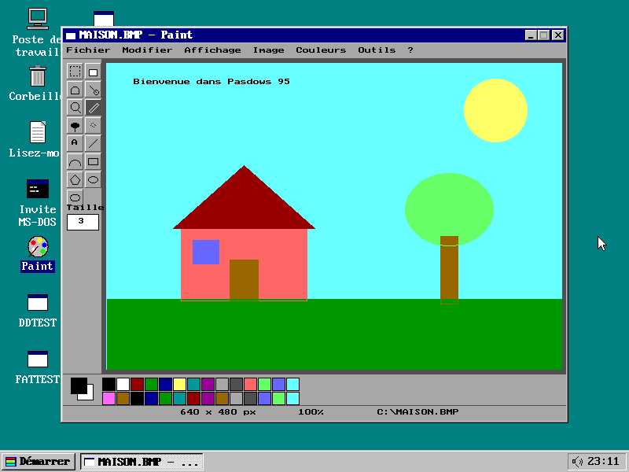

<i>Paint (APPS/PAINT.PAS, le Paint de CloneDRAW devenu une application Windows 95) dans le bureau de Pasdows 95 en 800x600.</i>

Pasdows 95 est un clone de Windows 95 écrit en Turbo Pascal / Free Pascal et compilé par <b>WPC</b> (« Windows 95 Pascal Compiler »). Comme Windows 95, il se compose d'un <b>IO.SYS</b> 16 bits (<b>KERNEL/IO.PAS</b>), amorçable directement depuis un CD-ROM (El Torito, sans émulation) et copiable sur n'importe quelle image ISO 9660, qui charge un noyau 32 bits <b>VMM32.VXD</b> (<b>KERNEL/VMM32.PAS</b>). VMM32 exécute de <b>vrais programmes Windows 95</b> (exécutables PE Win32) en leur fournissant KERNEL32, USER32, GDI32, WINMM et les autres DLL système.

_N'ayez pas peur ! Avec le Pascal, tout est possible !_

<h2>Liste des fichiers</h2>

<table>
	<tr><th>Nom</th><th>Description</th></tr>
	<tr><td><b>KERNEL/IO.PAS</b></td><td>IO.SYS de Pasdows 95 (16 bits) : démarrage, menu de démarrage (F8), lecture du CD-ROM (ou du disque dur FAT32 après l'installation), MSDOS.SYS et AUTOEXEC.BAT, mode MS-DOS, interface 16 couleurs du mode sans échec, puis chargement de VMM32.VXD (VESA, mode protégé).</td></tr>
	<tr><td><b>KERNEL/VMM32.PAS</b></td><td>Noyau 32 bits VMM32.VXD : mode protégé, mémoire, tâches préemptives, interface 256 couleurs, chargeur PE et API Win32 (plus de 550 fonctions de KERNEL32, USER32, GDI32, WINMM, ADVAPI32, SHELL32, COMDLG32, COMCTL32, OLE32, VERSION, MSVFW32).</td></tr>
	<tr><td><b>SETUP/INSTALL.PAS</b></td><td>Programme d'installation graphique de Pasdows 95 sur un disque dur (INSTALL.SYS, image d'amorce du CD-ROM d'installation), compilé par <b>WPC -CW95IO</b> : langue, partition, formatage FAT32, fuseau horaire, affichage, composants, copie des fichiers.</td></tr>
	<tr><td><b>SETUP/MBR.ASM</b>, <b>SETUP/BOOT16.ASM</b>, <b>SETUP/BOOT32.ASM</b>, <b>SETUP/NTFSBOOT.ASM</b></td><td>Sources NASM du code d'amorce écrit par INSTALL : secteur de partition (MBR), secteurs d'amorce FAT16 et FAT32 et chargeur NTFS de 16 secteurs ($Boot) qui cherche IO.SYS dans l'index de la racine ; tous chargent C:\IO.SYS (les octets assemblés sont repris dans INSTALL.PAS).</td></tr>
	<tr><td><b>SYSTEM/COMMAND.PAS</b></td><td>Interpréteur de commandes de l'Invite MS-DOS (COMMAND.EXE), adapté de CMD.PAS du projet Corail et compilé par <b>WPC -CW32</b> ; il tourne dans la console Win32 de VMM32.</td></tr>
	<tr><td><b>APPS/PAINT.PAS</b></td><td><b>Paint</b> : le programme de dessin PAINT.PAS du dépôt <a href="https://github.com/gladir/clonedraw">CloneDRAW</a> (plus de 45 000 lignes, toutes ses fonctions conservées) devenu une application Windows 95 compilée par <b>WPC -CW32</b> en PAINT.EXE ; une couche Win32 remplace les unités Graph, Crt et PtcMouse (voir la section <a href="#paint">Paint</a>).</td></tr>
	<tr><td><b>EXAMPLES/HTTPGET.PAS</b></td><td>Exemple Win32 en mode console (HTTPGET.EXE) : télécharge une adresse <b>http://</b> ou <b>https://</b> avec WININET (<i>HTTPGET url [fichier]</i>), voir la section <a href="#https">HTTPS</a>.</td></tr>
	<tr><td><b>EXAMPLES/HELLO.PAS</b></td><td>Exemple de programme Windows 95 (Win32, unité Graph) compilé par <b>WPC -CW32</b> en HELLO.EXE.</td></tr>
	<tr><td><b>KERNEL/BUILD.sh</b></td><td>Construit les outils, IO.SYS, le CD-ROM amorçable <i>IMAGE/PASDOWS.ISO</i> et le CD-ROM d'installation <i>IMAGE/INSTALL.ISO</i> (Linux).</td></tr>
	<tr><td><b>KERNEL/BUILD.BAT</b></td><td>Même chose sous DOS ou Windows (Free Pascal dans le PATH).</td></tr>
	<tr><td><b>TOOLS/WPC.PAS</b></td><td>Compilateur « Windows 95 Pascal Compiler » : copie du compilateur <i>OS2PC.PAS</i> (« OS/2 Pascal Compiler ») du dépôt <a href="https://github.com/gladir/OS2-0">OS2-0</a>, renommé et augmenté des destinations <b>-CW95IO</b> et <b>-CVMM32</b>.</td></tr>
	<tr><td><b>TOOLS/MAKEISO.PAS</b></td><td>Fabrique une image CD-ROM ISO 9660 amorçable (El Torito) avec table d'information d'amorce (dérivé de MAKEISO.PAS d'OS2-0).</td></tr>
	<tr><td><b>WIN64/WPC.EXE</b></td><td>Compilateur WPC compilé pour Windows 64 bits.</td></tr>
	<tr><td><b>WIN64/MAKEISO.EXE</b></td><td>MAKEISO compilé pour Windows 64 bits.</td></tr>
	<tr><td><b>IMAGE/PASDOWS.ISO</b></td><td>Image du CD-ROM amorçable de Pasdows 95 (démarre Pasdows directement depuis le CD-ROM).</td></tr>
	<tr><td><b>IMAGE/INSTALL.ISO</b></td><td>Image du CD-ROM d'installation : mêmes fichiers, mais il démarre le programme d'installation INSTALL.SYS (il n'est que sur ce CD-ROM).</td></tr>
	<tr><td><b>IMAGE/CDROM</b></td><td>Contenu du CD-ROM : IO.SYS, VMM32.VXD, PAINT.EXE, HELLO.EXE, MSDOS.SYS, CONFIG.SYS, AUTOEXEC.BAT et LISEZMOI.TXT. Tout programme Windows 95 déposé ici est mis sur le CD-ROM par BUILD.</td></tr>
	<tr><td><b>IMAGE/SCREENSHOTS</b></td><td>Captures d'écran de Pasdows 95 (QEMU, 640x480 en 256 couleurs) reprises dans ce document.</td></tr>
</table>

<h2>Fonctionnalités</h2>

<ul>
	<li>Écran « Démarrage de Pasdows 95... », menu de démarrage (F8) : Normal, Mode sans échec (F5), Invite de commandes seulement (Maj+F5), Redémarrer.</li>
	<li>Lecture du CD-ROM ISO 9660 par l'INT 13h étendue du BIOS, options de <b>MSDOS.SYS</b> (<i>BootMenu</i>, <i>BootGUI</i>, <i>Logo</i>, <i>BootDelay</i>) et commandes <b>SET</b> de <b>AUTOEXEC.BAT</b>.</li>
	<li>Démarrage normal : IO.SYS dresse la liste des modes <b>VESA</b> à mémoire linéaire de la carte (VBE 2.0, de 640x480 à 1600x1200, en 256 couleurs, 15, 16, 24 ou 32 bits), choisit celui enregistré dans le CMOS par <i>Affichage</i> (640x480 en 256 couleurs par défaut, VGA 16 couleurs au besoin), charge VMM32.VXD au-dessus du premier mégaoctet et passe en mode protégé 32 bits. Pendant l'initialisation du noyau, au lieu d'un écran noir, la boîte <b>Démarrage de Pasdows 95</b> énumère les étapes (carte graphique, horloge et son ; disques durs et CD-ROM ; systèmes de fichiers ; clavier, souris et interface graphique ; bibliothèques Win32 et Registre ; sous-système Windows 16 bits ; réseau ; bureau et barre des tâches) : chaque case se coche automatiquement en vert dès que son étape est terminée, avec une barre de progression, pour qu'une machine lente ne paraisse pas bloquée. Sans VMM32.VXD ou avec moins de 16 Mo (et en mode sans échec), IO.SYS garde son interface VGA 16 couleurs.</li>
	<li><b>Affichage</b> (clic droit sur le bureau, <i>Propriétés</i>, ou <i>Démarrer, Paramètres, Affichage</i>) : palette de couleurs (16 couleurs, 256 couleurs, High Color 15 ou 16 bits, True Color 24 ou 32 bits) et zone d'écran (toutes les résolutions VESA de la carte). Avec l'interface VBE de Bochs, QEMU, VirtualBox ou de l'émulateur de DEVENV (ports 1CEh/1CFh), le changement est immédiat, sans redémarrer : barre des tâches, icônes et fenêtres agrandies suivent la nouvelle taille et les programmes reçoivent WM_DISPLAYCHANGE ; sinon (et pour le VGA 16 couleurs), Pasdows propose de redémarrer, comme Windows 95. L'écran est composé en 256 couleurs (palette système) puis converti vers la profondeur de la carte. Le menu contextuel du bureau propose aussi <i>Réorganiser les icônes</i> (par nom, par type) et <i>Aligner les icônes</i>.</li>
	<li><b>Propriétés de Date/Heure</b> (clic sur l'horloge de la barre des tâches, ou <i>Démarrer, Paramètres, Date/Heure</i>), comme dans WINDOWS95-0 : onglet <i>Date et heure</i> (mois, année, calendrier, horloge analogique qui suit les secondes, réglage de l'heure, des minutes et des secondes) et onglet <i>Fuseau horaire</i> (liste des fuseaux, carte du monde où l'on peut cliquer, heure d'été). OK et Appliquer règlent l'horloge temps réel ; le fuseau horaire, gardé dans le CMOS, est rendu aux programmes par GetTimeZoneInformation.</li>
	<li><b>Programmes Windows 95</b> : chargeur PE (relocalisations, importations, ressources, DLL), tâches Win32 préemptives avec TIB et sauvegarde du coprocesseur, files de messages, fenêtres, classes, dialogues et contrôles (BUTTON, EDIT, LISTBOX, COMBOBOX, SCROLLBAR, STATIC), GDI avec palettes logiques, DIB et sections DIB, fichiers sur le CD-ROM (D:) et disque virtuel en mémoire (C:), minuteries multimédia, son numérique (waveOut, PlaySound, sndPlaySound) et MIDI (midiOut) sur la carte son. Essayé avec un projecteur Macromedia Director 5 et son film, qui se déroule entièrement.</li>
	<li><b>Programmes Windows 3.1</b> (Win16) : chargeur NE, segments de code en anneau 3 dans la LDT, passerelles d'appel vers l'API 16 bits de KERNEL, USER, GDI, SHELL, VER, LZEXPAND, TOOLHELP... (essayé avec un programme d'installation Microsoft ACME).</li>
	<li><b>DirectX</b> (version 4.04.0068 annoncée) : objets COM de <b>DDRAW.DLL</b> (DirectDrawCreate, mode plein écran 320x200, 320x240 ou 640x480 en 256 couleurs, surface primaire et tampons arrière avec Flip, Lock/Unlock, Blt avec remplissage, couleur transparente et étirement, BltFast, GetDC pour écrire avec GDI, palettes et clippers), <b>DSOUND.DLL</b> (DirectSound muet dont les tampons avancent en temps réel), <b>DINPUT.DLL</b> (clavier et souris, GetDeviceState) et <b>DSETUP.DLL</b>. Exemple : <b>EXAMPLES/DDTEST.C</b> (DDTEST.EXE sur le CD-ROM).</li>
	<li><b>Son</b> : pilote <b>Sound Blaster</b> (1.x, 2.0, Pro et 16 : réinitialisation du DSP, version, adresse, IRQ et DMA lus dans la variable <b>BLASTER</b> ou trouvés par le mixeur du SB16, lecture par DMA en mode auto-initialisé avec double tampon et interruption, 8 ou 16 bits, mono ou stéréo, conversion pour les cartes 8 bits) et pilote <b>AdLib</b> (OPL2 en 388h, détection par les minuteries, synthèse FM de 9 voix pour midiOut). Au démarrage, Pasdows joue <i>PASDOWS.WAV</i>. Dans la barre des tâches, l'icône du <b>volume</b> ouvre la réglette de volume (clic), le <b>Contrôle du volume</b> (double-clic : Général, Wave, MIDI, CD audio et Ligne avec balance, volume et Muet, sur le mixeur de la carte) ou un menu contextuel (clic droit : <i>Ouvrir les contrôles du volume</i>, <i>Ajuster les propriétés audio</i> : propriétés Multimédia avec les périphériques de lecture et l'affichage de l'icône).</li>
	<li><b>Gestionnaire de périphériques</b> (<i>Démarrer, Paramètres, Système</i> ou clic droit sur le Poste de travail, <i>Propriétés</i>) : onglet <i>Général</i> (version, processeur identifié par CPUID, mémoire) et arbre du matériel détecté, par catégorie (cartes graphiques avec le nom VESA, moniteur, clavier, souris, contrôleurs de disque dur et de disquette, lecteurs de disque et de CD-ROM avec leur modèle ATA, carte réseau, contrôleurs son, ports COM et LPT, périphériques système, et tous les périphériques PCI). Un double-clic ouvre les propriétés du périphérique : fabricant, état et ressources (plages d'E/S, IRQ, DMA, mémoire).</li>
	<li><b>Bloc-notes</b> : barre de menus <i>Fichier</i> (Nouveau, Ouvrir..., Enregistrer, Enregistrer sous..., Quitter), <i>Edition</i> (Annuler, Couper, Copier, Coller, Supprimer, Sélectionner tout, Heure/Date), <i>Recherche</i> (Rechercher..., Suivant) et <i>?</i> ; sélection à la souris ou avec Maj et les flèches, raccourcis Ctrl+N/O/S/Z/X/C/V/A/F, F3 et F5, presse-papiers partagé avec les programmes (CF_TEXT), boîtes <i>Ouvrir</i> et <i>Enregistrer sous</i> (lecteurs, dossiers, types de fichier) aussi offertes aux programmes par COMDLG32 (GetOpenFileName, GetSaveFileName), et question « Voulez-vous enregistrer les modifications ? » avant de fermer un texte modifié. Les fichiers s'enregistrent sur le disque dur C: (le CD-ROM D: est en lecture seule).</li>
	<li><b>Disques durs et FAT32</b> : pilote de disque IDE/ATA (PIO, LBA 28 bits), table de partitions (primaires et logiques) et systèmes de fichiers <b>FAT32</b>, FAT16 et FAT12 en lecture et en écriture, avec les <b>noms longs</b> (VFAT, casse conservée, noms courts NOM~1.EXT générés), FSInfo et les deux copies de la FAT. Le premier volume FAT devient <b>C:</b> (les suivants E:, F:... ; D: reste le CD-ROM) : les programmes y créent, lisent, renomment et suppriment fichiers et répertoires (CreateFile, FindFirstFile, MoveFile, GetDiskFreeSpaceEx, GetVolumeInformation « FAT32 »...), et le Poste de travail parcourt le disque. Un disque vierge peut être formaté en FAT32 depuis le Poste de travail. Sans disque dur, C: reste un disque virtuel en mémoire. Exemple : <b>EXAMPLES/FATTEST.C</b> (FATTEST.EXE sur le CD-ROM).</li>
	<li><b>NTFS</b> (partitions de type 07h, NTFS 3.x de Windows 2000/XP) en lecture et en écriture : enregistrements de la MFT avec correctifs de secteurs, attributs résidents et non résidents, fichiers fragmentés et creux, listes d'attributs, répertoires en arbre B+ ($I30) avec la table $UpCase, étiquette de $Volume. En écriture : création, écriture, troncature, suppression et renommage de fichiers et de répertoires, bitmap des clusters et de la MFT, extension de la MFT, passage des petits fichiers résidents aux fichiers non résidents, index reconstruits (petit index ou arbre B+ à plusieurs niveaux), $MFTMirr ; le journal $LogFile n'est pas tenu (il est vidé, comme le fait ntfs-3g). Les volumes modifiés par Pasdows restent valides pour ntfs-3g et ntfsresize. GetVolumeInformation rend « NTFS ». Les fichiers compressés ou chiffrés ne sont pas lus.</li>
	<li><b>HTTPS</b> : <b>WININET.DLL</b> (InternetOpenUrl, InternetReadFile, HttpQueryInfo...) avec un client HTTP/1.1 et <b>TLS 1.2</b> écrits en Pascal dans le noyau, voir la section <a href="#https">HTTPS</a>.</li>
	<li><b>Réseau TCP/IP</b> : pilote de carte <b>NE2000</b> (PCI RTL8029 ou ISA en 300h, comme la « NE2000 compatible » de Windows 95), pile TCP/IP écrite en Pascal (ARP, IP, ICMP, UDP, TCP avec retransmission et fenêtres, boucle locale 127.0.0.1), client <b>DHCP</b> et résolveur <b>DNS</b>. Les programmes utilisent <b>WSOCK32.DLL</b> / <b>WS2_32.DLL</b> (Winsock 1.1 par nom ou par ordinal : socket, connect, bind, listen, accept, send, recv, sendto, recvfrom, select, ioctlsocket, gethostbyname, WSAAsyncSelect...) et <b>ICMP.DLL</b> (IcmpSendEcho). Dans Pasdows : <i>Démarrer, Paramètres, Réseau (TCP/IP)</i> ou <i>Exécuter</i> <b>winipcfg</b> affiche la configuration IP, <b>ping</b> <i>hôte</i> envoie des échos ICMP. Exemple : <b>EXAMPLES/NETTEST.C</b> (NETTEST.EXE sur le CD-ROM : TCP et UDP locaux, ping, DNS, HTTP).</li>
	<li>Interface graphique (palette de Windows 95) : écran d'accueil, bureau et icônes (dont les .EXE du CD-ROM), barre des tâches avec horloge, menu Démarrer et sous-menus, fenêtres en relief déplaçables, boutons Réduire / Agrandir / Fermer, souris PS/2 et clavier.</li>
	<li><b>Paint</b> (icône sur le bureau et <i>Démarrer, Programmes, Paint</i>) : le Paint complet de CloneDRAW, voir la section <a href="#paint">Paint</a>.</li>
	<li>Applications : Poste de travail et Explorateur (navigation sur le CD-ROM), Bloc-notes, Paint, Invite MS-DOS (<b>COMMAND.EXE</b>, programme console Win32 : CD, CLS, COPY, DATE, DEL, DIR, ECHO, EXIT, MD, PATH, PROMPT, RD, REN, SET, TIME, TYPE, VER, VOL..., changement d'unité avec C: ou D:, historique avec les flèches, lancement des programmes du CD-ROM puis retour à l'invite), Panneau de configuration (Affichage, Date/Heure, Paramètres régionaux, Système), Corbeille, Aide, Exécuter, À propos, Bienvenue.</li>
	<li>Arrêter Pasdows : arrêt de l'ordinateur (APM), redémarrage ou redémarrage en mode MS-DOS (texte 80x25, <b>EXIT</b> ou <b>WIN</b> pour revenir).</li>
	<li>Raccourcis : Ctrl+Échap (menu Démarrer), Alt+F4, Alt+Tab, F1, double-clic.</li>
</ul>

<h2>Installation sur le disque dur</h2>

Le CD-ROM d'installation <b>IMAGE/INSTALL.ISO</b> démarre <b>INSTALL.SYS</b> (<b>SETUP/INSTALL.PAS</b>), un programme d'installation en mode graphique (VGA 640x480, souris et clavier) écrit en Pascal, comme le CD-ROM de Windows 95. Il n'a besoin ni de DOS ni de Pasdows : il utilise le BIOS (INT 13h étendue pour le CD-ROM et le disque dur) et le matériel. L'assistant demande :

<ul>
	<li>la <b>langue</b> parmi les 5 langues de Pasdows : français (par défaut), anglais, allemand, italien, espagnol ; l'assistant change de langue aussitôt et <i>AUTOEXEC.BAT</i> reçoit <b>SET LANGUAGE=</b> ;</li>
	<li>le <b>disque dur</b> (taille, table des partitions actuelle) et la <b>partition</b> : créer une nouvelle partition principale active (taille en Mo, le disque est effacé) ou formater une partition existante, avec le <b>système de fichiers</b> FAT16 (2 Go au plus), <b>FAT32</b> (par défaut) ou <b>NTFS</b> ;</li>
	<li>le <b>fuseau horaire</b> (même liste que <i>Date/Heure</i>) et l'heure d'été ;</li>
	<li>l'<b>affichage</b> (640x480, 800x600 ou 1024x768, en 16, 256 ou 65 536 couleurs) ;</li>
	<li>les <b>composants</b> (programmes d'exemple, son de démarrage, Lisez-moi), avec l'espace nécessaire.</li>
</ul>

Après un résumé et une confirmation, il écrit le <b>MBR</b> (code de <b>SETUP/MBR.ASM</b> et table des partitions), <b>formate</b> la partition : en <b>FAT16</b> (secteur d'amorce <b>SETUP/BOOT16.ASM</b>, deux FAT, racine de 512 entrées), en <b>FAT32</b> (secteur d'amorce <b>SETUP/BOOT32.ASM</b> et sa copie, FSInfo, deux FAT, grappes de 512 octets à 32 Ko selon la taille) ou en <b>NTFS 3.1</b> (chargeur <b>SETUP/NTFSBOOT.ASM</b>, MFT et $MFTMirr, $LogFile, $AttrDef, $Bitmap, $UpCase, $Secure, $Extend, copie du secteur d'amorce en fin de partition, grappes de 4 Ko) et copie les fichiers du CD-ROM avec une barre de progression : <i>C:\IO.SYS</i> et <i>C:\MSDOS.SYS</i> (cachés, système), <i>C:\CONFIG.SYS</i>, <i>C:\AUTOEXEC.BAT</i>, <i>C:\COMMAND.EXE</i> et le dossier <i>C:\WINDOWS</i> (VMM32.VXD, PASDOWS.WAV, LISEZMOI.TXT, programmes). Le fuseau horaire et le mode d'affichage sont gardés dans le CMOS.

Au redémarrage, le secteur d'amorce charge <i>C:\IO.SYS</i>, qui lit alors ses fichiers sur le disque dur (FAT16, FAT32 ou NTFS) et démarre VMM32 avec <i>C:\WINDOWS</i> comme dossier système (bureau, Lisez-moi, son de démarrage, Invite MS-DOS sur C:). Si le CD-ROM d'installation reste dans le lecteur et que le disque dur a déjà une partition active, il suffit de ne toucher aucune touche pendant 5 secondes : le disque dur démarre ; une touche relance l'installation.

<pre>qemu-img create -f raw disque.img 512M
qemu-system-i386 -m 64 -cdrom IMAGE/INSTALL.ISO -hda disque.img -boot d
qemu-system-i386 -m 64 -hda disque.img</pre>

<table>
	<tr><td align="center">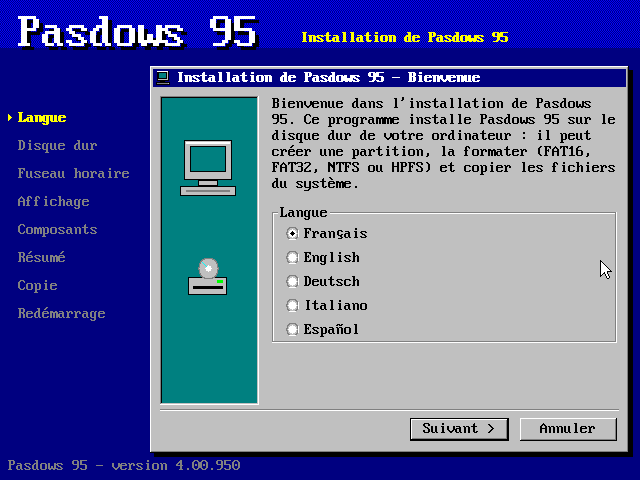<br><i>Choix de la langue</i></td><td align="center">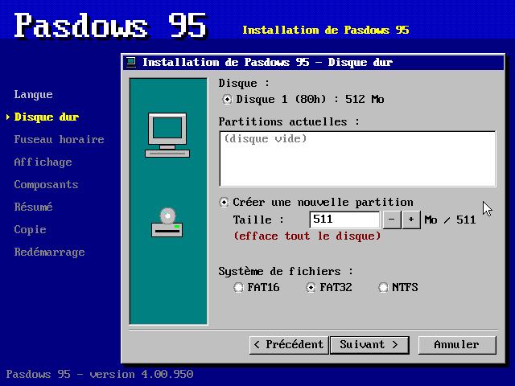<br><i>Disque dur et partition</i></td></tr>
	<tr><td align="center">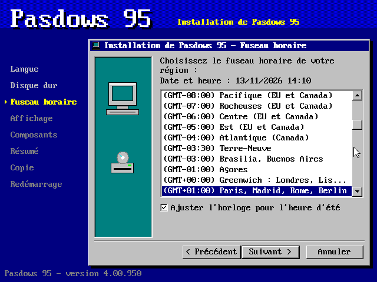<br><i>Fuseau horaire</i></td><td align="center">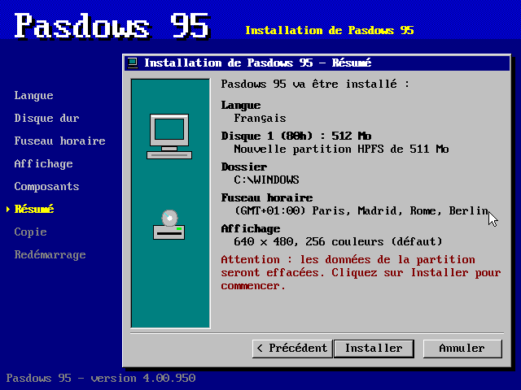<br><i>Résumé avant l'installation</i></td></tr>
	<tr><td align="center">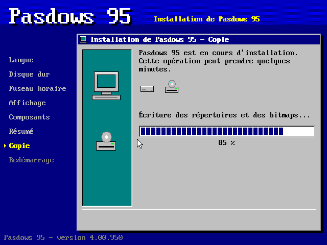<br><i>Formatage et copie des fichiers</i></td><td align="center">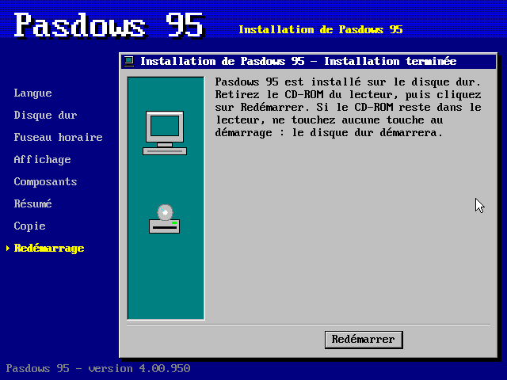<br><i>Installation terminée</i></td></tr>
</table>

<h2>Captures d'écran</h2>

<table>
	<tr><td align="center">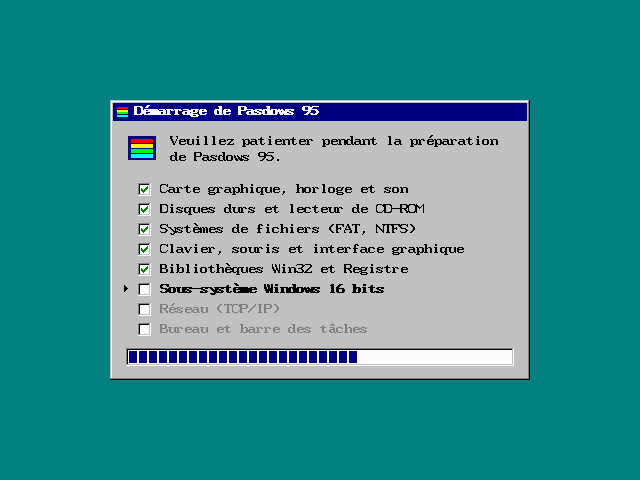<br><i>Démarrage : étapes cochées automatiquement</i></td><td align="center">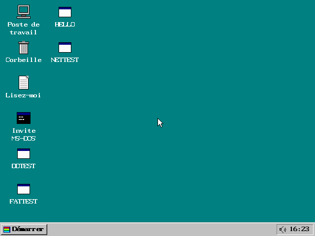<br><i>Bureau de Pasdows 95</i></td></tr>
	<tr><td align="center">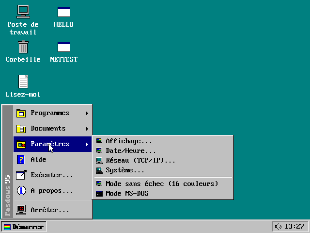<br><i>Menu Démarrer, sous-menu Paramètres</i></td><td align="center">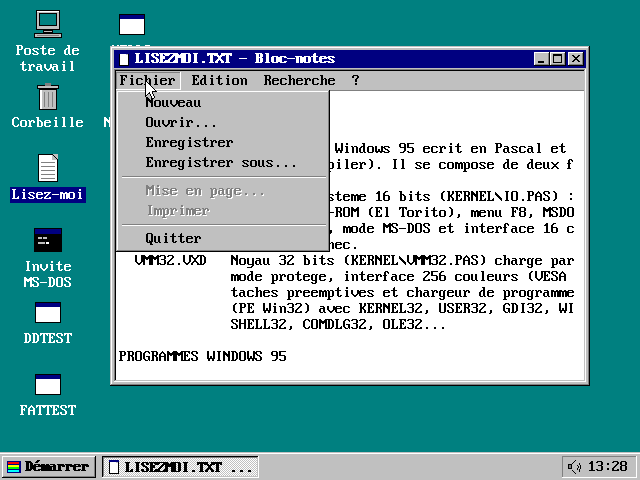<br><i>Bloc-notes et son menu Fichier</i></td></tr>
	<tr><td align="center">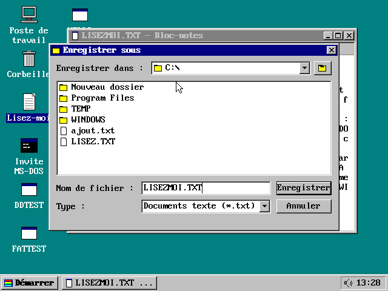<br><i>Boîte Enregistrer sous (disque dur C:)</i></td><td align="center">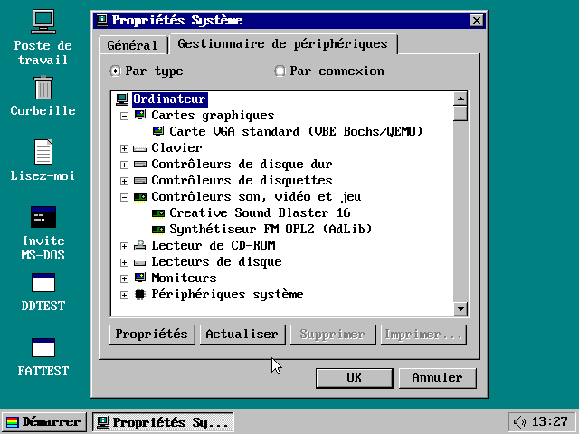<br><i>Gestionnaire de périphériques</i></td></tr>
	<tr><td align="center">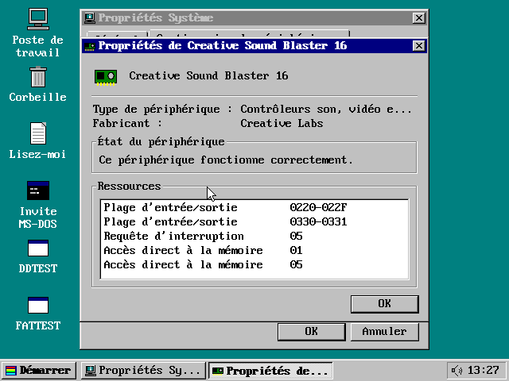<br><i>Propriétés de la Sound Blaster 16 (ressources)</i></td><td align="center">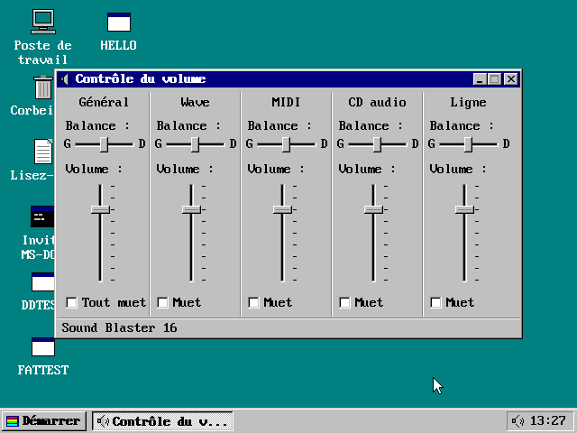<br><i>Contrôle du volume (mixeur de la carte son)</i></td></tr>
	<tr><td align="center">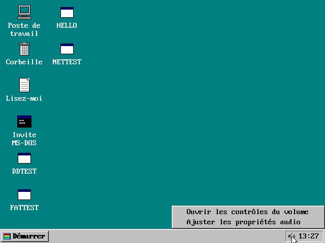<br><i>Menu contextuel de l'icône de volume</i></td><td align="center">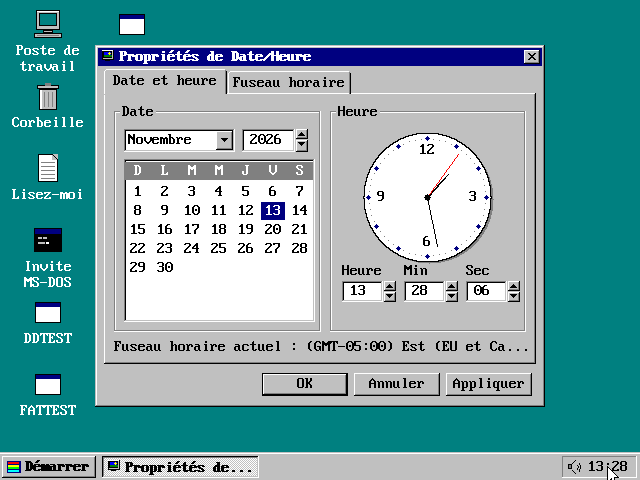<br><i>Propriétés de Date/Heure (clic sur l'horloge)</i></td></tr>
	<tr><td align="center">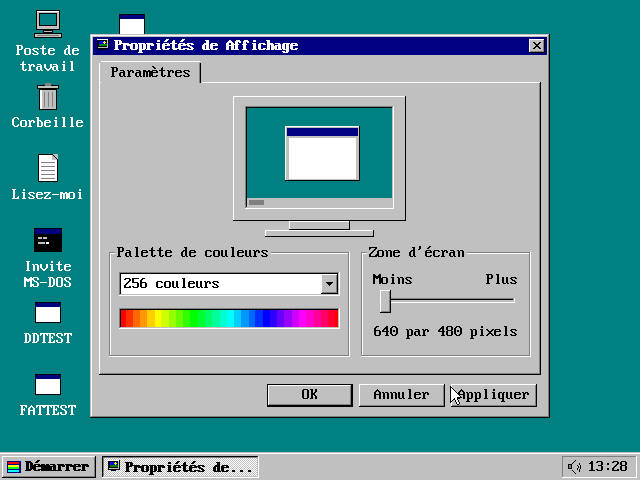<br><i>Propriétés d'affichage (modes VESA)</i></td><td align="center">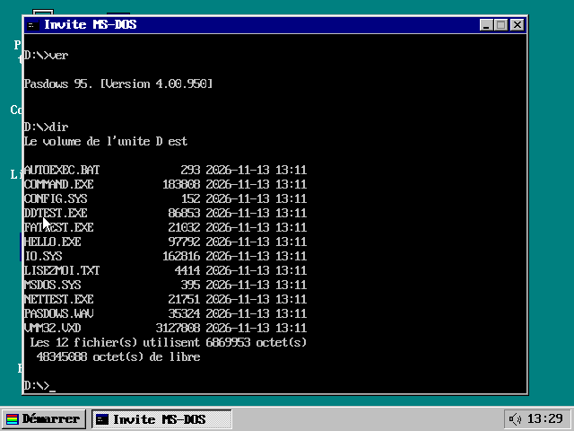<br><i>Invite MS-DOS (COMMAND.EXE)</i></td></tr>
</table>

<h2 id="paint">Paint</h2>

<b>APPS/PAINT.PAS</b> est le programme <b>PAINT.PAS</b> du dépôt <a href="https://github.com/gladir/clonedraw">CloneDRAW</a>, écrit pour DOS (Free Pascal, unités Graph, Crt et PtcMouse), adapté pour fonctionner comme une vraie application Windows 95 dans Pasdows. <b>Aucune fonction n'a été retirée</b> : outils de dessin (sélection, gomme, remplissage, pipette, loupe, crayon, pinceau, aérographe, texte, ligne, courbe, rectangle, polygone, ellipse, rectangle arrondi), annuler et rétablir, presse-papiers, zoom et plein écran, <i>Retourner/Pivoter</i>, <i>Étirer/Incliner</i>, <i>Inverser couleurs</i>, <i>Redimensionner</i>, <i>Rogner</i>, <i>Attributs</i>, <i>Modifier les couleurs</i> (teinte, saturation, luminosité, couleurs personnalisées, import et export de palettes), l'explorateur de fichiers de PAINT pour <i>Ouvrir</i> et <i>Enregistrer sous</i> (lecteurs, dossiers, nouveau dossier, filtres) avec tous ses formats (BMP, DIB, GIF, PNG, APNG, JPEG, PCX, TGA, TIFF, ICO, CUR, PPM, XBM, LBM, MSP, MacPaint, GEM, WPG, PSP, DDS, HDR, EXR, DICOM, fax, RAW ARW/CR2/DNG, BGX, export en source Pascal, assembleur, BASIC, C, C#, Python et Ruby), <i>Propriétés</i> du fichier, et les outils avancés : <i>Supprimer l'arrière-plan</i>, <i>Flou de l'arrière-plan</i>, <i>Reconnaissance de texte (OCR)</i> et <i>Fusionner des vêtements</i> (moteur VTON écrit en Pascal).

Le programme se lance par son icône sur le bureau, par <i>Démarrer, Programmes, Paint</i> (ou en tapant <b>PAINT</b> dans l'Invite MS-DOS). Il s'ouvre dans une fenêtre de 640x480 (zone de dessin de PAINT) centrée sur le bureau, dont le titre suit le fichier ouvert (« MAISON.BMP - Paint ») ; si l'écran est trop petit pour la fenêtre et son cadre (bureau en 640x480), Paint occupe tout l'écran, au-dessus de la barre des tâches, comme en plein écran. Alt+F4 ou <i>Fichier, Quitter</i> le ferment (en proposant d'enregistrer une image modifiée).

<table>
	<tr><td align="center">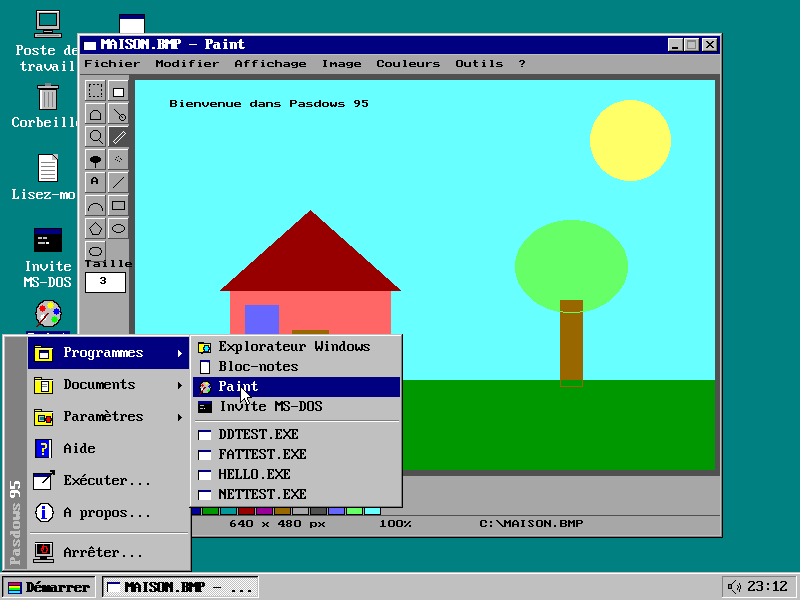<br><i>Démarrer, Programmes, Paint</i></td><td align="center">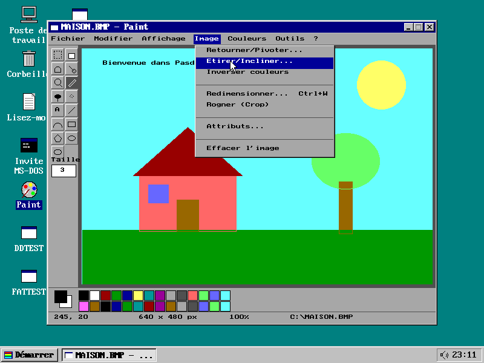<br><i>Menu Image</i></td></tr>
	<tr><td align="center">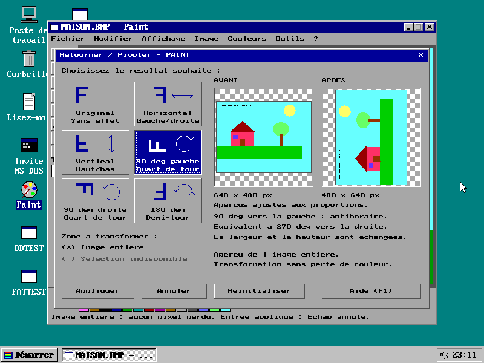<br><i>Retourner / Pivoter (aperçu avant et après)</i></td><td align="center">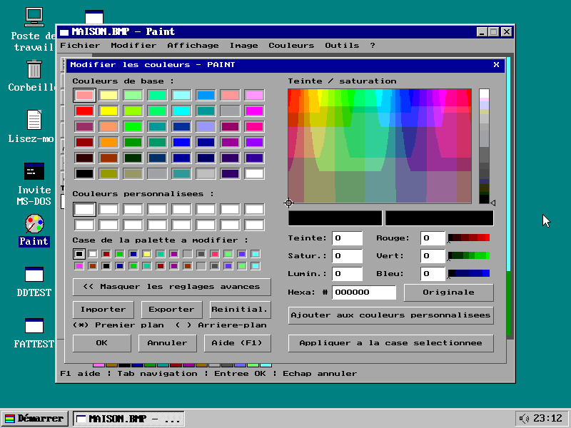<br><i>Modifier les couleurs</i></td></tr>
	<tr><td align="center">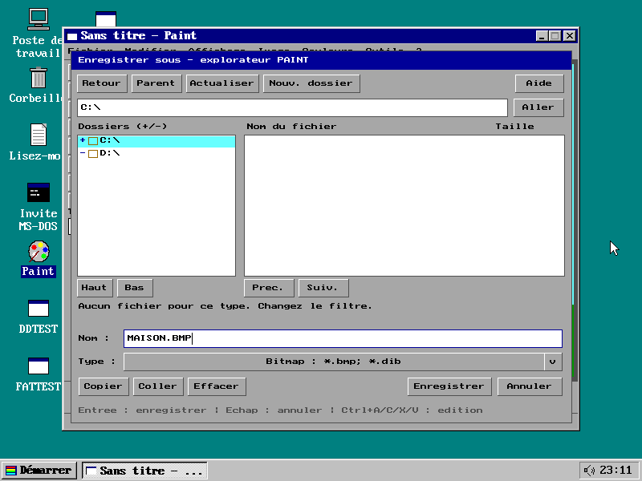<br><i>Enregistrer sous (disque dur C:)</i></td><td align="center">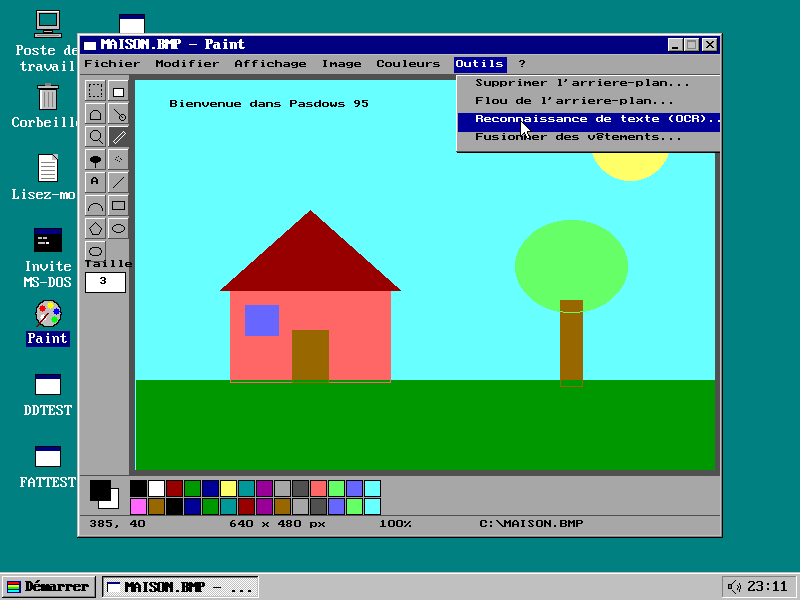<br><i>Menu Outils (arrière-plan, OCR, vêtements)</i></td></tr>
	<tr><td align="center">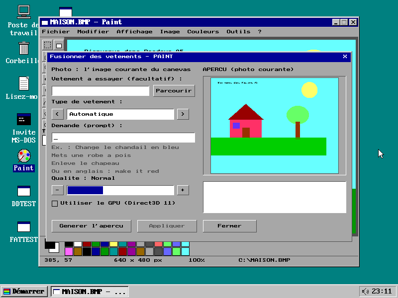<br><i>Fusionner des vêtements (moteur VTON)</i></td><td></td></tr>
</table>

<h3>Comment PAINT.PAS est devenu une application Windows 95</h3>

<ul>
	<li>Le source reste celui de CloneDRAW : compilé par Free Pascal ou Turbo Pascal, il utilise toujours ses unités d'origine. Compilé par WPC (symbole <b>WPC</b> défini), la section « Couche Pasdows 95 » placée en tête remplace les unités <b>Graph</b>, <b>Crt</b> et <b>PtcMouse</b> par des appels Win32 et <b>{$APPTYPE GUI}</b> en fait un programme fenêtré (sous-système 2, sans console).</li>
	<li><b>Graph</b> : PAINT dessine dans une image de 256 couleurs en mémoire (DIB descendante) avec les primitives du BGI réécrites en Pascal (PutPixel, GetPixel, Line avec styles et épaisseurs, Rectangle, Bar, Circle, Arc, Ellipse, FillEllipse, OutTextXY avec la police 8x8 de la page de code 437, GetImage/PutImage, SetViewPort, SetWriteMode XOR, SetRGBPalette sur 8 bits...). Seule la zone modifiée est copiée dans la fenêtre par <b>SetDIBitsToDevice</b> ; WM_PAINT recopie toute l'image.</li>
	<li><b>Crt</b> et <b>PtcMouse</b> : la procédure de fenêtre de PAINT reçoit les messages WM_KEYDOWN, WM_SYSKEYDOWN et WM_CHAR (traduits en codes de ReadKey, avec #0 et le code de balayage pour les touches étendues, Alt+lettre et Alt+F4) et les messages de la souris (coordonnées de la zone client, capture pendant un glissement, clics brefs mémorisés jusqu'à leur lecture). KeyPressed, ReadKey, Delay, GetMouseState lisent ces messages par PeekMessage, si bien que PAINT garde sa propre boucle de messages comme sous DOS.</li>
	<li>Les dialogues propres à PAINT (explorateur de fichiers, propriétés, couleurs, OCR, VTON...) sont dessinés par PAINT lui-même dans sa fenêtre, comme sous DOS.</li>
	<li>Quelques corrections ont été faites dans le code de PAINT pour qu'il fonctionne et ne plante pas : le menu <b>?</b> (Aide, À propos) ne s'ouvrait pas (borne 5 au lieu de MENU_HELP), les racines des lecteurs (C:\, D:\) sont reconnues comme des dossiers par l'explorateur, et le moteur VTON attend le relâchement du clic de <i>Générer l'aperçu</i> avant de commencer (sinon ce clic était pris pour <i>Annuler</i>).</li>
</ul>

<h3>Limites dans Pasdows</h3>

<ul>
	<li><b>Fusionner des vêtements</b> utilise le modèle de segmentation <i>segformer_b2_clothes</i> (110 Mo), que PAINT télécharge une fois de Hugging Face en HTTPS par WININET, comme sous Windows : il faut une carte réseau (<b>-nic user,model=ne2k_pci</b> avec qemu) et un accès à Internet. Le modèle est gardé dans <i>C:\vton\segformer_b2_clothes</i> (ou dans le dossier donné par <b>SET VTON_CACHE=</b>) ; on peut aussi y copier <i>model.safetensors</i> et <i>config.json</i> à la main. Sans réseau, PAINT indique que la connexion est impossible, sans planter. Direct3D 11 n'existe pas dans Pasdows : le calcul se fait sur le processeur.</li>
	<li><b>Importer depuis un scanner</b> (WIA) et <b>Imprimer</b> affichent qu'ils ne sont pas disponibles, comme sur un Windows sans scanner ni imprimante.</li>
	<li>Les images s'enregistrent sur le disque dur <b>C:</b> (le CD-ROM D: est en lecture seule).</li>
</ul>

<h2 id="https">HTTPS</h2>

Pasdows 95 a son propre client <b>HTTPS</b>, écrit en Pascal dans le noyau VMM32 et offert aux programmes par <b>WININET.DLL</b>, comme Internet Explorer le faisait pour Windows 95 :

<ul>
	<li><b>WININET</b> : InternetOpen, <b>InternetOpenUrl</b> (adresses <b>http://</b> et <b>https://</b>, en-têtes supplémentaires), <b>InternetReadFile</b>, InternetQueryDataAvailable, <b>HttpQueryInfo</b> (code d'état, Content-Length, Content-Type, Location..., en-têtes bruts, valeurs numériques), InternetSetOption, InternetCloseHandle, InternetGetConnectedState. Quatre requêtes peuvent être ouvertes en même temps.</li>
	<li><b>HTTP/1.1</b> : requête GET (Host, User-Agent du programme, Connection: close), réponses <b>Content-Length</b> ou <b>chunked</b>, <b>redirections</b> 301, 302, 303, 307 et 308 (dix au plus, adresses absolues ou relatives, d'un serveur à un autre), adresses longues comme les URL signées des CDN (4 Ko au plus).</li>
	<li><b>TLS 1.2</b> : échange de clés <b>ECDHE</b> sur <b>x25519</b>, chiffrement <b>AES-128-GCM</b>, <b>SHA-256</b> et PRF de TLS 1.2 (suites ECDHE-RSA-AES128-GCM-SHA256 et ECDHE-ECDSA-AES128-GCM-SHA256), avec l'extension SNI (nom du serveur) qu'exigent les hébergeurs et les CDN. La cryptographie (SHA-256, HMAC, AES avec tables T, GHASH par tables de 4 bits, X25519 sur 32 chiffres de 8 bits, avec LongInt seulement) a été vérifiée avec les vecteurs de test et la bibliothèque <i>cryptography</i> de Python, et le client avec OpenSSL et le serveur HTTPS de Python (certificats RSA et ECDSA). Les aléas viennent du compteur du PIT, de l'horloge et de la souris, mélangés par SHA-256.</li>
	<li><b>Fichier HOSTS</b> : comme Windows 95, Pasdows consulte <i>HOSTS</i> dans le dossier système (<i>C:\WINDOWS\HOSTS</i> une fois installé) avant le DNS ; <i>HOSTS.SAM</i> sur le CD-ROM en est un exemple.</li>
	<li>La pile TCP/IP annonce maintenant une fenêtre de 7 segments, ce que l'anneau de réception de la carte NE2000 peut garder : avant, une rafale du serveur débordait de la carte et les segments perdus attendaient une retransmission. Dans qemu, un téléchargement passe ainsi de 52 Ko/s à environ 2,4 Mo/s en HTTP et 700 Ko/s en HTTPS (le chiffrement en Pascal coûte le reste).</li>
</ul>

<b>EXAMPLES/HTTPGET.PAS</b> (HTTPGET.EXE sur le CD-ROM) montre l'utilisation de WININET : dans l'Invite MS-DOS, <b>HTTPGET https://serveur/fichier C:\FICHIER</b> télécharge un fichier en affichant la progression, et <b>HTTPGET http://serveur/page</b> affiche la page.

<table>
	<tr><td align="center">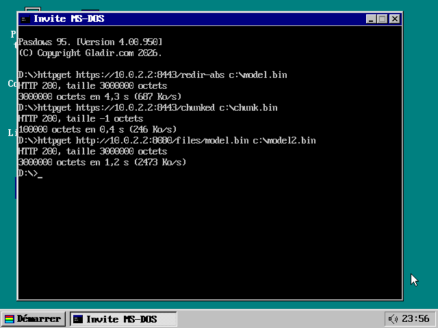<br><i>HTTPGET : HTTPS avec redirection, chunked, puis HTTP</i></td></tr>
</table>

Limites : <b>le certificat du serveur n'est pas vérifié</b> (Pasdows n'a ni magasin de certificats racines ni vérification des signatures RSA et ECDSA) : la connexion est chiffrée et protégée contre l'altération, mais un intermédiaire capable de se faire passer pour le serveur ne serait pas détecté. Seul TLS 1.2 est pris en charge (pas TLS 1.3 ni les versions antérieures), avec x25519 pour l'échange de clés ; pas de mandataire (proxy), pas de cookies ni de compression. Un serveur muet bloque la lecture jusqu'à la fermeture de la connexion TCP.

<h2>Langue</h2>

La langue par défaut est le français. On utilise l'anglais si la variable d'environnement est <b>LANGUAGE=EN</b>, l'allemand si elle est <b>LANGUAGE=GR</b>, l'espagnol avec <b>LANGUAGE=SP</b> et l'italien avec <b>LANGUAGE=IT</b>. La variable se fixe dans <i>AUTOEXEC.BAT</i> sur le CD-ROM, avec la commande <b>SET</b> dans l'Invite MS-DOS ou dans <i>Paramètres régionaux</i> ; l'interface change de langue immédiatement.

<h2>Compilateur WPC</h2>

<b>WPC.PAS</b> est une copie du compilateur <b>OS2PC.PAS</b> du dépôt OS2-0 (lui-même dérivé de <i>TPCW32.PAS</i> du dépôt DEV-COOLS), renommé de « OS/2 Pascal Compiler » à « Windows 95 Pascal Compiler ». Toutes ses destinations sont conservées et il ajoute :

<table>
	<tr><th>Option</th><th>Description</th></tr>
	<tr><td><b>-CW95IO</b></td><td>IO.SYS de Pasdows 95 : image binaire brute 8086 (mode réel) chargée en 07C0:0000. Le BIOS n'en charge que les 2 premiers Ko (comme ISOLINUX) ; une amorce de 227 octets placée en tête de l'image relit le reste du fichier depuis le CD-ROM grâce à la table d'information d'amorce écrite par MAKEISO, puis passe le contrôle au programme avec l'unité d'amorçage dans <i>PrefixSeg</i>.</td></tr>
	<tr><td><b>-CVMM32</b></td><td>VMM32.VXD de Pasdows 95 : image PE 32 bits chargée à 1 Mo (comme la destination noyau d'OS2-0). La clause <b>exports</b> du programme publie ses fonctions Pascal comme API Win32 : WPC génère pour chacune un thunk stdcall et la table d'exportation dans laquelle le chargeur PE de VMM32 résout les importations des programmes.</td></tr>
	<tr><td><b>-CW32</b></td><td>Exécutable Windows 95 (PE Win32), destination d'origine du compilateur ; l'unité Graph y est émulée par une fenêtre GDI.</td></tr>
</table>

Pour compiler Paint, WPC (destination <b>-CW32</b>) a été étendu au dialecte Free Pascal utilisé par CloneDRAW, et plusieurs erreurs du compilateur ont été corrigées :

<ul>
	<li>Types <b>Int64</b> / <b>QWord</b> (EDX:EAX, multiplication, division, décalages et comparaisons 64 bits), <b>AnsiString</b> en <b>{$H+}</b> (compteur de références, concaténation, Copy, Delete, SetLength, Length, chaînes constantes), <b>tableaux dynamiques</b> (SetLength, High, Length, libération automatique), <b>exceptions</b> (<b>Try...Except</b>, <b>Try...Finally</b>, <b>Raise</b>, classes d'exception sans champs), <b>{$PUSH}</b>/<b>{$POP}</b>, <b>{$APPTYPE GUI}</b>.</li>
	<li>Conventions <b>stdcall</b> et <b>cdecl</b>, types procéduraux (avec appel par transtypage), procédures imbriquées avec lien statique, tableaux ouverts, paramètres Var/Const sans type, valeurs par défaut, transtypages vers les types du programme (y compris à gauche d'une affectation), arithmétique de pointeurs (POINTERMATH), <b>With</b> réentrant, résultat de fonction <b>Result</b>.</li>
	<li>Corrections : constante nommée dans les bornes d'un tableau d'une section TYPE (le tableau n'avait qu'un élément), paramètres <b>Var</b> d'un type procédural pris pour des variables globales (une variable <i>Inc</i> masquait la procédure Inc), plus de 8 DLL importées (WININET et OLEAUT32 disparaissaient de la table d'importation), plus de 256 commutateurs {$I±}, {$R±}, <b>PType(expr)^ :=</b>, fonctions qui rendent un enregistrement (adresse dans une pile libérée), Ord, Abs et transtypages sur 32 bits, valeur d'un PChar littéral, adresse indiquée par les erreurs d'E/S.</li>
	<li>Limites relevées : 1,5 million de jetons, 4096 procédures, 16 Mo de code, 32 Mo de données.</li>
</ul>

VMM32 exporte aussi les fonctions nécessaires à PAINT : <b>sprintf</b> et <b>strtod</b> (formatage et lecture des réels du runtime de WPC), QueryPerformanceCounter/Frequency, CoTaskMemAlloc/Free, PropVariantClear, SysAllocString/SysFreeString (OLEAUT32) et WININET (voir la section <a href="#https">HTTPS</a>).

<h2>Construire et essayer</h2>

```bash
cd KERNEL
./BUILD.sh
```

```bash
qemu-system-i386 -m 64 -cdrom IMAGE/PASDOWS.ISO -boot d -nic user,model=ne2k_pci
```

Avec un disque dur FAT32 (un disque vierge se formate depuis le Poste de travail) :

```bash
qemu-img create -f raw disque.img 1G
```

```bash
qemu-system-i386 -m 64 -cdrom IMAGE/PASDOWS.ISO -boot d -hda disque.img -nic user,model=ne2k_pci
```

L'option <b>-nic user,model=ne2k_pci</b> donne à Pasdows une carte réseau NE2000 (qemu fournit l'adresse IP par DHCP ; l'hôte est joignable en 10.0.2.2). Sans elle, TCP/IP ne fonctionne qu'en boucle locale.

Pour exécuter un programme Windows 95, copiez-le (avec ses fichiers de données) dans <i>IMAGE/CDROM</i>, relancez BUILD, puis double-cliquez son icône sur le bureau de Pasdows.

Pour copier IO.SYS sur une autre image de CD-ROM, il suffit de le désigner comme fichier d'amorce :

```bash
MAKEISO MONCD.ISO /BOOT:IO.SYS IO.SYS VMM32.VXD AUTOEXEC.BAT MSDOS.SYS LISEZMOI.TXT
```

<h2>Règles de programmation</h2>

<ul>
	<li>Turbo Pascal / Free Pascal, sans programmation objet : des enregistrements (<i>Record</i>) passés par référence à des procédures et fonctions.</li>
	<li>Aucune unité ajoutée (IO.PAS et VMM32.PAS n'en utilisent aucune, ils ne s'appuient que sur le BIOS et le matériel) et aucun fichier d'inclusion ($I).</li>
	<li>Lignes de 80 caractères au plus dans IO.PAS et VMM32.PAS (chargeables dans l'EDI de Free Pascal) ; les caractères accentués sont écrits avec des codes <i>#nnn</i> de la page de code 437 (police du BIOS VGA).</li>
	<li><b>APPS/PAINT.PAS</b> garde le style de CloneDRAW (fichier UTF-8, lignes longues, mode FPC) pour rester compilable par Free Pascal et facile à resynchroniser ; seule sa couche Pasdows 95 suit les règles ci-dessus.</li>
</ul>

<h2>Licence</h2>

MIT, voir le fichier LICENSE.
