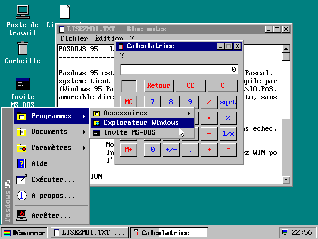

# Pasdows95
Clone de Windows 95 ecrit en Pascal



Pasdows 95 est un clone de Windows 95 écrit en Turbo Pascal / Free Pascal et compilé par <b>WPC</b> (« Windows 95 Pascal Compiler »). Comme Windows 95, il se compose d'un <b>IO.SYS</b> 16 bits (<b>KERNEL/IO.PAS</b>), amorçable directement depuis un CD-ROM (El Torito, sans émulation) et copiable sur n'importe quelle image ISO 9660, qui charge un noyau 32 bits <b>VMM32.VXD</b> (<b>KERNEL/VMM32.PAS</b>). VMM32 exécute de <b>vrais programmes Windows 95</b> (exécutables PE Win32) en leur fournissant KERNEL32, USER32, GDI32, WINMM et les autres DLL système.

<h2>Liste des fichiers</h2>

<table>
	<tr><th>Nom</th><th>Description</th></tr>
	<tr><td><b>KERNEL/IO.PAS</b></td><td>IO.SYS de Pasdows 95 (16 bits) : démarrage, menu de démarrage (F8), lecture du CD-ROM, MSDOS.SYS et AUTOEXEC.BAT, mode MS-DOS, interface 16 couleurs du mode sans échec, puis chargement de VMM32.VXD (VESA, mode protégé).</td></tr>
	<tr><td><b>KERNEL/VMM32.PAS</b></td><td>Noyau 32 bits VMM32.VXD : mode protégé, mémoire, tâches préemptives, interface 256 couleurs, chargeur PE et API Win32 (plus de 550 fonctions de KERNEL32, USER32, GDI32, WINMM, ADVAPI32, SHELL32, COMDLG32, COMCTL32, OLE32, VERSION, MSVFW32).</td></tr>
	<tr><td><b>EXEMPLES/HELLO.PAS</b></td><td>Exemple de programme Windows 95 (Win32, unité Graph) compilé par <b>WPC -CW32</b> en HELLO.EXE.</td></tr>
	<tr><td><b>KERNEL/BUILD.sh</b></td><td>Construit les outils, IO.SYS et le CD-ROM amorçable <i>IMAGE/PASDOWS.ISO</i> (Linux).</td></tr>
	<tr><td><b>KERNEL/BUILD.BAT</b></td><td>Même chose sous DOS ou Windows (Free Pascal dans le PATH).</td></tr>
	<tr><td><b>TOOLS/WPC.PAS</b></td><td>Compilateur « Windows 95 Pascal Compiler » : copie du compilateur <i>OS2PC.PAS</i> (« OS/2 Pascal Compiler ») du dépôt <a href="https://github.com/gladir/OS2-0">OS2-0</a>, renommé et augmenté des destinations <b>-CW95IO</b> et <b>-CVMM32</b>.</td></tr>
	<tr><td><b>TOOLS/MAKEISO.PAS</b></td><td>Fabrique une image CD-ROM ISO 9660 amorçable (El Torito) avec table d'information d'amorce (dérivé de MAKEISO.PAS d'OS2-0).</td></tr>
	<tr><td><b>WIN64/WPC.EXE</b></td><td>Compilateur WPC compilé pour Windows 64 bits.</td></tr>
	<tr><td><b>WIN64/MAKEISO.EXE</b></td><td>MAKEISO compilé pour Windows 64 bits.</td></tr>
	<tr><td><b>IMAGE/PASDOWS.ISO</b></td><td>Image du CD-ROM amorçable de Pasdows 95.</td></tr>
	<tr><td><b>IMAGE/CDROM</b></td><td>Contenu du CD-ROM : IO.SYS, VMM32.VXD, HELLO.EXE, MSDOS.SYS, CONFIG.SYS, AUTOEXEC.BAT et LISEZMOI.TXT. Tout programme Windows 95 déposé ici est mis sur le CD-ROM par BUILD.</td></tr>
</table>

<h2>Fonctionnalités</h2>

<ul>
	<li>Écran « Démarrage de Pasdows 95... », menu de démarrage (F8) : Normal, Mode sans échec (F5), Invite de commandes seulement (Maj+F5), Redémarrer.</li>
	<li>Lecture du CD-ROM ISO 9660 par l'INT 13h étendue du BIOS, options de <b>MSDOS.SYS</b> (<i>BootMenu</i>, <i>BootGUI</i>, <i>Logo</i>, <i>BootDelay</i>) et commandes <b>SET</b> de <b>AUTOEXEC.BAT</b>.</li>
	<li>Démarrage normal : IO.SYS passe en VESA 640x480 en 256 couleurs, charge VMM32.VXD au-dessus du premier mégaoctet et passe en mode protégé 32 bits. Sans VMM32.VXD, avec moins de 16 Mo ou sans VESA (et en mode sans échec), IO.SYS garde son interface VGA 16 couleurs.</li>
	<li><b>Programmes Windows 95</b> : chargeur PE (relocalisations, importations, ressources, DLL), tâches Win32 préemptives avec TIB et sauvegarde du coprocesseur, files de messages, fenêtres, classes, dialogues et contrôles (BUTTON, EDIT, LISTBOX, COMBOBOX, SCROLLBAR, STATIC), GDI avec palettes logiques, DIB et sections DIB, fichiers sur le CD-ROM (D:) et disque virtuel en mémoire (C:), minuteries multimédia et carte son muette (waveOut). Essayé avec un projecteur Macromedia Director 5 et son film, qui se déroule entièrement.</li>
	<li>Interface graphique (palette de Windows 95) : écran d'accueil, bureau et icônes (dont les .EXE du CD-ROM), barre des tâches avec horloge, menu Démarrer et sous-menus, fenêtres en relief déplaçables, boutons Réduire / Agrandir / Fermer, souris PS/2 et clavier.</li>
	<li>Applications : Poste de travail et Explorateur (navigation sur le CD-ROM), Bloc-notes, Calculatrice, Paint, Invite MS-DOS (CLS, DATE, DIR, ECHO, EXIT, HELP, MEM, SET, TIME, TYPE, VER, VOL, WIN...), Panneau de configuration (Affichage, Date/Heure, Paramètres régionaux, Système), Corbeille, Aide, Exécuter, À propos, Bienvenue.</li>
	<li>Arrêter Pasdows : arrêt de l'ordinateur (APM), redémarrage ou redémarrage en mode MS-DOS (texte 80x25, <b>EXIT</b> ou <b>WIN</b> pour revenir).</li>
	<li>Raccourcis : Ctrl+Échap (menu Démarrer), Alt+F4, Alt+Tab, F1, double-clic.</li>
</ul>

<h2>Langue</h2>

La langue par défaut est le français. On utilise l'anglais si la variable d'environnement est <b>LANGUAGE=EN</b>, l'allemand si elle est <b>LANGUAGE=GR</b>, l'espagnol avec <b>LANGUAGE=SP</b> et l'italien avec <b>LANGUAGE=IT</b>. La variable se fixe dans <i>AUTOEXEC.BAT</i> sur le CD-ROM, avec la commande <b>SET</b> dans l'Invite MS-DOS ou dans <i>Paramètres régionaux</i> ; l'interface change de langue immédiatement.

<h2>Compilateur WPC</h2>

<b>WPC.PAS</b> est une copie du compilateur <b>OS2PC.PAS</b> du dépôt OS2-0 (lui-même dérivé de <i>TPCW32.PAS</i> du dépôt DEV-COOLS), renommé de « OS/2 Pascal Compiler » à « Windows 95 Pascal Compiler ». Toutes ses destinations sont conservées et il ajoute :

<table>
	<tr><th>Option</th><th>Description</th></tr>
	<tr><td><b>-CW95IO</b></td><td>IO.SYS de Pasdows 95 : image binaire brute 8086 (mode réel) chargée en 07C0:0000. Le BIOS n'en charge que les 2 premiers Ko (comme ISOLINUX) ; une amorce de 227 octets placée en tête de l'image relit le reste du fichier depuis le CD-ROM grâce à la table d'information d'amorce écrite par MAKEISO, puis passe le contrôle au programme avec l'unité d'amorçage dans <i>PrefixSeg</i>.</td></tr>
	<tr><td><b>-CVMM32</b></td><td>VMM32.VXD de Pasdows 95 : image PE 32 bits chargée à 1 Mo (comme la destination noyau d'OS2-0). La clause <b>exports</b> du programme publie ses fonctions Pascal comme API Win32 : WPC génère pour chacune un thunk stdcall et la table d'exportation dans laquelle le chargeur PE de VMM32 résout les importations des programmes.</td></tr>
	<tr><td><b>-CW32</b></td><td>Exécutable Windows 95 (PE Win32), destination d'origine du compilateur ; l'unité Graph y est émulée par une fenêtre GDI.</td></tr>
</table>

<h2>Construire et essayer</h2>

```bash
cd KERNEL
./BUILD.sh
```

```bash
qemu-system-i386 -m 64 -cdrom IMAGE/PASDOWS.ISO -boot d
```

Pour exécuter un programme Windows 95, copiez-le (avec ses fichiers de données) dans <i>IMAGE/CDROM</i>, relancez BUILD, puis double-cliquez son icône sur le bureau de Pasdows.

Pour copier IO.SYS sur une autre image de CD-ROM, il suffit de le désigner comme fichier d'amorce :

```bash
MAKEISO MONCD.ISO /BOOT:IO.SYS IO.SYS VMM32.VXD AUTOEXEC.BAT MSDOS.SYS LISEZMOI.TXT
```

<h2>Règles de programmation</h2>

<ul>
	<li>Turbo Pascal / Free Pascal, sans programmation objet : des enregistrements (<i>Record</i>) passés par référence à des procédures et fonctions.</li>
	<li>Aucune unité ajoutée (IO.PAS et VMM32.PAS n'en utilisent aucune, ils ne s'appuient que sur le BIOS et le matériel) et aucun fichier d'inclusion ($I).</li>
	<li>Lignes de 80 caractères au plus dans IO.PAS et VMM32.PAS (chargeables dans l'EDI de Free Pascal) ; les caractères accentués sont écrits avec des codes <i>#nnn</i> de la page de code 437 (police du BIOS VGA).</li>
</ul>

<h2>Licence</h2>

MIT, voir le fichier LICENSE.
