# Pasdows95
Clone de Windows 95 ecrit en Pascal

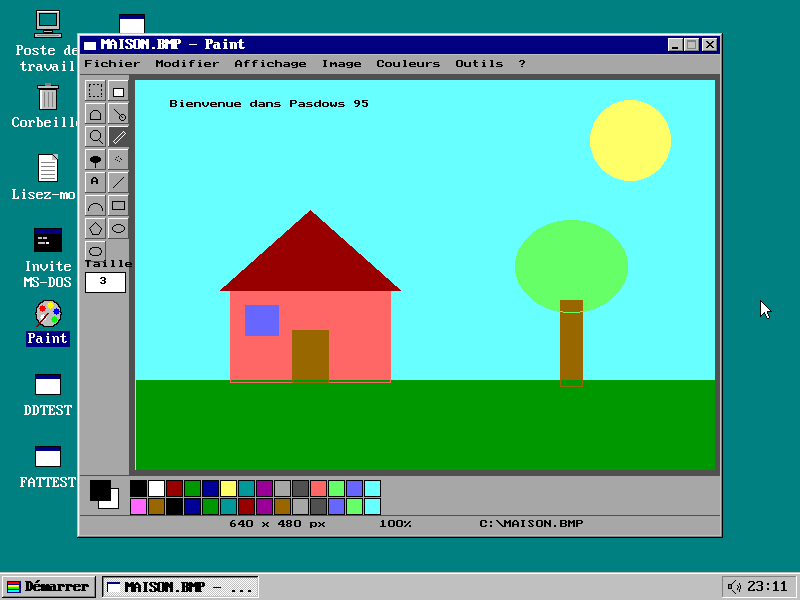

<i>Paint (APPS/PAINT.PAS, le Paint de CloneDRAW devenu une application Windows 95) dans le bureau de Pasdows 95 en 800x600.</i>

Pasdows 95 est un clone de Windows 95 écrit en Turbo Pascal / Free Pascal et compilé par <b>WPC</b> (« Windows 95 Pascal Compiler »). Comme Windows 95, il se compose d'un <b>IO.SYS</b> 16 bits (<b>KERNEL/IO.PAS</b>), amorçable directement depuis un CD-ROM (El Torito, sans émulation) et copiable sur n'importe quelle image ISO 9660, qui charge un noyau 32 bits <b>VMM32.VXD</b> (<b>KERNEL/VMM32.PAS</b>). VMM32 exécute de <b>vrais programmes Windows 95</b> (exécutables PE Win32) en leur fournissant KERNEL32, USER32, GDI32, WINMM et les autres DLL système.

_N'ayez pas peur ! Avec le Pascal, tout est possible !_

<h2>Liste des fichiers</h2>

<table>
	<tr><th>Nom</th><th>Description</th></tr>
	<tr><td><b>KERNEL/IO.PAS</b></td><td>IO.SYS de Pasdows 95 (16 bits) : démarrage, menu de démarrage (F8), lecture du CD-ROM (ou du disque dur FAT16, FAT32, NTFS ou HPFS après l'installation), MSDOS.SYS et AUTOEXEC.BAT, mode MS-DOS, interface 16 couleurs du mode sans échec, puis chargement de VMM32.VXD (VESA, mode protégé).</td></tr>
	<tr><td><b>KERNEL/VMM32.PAS</b></td><td>Noyau 32 bits VMM32.VXD : mode protégé, mémoire paginée, processus et tâches préemptives, interface graphique en 256 couleurs ou en vraies couleurs, chargeur PE et API Win32 (plus de 1 300 fonctions de KERNEL32, USER32, GDI32, WINMM, ADVAPI32, SHELL32, COMDLG32, COMCTL32, OLE32, VERSION, MSVFW32, PSAPI, IPHLPAPI, WSOCK32, WININET et DirectX).</td></tr>
	<tr><td><b>SETUP/INSTALL.PAS</b></td><td>Programme d'installation graphique de Pasdows 95 sur un disque dur (INSTALL.SYS, image d'amorce du CD-ROM d'installation), compilé par <b>WPC -CW95IO</b> : langue, partition, formatage FAT16, FAT32, NTFS ou HPFS, fuseau horaire, affichage, composants, copie des fichiers.</td></tr>
	<tr><td><b>SETUP/MBR.ASM</b>, <b>SETUP/BOOT16.ASM</b>, <b>SETUP/BOOT32.ASM</b>, <b>SETUP/NTFSBOOT.ASM</b>, <b>SETUP/HPFSBOOT.ASM</b></td><td>Sources NASM du code d'amorce écrit par INSTALL : secteur de partition (MBR), secteurs d'amorce FAT16 et FAT32, chargeur NTFS de 16 secteurs ($Boot) qui cherche IO.SYS dans l'index de la racine et chargeur HPFS de 16 secteurs (zone d'amorce avant le superbloc) qui descend l'arbre B des dnodes de la racine et lit IO.SYS par son arbre B+ d'allocation ; tous chargent C:\IO.SYS (les octets assemblés sont repris dans INSTALL.PAS).</td></tr>
	<tr><td><b>SYSTEM/COMMAND.PAS</b></td><td>Interpréteur de commandes de l'Invite DOS (COMMAND.EXE), adapté de CMD.PAS du projet Corail et compilé par <b>WPC -CW32</b> ; il tourne dans la console Win32 de VMM32. Ses fichiers de traitement par lots (<b>.BAT</b>) reconnaissent <b>@</b>, les étiquettes et <b>GOTO</b> (GOTO :EOF compris), <b>IF</b> [NOT] ERRORLEVEL n / EXIST fichier / chaîne1==chaîne2, <b>CALL</b> (retour à l'appelant), <b>SHIFT</b>, les paramètres %0 à %9 et les variables %NOM% ; ERRORLEVEL est le code de sortie du dernier programme, et SET modifie l'environnement Win32 transmis aux programmes lancés.</td></tr>
	<tr><td><b>DOS/*.PAS</b></td><td>Commandes externes de MS-DOS (ATTRIB, CHKDSK, EDIT, DEBUG, GWBASIC, XCOPY, PING, IPCONFIG, CURL...) prises dans <a href="https://github.com/gladir/MSDOS-0">MSDOS-0</a> et <a href="https://github.com/gladir/GWBASIC-0">GWBASIC-0</a>, compilées par <b>WPC -CW32</b> dans C:\WINDOWS\COMMAND, voir la section <a href="#commandes">Commandes DOS</a>.</td></tr>
	<tr><td><b>APPS/PAINT.PAS</b></td><td><b>Paint</b> : le programme de dessin PAINT.PAS du dépôt <a href="https://github.com/gladir/clonedraw">CloneDRAW</a> (plus de 45 000 lignes, toutes ses fonctions conservées) devenu une application Windows 95 compilée par <b>WPC -CW32</b> en PAINT.EXE ; une couche Win32 remplace les unités Graph, Crt et PtcMouse (voir la section <a href="#paint">Paint</a>).</td></tr>
	<tr><td><b>APPS/CALC.PAS</b></td><td><b>Calculatrice</b> comme celle de Windows 95 en mode Standard (CALC.EXE, compilé par <b>WPC -CW32</b>) : mémoire (MC, MR, MS, M+), Retour arrière, CE, C, racine carrée, pourcentage, inverse, +/-, égal qui répète la dernière opération, 15 chiffres significatifs (notation scientifique au-delà), séparateur décimal des paramètres régionaux, clavier, Copier/Coller ; menu <i>Démarrer, Programmes, Accessoires, Calculatrice</i>.</td></tr>
	<tr><td><b>APPS/BROWSER.PAS</b></td><td><b>Navigateur Web</b> (BROWSER.EXE, compilé par <b>WPC -CW32</b>) : le navigateur BROWSER.PAS du projet <a href="https://github.com/gladir/OS2-0">OS2-0</a> converti des API d'OS/2 (PMWIN, PMGPI, DOSCALLS, TCPIP32) aux API de Windows 95 (USER32, GDI32, KERNEL32, WININET), avec <b>HTTPS</b> ; HTML, CSS, JavaScript, images, formulaires, signets, code source, codes QR et outils de développement F12, voir la section <a href="#navigateur">Navigateur Web</a>.</td></tr>
	<tr><td><b>APPS/TASKMGR.PAS</b></td><td><b>Gestionnaire des tâches</b> dans le style de Windows XP (TASKMGR.EXE, compilé par <b>WPC -CW32</b>), voir la section <a href="#taskmgr">Gestionnaire des tâches</a>.</td></tr>
	<tr><td><b>APPS/APPWIZ.PAS</b></td><td><b>Ajout/Suppression de programmes</b> (APPWIZ.EXE, compilé par <b>WPC -CW32</b>), voir la section <a href="#appwiz">Ajout/Suppression de programmes</a>.</td></tr>
	<tr><td><b>APPS/WINHLP32.PAS</b></td><td><b>Aide de Windows</b> (WINHLP32.EXE, compilé par <b>WPC -CW32</b>) : visionneuse des fichiers d'aide <b>.HLP</b> de Windows 3.1 et 4.0, voir la section <a href="#aide">Aide de Windows</a>.</td></tr>
	<tr><td><b>APPS/FREECELL.PAS</b></td><td><b>FreeCell</b> (FREECELL.EXE, compilé par <b>WPC -CW32</b>) : le jeu FREECELL.PAS du projet <a href="https://github.com/gladir/OS2-0">OS2-0</a> converti des API d'OS/2 (PMWIN, PMGPI) aux API de Windows (USER32, GDI32), voir la section <a href="#freecell">FreeCell</a>.</td></tr>
	<tr><td><b>APPS/CHARMAP.PAS</b></td><td><b>Table de caractères</b> comme celle de Windows 95 (CHARMAP.EXE, compilé par <b>WPC -CW32</b>), voir la section <a href="#charmap">Table de caractères</a>.</td></tr>
	<tr><td><b>APPS/ECHECS.PAS</b></td><td><b>Échecs</b> (ECHECS.EXE) porté d'OS2-0, voir la section <a href="#echecs">Échecs</a>.</td></tr>
	<tr><td><b>APPS/SOL.PAS</b></td><td><b>Solitaire</b> (SOL.EXE), voir la section <a href="#solitaire">Solitaire</a>.</td></tr>
	<tr><td><b>APPS/DEFRAG.PAS</b>, <b>CLEANMGR.PAS</b>, <b>MSINFO32.PAS</b>, <b>MSTASK.PAS</b></td><td><b>Défragmenteur de disque</b>, <b>Nettoyage de disque</b>, <b>Informations système</b> et <b>Tâches planifiées</b>, voir la section <a href="#outils-systeme">Outils système</a>.</td></tr>
	<tr><td><b>APPS/CDPLAYER.PAS</b></td><td><b>Lecteur CD</b> (CDPLAYER.EXE, compilé par <b>WPC -CW32</b>) par MCI cdaudio, voir la section <a href="#lecteurcd">Lecteur CD</a>.</td></tr>
	<tr><td><b>APPS/FINDFILE.PAS</b></td><td><b>Rechercher</b> (FINDFILE.EXE) : fichiers ou dossiers, et ordinateur (/C), voir la section <a href="#rechercher">Rechercher</a>.</td></tr>
	<tr><td><b>APPS/IMAGING.PAS</b></td><td><b>Imaging</b> (IMAGING.EXE) : visionneuse TIFF (plusieurs pages), BMP, GIF, PNG et JPEG, voir la section <a href="#imaging">Imaging</a>.</td></tr>
	<tr><td><b>APPS/WAB.PAS</b></td><td><b>Carnet d'adresses</b> (WAB.EXE), voir la section <a href="#carnet">Carnet d'adresses</a>.</td></tr>
	<tr><td><b>APPS/MSTSC.PAS</b></td><td><b>Connexion Bureau à distance</b> (MSTSC.EXE, compilé par <b>WPC -CW32</b>) : client RDP avec TLS et NLA (CredSSP), voir la section <a href="#rdp">Connexion Bureau à distance</a>.</td></tr>
	<tr><td><b>APPS/FTPCLI.PAS</b></td><td><b>Client FTP</b> (FTPCLI.EXE, compilé par <b>WPC -CW32</b>) : client FTP et SFTP (SSH-2) dans le genre de FileZilla, avec gestionnaire de sites en XML, voir la section <a href="#ftp">Client FTP</a>.</td></tr>
	<tr><td><b>APPS/SSHCLI.PAS</b></td><td><b>Client SSH</b> (SSHCLI.EXE, compilé par <b>WPC -CW32</b>) : terminal SSH-2 (xterm) dans le genre de MobaXterm, onglets de sessions, panneau Sessions / Outils / Macros / SFTP, sessions en XML, voir la section <a href="#ssh">Client SSH</a>.</td></tr>
	<tr><td><b>APPS/GITCLI.PAS</b></td><td><b>Client GitHub</b> (GITCLI.EXE, compilé par <b>WPC -CW32</b>) : client Git et GitHub dans le genre de GitHub Desktop (clonage, validation, branches, fusion, historique, différences, envoi et tirage en HTTP, HTTPS et git://), voir la section <a href="#github">Client GitHub</a>.</td></tr>
	<tr><td><b>APPS/SVNCLI.PAS</b></td><td><b>Client SVN</b> (SVNCLI.EXE, compilé par <b>WPC -CW32</b>) : client <b>Subversion</b> dans le genre du Client GitHub (extraction, mise à jour avec fusion, validation, annulation, svn:ignore, branches, historique, différences) en <b>svn://</b>, <b>http://</b> et <b>https://</b>, voir la section <a href="#svn">Client SVN</a>.</td></tr>
	<tr><td><b>APPS/PASDEV.PAS</b></td><td><b>Pascal Developer</b> (PASDEV.EXE, compilé par <b>WPC -CW32</b>) : l'EDI Pascal du dépôt <a href="https://github.com/gladir/OS2-0">OS2-0</a> converti des API d'OS/2 (PMWIN, PMGPI, DOSCALLS) aux API de Windows ; il compile avec <b>WPC.EXE</b>, voir la section <a href="#devkit">Developer Kit</a>.</td></tr>
	<tr><td><b>APPS/PASDBG.PAS</b></td><td><b>Pasdows Debugger</b> (PASDBG.EXE, compilé par <b>WPC -CW32</b>) : l'OS2-Zero Debugger d'OS2-0 (fenêtre CPU dans l'esprit de Turbo Debugger) porté sur l'API de débogage Win32, voir la section <a href="#devkit">Developer Kit</a>.</td></tr>
	<tr><td><b>APPS/CONTROL.PAS</b></td><td><b>Panneau de configuration</b> (CONTROL.EXE) : applets désignées par leur fichier .CPL, boîtes Souris, Clavier et Paramètres régionaux, voir la section <a href="#panneau">Panneau de configuration</a>.</td></tr>
	<tr><td><b>APPS/MP3PLAY.PAS</b></td><td><b>Lecteur MP3</b> (MP3PLAY.EXE, compilé par <b>WPC -CW32</b>) : le lecteur MP3PLAY.PAS du projet <a href="https://github.com/gladir/OS2-0">OS2-0</a> converti des API d'OS/2 (MDM, PMWIN, PMGPI, DOSCALLS) aux API de Windows (WINMM, USER32, GDI32, KERNEL32), voir la section <a href="#mp3">Lecteur MP3</a>.</td></tr>
	<tr><td><b>EXAMPLES/HTTPGET.PAS</b></td><td>Exemple Win32 en mode console (HTTPGET.EXE) : télécharge une adresse <b>http://</b> ou <b>https://</b> avec WININET (<i>HTTPGET url [fichier]</i>), voir la section <a href="#https">HTTPS</a>.</td></tr>
	<tr><td><b>EXAMPLES/HELLO.PAS</b></td><td>Exemple de programme Windows 95 (Win32, unité Graph) compilé par <b>WPC -CW32</b> en HELLO.EXE.</td></tr>
	<tr><td><b>KERNEL/BUILD.sh</b></td><td>Construit les outils, IO.SYS, le CD-ROM amorçable <i>IMAGE/PASDOWS.ISO</i> et le CD-ROM d'installation <i>IMAGE/INSTALL.ISO</i> (Linux).</td></tr>
	<tr><td><b>KERNEL/BUILD.BAT</b></td><td>Même chose sous DOS ou Windows (Free Pascal dans le PATH).</td></tr>
	<tr><td><b>TOOLS/WPC.PAS</b></td><td>Compilateur « Windows 95 Pascal Compiler » : copie du compilateur <i>OS2PC.PAS</i> (« OS/2 Pascal Compiler ») du dépôt <a href="https://github.com/gladir/OS2-0">OS2-0</a>, renommé et augmenté des destinations <b>-CW95IO</b> et <b>-CVMM32</b>. Une chaîne littérale comme <i>')'</i> n'est plus prise pour une ponctuation (EPMatch) : JIs(')') fermait l'appel trop tôt et le corps d'un While se retrouvait hors de la boucle, ses Break devenant des identificateurs inconnus. Comme Turbo Pascal (<i>Duplicate identifier</i>), WPC refuse un identificateur déclaré deux fois dans une même portée : constantes, types et variables globaux du programme, routines de même nom (une déclaration <i>Forward</i> et sa définition restent permises), routine portant le nom d'une constante, d'une variable ou d'un type global ; il donne le nom et les lignes des déclarations. Les noms prédéfinis (unités System, Dos...) peuvent toujours être redéfinis.</td></tr>
	<tr><td><b>TOOLS/MAKEISO.PAS</b></td><td>Fabrique une image CD-ROM ISO 9660 amorçable (El Torito) avec table d'information d'amorce (dérivé de MAKEISO.PAS d'OS2-0).</td></tr>
	<tr><td><b>TOOLS/MAKEPAK.PAS</b></td><td>Fabrique COMMAND.PAK, l'archive des commandes DOS que VMM32 déballe dans C:\WINDOWS\COMMAND au premier démarrage après l'installation.</td></tr>
	<tr><td><b>WIN64/WPC.EXE</b></td><td>Compilateur WPC compilé pour Windows 64 bits.</td></tr>
	<tr><td><b>IMAGE/CDROM/WPC.EXE</b></td><td>Compilateur WPC compilé <b>par lui-même</b> (<i>WPC -CW32 TOOLS/WPC.PAS</i>) : un programme Win32 qui tourne dans Pasdows (C:\WINDOWS\WPC.EXE), utilisé par Pascal Developer et l'Invite DOS.</td></tr>
	<tr><td><b>WIN64/MAKEISO.EXE</b></td><td>MAKEISO compilé pour Windows 64 bits.</td></tr>
	<tr><td><b>IMAGE/PASDOWS.ISO</b></td><td>Image du CD-ROM amorçable de Pasdows 95 (démarre Pasdows directement depuis le CD-ROM).</td></tr>
	<tr><td><b>IMAGE/INSTALL.ISO</b></td><td>Image du CD-ROM d'installation : mêmes fichiers, mais il démarre le programme d'installation INSTALL.SYS (il n'est que sur ce CD-ROM).</td></tr>
	<tr><td><b>IMAGE/CDROM</b></td><td>Contenu du CD-ROM : IO.SYS, VMM32.VXD, PAINT.EXE, CALC.EXE, BROWSER.EXE, DXDIAG.EXE, TASKMGR.EXE, APPWIZ.EXE, WINHLP32.EXE, MP3PLAY.EXE, FREECELL.EXE, CHARMAP.EXE, PASDEV.EXE, PASDBG.EXE, WPC.EXE, GITCLI.EXE, SVNCLI.EXE, AURORE.MP3 (morceau d'exemple d'OS2-0), HELLO.EXE, MSDOS.SYS, CONFIG.SYS, AUTOEXEC.BAT et LISEZMOI.TXT. Tout programme Windows 95 déposé ici est mis sur le CD-ROM par BUILD.</td></tr>
	<tr><td><b>IMAGE/SCREENSHOTS</b></td><td>Captures d'écran de Pasdows 95 (QEMU, 640x480) reprises dans ce document.</td></tr>
</table>

<h2>Fonctionnalités</h2>

<ul>
	<li>Écran « Démarrage de Pasdows 95... », menu de démarrage (F8) : Normal, Mode sans échec (F5), Invite de commandes seulement (Maj+F5), Redémarrer.</li>
	<li>Lecture du CD-ROM ISO 9660 par l'INT 13h étendue du BIOS, options de <b>MSDOS.SYS</b> (<i>BootMenu</i>, <i>BootGUI</i>, <i>Logo</i>, <i>BootDelay</i>) et commandes <b>SET</b> de <b>AUTOEXEC.BAT</b>.</li>
	<li>Démarrage normal : IO.SYS dresse la liste des modes <b>VESA</b> à mémoire linéaire de la carte (VBE 2.0, de 640x480 à 1600x1200, en 256 couleurs, 15, 16, 24 ou 32 bits), choisit celui enregistré dans le CMOS par <i>Affichage</i> (640x480 en 256 couleurs par défaut, VGA 16 couleurs au besoin), charge VMM32.VXD au-dessus du premier mégaoctet et passe en mode protégé 32 bits. Pendant l'initialisation du noyau, au lieu d'un écran noir, la boîte <b>Démarrage de Pasdows 95</b> énumère les étapes (carte graphique, horloge et son ; disques durs et CD-ROM ; systèmes de fichiers ; clavier, souris et interface graphique ; bibliothèques Win32 et Registre ; sous-système Windows 16 bits ; réseau ; bureau et barre des tâches) : chaque case se coche automatiquement en vert dès que son étape est terminée, avec une barre de progression, pour qu'une machine lente ne paraisse pas bloquée. Sans VMM32.VXD ou avec moins de 16 Mo (et en mode sans échec), IO.SYS garde son interface VGA 16 couleurs.</li>
	<li><b>Affichage</b> (clic droit sur le bureau, <i>Propriétés</i>, ou <i>Démarrer, Paramètres, Affichage</i>) : palette de couleurs (16 couleurs, 256 couleurs, High Color 15 ou 16 bits, True Color 24 ou 32 bits) et zone d'écran (toutes les résolutions VESA de la carte). Avec l'interface VBE de Bochs, QEMU, VirtualBox ou de l'émulateur de DEVENV (ports 1CEh/1CFh), le changement est immédiat, sans redémarrer : barre des tâches, icônes et fenêtres agrandies suivent la nouvelle taille et les programmes reçoivent WM_DISPLAYCHANGE ; sinon (et pour le VGA 16 couleurs), Pasdows propose de redémarrer, comme Windows 95. En 256 couleurs, l'écran est composé avec la palette système ; en High Color et en True Color, il est composé en <b>vraies couleurs</b>, voir la section <a href="#couleurs">Vraies couleurs</a>. Le menu contextuel du bureau propose aussi <i>Réorganiser les icônes</i> (par nom, par type) et <i>Aligner les icônes</i>.</li>
	<li><b>Propriétés de Date/Heure</b> (clic sur l'horloge de la barre des tâches, ou <i>Démarrer, Paramètres, Date/Heure</i>), comme dans WINDOWS95-0 : onglet <i>Date et heure</i> (mois, année, calendrier, horloge analogique qui suit les secondes, réglage de l'heure, des minutes et des secondes) et onglet <i>Fuseau horaire</i> (liste des fuseaux, carte du monde où l'on peut cliquer, heure d'été). OK et Appliquer règlent l'horloge temps réel ; le fuseau horaire, gardé dans le CMOS, est rendu aux programmes par GetTimeZoneInformation.</li>
	<li><b>Programmes Windows 95</b> : chargeur PE (relocalisations, importations, ressources, DLL), tâches Win32 préemptives avec TIB et sauvegarde du coprocesseur, files de messages, fenêtres, classes, dialogues et contrôles (BUTTON, EDIT, LISTBOX, COMBOBOX, SCROLLBAR, STATIC), GDI avec palettes logiques, DIB et sections DIB, fichiers sur le CD-ROM (D:) et disque virtuel en mémoire (C:), minuteries multimédia, son numérique (waveOut, PlaySound, sndPlaySound) et MIDI (midiOut) sur la carte son. Essayé avec un projecteur Macromedia Director 5 et son film, qui se déroule entièrement, et avec le jeu <b>Hoyle Classic Games II</b> (Sierra, 2001 : Hearts, Pachisi, Backgammon, Go Fish, Hangman, Anagrams), qui se joue entièrement : comme sous Windows 95, il exige un affichage High Color ou True Color (GetDeviceCaps annonce la profondeur réelle de la carte, et ses images sont affichées en vraies couleurs), sa fenêtre WS_POPUP agrandie prend tout l'écran au-dessus de la barre des tâches, ses sons passent par waveOut et sa bibliothèque SOS (dont le thread audio est suspendu et relancé par SuspendThread et ResumeThread), et ses fichiers RIFF sont lus par les fonctions mmio de WINMM.</li>
	<li><b>Multitâche</b> : plusieurs programmes Windows 95 tournent en même temps, chacun dans son <b>processus</b> (espace d'adresses privé, tas, modules, classes, minuteries, sockets), avec <b>CreateProcess</b>, <b>OpenProcess</b>, <b>TerminateProcess</b>, <b>GetExitCodeProcess</b> et les priorités ; objets de synchronisation nommés et partagés entre processus (<b>mutex</b> avec abandon, <b>événements</b>, <b>sémaphores</b>, <b>mappages de fichiers</b> pour la mémoire partagée), attentes multiples (WaitForMultipleObjects, MsgWaitForMultipleObjects, SignalObjectAndWait), voir la section <a href="#multitache">Multitâche</a>. Le <b>Gestionnaire des tâches</b> (Ctrl+Alt+Suppr, Ctrl+Maj+Échap, ou clic droit sur la barre des tâches) les montre et les arrête, voir la section <a href="#taskmgr">Gestionnaire des tâches</a>.</li>
	<li><b>Programmes MS-DOS</b> (.COM et .EXE) dans une <b>machine virtuelle 8086</b> (mode V86, pagination), en mode texte dans la fenêtre MS-DOS et en mode graphique en plein écran (VGA, EGA, CGA, 256 couleurs), avec BIOS, DOS 7.0, souris et COMMAND.COM intégrés : l'EDI de <b>Turbo Pascal 7</b> s'installe depuis ses disquettes et fonctionne entièrement, voir la section <a href="#dos">Programmes MS-DOS</a>.</li>
	<li><b>Lecteur de disquettes A:</b> (contrôleur 765, DMA, FAT12 de 360 Ko à 1,44 Mo, changement de disquette détecté).</li>
	<li><b>Programmes Windows 3.1</b> (Win16) : chargeur NE, segments de code en anneau 3 dans la LDT, passerelles d'appel vers l'API 16 bits de KERNEL, USER, GDI, SHELL, VER, LZEXPAND, TOOLHELP... (essayé avec un programme d'installation Microsoft ACME).</li>
	<li><b>DirectX 8.0</b> (version 4.08.00.0400 annoncée dans le Registre) : DirectDraw, Direct3D 1 à 7 et Direct3D 8 logiciels, DirectSound sur la carte son, DirectInput 1 à 8, DirectPlay et l'<b>Outil de diagnostic DirectX</b> (DXDIAG.EXE), voir la section <a href="#directx">DirectX</a>.</li>
	<li><b>Son</b> : pilote <b>Sound Blaster</b> (1.x, 2.0, Pro et 16 : réinitialisation du DSP, version, adresse, IRQ et DMA lus dans la variable <b>BLASTER</b> ou trouvés par le mixeur du SB16, lecture par DMA en mode auto-initialisé avec double tampon et interruption, 8 ou 16 bits, mono ou stéréo, conversion pour les cartes 8 bits) et pilote <b>AdLib</b> (OPL2 en 388h, détection par les minuteries, synthèse FM de 9 voix pour midiOut). Cartes <b>PCI</b>, celles de VirtualBox, QEMU et VMware : <b>AC'97</b> (Intel 82801AA à ICH7, nForce, AMD-8111 : remise à zéro du lien, codec, fréquence variable VRA, liste de 32 descripteurs), <b>HD Audio</b> (Intel ICH6 à ICH9 : anneaux CORB et RIRB, recherche des broches de sortie et de leur DAC dans le graphe du codec, format de flux exact) et <b>ES1370</b> (Ensoniq AudioPCI, Sound Blaster PCI 64 : canal DAC2) ; elles lisent la mémoire elles-mêmes et la minuterie du noyau remplit, toutes les 4 ms, les blocs de 1 Ko qu'elles ont lus. Les formats et fréquences que la carte ne joue pas sont convertis au remplissage. Sans OPL (cartes PCI), le MIDI passe par un <b>synthétiseur logiciel</b> de 24 voix (formes d'onde et enveloppes selon la famille d'instruments General MIDI, percussions), mixé dans le flux de la carte comme DirectSound. Au démarrage, Pasdows joue <i>PASDOWS.WAV</i>. Dans la barre des tâches, l'icône du <b>volume</b> ouvre la réglette de volume (clic), le <b>Contrôle du volume</b> (double-clic : Général, Wave, MIDI, CD audio et Ligne avec balance, volume et Muet, sur le mixeur de la carte) ou un menu contextuel (clic droit : <i>Ouvrir les contrôles du volume</i>, <i>Ajuster les propriétés audio</i> : propriétés Multimédia avec les périphériques de lecture et l'affichage de l'icône).</li>
	<li><b>Gestionnaire de périphériques</b> (<i>Démarrer, Paramètres, Système</i> ou clic droit sur le Poste de travail, <i>Propriétés</i>) : onglet <i>Général</i> (version, processeur identifié par CPUID, mémoire) et arbre du matériel détecté, par catégorie (cartes graphiques avec le nom VESA, moniteur, clavier, souris, contrôleurs de disque dur et de disquette, lecteurs de disque et de CD-ROM avec leur modèle ATA, carte réseau, contrôleurs son, ports COM et LPT, périphériques système, et tous les périphériques PCI). Un double-clic ouvre les propriétés du périphérique : fabricant, état et ressources (plages d'E/S, IRQ, DMA, mémoire).</li>
	<li><b>Bloc-notes</b> : barre de menus <i>Fichier</i> (Nouveau, Ouvrir..., Enregistrer, Enregistrer sous..., Quitter), <i>Edition</i> (Annuler, Couper, Copier, Coller, Supprimer, Sélectionner tout, Heure/Date), <i>Recherche</i> (Rechercher..., Suivant) et <i>?</i> ; sélection à la souris ou avec Maj et les flèches, raccourcis Ctrl+N/O/S/Z/X/C/V/A/F, F3 et F5, presse-papiers partagé avec les programmes (CF_TEXT), boîtes <i>Ouvrir</i> et <i>Enregistrer sous</i> (lecteurs, dossiers, types de fichier) aussi offertes aux programmes par COMDLG32 (GetOpenFileName, GetSaveFileName), question « Voulez-vous enregistrer les modifications ? » avant de fermer un texte modifié, et <b>barre d'état</b> en bas de la fenêtre : position du curseur (<i>Ln 2, Col 4</i>) et mode <b>INS</b> (insertion) ou <b>RFP</b> (refrappe : la touche <i>Inser</i> bascule, le caractère tapé remplace celui du curseur, montré par un pavé inversé) ; Ctrl+Inser, Maj+Inser et Maj+Suppr copient, collent et coupent comme sous Windows. Les fichiers s'enregistrent sur le disque dur C: (le CD-ROM D: est en lecture seule).</li>
	<li><b>Disques durs et FAT32</b> : pilote de disque IDE/ATA (PIO, LBA 28 bits), table de partitions (primaires et logiques) et systèmes de fichiers <b>FAT32</b>, FAT16 et FAT12 en lecture et en écriture, avec les <b>noms longs</b> (VFAT, casse conservée, noms courts NOM~1.EXT générés), FSInfo et les deux copies de la FAT. Le premier volume FAT devient <b>C:</b> (les suivants E:, F:... ; D: reste le CD-ROM) : les programmes y créent, lisent, renomment et suppriment fichiers et répertoires (CreateFile, FindFirstFile, MoveFile, GetDiskFreeSpaceEx, GetVolumeInformation « FAT32 »...), et le Poste de travail parcourt le disque. Les clusters contigus d'un fichier sont lus et écrits en un seul transfert (jusqu'à 64 Ko par commande IDE), et des repères dans la chaîne FAT (un tous les 256 clusters) évitent de la reparcourir depuis le début quand un programme revient en arrière dans un gros fichier. Un disque vierge peut être formaté en FAT32 depuis le Poste de travail. Un clic droit sur un lecteur du Poste de travail ouvre son menu contextuel (<i>Ouvrir</i>, <i>Propriétés</i>) ; la boîte <i>Propriétés</i> affiche le nom du volume (modifiable en FAT, NTFS et HPFS, comme SetVolumeLabel), le type et le système de fichiers, l'espace utilisé, libre et la capacité avec leur camembert, ainsi que les onglets <i>Outils</i> et <i>Partage</i> ; la barre d'état donne l'espace libre et la capacité du lecteur sélectionné. Sans disque dur, C: reste un disque virtuel en mémoire. Exemple : <b>EXAMPLES/FATTEST.PAS</b> (FATTEST.EXE sur le CD-ROM).</li>
	<li><b>NTFS</b> (partitions de type 07h, NTFS 3.x de Windows 2000/XP) en lecture et en écriture : enregistrements de la MFT avec correctifs de secteurs, attributs résidents et non résidents, fichiers fragmentés et creux, listes d'attributs, répertoires en arbre B+ ($I30) avec la table $UpCase, étiquette de $Volume. En écriture : création, écriture, troncature, suppression et renommage de fichiers et de répertoires, bitmap des clusters et de la MFT, extension de la MFT, passage des petits fichiers résidents aux fichiers non résidents, index reconstruits (petit index ou arbre B+ à plusieurs niveaux), $MFTMirr ; le journal $LogFile n'est pas tenu (il est vidé, comme le fait ntfs-3g). Les volumes modifiés par Pasdows restent valides pour ntfs-3g et ntfsresize. GetVolumeInformation rend « NTFS ». Les fichiers compressés ou chiffrés ne sont pas lus.</li>
	<li><b>HPFS</b> (<i>High Performance File System</i> d'OS/2, partitions de type 07h, même format que le pilote HPFS.IFS du projet <a href="https://github.com/gladir/OS2-0">OS2-0</a>) en lecture et en écriture, et <b>amorçable</b> : superbloc et bloc de réserve, bitmaps de 2 Ko par bande de 8 Mo, bande des répertoires et sa bitmap, <b>fnodes</b> (un secteur par fichier ou répertoire), arbres B+ d'allocation (extensions dans le fnode ou <b>anodes</b> à plusieurs niveaux), répertoires en <b>arbres B de dnodes</b> de 2 Ko triés sans tenir compte de la casse (page de codes 850), noms longs de 254 caractères à casse conservée (convertis entre la page 850 du disque et le Latin-1 du noyau), dates en secondes depuis 1970, attributs (lecture seule, caché, système, archive, nom hors 8.3). En écriture : création, écriture, extension et troncature, suppression et renommage ou déplacement de fichiers et de répertoires ; la bitmap du volume est gardée en mémoire et ses secteurs modifiés sont réécrits aussitôt, un répertoire modifié est reconstruit en arbre B équilibré (en réutilisant ses dnodes), et le bit « sale » du bloc de réserve couvre chaque modification. GetVolumeInformation rend « HPFS » (noms de 254 caractères). Les attributs étendus (EA) ne sont pas lus. <b>EXAMPLES/FATTEST.PAS</b> passe entièrement sur un volume HPFS.</li>
	<li><b>HTTPS</b> : <b>WININET.DLL</b> (InternetOpenUrl, InternetReadFile, HttpQueryInfo...) avec un client HTTP/1.1 et <b>TLS 1.2</b> écrits en Pascal dans le noyau, voir la section <a href="#https">HTTPS</a>.</li>
	<li><b>Réseau TCP/IP</b> : pilotes de cartes <b>AMD PCnet</b> (PCnet-PCI II Am79C970A et PCnet-FAST III Am79C973, les cartes par défaut de VirtualBox et la carte « vlance » de VMware ; anneaux de descripteurs de 32 bits), <b>Intel PRO/1000</b> (82540EM MT Desktop, 82543GC T Server, 82545EM MT Server, 82574L « e1000e » de VMware : registres en mémoire, anneaux de descripteurs) et <b>NE2000</b> (PCI RTL8029 ou ISA en 300h, comme la « NE2000 compatible » de Windows 95), pile TCP/IP écrite en Pascal (ARP, IP, ICMP, UDP, TCP avec retransmission et fenêtres, boucle locale 127.0.0.1), client <b>DHCP</b> et résolveur <b>DNS</b>. Les programmes utilisent <b>WSOCK32.DLL</b> / <b>WS2_32.DLL</b> (Winsock 1.1 par nom ou par ordinal : socket, connect, bind, listen, accept, send, recv, sendto, recvfrom, select, ioctlsocket, gethostbyname, WSAAsyncSelect...) et <b>ICMP.DLL</b> (IcmpSendEcho). Dans Pasdows : <i>Démarrer, Paramètres, Réseau (TCP/IP)</i> ou <i>Exécuter</i> <b>winipcfg</b> affiche la configuration IP, <b>ping</b> <i>hôte</i> envoie des échos ICMP. Les <b>lecteurs réseau</b> (partages SMB2 de Windows Server et de Samba) sont décrits dans la section <a href="#lecteurs-reseau">Lecteurs réseau</a>. Exemple : <b>EXAMPLES/NETTEST.PAS</b> (NETTEST.EXE sur le CD-ROM : TCP et UDP locaux, ping, DNS, HTTP).</li>
	<li><b>VirtualBox</b> : Pasdows reconnaît la machine virtuelle et en pilote les périphériques, comme les Guest Additions. Carte graphique <b>VBoxVGA</b> (80EE:BEEF, interface VBE DISPI avec largeurs quelconques), périphérique <b>VMMDev</b> (80EE:CAFE) et cartes réseau PCnet ou Intel PRO/1000 parfaitement fonctionnelles. Par le VMMDev, Pasdows se présente comme Windows 95 et annonce qu'il sait changer la taille de son écran : <i>Ajuster automatiquement la taille de l'écran</i> (en redimensionnant la fenêtre de VirtualBox) et <i>Écran virtuel, Redimensionner en ...</i> donnent des demandes de changement d'affichage (largeur, hauteur et profondeur quelconques) appliquées aussitôt, sans redémarrer, comme le changement de mode d'<i>Affichage</i>. La <b>souris intégrée</b> est absolue : la position vient de l'hôte, et la forme du pointeur de Pasdows (flèche, sablier, curseurs des programmes) lui est donnée pour qu'il la dessine lui-même : il n'y a qu'un seul pointeur à l'écran, sans décalage ni retard ; si l'intégration est coupée (Hôte+I), Pasdows reprend la souris PS/2 relative et dessine son pointeur. Le Gestionnaire de périphériques affiche la carte VirtualBox Graphics Adapter, la carte réseau, la <i>Souris VirtualBox (intégration)</i> (une seule souris) et le <i>Périphérique VirtualBox (Guest Additions)</i> dans les périphériques système.</li>
	<li><b>VMware Workstation</b> : Pasdows reconnaît la « backdoor » de VMware (port 5658h) et pilote ses périphériques comme les VMware Tools. Carte graphique <b>VMware SVGA II</b> (15AD:0405) : au démarrage elle remplace le mode VESA (même taille, 32 bits par point) ; chaque zone modifiée de l'écran est envoyée à l'hôte par la FIFO de commandes (UPDATE) et les changements de mode d'<i>Affichage</i> se font sans redémarrer, à n'importe quelle taille. Souris absolue <b>vmmouse</b> : la souris PS/2 ne fait plus que signaler les événements, lus dans la file de la backdoor (position, boutons) ; le pointeur de Pasdows (flèche, sablier, curseurs des programmes) est donné à la carte SVGA (DEFINE_CURSOR) et dessiné par VMware : un seul pointeur, sans retard. Le canal RPC des Tools (TCLO et RPCI) annonce les capacités <i>resolution_set</i> : <i>Affichage, Ajuster automatiquement l'invité</i> et <i>Ajuster l'invité maintenant</i> envoient « Resolution_Set largeur hauteur », appliqué aussitôt. Cartes réseau vlance (AMD PCnet), Intel PRO/1000 et e1000e. Le Gestionnaire de périphériques affiche VMware SVGA II, la <i>Souris VMware (VMware Pointing Device)</i> (une seule souris) et l'<i>Interface VMware (backdoor des VMware Tools)</i>. Sous QEMU, qui imite la backdoor (<b>-machine pc,vmport=on</b>, actif par défaut) et la carte SVGA II (<b>-vga vmware</b>), la souris est aussi absolue : plus besoin de capturer la souris dans la fenêtre de QEMU.</li>
	<li>Interface graphique (palette de Windows 95) : écran d'accueil, bureau et icônes (dont les .EXE du CD-ROM), barre des tâches avec horloge, menu Démarrer et sous-menus, fenêtres en relief déplaçables, boutons Réduire / Agrandir / Fermer, souris PS/2 et clavier.</li>
	<li><b>Paint</b> (icône sur le bureau et <i>Démarrer, Programmes, Accessoires, Paint</i>) : le Paint complet de CloneDRAW, voir la section <a href="#paint">Paint</a>.</li>
	<li><b>Navigateur Web</b> (<i>Démarrer, Programmes, Accessoires, Outils Internet, Navigateur Web</i>) : HTML, feuilles de style, JavaScript, images GIF, PNG, JPEG et BMP, formulaires GET et POST, <b>HTTP et HTTPS</b>, signets, historique, code source coloré, codes QR et outils de développement F12 (Inspecteur, Débogueur, Éditeur de style, Console, Réseau), voir la section <a href="#navigateur">Navigateur Web</a>.</li>
	<li>Applications : Poste de travail et <b>Explorateur Pasdows</b> (<i>Démarrer, Programmes</i> : fenêtre à deux volets comme l'Explorateur de Windows 95, arbre <i>Tous les dossiers</i> à gauche — Bureau, Poste de travail, lecteurs et dossiers dépliables par les cases +/- — qui suit le dossier affiché à droite, en-têtes <i>Contenu de</i> et espace disque libre dans la barre d'état), Calculatrice, Bloc-notes, Paint, Invite DOS (<b>COMMAND.EXE</b>, programme console Win32 : CD, CLS, COPY, DATE, DEL, DIR, ECHO, EXIT, MD, PATH, PROMPT, RD, REN, SET, TIME, TYPE, VER, VOL..., changement d'unité avec A:, C: ou D:, historique avec les flèches, lancement des programmes Windows et MS-DOS puis retour à l'invite ; voir la section <a href="#invite">Invite DOS</a>), Panneau de configuration (Affichage, Date/Heure, Paramètres régionaux, Système), Corbeille, Aide, Exécuter (un nom sans extension, comme « dxdiag » ou « calc », est cherché en .EXE puis .COM dans le dossier courant, C:\WINDOWS, C:\ et sur le CD-ROM ; la ligne peut contenir des arguments), À propos, Bienvenue.</li>
	<li>Arrêter Pasdows : arrêt de l'ordinateur (APM), redémarrage ou redémarrage en mode MS-DOS (texte 80x25, <b>EXIT</b> ou <b>WIN</b> pour revenir).</li>
	<li>Raccourcis : Ctrl+Échap (menu Démarrer), Alt+F4, Alt+Tab, F1, double-clic.</li>
</ul>

<h2>Installation sur le disque dur</h2>

Le CD-ROM d'installation <b>IMAGE/INSTALL.ISO</b> démarre <b>INSTALL.SYS</b> (<b>SETUP/INSTALL.PAS</b>), un programme d'installation en mode graphique (VGA 640x480, souris et clavier) écrit en Pascal, comme le CD-ROM de Windows 95. Il n'a besoin ni de DOS ni de Pasdows : il utilise le BIOS (INT 13h étendue pour le CD-ROM et le disque dur) et le matériel. L'assistant demande :

<ul>
	<li>la <b>langue</b> parmi les 5 langues de Pasdows : français (par défaut), anglais, allemand, italien, espagnol ; l'assistant change de langue aussitôt et <i>AUTOEXEC.BAT</i> reçoit <b>SET LANGUAGE=</b> ;</li>
	<li>le <b>disque dur</b> (taille, table des partitions actuelle) et la <b>partition</b> : créer une nouvelle partition principale active (taille en Mo, le disque est effacé) ou formater une partition existante, avec le <b>système de fichiers</b> FAT16 (2 Go au plus), <b>FAT32</b> (par défaut), <b>NTFS</b> ou <b>HPFS</b> (64 Go au plus) ;</li>
	<li>le <b>fuseau horaire</b> (même liste que <i>Date/Heure</i>) et l'heure d'été ;</li>
	<li>l'<b>affichage</b> (640x480, 800x600 ou 1024x768, en 16, 256 ou 65 536 couleurs) ;</li>
	<li>les <b>composants</b> (programmes d'exemple, son de démarrage, Lisez-moi), avec l'espace nécessaire.</li>
</ul>

Après un résumé et une confirmation, il écrit le <b>MBR</b> (code de <b>SETUP/MBR.ASM</b> et table des partitions), <b>formate</b> la partition : en <b>FAT16</b> (secteur d'amorce <b>SETUP/BOOT16.ASM</b>, deux FAT, racine de 512 entrées), en <b>FAT32</b> (secteur d'amorce <b>SETUP/BOOT32.ASM</b> et sa copie, FSInfo, deux FAT, grappes de 512 octets à 32 Ko selon la taille) ou en <b>NTFS 3.1</b> (chargeur <b>SETUP/NTFSBOOT.ASM</b>, MFT et $MFTMirr, $LogFile, $AttrDef, $Bitmap, $UpCase, $Secure, $Extend, copie du secteur d'amorce en fin de partition, grappes de 4 Ko) ou en <b>HPFS</b> (chargeur <b>SETUP/HPFSBOOT.ASM</b> dans les 16 secteurs d'amorce, superbloc, bloc de réserve, pages de codes, bitmaps par bandes de 8 Mo et leur liste, bande des répertoires ; chaque fichier est écrit d'un seul tenant derrière son fnode, puis les répertoires sont écrits en arbres B de dnodes) et copie les fichiers du CD-ROM avec une barre de progression : <i>C:\IO.SYS</i> et <i>C:\MSDOS.SYS</i> (cachés, système), <i>C:\CONFIG.SYS</i>, <i>C:\AUTOEXEC.BAT</i>, <i>C:\COMMAND.EXE</i> et le dossier <i>C:\WINDOWS</i> (VMM32.VXD, PASDOWS.WAV, LISEZMOI.TXT, programmes). Le fuseau horaire et le mode d'affichage sont gardés dans le CMOS.

Au redémarrage, le secteur d'amorce charge <i>C:\IO.SYS</i>, qui lit alors ses fichiers sur le disque dur (FAT16, FAT32, NTFS ou HPFS) et démarre VMM32 avec <i>C:\WINDOWS</i> comme dossier système (bureau, Lisez-moi, son de démarrage, Invite DOS sur C:). Si le CD-ROM d'installation reste dans le lecteur et que le disque dur a déjà une partition active, il suffit de ne toucher aucune touche pendant 5 secondes : le disque dur démarre ; une touche relance l'installation.

Sous <b>VirtualBox</b>, y compris avec Hyper-V (NEM), IO.SYS vérifie la ligne <b>A20</b> (test de repliement de la mémoire) et l'active au besoin par le BIOS, le port 92h puis le contrôleur du clavier, juste avant de passer en mode protégé ; le trampoline 32 bits la réactive aussi. Sans cela, le noyau, chargé au-dessus de 1 Mo, était lu dans la zone du BIOS et la machine virtuelle s'arrêtait (triple faute) juste après le logo.

<pre>qemu-img create -f raw disque.img 512M
qemu-system-i386 -m 64 -cdrom IMAGE/INSTALL.ISO -hda disque.img -boot d
qemu-system-i386 -m 64 -hda disque.img</pre>

<table>
	<tr><td align="center"><br><i>Choix de la langue</i></td><td align="center">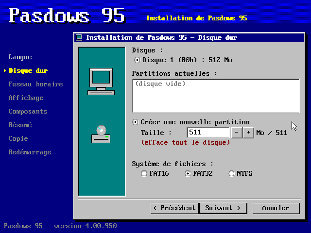<br><i>Disque dur, partition et système de fichiers (HPFS)</i></td></tr>
	<tr><td align="center">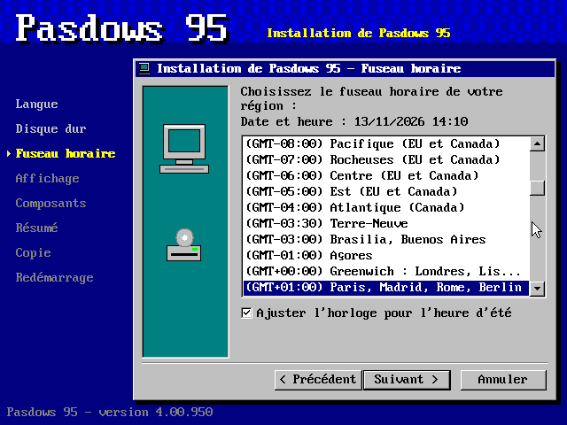<br><i>Fuseau horaire</i></td><td align="center"><br><i>Résumé avant l'installation</i></td></tr>
	<tr><td align="center">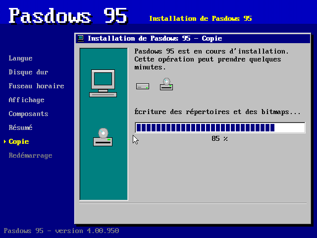<br><i>Copie des fichiers, puis écriture des répertoires et des bitmaps HPFS</i></td><td align="center">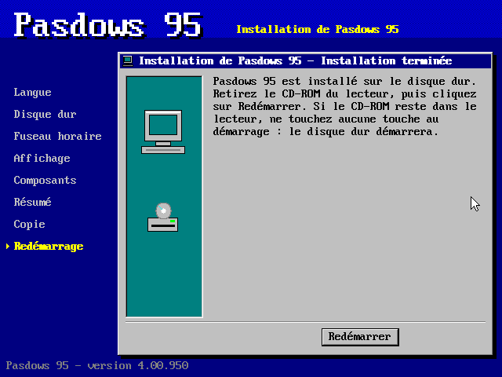<br><i>Installation terminée</i></td></tr>
	<tr><td align="center"><br><i>Démarré depuis la partition HPFS : C:\WINDOWS</i></td><td align="center"><br><i>FATTEST.EXE sur un volume HPFS (noms longs, écriture, troncature, déplacement)</i></td></tr>
</table>

<h2>Captures d'écran</h2>

<table>
	<tr><td align="center">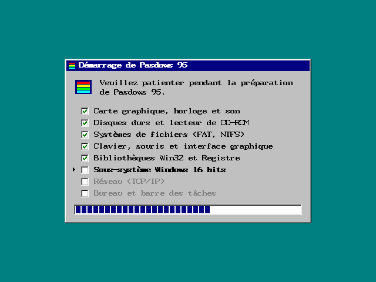<br><i>Démarrage : étapes cochées automatiquement</i></td><td align="center"><br><i>Bureau de Pasdows 95</i></td></tr>
	<tr><td align="center">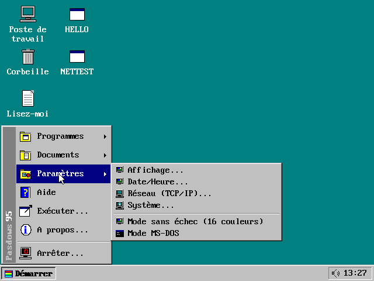<br><i>Menu Démarrer, sous-menu Paramètres</i></td><td align="center"><br><i>Bloc-notes et son menu Fichier</i></td></tr>
	<tr><td align="center"><br><i>Boîte Enregistrer sous (disque dur C:)</i></td><td align="center">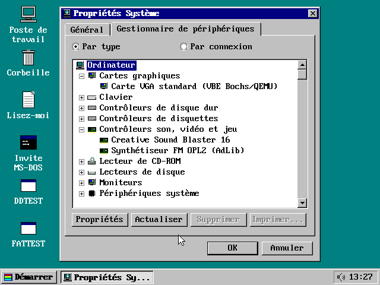<br><i>Gestionnaire de périphériques</i></td></tr>
	<tr><td align="center">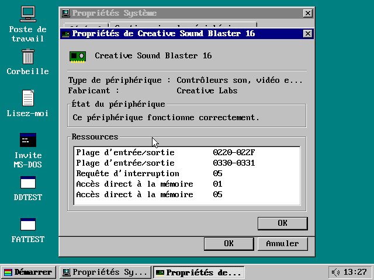<br><i>Propriétés de la Sound Blaster 16 (ressources)</i></td><td align="center"><br><i>Contrôle du volume (mixeur de la carte son)</i></td></tr>
	<tr><td align="center">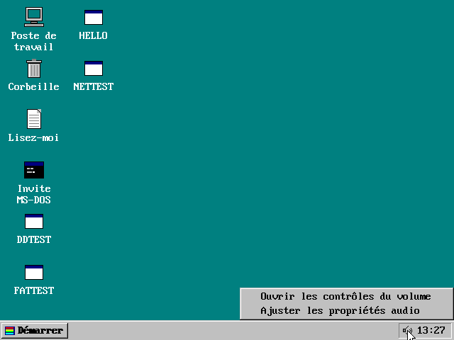<br><i>Menu contextuel de l'icône de volume</i></td><td align="center">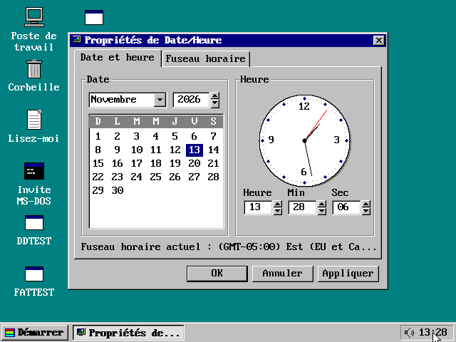<br><i>Propriétés de Date/Heure (clic sur l'horloge)</i></td></tr>
	<tr><td align="center"><br><i>Propriétés d'affichage (modes VESA)</i></td><td align="center">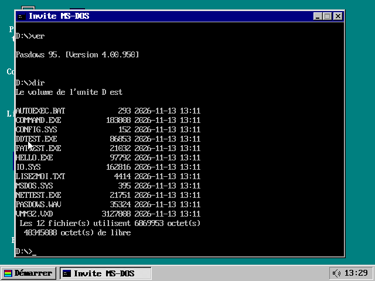<br><i>Invite DOS (COMMAND.EXE)</i></td></tr>
</table>

<h2 id="explorateur">Explorateur Pasdows et lecteurs</h2>

L'<b>Explorateur Pasdows</b> (<i>Démarrer, Programmes, Explorateur Pasdows</i>) est la fenêtre à deux volets de l'Explorateur de Windows 95. À gauche, l'arbre <i>Tous les dossiers</i> part du <b>Bureau</b> et du <b>Poste de travail</b> et montre les lecteurs (disques durs FAT, NTFS ou HPFS, CD-ROM) puis leurs dossiers, triés par ordre alphabétique et reliés par des traits pointillés ; les cases <b>+</b> et <b>-</b> déplient et replient une branche (les sous-dossiers ne sont lus qu'à ce moment), une barre de défilement apparaît quand l'arbre dépasse le volet. Un clic sur un dossier de l'arbre l'affiche à droite, sous l'en-tête <i>Contenu de 'dossier'</i> ; un double-clic le déplie aussi. À l'inverse, quand on ouvre un dossier dans le volet de droite, l'arbre se déplie jusqu'à lui et le sélectionne. Le titre devient « Explorateur Pasdows - <i>dossier</i> » et la barre d'état donne le nombre d'objets et l'<b>espace disque libre</b> du lecteur. Les noms longs (VFAT) sont gardés tels quels : « Program Files », « Mes documents ». Un double-clic sur un programme (.EXE ou .COM, quelle que soit la casse de l'extension) le lance ; sur un autre fichier, il l'ouvre dans le Bloc-notes.

Dans l'arbre de l'Explorateur, un <b>clic droit</b> sur le Bureau, le Poste de travail, un lecteur ou un dossier ouvre son menu contextuel : <i>Ouvrir</i> (fenêtre de dossier), <i>Explorer</i> (nouvel Explorateur ouvert sur cet élément) et <i>Propriétés</i> : Propriétés d'affichage pour le Bureau, Propriétés Système pour le Poste de travail, boîte <i>Propriétés</i> du lecteur (avec son graphique en secteurs) pour un lecteur, et pour un dossier son emplacement, sa taille (sous-dossiers compris) et son contenu. Le <b>menu système</b> s'ouvre aussi par un clic sur l'icône de la barre de titre de toute fenêtre (<i>Restaurer</i>, <i>Réduire</i>, <i>Agrandir</i>, <i>Fermer</i>).

Dans le volet de droite (et dans les fenêtres de dossier), un <b>clic droit sur un fichier ou un dossier</b> ouvre le menu de Windows 95 : <i>Ouvrir</i>, <b>Couper</b>, <b>Copier</b>, <b>Coller</b> (dans le dossier visé), <i>Supprimer</i>, <i>Renommer</i>, <b>Sélectionner tout</b> et <b>Propriétés</b> ; un clic droit sur le fond du dossier propose <b>Sélectionner tout</b>, <b>Actualiser</b>, <b>Coller</b>, <i>Nouveau</i> et <i>Propriétés</i>. Les documents et dossiers du bureau ont le même menu, et le menu du bureau a <b>Coller</b>. Sur le CD-ROM, seuls Ouvrir, Copier, Sélectionner tout et Propriétés sont actifs.

<ul>
	<li><b>Sélection multiple</b> : <b>Ctrl+clic</b> ajoute ou retire un élément, <b>Maj+clic</b> choisit une plage, <b>Sélectionner tout</b> (ou <b>Ctrl+A</b>) tout le dossier ; la barre d'état donne « <i>n</i> objet(s) sélectionné(s) » et leur taille. Couper, Copier, Supprimer et Propriétés portent sur tous les éléments choisis (« Voulez-vous vraiment supprimer ces 3 éléments ? ») ; Renommer n'est actif que pour un seul.</li>
	<li><b>Couper / Copier / Coller</b> (aussi <b>Ctrl+X</b>, <b>Ctrl+C</b>, <b>Ctrl+V</b>) : les fichiers et les dossiers (avec tout leur contenu) sont copiés d'un lecteur à l'autre (FAT, NTFS, HPFS, lecteurs réseau SMB2, depuis le CD-ROM) ; Couper déplace (renommage sur le même volume, sinon copie puis suppression). Copier dans le même dossier crée « Copie de <i>nom</i> », « Copie (2) de <i>nom</i> »... ; un élément qui existe déjà fait demander <i>Voulez-vous le remplacer ?</i> (Oui, Non, Annuler) ; copier un dossier dans lui-même est refusé. Comme sous Windows, le presse-papiers contient alors la liste des fichiers (<b>CF_HDROP</b> pour les programmes : GetClipboardData, IsClipboardFormatAvailable, EnumClipboardFormats, <b>DragQueryFileA</b>/<b>W</b>).</li>
	<li><b>Propriétés</b> d'un fichier ou d'un dossier, onglet <i>Général</i> : icône et nom, <b>type</b> (Application, Document texte, Fichier de commandes MS-DOS, Image bitmap...), <b>emplacement</b>, <b>taille</b> (« 375 Ko (384 000 octets) »), <b>contenu</b> d'un dossier (fichiers et sous-dossiers), <b>nom MS-DOS</b> (8.3), dates de <b>création</b>, de <b>modification</b> et de <b>dernier accès</b> (« samedi 21 novembre 2026 21:51:30 », lues dans l'entrée FAT) et <b>attributs</b> <i>Lecture seule</i>, <i>Masqué</i>, <i>Archive</i> (modifiables sur les volumes FAT, écrits sur le disque par OK ou Appliquer ; <b>SetFileAttributesA</b> les écrit aussi) et <i>Système</i>. Pour plusieurs éléments : nombre de fichiers et de dossiers, dossier commun et taille totale.</li>
	<li>Clavier : <b>Suppr</b>, <b>F2</b> (renommer), <b>F5</b> (actualiser), les <b>flèches</b> déplacent l'élément choisi, <b>Entrée</b> l'ouvre et <b>Retour arrière</b> remonte au dossier parent.</li>
</ul>

<table>
	<tr><td align="center">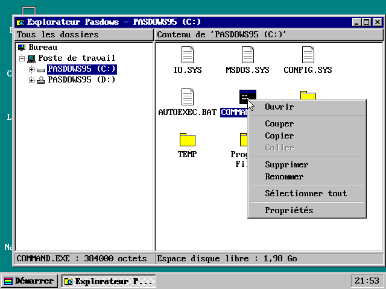<br><i>Clic droit sur un fichier : Couper, Copier, Coller, Sélectionner tout, Propriétés</i></td><td align="center">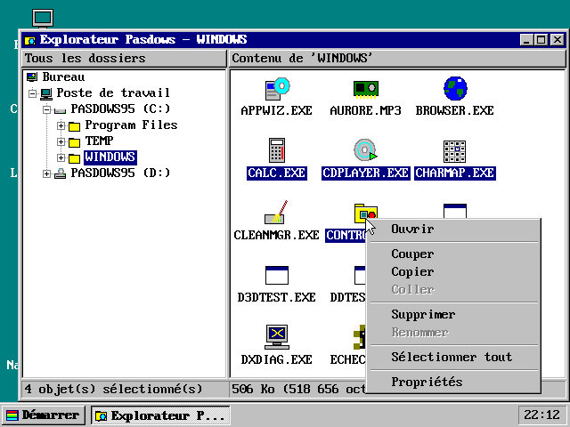<br><i>Maj+clic et Ctrl+clic : 4 éléments choisis</i></td></tr>
	<tr><td align="center">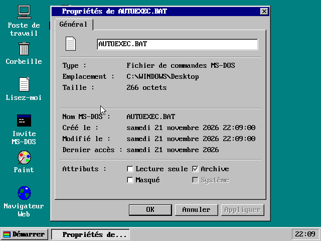<br><i>Propriétés d'un fichier (copié sur le bureau)</i></td><td align="center">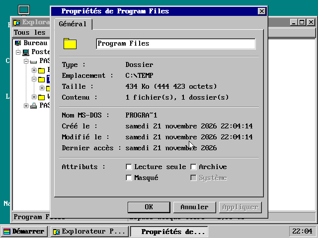<br><i>Propriétés d'un dossier copié avec son contenu</i></td></tr>
	<tr><td align="center">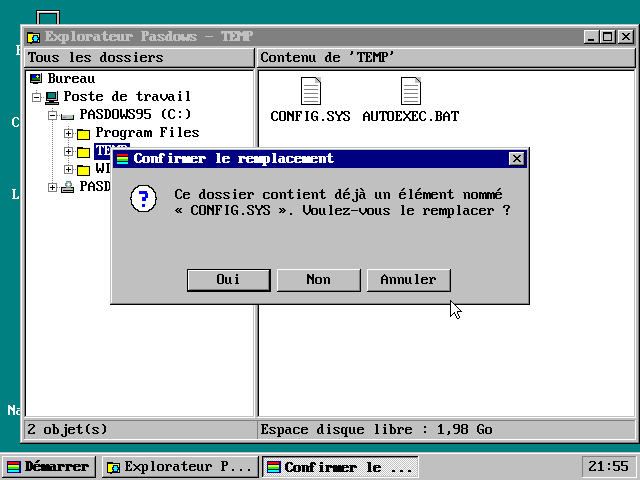<br><i>Coller sur un élément existant</i></td><td align="center">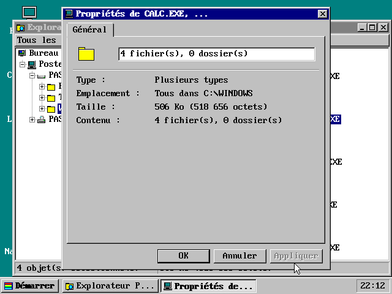<br><i>Propriétés de plusieurs éléments</i></td></tr>
</table>

Dans le <b>Poste de travail</b> comme dans l'Explorateur, un <b>clic droit sur un lecteur</b> ouvre son menu contextuel (<i>Ouvrir</i>, <i>Formater...</i>, <i>Propriétés</i>) ; la barre d'état donne l'espace libre et la capacité du lecteur sélectionné. La boîte <b>Propriétés</b> reprend celle de Windows 95 :

<ul>
	<li>onglet <i>Général</i> : le <b>nom du volume</b> (modifiable), le type et le système de fichiers (« Disque local (FAT32) », « Disque CD-ROM (CDFS) »...), l'<b>espace utilisé</b>, l'<b>espace libre</b> et la <b>capacité</b> en octets (avec séparateur des milliers, au-delà de 2 Go) et en Ko, Mo ou Go, et le <b>camembert en relief</b> (bleu : utilisé, magenta : libre) ;</li>
	<li>onglet <i>Outils</i> : <b>Vérifier maintenant...</b> ouvre <b>ScanDisk</b> (lecteurs FAT12, FAT16 et FAT32) ; test <i>Standard</i> (fichiers et dossiers) ou <i>Minutieux</i> (lit aussi toutes les données utilisées), case <i>Corriger automatiquement les erreurs</i>. ScanDisk suit les chaînes de clusters de chaque fichier et dossier (clusters hors du volume, chaînes croisées, chaînes invalides, tailles incorrectes), cherche les <b>fragments perdus</b> (clusters occupés qu'aucun fichier n'utilise), compare les copies de la FAT et, en mode minutieux, relit les données ; la correction libère les fragments perdus, raccourcit les chaînes trop longues et recopie la FAT. Le travail se fait par étapes avec une barre de progression (la fenêtre reste utilisable, <i>Annuler</i> l'arrête) et se termine par les <b>Résultats de ScanDisk</b> (espace total, fichiers cachés, dossiers, fichiers, secteurs défectueux, espace disponible, unités d'allocation) ; l'onglet indique ensuite la date de la dernière vérification. Les boutons de sauvegarde et de défragmentation restent grisés ;</li>
	<li>onglet <i>Partage</i> ;</li>
	<li>boutons <i>OK</i>, <i>Annuler</i> et <i>Appliquer</i> (actif dès que le nom change).</li>
</ul>

Le nouveau nom est écrit sur le disque, comme le fait la commande LABEL et l'API <b>SetVolumeLabelA</b> (ajoutée au noyau) : en FAT12, FAT16 et FAT32 dans le secteur d'amorce (et sa copie en FAT32) et dans l'entrée d'étiquette de la racine, en majuscules ; en NTFS dans l'attribut $VOLUME_NAME de $Volume, casse conservée ; en HPFS dans le secteur d'amorce. Le nom du CD-ROM reste en lecture seule.

<table>
	<tr><td align="center">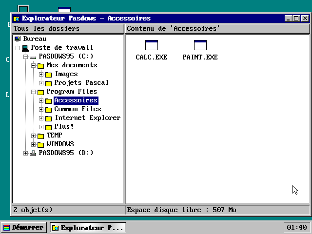<br><i>Explorateur Pasdows : arbre des dossiers et contenu de C:\Program Files\Accessoires</i></td><td align="center">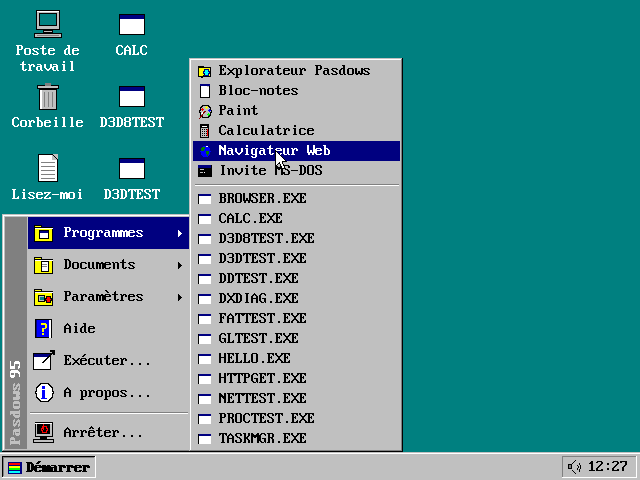<br><i>Démarrer, Programmes : Explorateur Pasdows, Calculatrice et Navigateur Web</i></td></tr>
	<tr><td align="center">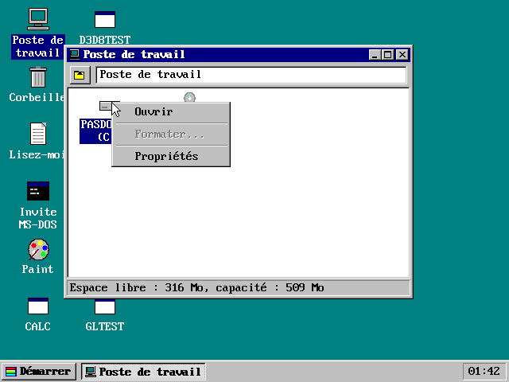<br><i>Clic droit sur un lecteur du Poste de travail</i></td><td align="center"><br><i>Propriétés de (C:) : espace utilisé, libre et camembert</i></td></tr>
	<tr><td align="center">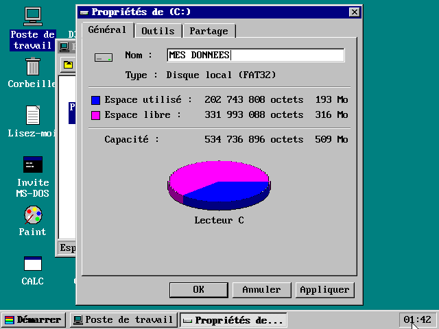<br><i>Nouveau nom du volume (Appliquer devient actif)</i></td><td align="center">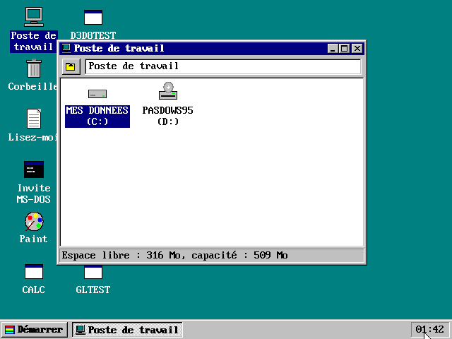<br><i>Le Poste de travail affiche aussitôt le nouveau nom</i></td></tr>
	<tr><td align="center">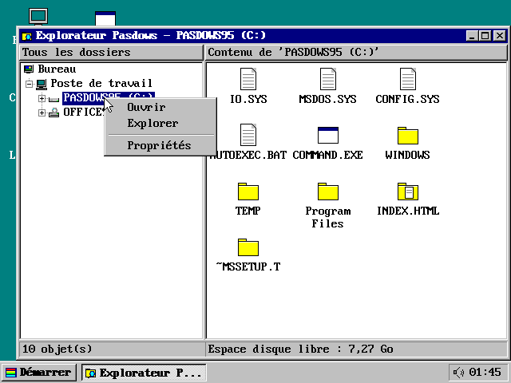<br><i>Clic droit sur un lecteur de l'arbre : Ouvrir, Explorer, Propriétés</i></td><td align="center">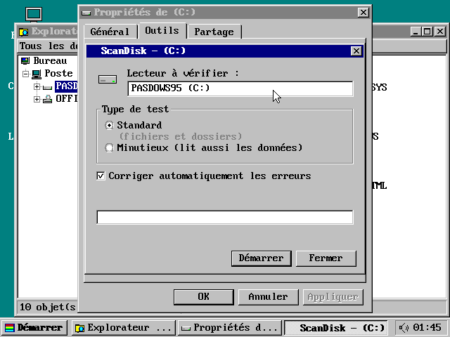<br><i>Outils, Vérifier maintenant... : ScanDisk</i></td></tr>
</table>

<h2 id="aide">Aide de Windows</h2>

<b>APPS/WINHLP32.PAS</b> (WINHLP32.EXE) lit et affiche les fichiers d'aide <b>.HLP</b> de Windows 3.1 et 4.0 : ceux des accessoires de Windows 95, d'Office 97 (Word, Excel, ODBC, Outlook...) et des autres programmes. Elle s'ouvre par un double-clic sur un fichier .HLP dans l'Explorateur, par <i>Exécuter</i> (« WINHLP32 fichier.hlp ») et par l'API <b>WinHelp</b> des programmes : HELP_CONTEXT (numéro de rubrique), HELP_KEY et HELP_PARTIALKEY (mot-clé), HELP_CONTEXTPOPUP, HELP_CONTEXTMENU et HELP_WM_HELP (aide « Qu'est-ce que c'est ? » : la fenêtre contextuelle seule), HELP_FINDER et HELP_CONTENTS, HELP_QUIT. Un fichier sans chemin est cherché dans le dossier du fichier courant, C:\WINDOWS\HELP, C:\WINDOWS, C:\WINDOWS\SYSTEM et dans la clé <i>HKLM\Software\Microsoft\Windows\Help</i>, où les programmes inscrivent le dossier de leurs fichiers d'aide.

Le format WinHelp est décodé entièrement en Pascal (la visionneuse de DEVENV.PAS, dans DEV-COOLS, qui lit le format de HC.PAS, en a donné l'organisation) :

<ul>
	<li>conteneur : en-tête, répertoire des fichiers internes en arbre B, |SYSTEM (titre, rubrique de sommaire, compression) ;</li>
	<li>|TOPIC : blocs de 4 Ko compressés en <b>LZ77</b>, gardés décompressés dans un petit cache ; enregistrements TOPICLINK (en-têtes de rubrique, paragraphes, tableaux) suivis par leurs pointeurs ; textes compressés par <b>phrases</b> (|Phrases de WinHelp 3.1, ou compression de Hall |PhrIndex et |PhrImage de WinHelp 4) ;</li>
	<li>mise en forme : polices de |FONT (taille, gras, souligné, couleur), retraits, espacements, tabulations, alignement, <b>tableaux</b>, <b>zone non défilante</b> (titre de la rubrique au-dessus d'un trait) ; images <b>|bmN</b> (SHG et MRB : DIB et DDB de 1 à 24 bits, compressions RLE et LZ77) avec leurs zones sensibles ;</li>
	<li>liens : sauts (verts soulignés) et <b>fenêtres contextuelles</b> (pointillés, fenêtre jaune pâle) par |CONTEXT (valeur de hachage des noms de contexte), liens vers d'autres fichiers d'aide, macros JumpId, PopupId, JumpContext, JumpKeyword, KLink et ALink (mots-clés), Contents, Finder, Back, Next, Prev, ExecFile... ;</li>
	<li><b>Rubriques d'aide</b> : onglets <i>Sommaire</i> (fichier .CNT avec ses livres ouverts ou fermés et :Include), <i>Index</i> (|KWBTREE et |KWDATA : l'entrée suit les lettres tapées ; plusieurs rubriques : liste <i>Rubriques trouvées</i>) et <i>Rechercher</i> (le texte cherché dans toutes les rubriques) ;</li>
	<li>boutons <i>Rubriques d'aide</i>, <i>Précédent</i> (historique, même entre fichiers), <b>&lt;&lt;</b> et <b>&gt;&gt;</b> (séquences de lecture) ; menus <i>Fichier</i> (Ouvrir), <i>Édition</i> (Copier le texte de la rubrique), <i>Options</i> (taille du texte) et <i>?</i>.</li>
</ul>

Les textes ANSI sont convertis pour la police de l'écran. Le format de Windows 3.0 (rare) n'est pas pris en charge. Avant d'écrire la visionneuse, un prototype a décodé sans erreur les 95 fichiers d'aide disponibles (Office 97, accessoires de Windows 95, jeux).

<table>
	<tr><td align="center">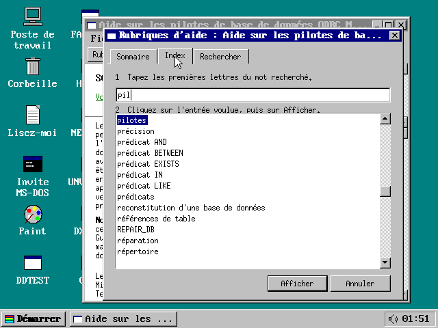<br><i>Rubriques d'aide : l'Index suit les lettres tapées</i></td><td align="center">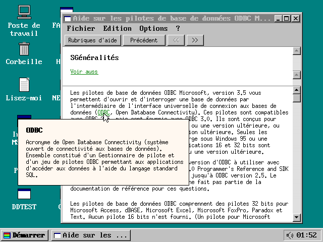<br><i>Rubrique avec zone non défilante et fenêtre contextuelle</i></td></tr>
	<tr><td align="center">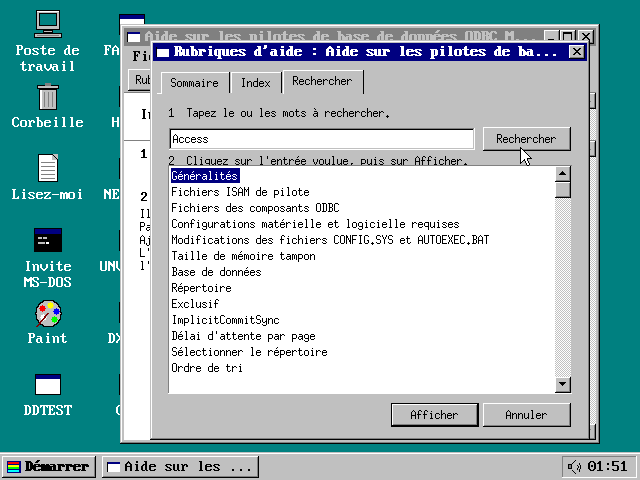<br><i>Onglet Rechercher : le mot dans toutes les rubriques</i></td><td align="center">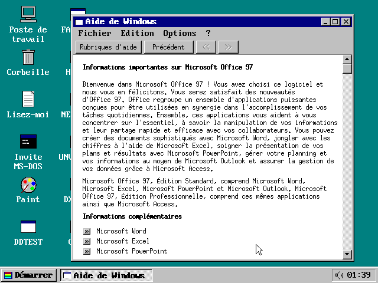<br><i>Aide d'Office 97 : images et liens vers d'autres fichiers d'aide</i></td></tr>
</table>

<h2 id="appwiz">Ajout/Suppression de programmes</h2>

<b>APPS/APPWIZ.PAS</b> (APPWIZ.EXE) reprend la page <i>Installation/Désinstallation</i> de l'applet <i>Ajout/Suppression de programmes</i> de Windows 95. Elle s'ouvre par <b>Démarrer, Paramètres, Ajout/Suppression de programmes...</b> :

<ul>
	<li><b>Installer...</b> cherche un programme d'installation (SETUP.EXE, puis INSTALL.EXE) sur la disquette (A:) puis sur les CD-ROM (D: à H:), demande confirmation et le lance ;</li>
	<li>la liste montre les logiciels que Pasdows sait supprimer : les sous-clés de <i>HKEY_LOCAL_MACHINE\Software\Microsoft\Windows\CurrentVersion\Uninstall</i> qui ont un nom (<i>DisplayName</i>) et une commande de désinstallation (<i>UninstallString</i>), écrites par les programmes d'installation ;</li>
	<li><b>Ajouter/Supprimer...</b> (ou un double-clic) lance la commande du logiciel choisi. Le bouton est grisé tant qu'aucun logiciel n'est choisi.</li>
</ul>

La liste est relue toutes les deux secondes : un logiciel installé ou supprimé y apparaît ou en disparaît dès que son programme d'installation a mis le registre à jour. Les noms ANSI du registre sont convertis pour la police de l'écran. L'interface suit la variable <b>LANGUAGE</b> (FR, EN, GR, IT, SP). La désinstallation de Microsoft Office 97 a été essayée de bout en bout, voir la section <a href="#office97">Office 97</a>.

<table>
	<tr><td align="center">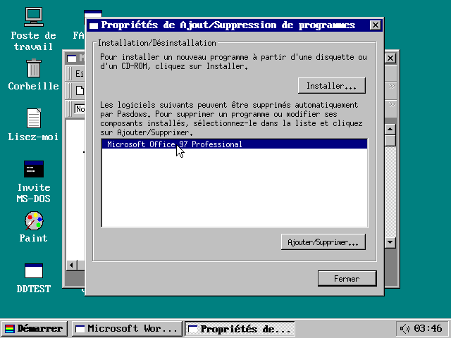<br><i>Ajout/Suppression de programmes : Office 97 dans la liste</i></td><td align="center">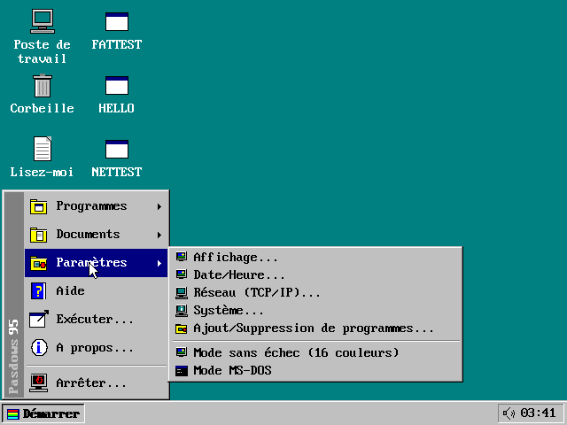<br><i>Démarrer, Paramètres</i></td></tr>
</table>

<h2 id="accessoires">Menu Démarrer : Accessoires</h2>

Comme dans Windows 95, <i>Démarrer, Programmes</i> commence par le groupe <b>Accessoires</b> et le dossier <b>Developer Kit</b> (voir la section <a href="#devkit">Developer Kit</a>), suivis de l'Explorateur Pasdows et de l'Invite DOS ; viennent ensuite les autres programmes du dossier du système. Les programmes de Pasdows déjà présents dans les menus (Calculatrice, Navigateur Web, Lecteur MP3, Lecteur CD, Échecs, FreeCell, Solitaire, outils système, Table de caractères, Carnet d'adresses, Imaging, Rechercher, Aide, Ajout/Suppression de programmes, Gestionnaire des tâches, programmes d'essai) n'y sont plus répétés, ni sur le bureau.

<ul>
	<li><b>Accessoires</b> : les groupes <b>Communications</b>, <b>Jeux</b>, <b>Multimédia</b>, <b>Outils Internet</b> et <b>Outils système</b>, puis Bloc-notes, Calculatrice, <b>Carnet d'adresses</b>, <b>Imaging</b>, Paint et <b>Table de caractères</b> ;</li>
	<li><b>Communications</b> : <b>Connexion Bureau à distance</b> (voir la section <a href="#rdp">Connexion Bureau à distance</a>) ;</li>
	<li><b>Jeux</b> : <b>Échecs</b>, <b>FreeCell</b> et <b>Solitaire</b> ;</li>
	<li><b>Multimédia</b> : <b>Lecteur CD</b>, <b>Lecteur MP3</b>, Contrôle du volume, puis les programmes DirectX installés : Outil de diagnostic DirectX (DXDIAG), DDTEST, D3DTEST, D3D8TEST et GLTEST ;</li>
	<li><b>Outils Internet</b> : Navigateur Web, <b>Client FTP</b> (voir la section <a href="#ftp">Client FTP</a>), <b>Client SSH</b> (voir la section <a href="#ssh">Client SSH</a>), <b>Client GitHub</b> (voir la section <a href="#github">Client GitHub</a>), <b>Client SVN</b> (voir la section <a href="#svn">Client SVN</a>), puis NETTEST et HTTPGET s'ils sont installés ;</li>
	<li><b>Outils système</b> : <b>Défragmenteur de disque</b>, Gestionnaire des tâches, <b>Informations système</b>, <b>Nettoyage de disque</b>, ScanDisk (vérification du disque C:), <b>Tâches planifiées</b>, puis FATTEST, PROCTEST et HELLO s'ils sont installés.</li>
</ul>

<b>Raccourcis et menu contextuel du bureau.</b> Quand Pasdows est installé sur le disque dur, les icônes Lisez-moi, Invite DOS, Paint, Navigateur Web et les programmes du dossier du système sont de vrais <b>raccourcis Windows</b> (fichiers <b>.LNK</b> au format MS-SHLLINK : en-tête et LinkInfo avec le chemin de la cible) du dossier <b>C:\WINDOWS\Desktop</b>, créés une seule fois au démarrage (la liste est dans C:\WINDOWS\DESKLNK.INI : un raccourci supprimé n'est pas recréé) et marqués de la petite flèche. Toutes les commandes du menu contextuel d'une icône fonctionnent donc : <b>Ouvrir</b> (la cible du raccourci), <b>Couper</b>, <b>Copier</b>, <b>Coller</b> (sur le bureau, ou dans un dossier), <b>Supprimer</b> (avec confirmation), <b>Renommer</b>, <b>Sélectionner tout</b> (toutes les icônes du bureau ; Couper, Copier, Supprimer et Propriétés portent alors sur toute la sélection) et <b>Propriétés</b> (type <i>Raccourci</i> et sa <b>Cible</b>, ou plusieurs éléments). Le fond du bureau donne aussi <b>Coller le raccourci</b> (« Raccourci vers ... » pour chaque élément copié ; un raccourci copié donne un raccourci vers la même cible), et le clavier Entrée, F2, Suppr, Ctrl+A, Ctrl+C, Ctrl+X et Ctrl+V. La <b>Corbeille</b> a son menu (Ouvrir, Vider la Corbeille, Propriétés) et le Poste de travail le sien. Démarré depuis le CD-ROM (bureau en lecture seule), les icônes fixes se copient et montrent leurs propriétés.

<table>
	<tr><td align="center">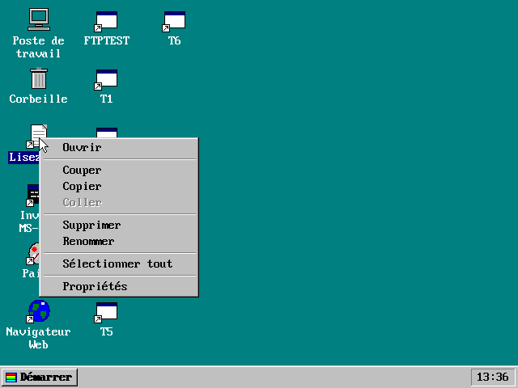<br><i>Menu contextuel d'un raccourci du bureau</i></td><td align="center">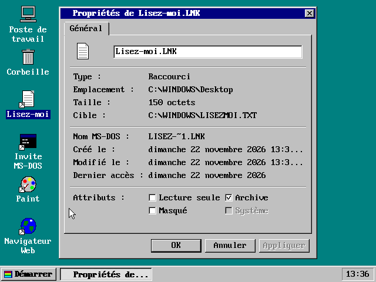<br><i>Propriétés d'un raccourci : sa cible</i></td></tr>
</table>

Le bureau a une icône <b>Navigateur Web</b> (à côté de Paint). Le bureau est aussi un vrai dossier, <b>C:\WINDOWS\Desktop</b> : clic droit, <b>Nouveau</b> crée un <i>Dossier</i>, un <i>Document texte</i>, une <i>Image bitmap</i> ou un <i>Document HTML</i>, puis propose aussitôt de le renommer (le nom est choisi : la frappe le remplace) ; ses dossiers et documents s'affichent sur le bureau avec leur icône et s'ouvrent d'un double clic (dossier : Explorateur ; texte : Bloc-notes ; .BMP : Paint, même vide ; .HTM : Navigateur Web ; images : Imaging) ; leur menu contextuel donne Ouvrir, <b>Supprimer</b> (avec confirmation ; un dossier avec son contenu), <b>Renommer</b> et Propriétés ; F2 renomme et Suppr supprime. Dans l'Explorateur, le clic droit sur le fond d'un dossier d'un disque donne aussi <b>Nouveau</b> et Propriétés, et sur un élément Ouvrir, Supprimer et Renommer. Le menu Démarrer a aussi <b>Rechercher</b>, avec <i>Fichiers ou dossiers...</i> et <i>Ordinateur...</i> (voir <a href="#rechercher">Rechercher</a>). Chaque programme a son icône : cartes à jouer pour FreeCell, bloc-notes à spirale, disque compact, carnet, image, loupe, grille de caractères... Un sous-menu qui n'a plus de place à droite de l'écran s'ouvre à gauche de son menu, comme sous Windows. <i>Exécuter</i> reconnaît aussi « notepad » (et « notepad fichier »).

Dans les fenêtres des programmes (et les boîtes de dialogue), <b>Tab</b> et <b>Maj+Tab</b> passent d'un contrôle à l'autre (ceux qui ont WS_TABSTOP, dans l'ordre de création) ; <b>ShellExecute</b> ouvre un dossier dans l'Explorateur et un document selon son extension (Aide pour .HLP, Lecteur MP3, Imaging pour les images, sinon le Bloc-notes), comme un double clic dans l'Explorateur.

<table>
	<tr><td align="center">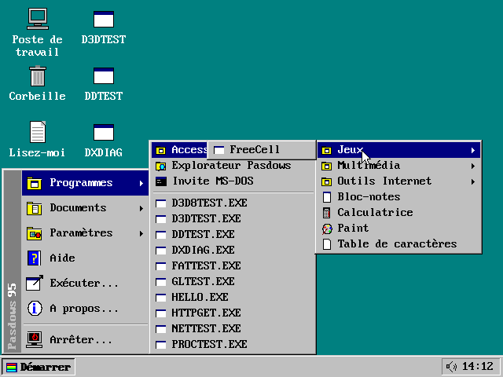<br><i>Démarrer, Programmes, Accessoires, Jeux, FreeCell</i></td><td align="center">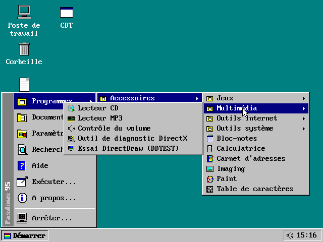<br><i>Accessoires, Multimédia : Lecteur CD, Lecteur MP3, DirectX</i></td></tr>
	<tr><td align="center">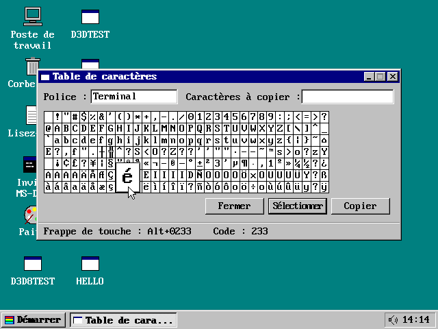<br><i>Table de caractères : caractère agrandi, frappe Alt+0233</i></td><td align="center">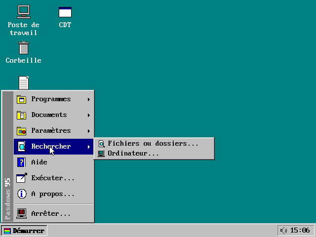<br><i>Démarrer, Rechercher</i></td></tr>
	<tr><td align="center">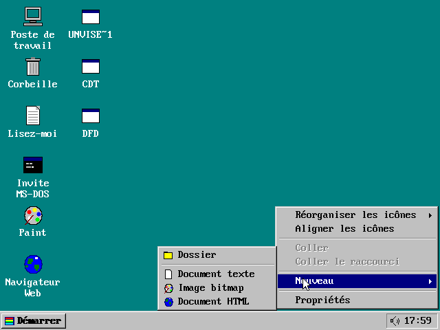<br><i>Bureau : clic droit, Nouveau</i></td><td align="center">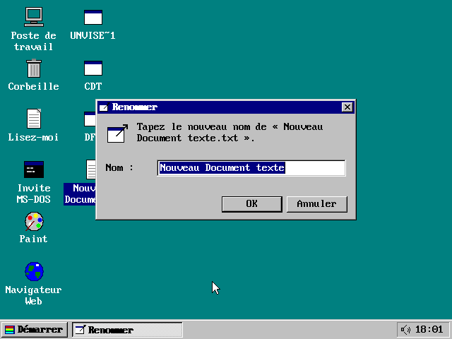<br><i>Nouveau document texte : Renommer</i></td></tr>
	<tr><td align="center">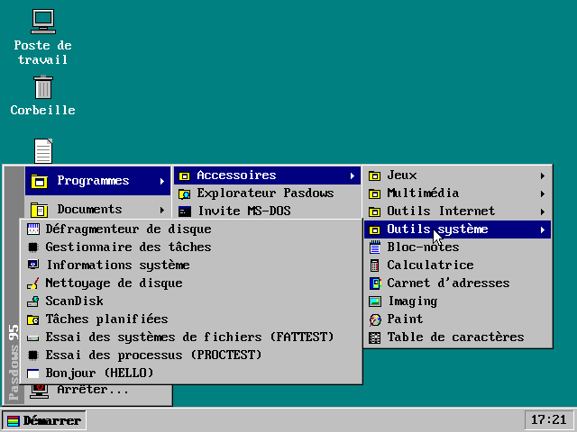<br><i>Accessoires, Outils système</i></td><td align="center">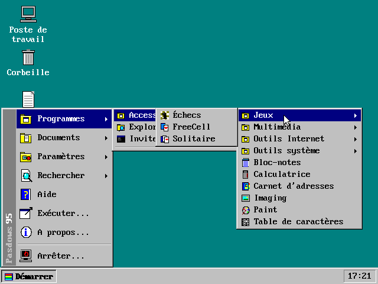<br><i>Accessoires, Jeux : Échecs, FreeCell, Solitaire ; bureau : Navigateur Web</i></td></tr>
</table>

<h2 id="devkit">Developer Kit : Pascal Developer et Pasdows Debugger</h2>

<i>Démarrer, Programmes, <b>Developer Kit</b></i> contient deux programmes du dépôt <a href="https://github.com/gladir/OS2-0">OS2-0</a>, migrés des API d'OS/2 (Presentation Manager, DOSCALLS) aux API de Windows (USER32, GDI32, KERNEL32) et compilés par <b>WPC -CW32</b> (sans unité supplémentaire), avec toutes leurs fonctions :

<ul>
	<li><b>Pascal Developer</b> (<b>APPS/PASDEV.PAS</b>, PASDEV.EXE) : environnement de développement Pascal à fenêtres multiples (MDI) avec coloration syntaxique, dans l'esprit de Borland Pascal. Menus Fichier, Édition, Recherche, Exécuter, Compiler, Fenêtre et Aide ; barre d'état (ligne et colonne, Insertion ou Refrappe, Modifié, destination) ; menu contextuel (bouton droit ou Maj+F10) ; fenêtres d'édition dessinées dans la zone de travail (déplacement, agrandissement, barres de défilement, coin de redimensionnement, Mosaïque, Cascade, liste des fenêtres) ; presse-papiers de Windows (CF_TEXT) ; boîtes Ouvrir, Enregistrer sous, Rechercher, Aller à la ligne, Paramètres, Information et À propos (Blaise Pascal écrivant « Win95 »). Le compilateur par défaut est <b>WPC.EXE</b> (celui de Pasdows, compilé par lui-même), au lieu d'OS2PC : il est lancé par <b>CreateProcessA</b>, sa sortie standard redirigée dans un fichier (STARTF_USESTDHANDLES) ; ses erreurs et avertissements remplissent la fenêtre <b>Messages</b> (double clic ou Entrée : la ligne en cause). Pendant la compilation, une boîte montre l'étape, la ligne et une barre de progression, que WPC écrit avec l'option <b>-PRG</b> dans une mémoire partagée nommée <i>WPC.PRG</i> (CreateFileMappingA / OpenFileMappingA, MapViewOfFile) ; Annuler arrête le compilateur (TerminateProcess). Destinations : <b>Windows (fenêtres)</b> (WPC -WG) ou <b>Console Win32</b> (WPC -WC). Exécuter (Ctrl+F9) compile si besoin puis lance le programme ; un programme console (ou sans fenêtre) s'exécute dans l'Invite DOS (COMMAND.EXE /C programme /C PAUSE).</li>
	<li><b>Pasdows Debugger</b> (<b>APPS/PASDBG.PAS</b>, PASDBG.EXE), l'<i>OS2-Zero Debugger</i> d'OS2-0 : fenêtre CPU dans l'esprit de Turbo Debugger, avec quatre volets : <b>Code</b> (désassembleur x86 32 bits coloré, symboles, ligne d'EIP, points d'arrêt, saut conditionnel effectué ou non), <b>Registres</b> (valeurs changées en rouge, modification, drapeaux), <b>Mémoire</b> (octets changés en rouge) et <b>Pile</b> (adresses de retour nommées). Barre d'outils, menus Fichier, Exécution, Points d'arrêt, Données et Aide, touches de Turbo Debugger : F9 exécuter, F7 pas à pas, F8 pas (sauter les appels), F4 jusqu'au curseur, Alt+F8 jusqu'au retour, F12 pause, F2 point d'arrêt, Ctrl+F2 redémarrer, Alt+F2 terminer, Ctrl+G aller à l'adresse (hexadécimal, registre, symbole, + et -), Ctrl+E origine. Le programme est lancé par <b>CreateProcessA</b> (DEBUG_ONLY_THIS_PROCESS) et suivi par l'API de débogage de Windows : <b>WaitForDebugEvent</b>, <b>ContinueDebugEvent</b> (DBG_CONTINUE, ou DBG_EXCEPTION_NOT_HANDLED pour qu'une exception arrête le programme), <b>GetThreadContext</b> / <b>SetThreadContext</b> (pas à pas par le drapeau TF), <b>ReadProcessMemory</b> / <b>WriteProcessMemory</b> (points d'arrêt INT 3) et <b>DebugBreakProcess</b> (pause). Les symboles viennent des importations (<i>KERNEL32.GetStdHandle</i>...), des exportations des DLL et de la carte <b>.MAP</b> de WPC (<i>WPC -GD PROG.PAS</i>). Les fonctions de KERNEL32, USER32, GDI32... étant dans le noyau de Pasdows (code partagé), F7 sur leur appel passe par-dessus, et on n'y pose pas de point d'arrêt.</li>
</ul>

<b>API de débogage dans VMM32.</b> Le noyau implémente pour cela l'API Win32 de débogage : CreateProcessA avec DEBUG_PROCESS / DEBUG_ONLY_THIS_PROCESS (le programme démarre arrêté ; CREATE_PROCESS_DEBUG_EVENT, puis un premier arrêt au point d'entrée), EXCEPTION_DEBUG_EVENT pour INT 3 (EXCEPTION_BREAKPOINT), le pas à pas (EXCEPTION_SINGLE_STEP), la division par zéro, l'instruction invalide, le défaut de page (EXCEPTION_ACCESS_VIOLATION avec l'adresse fautive)..., EXIT_PROCESS_DEBUG_EVENT avec le code de sortie, IsDebuggerPresent, FlushInstructionCache, et la redirection des sorties standard d'un programme lancé (STARTF_USESTDHANDLES). Le programme débogué reste arrêté dans le noyau jusqu'à ContinueDebugEvent ; le pas à pas ne s'arrête jamais dans le code du noyau (une API appelée en pas à pas s'exécute jusqu'au retour au programme), et WriteProcessMemory refuse d'écrire dans le code du noyau.

<table>
	<tr><td align="center">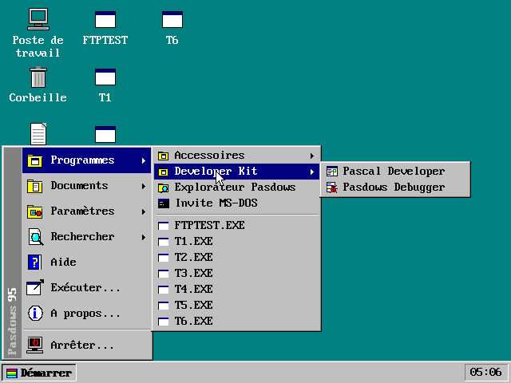<br><i>Démarrer, Programmes, Developer Kit</i></td><td align="center">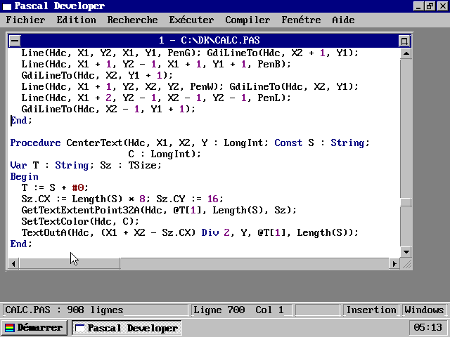<br><i>Pascal Developer : CALC.PAS, coloration syntaxique</i></td></tr>
	<tr><td align="center">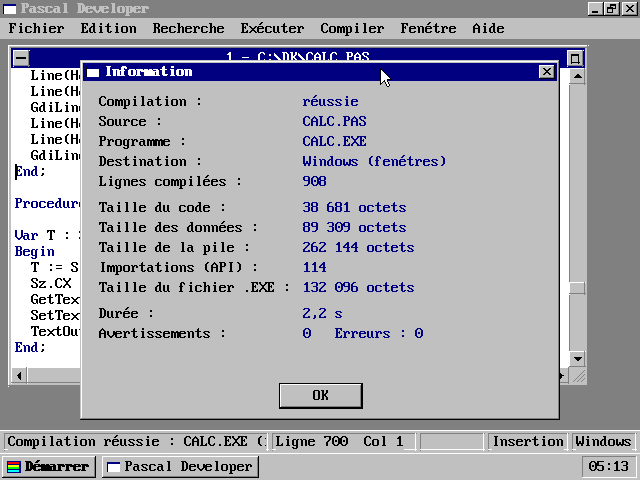<br><i>Compilé par WPC.EXE dans Pasdows : Compiler, Information</i></td><td align="center">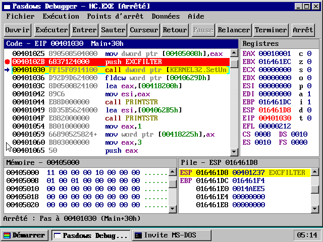<br><i>Pasdows Debugger : point d'arrêt, pas à pas, appel de KERNEL32</i></td></tr>
</table>

<h2 id="rechercher">Rechercher</h2>

<b>APPS/FINDFILE.PAS</b> (FINDFILE.EXE, <i>Démarrer, Rechercher, Fichiers ou dossiers...</i>) reprend la boîte <i>Rechercher : Tous les fichiers</i> de Windows 95 :
<ul>
	<li><b>Nommé</b> : un ou plusieurs modèles (<b>*</b> et <b>?</b>) séparés par ; ou , ; sans joker, le nom doit contenir le texte (« note » trouve NOTE.TXT et BLOCNOTE.EXE) ;</li>
	<li><b>Contenant le texte</b> : le contenu des fichiers est lu par morceaux (sans tenir compte de la casse, sauf <i>Options, Respecter la casse</i>) ;</li>
	<li><b>Rechercher dans</b> : un ou plusieurs dossiers séparés par ; ; <i>Parcourir...</i> propose les lecteurs, C:\WINDOWS et « tous les disques durs » ; <b>Inclure les sous-dossiers</b> ;</li>
	<li>la recherche avance par petits morceaux (la fenêtre reste utilisable, la barre d'état montre le dossier parcouru), <b>Arrêter</b> ou Échap l'interrompent, <b>Nouvelle recherche</b> vide les champs ;</li>
	<li>résultats : Nom, Dans le dossier, Taille, Type, Modifié, triés en cliquant sur l'en-tête ; double clic ou Entrée ouvrent l'élément (ShellExecute), le clic droit donne Ouvrir, Ouvrir le dossier contenant et Copier le chemin ; <i>Fichier, Enregistrer les résultats</i> écrit C:\RECHERCH.TXT.</li>
</ul>
<i>Démarrer, Rechercher, Ordinateur...</i> lance <b>FINDFILE /C</b> : le nom est résolu par <b>gethostbyname</b> (DNS de la pile TCP/IP de Pasdows) et le poste lui-même par GetComputerName ; la liste donne le nom, l'emplacement et l'adresse IP.

<h2 id="carnet">Carnet d'adresses</h2>

<b>APPS/WAB.PAS</b> (WAB.EXE, <i>Démarrer, Programmes, Accessoires, Carnet d'adresses</i>) : liste des contacts (Nom, Adresse de messagerie, téléphones au bureau et au domicile) triée par nom, prénom ou adresse (<i>Affichage</i>) ; la zone « Tapez le nom ou sélectionnez-le dans la liste » choisit le premier contact qui commence ainsi. <b>Nouveau contact</b> (Ctrl+N), <b>Propriétés</b> (double clic ou Entrée) et <b>Supprimer</b> (Suppr) ; la fiche a le prénom, le nom, l'adresse de messagerie, les téléphones (domicile, bureau, mobile), l'adresse, la ville, le code postal, le pays, la société, la fonction et des remarques. <i>Fichier, Importer</i> et <i>Exporter</i> lisent et écrivent un fichier texte <b>CSV</b> (entête, guillemets ; virgule ou point-virgule à l'importation, entêtes français ou anglais reconnus) ; <i>Edition, Copier</i> met la fiche en texte dans le presse-papiers. Le carnet est gardé dans <b>CARNET.WAB</b> (un contact par ligne, champs séparés par des tabulations) dans le dossier du programme.

<h2 id="imaging">Imaging</h2>

<b>APPS/IMAGING.PAS</b> (IMAGING.EXE, <i>Démarrer, Programmes, Accessoires, Imaging</i>, ou double clic sur une image dans l'Explorateur) est la visionneuse d'images de Windows 95 :
<ul>
	<li>formats : <b>TIFF</b> (non compressé, PackBits, LZW avec ou sans prédicteur ; 1, 4 et 8 bits gris ou palette, 24 et 32 bits ; <b>plusieurs pages</b>), BMP, GIF, PNG et JPEG (décodeurs du Navigateur Web) ;</li>
	<li>barre d'outils : Ouvrir, Zoom +, Zoom -, Ajuster, 100 %, Pivoter G, Pivoter D, &lt; Page, Page &gt; ; menus <i>Zoom</i> (avant, arrière, ajuster à la fenêtre ou à la largeur, taille réelle, 25 à 400 %), <i>Image</i> (pivoter à gauche, à droite, de 180 degrés, miroir) et <i>Page</i> (première, précédente, suivante, dernière) ;</li>
	<li>barres de défilement et flèches quand l'image dépasse la fenêtre ; barre d'état : page, zoom, dimensions et format ;</li>
	<li><i>Fichier, Enregistrer sous</i> : BMP 24 bits ; <i>Propriétés</i> : format, taille du fichier, dimensions, nombre de pages.</li>
</ul>

<h2 id="lecteurcd">Lecteur CD</h2>

<b>APPS/CDPLAYER.PAS</b> (CDPLAYER.EXE, <i>Démarrer, Programmes, Accessoires, Multimédia, Lecteur CD</i>) : afficheur à sept segments (temps écoulé ou restant de la piste ou du disque, menu <i>Affichage</i>), boutons Lecture, Pause, Arrêt, piste précédente, retour et avance rapides, piste suivante et Éjecter, champs Artiste, Titre et Piste (un clic sur Piste donne la liste des pistes), <i>Options</i> : ordre aléatoire, lecture continue et Intro (10 secondes de chaque piste). Il passe par <b>MCI</b> : le noyau a maintenant le périphérique <b>cdaudio</b> de WINMM (<b>mciSendString</b> : open, close, play from/to, stop, pause, resume, seek, set time format ms/msf/tmsf, set door open/closed, status mode, media present, number of tracks, current track, length, position, type track ; <b>mciSendCommand</b> : MCI_OPEN, PLAY, SEEK, STOP, PAUSE, RESUME, SET, STATUS et MM_MCINOTIFY). La table des matières est lue par la commande ATAPI READ TOC ; la musique est lue <i>numériquement</i> (READ CD, secteurs CD-DA de 2352 octets) et jouée par la carte son (Sound Blaster, AC'97, HD Audio ou ES1370), comme le « CD digital audio » de Windows. QEMU n'émule pas les CD audio (seulement la piste de données) : un CD de données montre « Disque de données ».

<table>
	<tr><td align="center">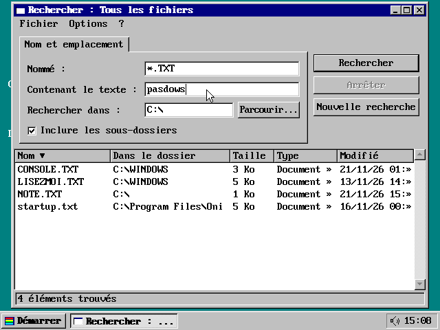<br><i>Rechercher : *.TXT contenant « pasdows »</i></td><td align="center">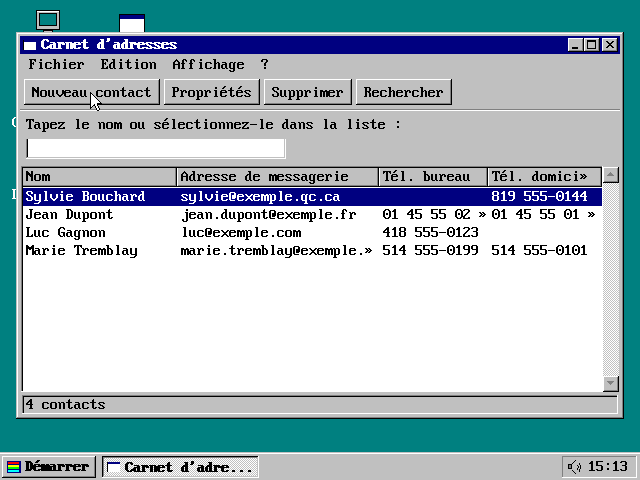<br><i>Carnet d'adresses</i></td></tr>
	<tr><td align="center">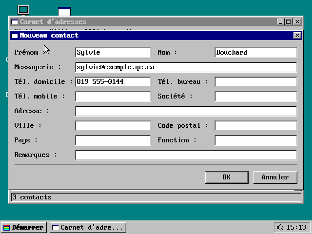<br><i>Carnet d'adresses : nouveau contact (Tab d'un champ à l'autre)</i></td><td align="center">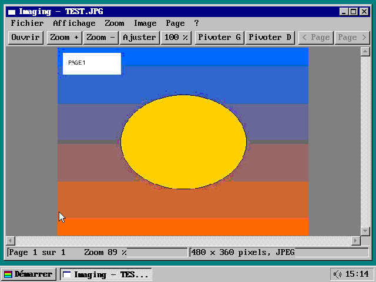<br><i>Imaging : image JPEG ajustée à la fenêtre</i></td></tr>
	<tr><td align="center">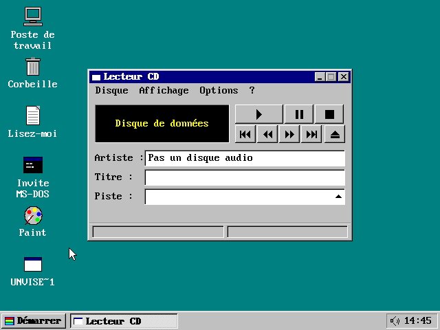<br><i>Lecteur CD (ici avec le CD de données de Pasdows)</i></td><td></td></tr>
</table>

<h2 id="charmap">Table de caractères</h2>

<b>APPS/CHARMAP.PAS</b> (CHARMAP.EXE, <i>Démarrer, Programmes, Accessoires, Table de caractères</i>) reprend la Table de caractères de Windows 95 : la grille montre les 224 caractères affichables du jeu de Windows (codes 32 à 255, page de codes ANSI) en 32 colonnes. Un clic choisit un caractère et l'agrandit tant que le bouton reste enfoncé ; les flèches déplacent le choix. Un double clic, <b>Entrée</b> ou <b>Sélectionner</b> l'ajoutent à la zone <i>Caractères à copier</i>, que <b>Copier</b> met dans le presse-papiers (à coller dans le Bloc-notes par Ctrl+V ou Maj+Inser). La barre d'état donne la frappe qui produit le caractère : la touche, ou Alt et le code sur le pavé numérique (Alt+0233 pour é). Sous Pasdows, qui affiche les programmes de WPC avec la police de l'écran, les caractères sont convertis pour l'affichage et le presse-papiers ; sous Windows, ils sont passés tels quels.

<h2 id="echecs">Échecs</h2>

<b>APPS/ECHECS.PAS</b> (ECHECS.EXE, <i>Démarrer, Programmes, Accessoires, Jeux, Échecs</i>) est le jeu d'échecs du Presentation Manager d'<a href="https://github.com/gladir/OS2-0">OS2-0</a> porté pour les API de Windows. Le moteur est inchangé : toutes les règles (roque, prise en passant, promotion, échec et mat, pat, 50 coups, matériel insuffisant), recherche alpha-bêta à profondeur 1, 2 ou 3 selon le niveau, suivie d'une recherche des prises ; l'ordinateur joue les noirs, les blancs (<i>Jouer avec les noirs</i>) ou personne (<i>Deux joueurs</i>) ; notation française des coups (Cg1-f3, O-O, +, #), annulation (Ctrl+Z), F2. Le portage remplace WinCreateStdWindow, les menus de PM, GpiBox, GpiLine, WinDrawText et WinFillRect par CreateWindowEx, CreateMenu, RoundRect, LineTo, TextOut et FillRect ; les coordonnées de PM (origine en bas à gauche) sont retournées et le dessin se fait dans une image en mémoire.

<h2 id="solitaire">Solitaire</h2>

<b>APPS/SOL.PAS</b> (SOL.EXE, <i>Démarrer, Programmes, Accessoires, Jeux, Solitaire</i>), écrit pour Pasdows, est le Klondike du Solitaire de Windows 95 :
<ul>
	<li>sept colonnes, la pioche, le talon et quatre piles de couleur ; cartes dessinées par le programme (symboles vectoriels, figures, six dos au choix : <i>Jeu, Dos des cartes</i>) ;</li>
	<li>glisser-déposer d'une carte ou d'une suite, clic sur la pioche (tirer une ou trois cartes, la retourner quand elle est vide), clic sur une carte cachée pour la retourner, double clic ou clic droit : vers les piles de couleur ;</li>
	<li><i>Jeu, Options</i> : tirer une ou trois cartes, score standard (talon → colonne +5, pile de couleur +10, carte retournée +5, pioche recommencée −100 ou −20), Vegas (la partie coûte 52 $, 5 $ par carte, un ou trois passages, score cumulé) ou aucun, partie chronométrée (−2 toutes les 10 secondes, prime de fin), barre d'état ; <i>Annuler</i> (Ctrl+Z), <i>Distribuer</i> (F2) ;</li>
	<li>partie gagnée : les cartes s'envolent des piles et rebondissent, comme sous Windows (Alt+Maj+2 la gagne aussitôt, comme le raccourci du Solitaire de Windows).</li>
</ul>

<h2 id="outils-systeme">Outils système</h2>

<ul>
	<li><b>Défragmenteur de disque</b> (<b>APPS/DEFRAG.PAS</b>, DEFRAG.EXE, ou <i>DEFRAG C:</i>) : choix du lecteur, analyse (pourcentage de fragmentation, fichiers fragmentés), <i>Démarrer</i>, <i>Pause</i>, <i>Arrêter</i>, <i>Paramètres</i> (défragmentation complète, fichiers seulement ou espace libre seulement) et la carte des clusters (optimisés, non optimisés, non déplaçables, espace libre, lecture, écriture) mise à jour en direct. Il utilise les commandes de défragmentation de Windows NT, ajoutées au noyau pour les volumes FAT12/16/32 : <b>CreateFile("\\.\C:")</b> et <b>DeviceIoControl</b> FSCTL_GET_VOLUME_BITMAP, FSCTL_GET_RETRIEVAL_POINTERS et FSCTL_MOVE_FILE (le noyau copie les clusters, refait la chaîne de la FAT, met à jour l'entrée du répertoire et les fichiers ouverts, puis libère les anciens clusters). Les dossiers et les fichiers système (IO.SYS) ne sont pas déplacés. Vérifié : fichiers fragmentés regroupés avec leur contenu intact, fsck sans erreur ;</li>
	<li><b>Nettoyage de disque</b> (<b>APPS/CLEANMGR.PAS</b>, CLEANMGR.EXE) : espace occupé par les fichiers temporaires (\WINDOWS\TEMP, \TEMP), les fichiers temporaires d'installation (~*.*, *.TMP), les anciens fichiers de ScanDisk (FOUND.nnn\*.CHK), les sauvegardes (*.BAK, *.OLD, *.SAV), les journaux (*.LOG) et la Corbeille ; cases à cocher, description, espace total libéré, <i>Afficher les fichiers</i> (Explorateur), suppression avec confirmation et barre de progression ;</li>
	<li><b>Informations système</b> (<b>APPS/MSINFO32.PAS</b>, MSINFO32.EXE) : résumé système (système, processeur, mémoire, dossiers, affichage, DirectX, durée de fonctionnement), ressources matérielles (IRQ, DMA, E/S, mémoire de chaque périphérique : le noyau publie la liste du Gestionnaire de périphériques dans <i>HKEY_LOCAL_MACHINE\Enum\Pasdows</i>), composants (multimédia, affichage, réseau, stockage, ports, périphériques), tâches en cours et modules chargés (Toolhelp32), variables d'environnement ; rapport texte, copie, menu <i>Outils</i> ;</li>
	<li><b>Tâches planifiées</b> (<b>APPS/MSTASK.PAS</b>, MSTASK.EXE) : liste des tâches (planification, prochaine et dernière exécution, état), <i>Ajouter une tâche planifiée</i>, propriétés (ligne de commande, Parcourir, une seule fois, chaque jour, certains jours de la semaine, au démarrage, activée), Supprimer, Exécuter, <i>Avancé, Suspendre</i>. L'agent (<i>MSTASK /AGENT</i>, sans fenêtre, une seule instance) lance les tâches dues ; il est inscrit dans <i>HKLM\Software\Microsoft\Windows\CurrentVersion\Run</i>, clé que le noyau lance maintenant au démarrage de Pasdows (RegFlushKey écrit le registre sur le disque).</li>
</ul>

L'installation NTFS accepte maintenant ces fichiers : la MFT a 128 enregistrements et l'index de C:\WINDOWS est un arbre B à plusieurs blocs (vérifié avec ntfs-3g et au démarrage de Pasdows).

<table>
	<tr><td align="center"><br><i>Échecs : coups en notation française</i></td><td align="center"><br><i>Solitaire</i></td></tr>
	<tr><td align="center"><br><i>Solitaire : partie gagnée, les cartes rebondissent</i></td><td align="center"><br><i>Défragmenteur de disque : regroupement de l'espace libre</i></td></tr>
	<tr><td align="center"><br><i>Nettoyage de disque</i></td><td align="center"><br><i>Informations système : IRQ</i></td></tr>
	<tr><td align="center"><br><i>Tâches planifiées</i></td><td align="center"><br><i>Bureau : icône Navigateur Web</i></td></tr>
</table>

<h2 id="panneau">Panneau de configuration</h2>

<b>APPS/CONTROL.PAS</b> (CONTROL.EXE) est le <b>Panneau de configuration</b> de Windows 95 : <i>Démarrer, Paramètres, Panneau de configuration</i> (le premier élément du menu, avant les raccourcis Affichage, Date/Heure, Réseau, Système et Ajout/Suppression de programmes), ou l'élément <i>Panneau de configuration</i> du <b>Poste de travail</b>. La fenêtre montre une icône par applet ; un clic donne sa description dans la barre d'état, un double-clic ou Entrée l'ouvre. Comme sous Windows, chaque applet est désignée par son fichier <b>.CPL</b> :

<ul>
	<li>son icône vient d'<b>ExtractIcon</b> (SHELL32) sur ce fichier : le noyau rend l'icône de l'applet (desk.cpl, timedate.cpl, sysdm.cpl, appwiz.cpl, mmsys.cpl, netcpl.cpl, intl.cpl, main.cpl,@0 souris, @1 clavier, @2 polices) ;</li>
	<li><b>Control_RunDLL</b> (SHELL32, exporté par le noyau) ouvre les boîtes du système : <b>Affichage</b> (desk.cpl), <b>Ajout/Suppression de programmes</b> (appwiz.cpl), <b>Contrôle du volume</b> (mmsys.cpl,@1), <b>Date/Heure</b> (timedate.cpl), <b>Multimédia</b> (mmsys.cpl), <b>Réseau</b> (netcpl.cpl) et <b>Système</b> (sysdm.cpl) ; la commande est passée à la boucle du système, qui ouvre la boîte ;</li>
	<li><b>Souris</b> : inverser les boutons (gaucher), vitesse du double-clic avec sa zone de test (une boîte à surprise qui s'ouvre au double-clic), vitesse du pointeur ;</li>
	<li><b>Clavier</b> : délai et vitesse de répétition des touches, avec une zone de test ;</li>
	<li><b>Paramètres régionaux</b> : la langue de Pasdows (français, anglais, allemand, italien, espagnol), au prochain démarrage (proposé aussitôt) ;</li>
	<li><b>Polices</b> : le dossier C:\WINDOWS\FONTS.</li>
</ul>

Les réglages passent par les API de Windows et sont réellement appliqués par le noyau : <b>SystemParametersInfo</b> (SPI_SETDOUBLECLICKTIME, SPI_SETMOUSEBUTTONSWAP, SPI_GET/SETMOUSESPEED, SPI_GET/SETKEYBOARDDELAY, SPI_GET/SETKEYBOARDSPEED ; avec SPIF_UPDATEINIFILE ils sont écrits dans <i>HKEY_CURRENT_USER\Control Panel\Mouse</i> et <i>\Keyboard</i>, comme sous Windows), <b>SwapMouseButton</b>, <b>SetDoubleClickTime</b>/<b>GetDoubleClickTime</b>, GetSystemMetrics(SM_SWAPBUTTON). Le noyau utilise le délai du double-clic partout (bureau, Explorateur, programmes), inverse les boutons de toutes les souris (PS/2, VMware, VirtualBox), ajuste la vitesse des déplacements relatifs et programme la répétition du clavier (commande F3h du contrôleur 8042). La langue est la valeur <i>Locale</i> de <i>HKEY_CURRENT_USER\Control Panel\International</i> (0000040C, 00000409...), lue au démarrage avec les réglages de la souris et du clavier. <b>CONTROL MAIN.CPL</b>, <b>CONTROL MAIN.CPL,@1</b>, <b>CONTROL INTL.CPL</b>, <b>CONTROL DESK.CPL</b>... (ou CONTROL MOUSE, KEYBOARD, FONTS) ouvrent directement une applet, comme sous Windows.

<table>
	<tr><td align="center"><br><i>Démarrer, Paramètres : Panneau de configuration en tête</i></td><td align="center"><br><i>Panneau de configuration</i></td></tr>
	<tr><td align="center"><br><i>Souris : la zone de test s'est ouverte au double-clic</i></td><td></td></tr>
</table>

<h2 id="lecteurs-reseau">Lecteurs réseau (SMB2)</h2>

Pasdows connecte des <b>lecteurs réseau</b> comme Windows 95 : clic droit sur le <b>Poste de travail</b> (bureau, arbre de l'Explorateur ou fond de la fenêtre du Poste de travail), <b>Connecter un lecteur réseau...</b> et <b>Déconnecter un lecteur réseau...</b>. La boîte demande la lettre (liste des lettres libres), le chemin <b>\\serveur\partage</b>, le nom d'utilisateur (<i>DOMAINE\nom</i>, ou vide pour l'invité) et le mot de passe, et propose de <i>se reconnecter à l'ouverture de session</i>. Le lecteur apparaît alors dans le Poste de travail (« partage sur 'serveur' (Z:) », icône de lecteur réseau) et s'ouvre aussitôt ; son menu contextuel a <b>Déconnecter</b>.

Windows Server 2019 n'accepte plus SMB1 (le protocole de Windows 95) : le noyau contient donc un client <b>SMB2</b> écrit en Pascal (dialectes 2.0.2 et 2.1 sur TCP 445, que Windows Server 2008 à 2022 et Samba acceptent) :

<ul>
	<li><b>authentification NTLMv2</b> dans <b>SPNEGO</b> (NTLMSSP NEGOTIATE, CHALLENGE, AUTHENTICATE ; hachage NT par MD4, NTOWFv2 et preuve par HMAC-MD5, horodatage et informations du serveur) ; le domaine est celui donné, sinon celui du serveur (comptes locaux d'un serveur autonome) ;</li>
	<li><b>signature HMAC-SHA256</b> des requêtes quand le serveur l'exige (contrôleurs de domaine, serveurs durcis) ;</li>
	<li>requêtes CREATE, CLOSE, READ et WRITE (64 Ko au plus par requête), QUERY_DIRECTORY (FileBothDirectoryInformation : noms longs et courts), QUERY_INFO (espace libre), SET_INFO (renommer, supprimer, taille), TREE_CONNECT, LOGOFF ; réponses provisoires (STATUS_PENDING), crédits ;</li>
	<li>le nom du serveur est résolu par le DNS, sinon par une requête <b>NetBIOS</b> diffusée (NBNS, UDP 137), comme Windows dans un groupe de travail ;</li>
	<li>une connexion coupée (le serveur ferme les sessions inactives) est rétablie et la requête renvoyée.</li>
</ul>

Le lecteur est un <b>volume</b> du noyau, au même titre que FAT, NTFS et HPFS : l'Explorateur (listes, arbre, Nouveau, Renommer, Supprimer, Propriétés), les boîtes Ouvrir/Enregistrer, le Bloc-notes, l'<b>Invite DOS</b> (DIR Z:, COPY) et tous les programmes Win32 et MS-DOS y lisent et écrivent comme sur un disque ; GetDriveType renvoie DRIVE_REMOTE. Les API de <b>MPR.DLL</b> sont celles de Windows : <b>WNetAddConnection2A</b>/<b>3A</b>/<b>A</b> (CONNECT_UPDATE_PROFILE : connexion permanente ; sans lettre : vérification du partage), <b>WNetCancelConnection2A</b>/<b>A</b>, <b>WNetGetConnectionA</b>, <b>WNetGetUniversalNameA</b> (Z:\dossier -> \\serveur\partage\dossier), <b>WNetOpenEnumA</b>/<b>WNetEnumResourceA</b>/<b>WNetCloseEnum</b> (RESOURCE_CONNECTED et RESOURCE_REMEMBERED), <b>WNetConnectionDialog</b>, <b>WNetDisconnectDialog</b>, <b>WNetGetUserA</b> et <b>WNetGetLastErrorA</b>. Les connexions permanentes sont gardées comme sous Windows dans <i>HKEY_CURRENT_USER\Network\&lt;lettre&gt;</i> (RemotePath, UserName, ProviderName, ConnectionType), avec le hachage NT du mot de passe (jamais le mot de passe lui-même) ; elles réapparaissent au démarrage et se connectent à la première utilisation. <i>Exécuter</i> reconnaît aussi <b>net use</b> : <i>net use Z: \\serveur\partage motdepasse /user:nom</i>, <i>net use Z: /delete</i> et <i>net use</i> (liste).

Essayé avec Samba 4 réglé comme Windows Server 2019 (SMB2 minimum, NTLMv2 seulement, puis signature obligatoire) : connexion, listes de dossiers, lecture et écriture dans le Bloc-notes, création, renommage et suppression de dossiers, copies de 300 Ko et de 3 Mo dans les deux sens par l'Invite DOS (sommes MD5 identiques), mauvais mot de passe (message clair), reconnexion au démarrage, déconnexion. Avec qemu, le serveur de l'hôte est <b>\\10.0.2.2\partage</b>.

<table>
	<tr><td align="center"><br><i>Clic droit sur le Poste de travail</i></td><td align="center"><br><i>Connecter un lecteur réseau</i></td></tr>
	<tr><td align="center"><br><i>Le partage ouvert en Z:</i></td><td align="center"><br><i>Explorateur : le lecteur réseau dans l'arbre et le menu du Poste de travail</i></td></tr>
</table>

<h2 id="rdp">Connexion Bureau à distance</h2>

<b>APPS/MSTSC.PAS</b> (MSTSC.EXE, compilé par <b>WPC -CW32</b>, sans unité supplémentaire) est un client <b>RDP</b> écrit en Pascal : <i>Démarrer, Programmes, Accessoires, Communications, Connexion Bureau à distance</i>. La boîte demande l'<b>ordinateur</b> (nom ou adresse, <i>serveur:port</i> si le port n'est pas 3389), le <b>nom d'utilisateur</b> (<i>DOMAINE\nom</i> ou <i>nom</i>), le <b>mot de passe</b>, le <b>domaine</b> et la <b>taille de l'écran</b> (640x480, 800x600, 1024x768 ou plein écran). Le dernier ordinateur et le nom d'utilisateur de chaque serveur sont gardés comme sous Windows dans <i>HKEY_CURRENT_USER\Software\Microsoft\Terminal Server Client</i> (Default\MRU0, Servers\&lt;serveur&gt;\UsernameHint) ; le mot de passe n'est jamais enregistré.

Windows Server 2019 exige par défaut l'<b>authentification au niveau du réseau</b> (NLA) ; le client implémente toute la pile nécessaire :

<ul>
	<li><b>X.224</b> avec négociation (RDP_NEG_REQ : TLS et CredSSP), puis <b>TLS 1.2</b> (ECDHE x25519, AES-128-GCM, le code TLS du noyau, celui de WININET) ;</li>
	<li><b>CredSSP</b> (versions 2 à 6, TSRequest en DER) avec <b>NTLMv2</b> (KEY_EXCH, scellement RC4 et signature HMAC-MD5), preuve de la clé publique du certificat (hachage SHA-256 avec nonce pour CredSSP 5 et 6) et envoi des TSPasswordCreds : la session s'ouvre sans écran de connexion du serveur ;</li>
	<li>serveurs sans NLA (sécurité « SSL ») : TLS seul, puis l'écran de connexion de Windows ;</li>
	<li><b>MCS</b> (Connect-Initial en BER, GCC en PER, blocs CS_CORE, CS_SECURITY, CS_NET, CS_CLUSTER), Erect Domain, Attach User, Channel Join ; Client Info (ouverture automatique, options de performance), <b>licences</b> (licence valide, ou demande de nouvelle licence), Demand/Confirm Active, Synchronize, Control et Font List ;</li>
	<li>mises à jour <b>bitmap</b> en 8, 15, 16 et 24 bits, compressées (RLE entrelacé) ou non, par le chemin lent et le chemin rapide (<i>fast-path</i>, avec fragmentation) ; image de 16 bits affichée par StretchDIBits ;</li>
	<li>entrées par le <b>fast-path</b> : clavier en codes de balayage (touches étendues, disposition du clavier de GetKeyboardLayout), souris (déplacements, trois boutons, molette) et synchronisation des verrouillages.</li>
</ul>

La session s'ouvre dans une fenêtre avec barres de défilement quand le bureau distant est plus grand que l'écran ; <b>Ctrl+Alt+Fin</b> envoie Ctrl+Alt+Suppr au serveur, <b>Ctrl+Alt+Pause</b> ou <b>Ctrl+Alt+Entrée</b> passe du plein écran à la fenêtre et inversement, fermer la fenêtre demande confirmation et déconnecte la session (qui reste ouverte sur le serveur, comme sous Windows). Les erreurs du serveur sont traduites (mot de passe incorrect, compte désactivé, session fermée par l'administrateur, inactivité, autre ouverture de session, etc.).

Limites : pas de sécurité RDP « standard » (chiffrement RC4 sans TLS, désactivé par défaut depuis Windows Server 2012), pas de presse-papiers, de son, de redirection de lecteurs ni d'imprimantes, pas de RemoteFX ni de compression RDP 6 (le client ne demande que des bitmaps). Un serveur ayant le rôle <i>Hôte de session Bureau à distance</i> avec un serveur de licences (licences d'accès client RDS) envoie un défi de plate-forme que le client ne sait pas encore traiter ; l'accès d'administration à distance de Windows Server 2019 (deux sessions, sans licence) fonctionne.

Essayé avec le serveur <b>FreeRDP</b> (shadow, NLA et NTLMv2 obligatoires, 800x600 en 32 bits) et <b>xrdp</b> (TLS seul, licences, écran de connexion) : ouverture de session, affichage, frappe dans un terminal, souris et molette, défilement, plein écran, mauvais mot de passe, déconnexion. Avec qemu, le serveur de l'hôte est <b>10.0.2.2</b>.

<table>
	<tr><td align="center"><br><i>Accessoires, Communications</i></td><td align="center"><br><i>La boîte de connexion</i></td></tr>
	<tr><td align="center" colspan="2"><br><i>Session de 800x600 dans une fenêtre (serveur FreeRDP avec NLA)</i></td></tr>
</table>

<h2 id="ftp">Client FTP</h2>

<b>APPS/FTPCLI.PAS</b> (FTPCLI.EXE, compilé par <b>WPC -CW32</b>, sans unité supplémentaire) est un client <b>FTP</b> et <b>SFTP</b> dans le genre de <b>FileZilla</b>, avec l'apparence de Windows 95 : <i>Démarrer, Programmes, Accessoires, Outils Internet, Client FTP</i>. La fenêtre reprend la disposition de FileZilla :

<ul>
	<li>une <b>barre d'outils</b> (Gestionnaire de sites, Actualiser, Traiter la file d'attente, Annuler, Déconnecter, Reconnecter, afficher la file) et une barre de <b>connexion rapide</b> (Hôte, Identifiant, Mot de passe, Port, bouton <b>Connexion</b> et historique des connexions récentes) : <i>serveur</i>, <i>sftp://utilisateur@serveur:port/dossier</i> ou le port 22 choisissent SFTP ;</li>
	<li>le <b>journal des messages</b> en couleurs (Statut, Commande, Réponse, Erreur) ;</li>
	<li>deux panneaux, <b>Site local</b> et <b>Site distant</b>, avec chemin modifiable, colonnes triables (nom, taille, date, et droits et propriétaire côté serveur), dossier parent « .. », <b>sélection multiple</b> (Maj+clic, Ctrl+clic), et une ligne d'état (« 3 fichiers et 1 dossier. Taille totale : ... ») ; double clic sur un dossier pour l'ouvrir, sur un fichier pour le transférer ; <b>glisser-déposer</b> d'un panneau à l'autre ou vers la file ; Retour arrière, Suppr, F2 et F5 ;</li>
	<li>la <b>file d'attente</b> avec ses onglets <b>Fichiers en attente</b>, <b>Transferts échoués</b> et <b>Transferts réussis</b> : barre de progression, vitesse dans la barre d'état, dossiers transférés avec leur contenu (récursivement, dans les deux sens), question quand le fichier cible existe (Oui, Non, Annuler, ou <i>Transfert, Si le fichier existe</i> : toujours remplacer ou ignorer), recommencer les transferts échoués ;</li>
	<li>des <b>menus déroulants</b> (Fichier, Édition, Affichage, Transfert, Serveur, ?) et des <b>menus contextuels</b> : Envoyer, Télécharger, Ajouter à la file d'attente, Ouvrir, Créer un dossier, Actualiser, Supprimer (dossiers avec leur contenu), Renommer, Copier l'URL dans le presse-papiers, <b>Droits d'accès</b> (cases lecture, écriture, exécution et valeur octale, comme FileZilla) ; <i>Serveur, Entrer une commande personnalisée</i> (FTP) ; affichage des fichiers masqués.</li>
</ul>

Le <b>Gestionnaire de sites</b> enregistre les serveurs dans <b>sitemanager.xml</b>, au même format XML que FileZilla 3 (éléments <i>Server</i> dans des <i>Folder</i>, Protocol 0 = FTP et 1 = SFTP, Logontype anonyme, normale ou « demander le mot de passe », mot de passe en base64 comme FileZilla, dossiers local et distant par défaut, commentaires) ; on peut donc <b>importer</b> le <i>sitemanager.xml</i> de FileZilla (<i>Fichier, Importer des sites</i>) ou <b>exporter</b> les sites. On s'y connecte d'un clic sur <b>Connexion</b>, ou immédiatement avec la barre de connexion rapide, dont l'historique est gardé dans <b>recentservers.xml</b>. Ces fichiers sont à côté du programme (sur C:\ quand Pasdows démarre du CD-ROM).

Les protocoles sont entièrement écrits en Pascal dans le programme, sur WSOCK32 :

<ul>
	<li><b>FTP</b> : mode passif <b>EPSV</b> puis PASV (une adresse privée annoncée par le serveur est remplacée par celle du serveur), FEAT, <b>UTF-8</b>, TYPE I, listes <b>MLSD</b> ou LIST (formats Unix et MS-DOS ; l'année manquante des fichiers récents est complétée), RETR, STOR, MKD, RMD, DELE, RNFR/RNTO, SITE CHMOD ;</li>
	<li><b>SFTP</b> (version 3) sur <b>SSH-2</b> : échange de clés <b>curve25519-sha256</b> (X25519), clés d'hôte <b>ssh-ed25519</b>, <b>rsa-sha2-512</b> et <b>rsa-sha2-256</b> dont la signature est vérifiée (Ed25519 et SHA-512, RSA en arithmétique de Montgomery), chiffrement <b>aes128-ctr</b> et <b>hmac-sha2-256</b>, « kex strict » (protection contre l'attaque Terrapin), authentification par mot de passe ou clavier interactif, canal <i>session</i> et sous-système <i>sftp</i>, lectures et écritures de 32 Ko avec 8 requêtes en vol ; la première connexion à un serveur affiche l'<b>empreinte SHA-256</b> de sa clé (comme FileZilla et OpenSSH), qui peut être mémorisée dans <b>knownhosts.txt</b> ; une clé changée est signalée.</li>
</ul>

Les échanges réseau se font dans un second <b>thread</b> (CreateThread, événement, PostMessage vers la fenêtre) : la fenêtre reste utilisable pendant les transferts, et <b>Annuler</b> interrompt l'opération en cours. Le code de WPC partageant ses tampons de chaînes entre les threads, un verrou (section critique) les protège ; le thread réseau le rend pendant les attentes du réseau et à chaque étape de la progression.

En écrivant ce programme, un défaut de <b>WPC</b> a été corrigé : <b>Delete(S, Pos, N)</b> ne bornait pas N à la fin de la chaîne (la copie continuait après le zéro final : <i>Delete(S, 1, Length(S) + 1)</i> ne vidait pas la chaîne) ; il se comporte maintenant comme en Turbo Pascal (rien si Pos est hors de la chaîne ou N ≤ 0). Tous les programmes ont été recompilés.

Limites : pas de FTPS (FTP sur TLS), pas d'authentification SSH par clé, un seul algorithme de chacun des types SSH ci-dessus (ceux qu'OpenSSH propose par défaut), pas de reprise des transferts interrompus ni de comparaison de dossiers ; le choix du protocole se fait par des boutons radio. En SFTP, le chiffrement en Pascal limite le débit (environ 430 Ko/s sous qemu sans KVM, contre 2,6 Mo/s en FTP).

Essayé avec <b>vsftpd</b> (FTP, listes LIST, envoi et téléchargement d'un dossier, fichier de 20 Mo, renommage, droits, suppression récursive, identifiant refusé) et <b>OpenSSH 9.6</b> (SFTP, clés Ed25519 et RSA, mot de passe et clavier interactif) : fichiers identiques des deux côtés (md5). Avec qemu, le serveur de l'hôte est <b>10.0.2.2</b>.

<table>
	<tr><td align="center"><br><i>Accessoires, Outils Internet : Client FTP, Client SSH, Client GitHub et Client SVN</i></td><td align="center"><br><i>Connecté en SFTP : téléchargement en cours</i></td></tr>
	<tr><td align="center"><br><i>Gestionnaire de sites (sitemanager.xml)</i></td><td align="center"><br><i>Première connexion SFTP : empreinte de la clé d'hôte</i></td></tr>
	<tr><td align="center"><br><i>Le fichier cible existe déjà</i></td><td align="center"><br><i>Modifier les droits d'accès (FTP : SITE CHMOD)</i></td></tr>
</table>

<h2 id="ssh">Client SSH</h2>

<b>APPS/SSHCLI.PAS</b> (SSHCLI.EXE, compilé par <b>WPC -CW32</b>, sans unité supplémentaire) est un client <b>SSH</b> dans le genre de <b>MobaXterm</b>, avec l'apparence de Windows 95 : <i>Démarrer, Programmes, Accessoires, Outils Internet, Client SSH</i>.

<ul>
	<li><b>Barre d'outils</b> à grandes icônes : Session (nouvelle session), Sessions (sessions enregistrées), Outils, Affichage (panneau de gauche), <b>MultiExec</b> (la frappe va dans tous les terminaux ouverts), Macros, SFTP, Paramètres, Aide, Quitter ; <b>menus déroulants</b> Terminal, Sessions, Affichage, Outils, Paramètres, Macros et ? ; barre d'état (utilisateur@serveur:port, taille du terminal, type, UTF-8).</li>
	<li><b>Panneau de gauche</b> avec la <b>connexion rapide</b> (<i>utilisateur@serveur:port</i>, puis Entrée ; le mot de passe est demandé) et quatre <b>onglets horizontaux</b> :
		<ul>
			<li><b>Sessions</b> : arbre « Sessions utilisateur » avec dossiers dépliables ; double clic pour se connecter ; petite barre d'outils et menu contextuel (Connexion, Connexion en tant que..., Modifier, Renommer, Dupliquer, Supprimer, Nouvelle session, Nouveau dossier) ;</li>
			<li><b>Outils</b> : Invite DOS, Gestionnaire des tâches, Informations système, Panneau de configuration, Bloc-notes, Calculatrice, Table de caractères, <b>Table ASCII</b> (page 437, code décimal, hexadécimal et Unicode ; double clic : le caractère est tapé dans le terminal), Client FTP, Connexion Bureau à distance, <b>Générateur de mots de passe</b>, Navigateur Web ;</li>
			<li><b>Macros</b> : enregistrement des frappes au clavier dans le terminal (bouton rouge, puis carré pour arrêter), nouvelle macro écrite à la main (<i>\r</i> Entrée, <i>\t</i>, <i>\e</i> Échap, <i>\xHH</i>), exécution d'un double clic, gardées dans <b>macros.xml</b> ;</li>
			<li><b>SFTP</b> : les fichiers de la session active (seconde connexion SSH ouverte après la connexion), chemin modifiable, dossier parent, dossier personnel, actualiser, <b>télécharger</b> (boîte Enregistrer sous), <b>envoyer</b> (boîte Ouvrir), créer un dossier, renommer, supprimer.</li>
		</ul></li>
	<li><b>Onglets des sessions</b> au-dessus du terminal : onglet d'accueil (nouvelle session, configuration, sessions enregistrées), un onglet par session (jusqu'à 8 à la fois, chacune dans sa tâche), croix de fermeture, bouton +, menu contextuel (Reconnecter, Dupliquer, Renommer, Fermer). Quand la session se termine, le code de sortie s'affiche : Entrée ferme l'onglet, R relance la session.</li>
	<li>Les sessions sont enregistrées dans <b>sessions.xml</b> (élément <i>Folder</i> pour chaque dossier, <i>Session</i> avec l'hôte, le port, l'utilisateur, le mot de passe facultatif en base64, la commande à exécuter, le type de terminal et un commentaire), importables et exportables (<i>Sessions, Importer / Exporter</i>) ; les paramètres sont dans <b>settings.xml</b> ; les empreintes des clés d'hôte acceptées dans <b>knownhosts.txt</b>, commun avec le Client FTP.</li>
</ul>

Le <b>terminal</b> émule un <b>xterm</b> : couleurs (16 couleurs, palettes de 256 couleurs et RVB ramenées aux 16), gras, vidéo inverse, souligné, positionnement du curseur, effacements, insertion et suppression de lignes et de caractères, <b>région de défilement</b>, <b>écran alternatif</b> (vim, less, top, nano), tabulations, sauvegarde du curseur, titre de la fenêtre (OSC), réponses DSR et DA, mode curseur d'application, collage entre crochets ; les caractères <b>UTF-8</b> sont affichés avec la police 8 × 16 de l'écran (page 437 : accents, cadres, blocs, flèches ; les autres caractères sont approchés) et les <b>graphismes DEC</b> sont convertis en cadres. Clavier : flèches, Origine, Fin, Inser, Suppr, Page précédente et suivante, F1 à F12 (avec Maj et Ctrl), Ctrl+lettre, Retour arrière (^? ou ^H). Historique de 1 000 lignes (molette, barre de défilement, Maj+Page précédente), <b>sélection à la souris</b> copiée aussitôt (double clic : un mot), collage par Maj+Inser, le clic du milieu ou le clic droit (au choix), enregistrement du texte du terminal dans un fichier. La taille du terminal suit celle de la fenêtre (le serveur est prévenu : <i>window-change</i>). Quatre jeux de couleurs : blanc sur noir, noir sur blanc, vert sur noir, ambre sur noir.

La pile <b>SSH-2</b> est celle du Client FTP (curve25519-sha256, clés d'hôte ssh-ed25519, rsa-sha2-512 et rsa-sha2-256 vérifiées, aes128-ctr, hmac-sha2-256, « kex strict », mot de passe ou clavier interactif), avec un canal <i>session</i>, un pseudo-terminal (<i>pty-req</i>), le <i>shell</i> ou une commande (<i>exec</i>), le maintien de la connexion (paquets <i>ignore</i> toutes les 60 secondes, réglable) et le code de sortie (<i>exit-status</i>). Chaque session a sa tâche réseau, qui attend à la fois les données du serveur et les frappes (<i>select</i> avec un délai de 30 ms). Les variables de la pile SSH étant globales, le verrou qui protège les chaînes du runtime de WPC <b>échange le contexte SSH</b> de la tâche qui le prend (<i>TlsGetValue</i>) : chaque tâche retrouve sa connexion.

Limites : pas d'authentification par clé, de redirection de ports (tunnels), de X11 ni de terminal local ; un seul algorithme de chaque sorte (ceux d'OpenSSH par défaut) ; caractères larges (chinois, émojis) affichés sur une seule case ; le navigateur SFTP ne transfère pas de dossiers entiers.

Essayé avec <b>OpenSSH 9.6</b> : connexion rapide et sessions enregistrées, deux sessions en même temps, MultiExec, <i>ls --color</i>, accents et cadres UTF-8, <i>top</i> (et changement de taille pendant qu'il tourne), <i>vim</i>, sélection et collage, macros, téléchargement et envoi SFTP (fichiers identiques, md5), <i>exit 3</i> (code de sortie affiché), serveur arrêté (message d'erreur, puis R pour relancer).

<table>
	<tr><td align="center"><br><i>Session SSH et onglet SFTP</i></td><td align="center"><br><i>top, panneau masqué (78 colonnes)</i></td></tr>
	<tr><td align="center"><br><i>Propriétés de la session (sessions.xml)</i></td><td align="center"><br><i>Onglet d'accueil et arbre des sessions</i></td></tr>
	<tr><td align="center"><br><i>Onglet Outils</i></td><td align="center"><br><i>Onglet Macros</i></td></tr>
</table>

<h2 id="github">Client GitHub</h2>

<b>APPS/GITCLI.PAS</b> (GITCLI.EXE, compilé par <b>WPC -CW32</b>, sans unité supplémentaire) est un client <b>Git</b> et <b>GitHub</b> dans le genre de <b>GitHub Desktop</b>, avec l'apparence de Windows 95 : <i>Démarrer, Programmes, Accessoires, Outils Internet, Client GitHub</i>. Git y est entièrement écrit en Pascal : aucun programme git n'est nécessaire.

<ul>
	<li><b>Fenêtre de GitHub Desktop</b> : trois boutons en haut, <b>Dépôt actuel</b> (liste des dépôts, Ctrl+T), <b>Branche actuelle</b> (branches locales et distantes, nouvelle branche, fusion ; Ctrl+B) et le bouton de synchronisation, qui devient selon l'état <i>Récupérer origin</i>, <i>Pousser origin ↑n</i>, <i>Tirer origin ↓n</i>, <i>Publier la branche</i> ou <i>Publier le dépôt</i> (on peut y annuler une opération en cours) ; à gauche, les onglets <b>Modifications</b> (fichiers modifiés avec leurs <b>cases à cocher</b> et leurs icônes ajouté, modifié, supprimé ou en conflit ; résumé et description du commit ; bouton <i>Valider dans branche</i>) et <b>Historique</b> (commits avec l'auteur et la date ; à droite, l'en-tête du commit et ses fichiers modifiés) ; la <b>vue des différences</b> en couleurs (numéros des anciennes et nouvelles lignes, blocs @@, lignes ajoutées en vert et supprimées en rouge, défilement horizontal, fichiers binaires signalés) ; une barre d'état avec la progression des opérations.</li>
	<li><b>Menus déroulants</b> : <i>Fichier</i> (Nouveau dépôt, Ajouter un dépôt local, Cloner un dépôt, Options, Quitter), <i>Édition</i> (cocher ou décocher tous les fichiers, copier le chemin, ouvrir le fichier, ajouter à .gitignore, annuler les modifications d'un fichier ou de tous), <i>Affichage</i> (Modifications, Historique, listes des dépôts et des branches, Actualiser), <i>Dépôt</i> (Pousser, Tirer, Récupérer, Publier sur GitHub.com, Voir sur GitHub, ouvrir dans l'Explorateur ou dans l'Invite DOS, Paramètres, Retirer de la liste), <i>Branche</i> (Nouvelle, Renommer, Supprimer, Fusionner dans la branche actuelle) et <i>Aide</i> ; menu contextuel des fichiers modifiés ; les <b>raccourcis de GitHub Desktop</b> : Ctrl+1 et Ctrl+2, Ctrl+T, Ctrl+B, Ctrl+N, Ctrl+O, Ctrl+Maj+O, Ctrl+P (pousser), Ctrl+Maj+P (tirer), Ctrl+Maj+T (récupérer), Ctrl+Maj+N, Ctrl+Maj+M, Ctrl+Entrée (valider), F5, Espace (cocher).</li>
	<li><b>Boîtes de dialogue</b> : <i>Cloner un dépôt</i> (liste de vos dépôts GitHub.com, URL <b>https://</b>, <b>http://</b> ou <b>git://</b>, ou simplement <i>utilisateur/dépôt</i>, chemin local et bouton Parcourir), <i>Créer un nouveau dépôt</i> (README, .gitignore et commit initial), <i>Ajouter un dépôt local</i> (création proposée si le dossier n'est pas un dépôt), <i>Options</i> (<b>jeton d'accès personnel</b> GitHub, identité de l'auteur des commits, <b>proxy HTTP</b>, dossier de clonage), <i>Publier le dépôt sur GitHub.com</i> (nom, description, privé), <i>Authentification</i> (serveurs HTTP protégés : utilisateur et mot de passe ou jeton), <i>Paramètres du dépôt</i> (origin, identité propre au dépôt). Les réglages et la liste des dépôts sont gardés dans <b>GITCLI.INI</b>.</li>
</ul>

<b>Git en Pascal</b> : SHA-1, zlib (inflate complet ; deflate LZ77 avec chaînes de hachage et codes de Huffman fixes), objets libres, <b>packs</b> et index de pack version 2 (deltas <i>OFS_DELTA</i> et <i>REF_DELTA</i>, cache des bases des chaînes de deltas), <b>index</b> du dossier de travail (DIRC version 2 : la taille et la date des fichiers évitent de relire les fichiers inchangés), arbres, commits (UTF-8), références libres et <i>packed-refs</i>, HEAD symbolique ou détachée, <i>.git/config</i>, <b>.gitignore</b> (motifs *, **, ?, [...], négation !, dossiers, <i>.git/info/exclude</i>), statut, validation des fichiers cochés, extraction et changement de branche, <b>fusion à trois voies</b> (avance rapide, ou fusion ligne par ligne avec la base commune ; conflits marqués par <i>&lt;&lt;&lt;&lt;&lt;&lt;&lt;</i>, <i>=======</i> et <i>&gt;&gt;&gt;&gt;&gt;&gt;&gt;</i>, MERGE_HEAD, puis commit de fusion à deux parents), différences (algorithme <i>patience</i> puis plus longue sous-suite commune) et historique. Les dépôts restent compatibles avec git : les clones, commits et fusions faits dans Pasdows passent <i>git fsck</i>.

<b>Protocoles</b> : le protocole Git « intelligent » en <b>HTTP et HTTPS</b> par <b>WININET</b> (<i>info/refs</i>, <i>git-upload-pack</i>, <i>git-receive-pack</i>, authentification Basic, proxy), et <b>git://</b> (port 9418) par <b>Winsock</b> ; lignes <i>pkt-line</i>, négociation <i>want</i>/<i>have</i>, réception des packs, <b>envoi</b> (<i>push</i> : seuls les objets absents du serveur, refus si ce n'est pas une avance rapide, <i>report-status</i>) ; clonage, récupération (les branches supprimées du serveur disparaissent), tirage (récupération puis fusion). <b>API de GitHub.com</b> (jeton d'accès personnel) : compte (<i>/user</i>), liste de vos dépôts (<i>/user/repos</i>) et création d'un dépôt pour la publication. Le réseau tourne dans une tâche (CreateThread), avec le verrou de section critique de FTPCLI.

<b>API de Windows ajoutées au noyau</b> pour ce programme : <b>SHBrowseForFolderA</b> (la boîte <i>Rechercher un dossier</i> : la boîte Ouvrir de Pasdows en mode dossier, avec le titre du programme ; double clic pour entrer dans un dossier, OK pour choisir, puis <b>SHGetPathFromIDList</b>) et, dans <b>WININET</b>, une session par InternetOpen avec son propre proxy et sa liste de contournement (voir la section <a href="#https">HTTPS</a>).

<b>Peu de mémoire, gros dépôts</b> : le pack reçu va directement dans un fichier (le tampon de réception reste de 64 Ko), les packs sont lus dans leur fichier (seul l'index .idx est en mémoire), la décompression zlib travaille en flux (entrée : mémoire ou fichier ; sortie : mémoire, fichier ou empreinte SHA-1, avec une fenêtre de 32 Ko) et les objets de plus de 2 Mo (images ISO...) ne sont jamais en un seul bloc : ils sont reconstitués dans des fichiers temporaires (<i>.git\pasgit</i>, cache des bases des chaînes de deltas), dans l'ordre d'un parcours en profondeur de l'arbre des deltas. La base d'un delta est chargée en mémoire par morceaux de 1 Mo (un bloc contigu de 23 Mo n'est souvent plus disponible quand la mémoire est fragmentée) et gardée pour les deltas suivants qui partagent la même base ; un objet qui ne sert de base à aucun autre n'est pas écrit sur le disque, seule son empreinte est calculée. Le statut, la validation et l'extraction lisent et écrivent les gros fichiers par morceaux. Une allocation qui échoue n'est plus fatale : les caches sont vidés et l'objet est redemandé, sinon l'opération s'arrête avec « mémoire insuffisante ». Le SHA-1 (rotations écrites en ligne, blocs lus directement dans la source) et le décodage de Huffman ont été accélérés : sous Linux, le clonage du dépôt Pasdows95 lui-même (pack de 72 Mo, 1 476 objets, ISO de 23 Mo) prend 23 s avec un pic de 33 Mo de mémoire, et il réussit dans Pasdows avec une machine de <b>64 Mo</b>.

Deux particularités de WPC dont le programme tient compte : le résultat d'une fonction de type String est gardé dans un anneau de 256 chaînes temporaires (une fonction qui travaille longtemps après avoir donné son résultat le perdrait : il est donc affecté à la fin), et FindFirst/FindNext ne sont pas réentrants (les dossiers sont lus en entier avant de descendre dans leurs sous-dossiers). L'octet #0 ne passe pas dans une concaténation de chaînes : les lignes de protocole qui en contiennent sont construites octet par octet. Un défaut de <b>WPC</b> a été corrigé à cette occasion : <b>FindClose</b> n'était qu'un commentaire (le handle de recherche n'était fermé que lorsque FindNext arrivait au bout), si bien qu'un FindFirst suivi de FindClose, comme pour tester l'existence d'un dossier, perdait un objet du système à chaque appel ; après quelques centaines d'appels la table des objets de Pasdows (512) était pleine et plus aucun fichier ne s'ouvrait. FindClose ferme maintenant la recherche, FindFirst ferme aussi une recherche précédente restée ouverte et celle qui ne trouve rien ; tous les programmes ont été recompilés.

Limites : pas de protocole SSH (adresses <i>git@serveur:...</i>), de remisage (<i>stash</i>), de rebase, de Git LFS ni de contenu des sous-modules ; les certificats TLS ne sont pas vérifiés ; les packs envoyés ne contiennent pas de deltas (un gros fichier envoyé passe en mémoire, non compressé) ; les conflits se corrigent dans un éditeur (Bloc-notes, Pascal Developer) ; le jeton est gardé en clair dans GITCLI.INI.

Essayé dans Pasdows avec <b>git 2.43</b> : <i>git daemon</i> (git://, envoi permis) et <i>git http-backend</i> derrière un serveur HTTP qui demande un mot de passe pour l'envoi ; clonage, validation, envoi refusé puis tirage avec commit de fusion et nouvel envoi, envoi authentifié, création de dépôt, changement de branche ; et en lecture sur <b>github.com</b> par HTTPS (octocat/Hello-World, madler/zlib : 1 233 commits, 9 753 objets, 271 fichiers ; <i>git fsck</i> et <i>git status</i> sans erreur sur le clone fait dans Pasdows). Le cœur Git a aussi été comparé à git sous Linux, compilé par Free Pascal : index de pack identique octet pour octet, statut, validation, fusion avec conflit corrigé puis validé, envoi et tirage.

<table>
	<tr><td align="center"><br><i>Modifications : fichiers cochés, résumé, différences en couleurs</i></td><td align="center"><br><i>Historique de zlib cloné de GitHub.com en HTTPS</i></td></tr>
	<tr><td align="center"><br><i>Cloner un dépôt (utilisateur/dépôt ou URL)</i></td><td align="center"><br><i>SHBrowseForFolderA : choix du dossier de clonage</i></td></tr>
</table>

<h2 id="svn">Client SVN</h2>

<b>APPS/SVNCLI.PAS</b> (SVNCLI.EXE, compilé par <b>WPC -CW32</b>, sans unité supplémentaire) est un client <b>Subversion</b> (SVN) dans le genre du <a href="#github">Client GitHub</a>, avec l'apparence de Windows 95 : <i>Démarrer, Programmes, Accessoires, Outils Internet, Client SVN</i>, juste sous le Client GitHub. Subversion y est entièrement écrit en Pascal : aucun programme svn n'est nécessaire.

<ul>
	<li><b>Même fenêtre que le Client GitHub</b> : trois boutons en haut, <b>Copie de travail actuelle</b> (liste des copies, Ctrl+T), <b>Branche actuelle</b> (<i>trunk</i>, <i>branches/...</i> et <i>tags/...</i> lus sur le serveur, nouvelle branche, changement d'URL ; Ctrl+B) et <b>Mettre à jour</b>, qui affiche <i>↓n</i> quand le serveur a des révisions plus récentes que la copie. Onglet <b>Modifications</b> : fichiers modifiés, nouveaux (non suivis), supprimés ou manquants, en conflit, et propriétés <i>svn:ignore</i> à valider, avec cases à cocher, résumé et description de la validation (bouton <i>Valider dans trunk</i>) et différences en couleurs. Onglet <b>Historique</b> : les révisions (numéro, message, auteur, date ; en rouge celles qui ne sont pas encore dans la copie), les chemins modifiés par chacune et leurs différences, lues sur le serveur.</li>
	<li><b>Menus déroulants</b> : <i>Fichier</i> (Extraire une copie de travail, Ajouter une copie de travail, Options, Quitter), <i>Édition</i> (cocher ou décocher tout, copier le chemin, ouvrir le fichier, ajouter à svn:ignore, marquer comme résolu, annuler les modifications d'un fichier ou de toutes), <i>Affichage</i>, <i>Copie de travail</i> (Mettre à jour, Rechercher les nouvelles révisions, Explorateur, invite MS-DOS, copier l'URL, Informations, Nettoyer, retirer de la liste), <i>Branche</i> (nouvelle branche, changer de branche, changer d'URL) et <i>Aide</i> ; raccourcis clavier (Ctrl+Maj+O, Ctrl+Maj+P, Ctrl+Entrée...).</li>
	<li><b>Boîtes de dialogue</b> : <i>Extraire une copie de travail</i> (adresses utilisées récemment, URL, dossier et bouton Parcourir), <i>Ajouter une copie de travail</i>, <i>Options</i> (proxy HTTP, dossier par défaut, oubli des mots de passe) et <i>Authentification</i> (demandée quand le serveur l'exige, identifiants enregistrables par serveur).</li>
</ul>

<b>Protocoles</b> : <b>svn://</b> (svnserve, port 3690) par <b>Winsock</b> : protocole <i>ra_svn</i> version 2 (S-expressions), authentification <b>ANONYMOUS</b> et <b>CRAM-MD5</b> (HMAC-MD5), commandes <i>get-latest-rev</i>, <i>check-path</i>, <i>get-dir</i>, <i>get-file</i>, <i>log</i>, <i>reparent</i> et <i>commit</i> (pilotage de l'éditeur du serveur : open-root, open-dir, add-dir avec copie, add-file, open-file, delete-entry, change-dir-prop, fenêtres <b>svndiff0</b> de 64 Ko). <b>http://</b> et <b>https://</b> (Apache et mod_dav_svn) par <b>WININET</b> : WebDAV et le protocole HTTP v2 de Subversion (OPTIONS, PROPFIND, GET, REPORT <i>log-report</i>, POST <i>create-txn-with-props</i>, PUT en svndiff, MKCOL, DELETE, COPY, PROPPATCH, MERGE), authentification Basic, proxy. Les deux protocoles passent par la même interface : dernière révision, contenu d'un dossier, contenu d'un fichier (écrit directement dans un fichier, MD5 vérifié), journal avec chemins modifiés, validation.

<b>Copie de travail</b> (dossier <i>.pasvn</i>) : liste des éléments (révision du dernier changement, taille, date, MD5, état) et une copie de base de chaque fichier, rangée par son MD5, qui sert au statut, aux différences, à l'annulation et à la fusion. Le statut ne relit que les fichiers dont la taille ou la date a changé. La <b>mise à jour</b> lit les dossiers du serveur et ne descend pas dans ceux dont la révision du dernier changement n'a pas bougé ; un fichier modifié des deux côtés est fusionné ligne par ligne (fusion à trois voies du Client GitHub) et, en cas de conflit, marqué comme svn le fait (<i>&lt;&lt;&lt;&lt;&lt;&lt;&lt; .mine</i>, <i>=======</i>, <i>&gt;&gt;&gt;&gt;&gt;&gt;&gt; .rN</i>, fichiers <i>.mine</i> et <i>.rN</i> à côté). Un fichier en conflit ne peut être validé que lorsque les marqueurs ont disparu. La <b>validation</b> envoie les fichiers cochés : modifiés, nouveaux (les dossiers nécessaires sont ajoutés), supprimés ou manquants (un dossier disparu est supprimé en entier) et les propriétés <i>svn:ignore</i> ; si aucune autre révision n'a touché la copie entre-temps, toute la copie passe à la nouvelle révision. Les <b>branches</b> suivent la disposition habituelle <i>trunk</i>, <i>branches</i>, <i>tags</i> : une nouvelle branche est une copie faite sur le serveur (une révision), puis la copie de travail y passe (<i>switch</i>). Les noms de fichiers et les messages sont en UTF-8 sur le serveur et en ANSI dans Pasdows.

Essayé avec <b>Subversion 1.14</b> (svnserve et Apache 2.4 avec mod_dav_svn), sous Linux (même code compilé par Free Pascal, 22 essais par protocole (svn://, http://, https://) comparés au client svn officiel : extraction identique à <i>svn export</i>, validation, svn:ignore, mise à jour avec fusion sans conflit puis avec conflit, annulation, création de branche et changement de branche aller-retour, <i>svnadmin verify</i>) et dans Pasdows (extraction en svn://, http:// et https:// (Apache avec mod_ssl, certificat auto-signé), validation en svn:// avec authentification CRAM-MD5 et en https:// avec authentification Basic, révisions plus récentes détectées, mise à jour, historique et différences, changement de branche, dépôt remplacé sur le serveur détecté par son UUID). Avec qemu, les serveurs de l'hôte sont sur <b>10.0.2.2</b>.

Limites : pas de svn+ssh://, de verrous, de <i>svn:externals</i>, de fusion entre branches (<i>svn merge</i>) ni de conversion des fins de ligne (<i>svn:eol-style</i>) ; seule la propriété <i>svn:ignore</i> des dossiers est gérée ; le format de la copie de travail (<i>.pasvn</i>) n'est pas celui du client svn officiel (<i>.svn</i>, SQLite) ; un fichier envoyé en http:// passe en mémoire ; les chemins sont limités à 255 caractères ; les certificats TLS ne sont pas vérifiés ; les mots de passe enregistrés sont gardés en clair dans SVNCLI.INI.

<table>
	<tr><td align="center"><br><i>Modifications : fichiers cochés, résumé, différences en couleurs</i></td><td align="center"><br><i>Historique : révision faite avec le client svn officiel</i></td></tr>
	<tr><td align="center"><br><i>Extraire une copie de travail (http://)</i></td><td align="center"><br><i>Démarrer, Programmes, Accessoires, Outils Internet, Client SVN</i></td></tr>
</table>

<h2 id="freecell">FreeCell</h2>

<b>APPS/FREECELL.PAS</b> (FREECELL.EXE, <i>Démarrer, Programmes, Accessoires, Jeux, FreeCell</i>) est le FreeCell du Presentation Manager d'<a href="https://github.com/gladir/OS2-0">OS2-0</a> (lui-même porté du prototype de 7iles) porté pour Windows. Les règles, les donnes numérotées (les mêmes que celles du FreeCell de Windows : <b>/DEAL:n</b>), le déplacement de plusieurs cartes, les cartes qui montent seules aux fondations, le double clic, l'annulation (Ctrl+Z, Retour arrière), le clavier (1 à 8, A à D, H, F1, F2, F3) et les statistiques sont inchangés ; seules les API d'OS/2 ont été remplacées :

<ul>
	<li><b>PMWIN</b> → <b>USER32</b> : barre de menus (Partie, Options avec coches, ?), minuteur, boîtes de message, MessageBeep, WM_KEYDOWN et WM_CHAR, WM_LBUTTONDOWN et WM_LBUTTONDBLCLK ;</li>
	<li><b>PMGPI</b> → <b>GDI32</b> : cartes en rectangles arrondis (<b>RoundRect</b>, que le noyau de Pasdows dessine désormais avec de vrais coins arrondis au lieu d'un rectangle), traits (MoveToEx, LineTo), texte dans la police OEM 8 × 16 (symboles des couleurs des cartes) et 16 × 32 pour les grands textes ; dessin dans une image en mémoire recopiée par BitBlt ; les coordonnées de PM (origine en bas à gauche) sont converties.</li>
</ul>

Sur un écran de 640 × 480, les colonnes se resserrent pour que la fenêtre tienne au-dessus de la barre des tâches. Les règles (F1) dépassent 255 caractères : <b>MessageBoxA</b> de Pasdows affiche désormais les longs textes en entier (texte gardé dans le tas du noyau, boîte élargie).

<table>
	<tr><td align="center"><br><i>FreeCell : donne 617</i></td><td align="center"><br><i>Règles du jeu (F1) : boîte de message de plus de 255 caractères</i></td></tr>
</table>

<h2 id="mp3">Lecteur MP3</h2>

<b>APPS/MP3PLAY.PAS</b> (MP3PLAY.EXE, menu <i>Démarrer, Programmes, Accessoires, Multimédia, Lecteur MP3</i>, ou double-clic sur un fichier <b>.MP3</b> ou <b>.M3U</b> dans l'Explorateur) est le lecteur MP3 du Presentation Manager d'<a href="https://github.com/gladir/OS2-0">OS2-0</a> porté pour Windows. Le décodeur (MPEG-1, 2 et 2.5 Layer III, débit fixe ou variable, repris de PLAYMP3.PAS) et l'interface (afficheur à sept segments, spectre, liste de lecture, égaliseur de 10 bandes et préréglages, étiquettes ID3, listes M3U) sont inchangés ; seules les API d'OS/2 ont été remplacées :

<ul>
	<li><b>MDM.DLL</b> (MMPM/2) → <b>WINMM</b> : un fil d'exécution (CreateThread) décode le morceau en avance dans un anneau de 3 secondes, joué par <b>waveOut</b> avec seize en-têtes WAVEHDR de 8 Ko lus à tour de rôle dans l'anneau (waveOutPrepareHeader, waveOutWrite, waveOutPause, waveOutRestart, waveOutReset, waveOutSetVolume) ;</li>
	<li><b>PMWIN</b> → <b>USER32</b> : vraie barre de menus (CreateMenu, AppendMenuA, CheckMenuItem), menu des préréglages (TrackPopupMenu), minuteur, capture de la souris, boîtes de message, boîte de fichiers faite des contrôles EDIT, LISTBOX et BUTTON ;</li>
	<li><b>PMGPI</b> → <b>GDI32</b> : dessin dans une image en mémoire (CreateCompatibleDC) recopiée par BitBlt, rectangles des 16 couleurs de PM, police Fixedsys ;</li>
	<li><b>DOSCALLS</b> → <b>KERNEL32</b> : CreateFileA, ReadFile, WriteFile, SetFilePointer, FindFirstFileA, GetLogicalDrives, Sleep, ExitThread.</li>
</ul>

Les textes sont en Latin-1, la page de codes de Windows : sous un vrai Windows 9x ou NT, le programme les passe tels quels ; sous Pasdows (<i>ProductName</i> du registre), qui affiche les programmes de WPC avec la police de l'écran, ils sont convertis en page 437. Le décodage se fait en temps réel dans Pasdows sous QEMU sans accélération : le son enregistré à la sortie de la carte AC'97 émulée est identique, échantillon pour échantillon, au décodage de référence de ffmpeg. Sur un écran de 640 × 480, la liste de lecture montre moins de lignes pour que la fenêtre tienne au-dessus de la barre des tâches. Au premier lancement, la liste contient les MP3 du dossier du programme (AURORE.MP3, morceau d'exemple d'OS2-0) ; elle est gardée dans MP3PLAY.M3U avec les réglages (MP3PLAY.INI).

<table>
	<tr><td align="center"><br><i>Lecteur MP3 : lecture, spectre et liste de lecture</i></td><td align="center"><br><i>Égaliseur (préréglage Rock) et analyseur de spectre</i></td></tr>
	<tr><td align="center"><br><i>DXDIAG : la carte AC'97 de VirtualBox et QEMU (pilote ICHAUD.VXD)</i></td><td align="center"><br><i>DXDIAG : synthétiseur MIDI logiciel (carte sans OPL)</i></td></tr>
</table>

<h2 id="calculatrice">Calculatrice</h2>

<b>APPS/CALC.PAS</b> est la <b>Calculatrice</b> de Pasdows (CALC.EXE), une application Win32 écrite en Pascal et compilée par WPC, qui reprend celle de Windows 95 en mode <i>Standard</i> : affichage, indicateur de mémoire (« M »), touches <i>Retour</i> (retour arrière), <i>CE</i> et <i>C</i>, mémoire <i>MC</i>, <i>MR</i>, <i>MS</i> et <i>M+</i>, chiffres, <i>+/-</i>, séparateur décimal, les quatre opérations, <i>sqrt</i> (racine carrée), <i>%</i> (pourcentage) et <i>1/x</i>. Les opérations s'enchaînent comme sous Windows 95 (2 + 3 * affiche 5) et <i>=</i> répète la dernière opération. Le calcul se fait en double précision et l'affichage garde <b>15 chiffres significatifs</b>, avec le séparateur décimal toujours présent (« 15, ») et la notation scientifique au-delà ; les erreurs s'affichent dans la calculatrice (« Impossible de diviser par zéro. », « Entrée non valide pour la fonction. »). Les touches sont dessinées comme celles de Windows 95, chiffres en bleu, opérations et mémoire en rouge.

Au clavier : chiffres, virgule ou point, <b>+ - * /</b>, <b>Entrée</b> ou <b>=</b>, <b>@</b> (racine carrée), <b>%</b>, <b>R</b> (1/x), <b>F9</b> (+/-), <b>Retour arrière</b>, <b>Suppr</b> (CE), <b>Échap</b> (C), <b>Ctrl+L</b>, <b>Ctrl+R</b> et <b>Ctrl+P</b> (MC, MR, M+). Le menu <i>Édition</i> copie le résultat dans le presse-papiers et colle un texte, tapé touche par touche comme sous Windows ; le menu <i>?</i> donne <i>À propos de la Calculatrice</i>. Le séparateur décimal suit les paramètres régionaux (GetLocaleInfoA) et l'interface la variable <b>LANGUAGE</b>. Elle s'ouvre par <i>Démarrer, Programmes, Accessoires, Calculatrice</i>, par <i>Exécuter</i> (« calc ») ou depuis l'Explorateur, et elle est toujours installée sur le disque dur.

<table>
	<tr><td align="center"><br><i>Calculatrice : 12 + 3 = 15 mis en mémoire (M), puis racine carrée</i></td><td align="center"><br><i>Menu Édition : Copier et Coller</i></td></tr>
</table>

<h2 id="navigateur">Navigateur Web</h2>

<b>APPS/BROWSER.PAS</b> est le <b>Navigateur Web</b> de Pasdows (BROWSER.EXE, environ 16 000 lignes de Pascal compilées par WPC). C'est le navigateur de Presentation Manager <i>BROWSER.PAS</i> du projet <a href="https://github.com/gladir/OS2-0">OS2-0</a>, dont toutes les API d'OS/2 ont été remplacées par celles de Windows 95 ; son moteur est inchangé : analyseur HTML qui construit un arbre de nœuds (DOM), feuilles de style, interpréteur <b>JavaScript</b>, mise en page dans une liste d'affichage, décodeurs d'images, encodeur de codes QR.

<table>
	<tr><th>OS/2 (version d'origine)</th><th>Windows 95 (Pasdows)</th></tr>
	<tr><td>PMWIN : WinCreateStdWindow, menu par gabarit, WC_ENTRYFIELD, WC_SCROLLBAR, WC_LISTBOX, WinMessageBox, WinPopupMenu, WinStartTimer, presse-papiers</td><td>USER32 : fenêtre <i>PasdowsBrowser</i>, vraie barre de menus (CreateMenu, AppendMenuA, CheckMenuItem), contrôles <b>EDIT</b> (champ Adresse sous-classé par SetWindowLongA), <b>BUTTON</b>, <b>SCROLLBAR</b>, <b>LISTBOX</b>, MessageBoxA, <b>TrackPopupMenu</b>, SetTimer, CF_TEXT ; coordonnées de Windows (origine en haut à gauche)</td></tr>
	<tr><td>PMGPI : GpiBox, GpiCharStringAt et GpiSetCharBox, GpiDrawBits, icônes d'OS/2 (WinCreatePointerIndirect)</td><td>GDI32 : rectangles (ExtTextOutA ETO_OPAQUE), traits (MoveToEx, LineTo), texte en trois tailles (<b>CreateFontA</b> 8x16, 12x24, 16x32), images par <b>StretchDIBits</b> (DIB de 24 bits), icônes de la barre d'outils en DIB (SetDIBitsToDevice), grisées en relief comme celles de Windows 95</td></tr>
	<tr><td>DOSCALLS : DosAllocMem, DosOpen, DosRead, DosWrite, DosCreateThread, DosGetDateTime, DosScanEnv</td><td>KERNEL32 : VirtualAlloc, CreateFileA, ReadFile, WriteFile, <b>CreateThread</b> (chargement dans un fil à part), GetLocalTime, GetEnvironmentVariableA, OutputDebugStringA</td></tr>
	<tr><td>PMMERGE : OS2.INI</td><td><b>BROWSER.INI</b> (GetPrivateProfileStringA, WritePrivateProfileStringA) : signets, page d'accueil, proxy</td></tr>
	<tr><td>TCPIP32 : sockets, HTTP seulement (HTTPS par un proxy)</td><td><b>WININET</b> : InternetOpenA, InternetConnectA, <b>HttpOpenRequestA</b>, <b>HttpSendRequestA</b>, HttpQueryInfoA, InternetReadFile ; <b>HTTPS direct</b> (TLS 1.2 du noyau, INTERNET_FLAG_SECURE), proxy HTTP en option (y compris pour https://, par un tunnel CONNECT)</td></tr>
	<tr><td>Boîtes de saisie de nom de fichier</td><td>Boîtes communes <b>Ouvrir</b> et <b>Enregistrer sous</b> de Windows 95 (GetOpenFileNameA, GetSaveFileNameA)</td></tr>
</table>

Toutes les fonctions de la version d'OS/2 sont présentes :

<ul>
	<li><b>HTML</b> : titres, paragraphes, listes, tableaux, polices et couleurs, liens et ancres, images GIF, PNG, JPEG et BMP (<i>Affichage, Charger les images</i>), <b>formulaires</b> (champs, cases, boutons radio, listes, envoi en <b>GET</b> et en <b>POST</b>), redirections HTTP et &lt;meta refresh&gt;, pages locales (file:///C:/...), page d'accueil interne (about:home) et page d'erreur ;</li>
	<li><b>feuilles de style</b> (&lt;style&gt;, &lt;link&gt;, attribut style) et <b>JavaScript</b> (sous-ensemble d'ECMAScript 5 et 6) : DOM (getElementById, querySelector, innerHTML, style, classList, createElement...), événements (onclick, addEventListener, onload, onsubmit), setTimeout et setInterval, alert et confirm (MessageBoxA), console ; seules les zones changées par un script sont redessinées ;</li>
	<li>barre d'outils (Précédent, Suivant, Arrêter, Actualiser, Accueil, Favori, Source) et globe qui s'allume pendant le chargement, champ <b>Adresse</b> et bouton <b>Aller</b>, barre d'état (adresse des liens survolés, progression), sablier pendant le chargement ;</li>
	<li>menus <i>Fichier</i> (Ouvrir une adresse, Ouvrir un fichier, Enregistrer la page sous, Quitter), <i>Affichage</i>, <i>Aller</i> (<b>historique</b>), <i>Signets</i> (ajouter, gérer : ouvrir, supprimer), <i>Options</i> (page d'accueil, proxy) et <i>?</i> ;</li>
	<li><b>code source</b> coloré et numéroté (view-source:, <b>Ctrl+U</b>) ;</li>
	<li><b>codes QR</b> (versions 1 à 10, correction L, Reed-Solomon) de la page ou d'un lien ;</li>
	<li><b>menu contextuel</b> de la page (bouton droit, Maj+F10) : ouvrir un lien, code QR du lien, copier son adresse, navigation, code source, enregistrement, inspection ;</li>
	<li><b>outils de développement</b> (<b>F12</b>, à la manière de Firebug) : <i>Inspecteur</i> (arbre du DOM dépliable, attributs et style calculé de l'élément, sélection à la souris dans la page avec un cadre orange), <i>Débogueur</i> (scripts de la page, fonctions, erreurs), <i>Éditeur de style</i> (feuilles de la page, modifiées ligne par ligne et appliquées aussitôt), <i>Console</i> (journal et évaluation d'expressions, historique par les flèches) et <i>Réseau</i> (requêtes, état, méthode, domaine, fichier, type, taille, durée).</li>
</ul>

Raccourcis : Entrée (charger l'adresse), F5, Échap, Alt+Gauche et Alt+Droite, Ctrl+U, Ctrl+L (champ Adresse), Ctrl+O, Ctrl+S, Ctrl+D (signet), F12, F1. Le navigateur s'ouvre par <i>Démarrer, Programmes, Accessoires, Outils Internet, Navigateur Web</i>, par <i>Exécuter</i> (« browser », éventuellement suivi d'une adresse) ou par l'icône du bureau ; il est toujours installé sur le disque dur.

Pour ce portage, les contrôles Win32 du noyau ont été complétés : le champ <b>EDIT</b> a un curseur qu'on déplace (flèches, Début, Fin, clic), une sélection (Maj+flèches, glisser, double-clic, Ctrl+A, EM_SETSEL), le défilement horizontal, Suppr, Couper, Copier et Coller (Ctrl+X, C, V) et 254 caractères ; la <b>SCROLLBAR</b> a ses flèches, sa zone de page et son curseur qu'on fait glisser (WM_VSCROLL, SB_THUMBTRACK, SetScrollRange, SetScrollPos) ; la <b>LISTBOX</b> défile (barre interne, flèches, Pg.préc., Pg.suiv.) ; une police demandée d'au moins 20 points (CreateFontA) est dessinée en 12x24, à partir de 28 points en 16x32 ; <b>WritePrivateProfileStringA</b> écrit vraiment les fichiers .INI ; un contrôle sous-classé reçoit le clavier et prend le focus au clic, et une fenêtre activée rend le focus à l'enfant qui l'avait.

<b>Robustesse</b> : sur un vrai processeur (VirtualBox), une page comme https://www.gladir.com/ provoquait un écran bleu « Exception 16 » (erreur du coprocesseur). Le runtime de WPC démasque les exceptions x87 (dépassement, division par zéro, opération invalide) ; une exception restée en attente dans une application était relancée par le FRSTOR du changement de tâche, <i>dans le noyau</i>. QEMU (TCG) ne produit pas ces exceptions, d'où un plantage invisible en émulation. Désormais : le navigateur masque les exceptions x87 (un calcul impossible donne l'infini ou NaN, comme dans un vrai navigateur) dans chacun de ses fils ; VMM32 efface les exceptions en attente (FNCLEX) avant FRSTOR et à l'entrée du gestionnaire de fautes, ignore une exception 16 survenue dans le noyau, réinitialise le coprocesseur (FNINIT) après l'arrêt d'une application fautive et nomme l'exception 16 « Erreur du coprocesseur ». Le fil principal reçoit la taille de pile demandée par l'en-tête PE (jusqu'à 16 Mo) : le navigateur prend 8 Mo et vérifie la pile dans son analyseur HTML, sa mise en page et son interpréteur JavaScript (récursion trop profonde : erreur JavaScript « too much recursion » au lieu d'un débordement). Deux erreurs de WPC ont aussi été corrigées (chaînes de 255 caractères, boucles For récursives, voir <a href="#wpc">Compilateur WPC</a>). Les pages réelles de gladir.com et de Google ont été chargées sans faute sous QEMU et sous Wine, qui exécute BROWSER.EXE avec de vraies exceptions du processeur.

<table>
	<tr><td align="center"><br><i>Page en <b>HTTPS</b> : CSS, horloge en JavaScript, images PNG, GIF et JPEG, formulaires</i></td><td align="center"><br><i>Démarrer, Programmes (avant le groupe Accessoires) : Navigateur Web</i></td></tr>
	<tr><td align="center"><br><i>Menu contextuel d'un lien</i></td><td align="center"><br><i>Code QR du lien</i></td></tr>
	<tr><td align="center"><br><i>Code source coloré et numéroté (Ctrl+U)</i></td><td align="center"><br><i>F12, Inspecteur : élément choisi à la souris, attributs et style calculé</i></td></tr>
	<tr><td align="center"><br><i>F12, Console : évaluation de JavaScript</i></td><td align="center"><br><i>F12, Réseau : les requêtes HTTPS de la page</i></td></tr>
</table>

<h2 id="directx">DirectX</h2>

Les jeux de Windows 95 passent presque tous par DirectX : Pasdows en fournit une implémentation écrite en Pascal dans le noyau (VMM32.VXD), qui se présente comme <b>DirectX 8.0</b> (clé <i>HKLM\Software\Microsoft\DirectX</i>, <i>Version</i> = 4.08.00.0400). Les DLL <b>DDRAW</b>, <b>D3DIM</b>, <b>D3DIM700</b>, <b>D3D8</b>, <b>DSOUND</b>, <b>DINPUT</b>, <b>DINPUT8</b>, <b>DPLAY</b>, <b>DPLAYX</b> et <b>DSETUP</b> sont résolues par nom et par ordinal, et <b>CoCreateInstance</b> crée les mêmes objets (CLSID_DirectDraw, CLSID_DirectSound, CLSID_DirectInput...). Chaque objet est un vrai objet COM : <b>QueryInterface</b> passe d'une version d'interface à l'autre (IDirectDraw, 2, 4, 7 ; IDirectDrawSurface, 2, 3, 4, 7 ; IDirect3D, 2, 3, 7...) en partageant le même cœur, avec AddRef et Release.

<ul>
	<li><b>DirectDraw</b> (DirectDrawCreate, DirectDrawCreateEx, DirectDrawEnumerate(Ex)) : niveaux de coopération plein écran exclusif et fenêtré, <b>vrais changements de mode</b> (SetDisplayMode à toutes les tailles VESA ou DISPI de la carte, en 8, 15, 16, 24 et 32 bits, EnumDisplayModes, RestoreDisplayMode) et, si la carte ne connaît pas le mode, agrandissement centré ; surfaces primaire, tampons arrière et chaînes de Flip, surfaces hors écran, textures, tampons Z et niveaux de mipmap ; Lock/Unlock, Blt (remplissage, étirement, miroirs, couleurs transparentes source et destination, ROP de copie, BLACKNESS et WHITENESS), BltFast, GetDC/ReleaseDC pour dessiner avec GDI ; palettes (8 bits, GetEntries/SetEntries appliqués à l'écran), découpeurs (listes de rectangles, découpeur attaché à une fenêtre), GetCaps, GetAvailableVidMem, GetDeviceIdentifier, WaitForVerticalBlank, GetScanLine, données privées et compteurs d'unicité. En mode fenêtré, la surface primaire est la fenêtre : ce qui y est copié est converti et affiché par le GDI de Pasdows.</li>
	<li><b>Direct3D</b> (Immediate Mode 1 à 7, et Direct3D 8) : un moteur de rendu <b>logiciel</b> complet, sans carte 3D : matrices monde, vue et projection, éclairage (lumières directionnelles, ponctuelles et projecteurs, matériaux, ambiant, spéculaire), brouillard, découpage sur les 6 plans, rastérisation avec correction de perspective, tampon Z 16 ou 32 bits, <b>textures</b> (8 bits avec palette, 16 et 32 bits, échantillonnage au plus proche, adressage répété, miroir ou bloqué), deux étages de mélange de textures, transparence (alpha blending et alpha test), états de rendu et de textures. Toutes les manières de dessiner sont reconnues : tampons d'exécution de Direct3D 1 (IDirect3DExecuteBuffer), DrawPrimitive, DrawIndexedPrimitive et leurs variantes Strided et VB (Direct3D 2, 3 et 7, sommets D3DVERTEX, D3DLVERTEX, D3DTLVERTEX et FVF), viewports, matériaux et lumières en objets (D3D 1 à 3), blocs d'états (D3D 7), énumération des périphériques et des formats de tampon Z. <b>Direct3D 8</b> (Direct3DCreate8) : adaptateurs et modes, CreateDevice en fenêtre ou en plein écran, Present, Reset, tampons de sommets et d'index, textures et surfaces avec LockRect, tampon Z automatique, SetVertexShader avec un code FVF, curseur, rampes de gamma. Les nuanceurs programmables (vertex et pixel shaders) ne sont pas disponibles : la version 0 est annoncée, comme une carte sans nuanceurs.</li>
	<li><b>DirectSound</b> (DirectSoundCreate, DirectSoundCreate8, DirectSoundEnumerate) : les tampons secondaires (8 ou 16 bits, mono ou stéréo, toutes fréquences) sont <b>mélangés en temps réel sur la carte son</b> (Sound Blaster, AC'97, HD Audio ou ES1370), dans l'interruption DMA ou la minuterie, avec volume, balance, fréquence, lecture en boucle, positions de lecture et d'écriture exactes, tampon primaire (SetFormat), DuplicateSoundBuffer, notifications de position (IDirectSoundNotify, événements signalés), son <b>3D</b> logiciel (IDirectSound3DBuffer et IDirectSound3DListener : position, vitesse, distances, cônes, atténuation et panoramique calculés par source). Sans carte son, les tampons avancent quand même en temps réel. La capture (enregistrement) n'est pas fournie.</li>
	<li><b>DirectInput</b> (DirectInputCreate, DirectInputCreateEx, DirectInput8Create) : clavier et souris système, EnumDevices, formats de données prédéfinis (c_dfDIKeyboard, c_dfDIMouse, c_dfDIMouse2) et formats propres au programme, GetDeviceState, mode tamponné (DIPROP_BUFFERSIZE, GetDeviceData, horodatage et numéro de séquence), mode absolu ou relatif, niveaux de coopération, acquisition et événements de notification. Il n'y a pas de manette de jeu (aucune n'est énumérée).</li>
	<li><b>DirectPlay</b> (DirectPlayCreate, DirectPlayEnumerate, DirectPlayLobbyCreate) : objets, sessions et lobby répondent, mais aucun fournisseur de service réseau n'est énuméré. <b>DirectMusic</b> n'est pas installé (CoCreateInstance rend REGDB_E_CLASSNOTREG, ce que les jeux savent traiter).</li>
</ul>

<b>APPS/DXDIAG.PAS</b> est l'<b>Outil de diagnostic DirectX</b> (<i>DirectX Diagnostic Tool</i>), une application Win32 écrite en Pascal et compilée par WPC, qui suit celui de Windows 95. Ses onglets <i>Système</i>, <i>Fichiers DirectX</i>, <i>Affichage</i>, <i>Son</i>, <i>Musique</i>, <i>Entrée</i>, <i>Réseau</i> et <i>Plus d'aide</i> sont remplis en interrogeant réellement les API : le Registre (version de DirectX, processeur), DirectDrawCreateEx (GetDeviceIdentifier, GetAvailableVidMem, GetDisplayMode, GetCaps), IDirect3D7::EnumDevices et Direct3DCreate8, DirectSoundEnumerate et IDirectSound::GetCaps, IDirectInput::EnumDevices et DirectPlayEnumerate. Les boutons <i>Tester DirectDraw</i> (plein écran 640x480 en 256 couleurs, remplissages et Flip), <i>Tester Direct3D</i> (cube éclairé qui tourne dans une fenêtre, tampon Z) et <i>Tester DirectSound</i> (son de 440 Hz) mettent DirectX à l'épreuve ; <i>Enregistrer les infos...</i> écrit le rapport DxDiag.txt. L'interface suit la variable d'environnement <b>LANGUAGE</b> : français (FR, par défaut), anglais (EN), allemand (GR ou DE), italien (IT) ou espagnol (SP ou ES) ; le rapport enregistré est en anglais, comme celui de Microsoft.

Exemples sur le CD-ROM : <b>DXDIAG.EXE</b>, <b>DDTEST.EXE</b> (<b>EXAMPLES/DDTEST.PAS</b> : DirectDraw 8 bits, DirectSound, DirectInput), <b>D3DTEST.EXE</b> (<b>EXAMPLES/D3DTEST.PAS</b> : Direct3D 7 en plein écran 16 bits, cube texturé et transparence) et <b>D3D8TEST.EXE</b> (<b>EXAMPLES/D3D8TEST.PAS</b> : Direct3D 8 dans une fenêtre, tampons de sommets et d'index, texture, éclairage). Le rendu étant entièrement logiciel, il est lent dans un émulateur sans accélération (quelques images par seconde sous QEMU).

<table>
	<tr><td align="center"><br><i>Outil de diagnostic DirectX : onglet Système</i></td><td align="center"><br><i>Fichiers DirectX</i></td></tr>
	<tr><td align="center"><br><i>Tester Direct3D : cube éclairé rendu par le moteur logiciel</i></td><td align="center"><br><i>Onglet Son (DirectSound sur la Sound Blaster 16)</i></td></tr>
</table>

<h2 id="opengl">OpenGL</h2>

Pasdows fournit aussi <b>OPENGL32.DLL</b> : un <b>OpenGL 1.1 logiciel</b> écrit en Pascal dans le noyau, qui réutilise le moteur de rastérisation de Direct3D. Les 389 points d'entrée d'OpenGL 1.1 sont exportés (GetProcAddress, wglGetProcAddress), avec les contextes <b>wgl</b> (wglCreateContext, wglMakeCurrent, wglDeleteContext, wglShareLists...), les formats de pixels de GDI32 (ChoosePixelFormat, SetPixelFormat, DescribePixelFormat : RGBA 32 bits, double tampon, Z 24 bits, annoncé comme accéléré) et <b>SwapBuffers</b>, qui copie le tampon arrière dans la fenêtre. Sont réalisés : glBegin/glEnd et toutes les variantes de glVertex, glColor, glNormal, glTexCoord et glRasterPos ; les tableaux de sommets (glVertexPointer..., glDrawArrays, glDrawElements, glArrayElement, glInterleavedArrays) ; les piles de matrices (modèle-vue, projection, texture), glFrustum, glOrtho, glRotate, glTranslate, glScale ; tous les types de primitives (points, lignes, boucles, triangles, bandes, éventails, quadrilatères, polygones) avec le sommet qui donne la couleur en ombrage plat ; le tampon Z (glDepthFunc, glDepthMask, glDepthRange, glClearDepth), le mélange (glBlendFunc), le test alpha, l'élimination des faces (glCullFace, glFrontFace), glPolygonMode, glPolygonOffset, glScissor, glViewport ; l'<b>éclairage</b> (8 lumières directionnelles, ponctuelles ou projecteurs, matériaux, glColorMaterial, modèle d'éclairage) et le <b>brouillard</b> (linéaire, EXP, EXP2) ; les <b>textures</b> (glGenTextures, glBindTexture, glTexImage2D, glTexSubImage2D, glCopyTexImage2D, tous les formats et types de pixels dont les types compactés 16 bits, stockage en 16 ou 32 bits selon le format interne, répétition ou bord, glTexEnv MODULATE, REPLACE, DECAL et ADD, génération de coordonnées SPHERE_MAP et linéaire), le multitexture (glActiveTextureARB, glMultiTexCoord*ARB, deux unités) ; glReadPixels, glDrawPixels, glPushAttrib/glPopAttrib, glGetIntegerv/Floatv/Doublev/Booleanv, glGetString et glGetError. Les listes d'affichage, le tampon de pochoir, le tampon d'accumulation, les évaluateurs et la sélection sont acceptés sans effet. Pour aller vite, le rastériseur a un chemin rapide (une texture, cible 32 bits) qui sert aussi à Direct3D.

Exemple sur le CD-ROM : <b>GLTEST.EXE</b> (<b>EXAMPLES/GLTEST.PAS</b>) : cube texturé et éclairé (glBegin/glEnd), pyramide en tableaux de sommets (glDrawElements), carré translucide et brouillard, dans une fenêtre. Le jeu <i>Oni</i> (Bungie, 2001), qui n'existe qu'en OpenGL, s'installe (VISE) et se joue : menu à la souris (DirectInput), nouvelle partie, chargement et niveaux en 3D. Pour cela, le chargeur de programmes applique un <b>correctif de compatibilité</b> : la conversion flottant vers entier de la bibliothèque CodeWarrior d'Oni commence par « add esp,0F4h » au lieu de « add esp,-0Ch », ce qui remonte la pile de 244 octets ; sous Windows, où les programmes tournent en anneau 3, les interruptions utilisent la pile du noyau et ce bogue passe inaperçu, alors que sous Pasdows (anneau 0) l'horloge écrasait les adresses de retour du jeu. L'instruction est corrigée au chargement. Pendant un long rendu, le noyau lit aussi la souris et le clavier entre deux lignes de la rastérisation. Comme pour Direct3D, le rendu logiciel est lent dans un émulateur sans accélération.

<table>
	<tr><td align="center"><br><i>GLTEST.EXE : OpenGL 1.1 logiciel dans une fenêtre</i></td></tr>
</table>

<h2 id="couleurs">Vraies couleurs</h2>

En 256 couleurs, Pasdows compose l'écran avec la palette système, comme Windows 95. En <b>High Color</b> (15 ou 16 bits) et en <b>True Color</b> (24 ou 32 bits), le GDI compose désormais l'écran <b>en vraies couleurs</b>, directement au format de la carte (ou en 32 bits si la carte a un format inhabituel) : les couleurs RGB des crayons, des pinceaux et du texte, les bitmaps compatibles (CreateCompatibleBitmap, au format de l'écran), les DIB de 1, 4, 8, 16 (555 et 565 avec BI_BITFIELDS), 24 et 32 bits (SetDIBitsToDevice, StretchDIBits, CreateDIBitmap, GetDIBits, CreateDIBSection), BitBlt et StretchBlt avec toutes les opérations raster, les bitmaps monochromes et les masques gardent leurs couleurs exactes au lieu d'être ramenés à la palette. Les bitmaps compatibles sont reconvertis quand on change de mode d'<i>Affichage</i> sans redémarrer. RealizePalette ne touche plus la palette de l'écran en vraies couleurs (les palettes logiques ne servent qu'aux DIB à palette), et DirectDraw ou Direct3D en fenêtre passent leurs images au GDI en 32 bits. Le jeu Hoyle Classic Games II, qui exige High Color, est ainsi affiché avec toutes ses nuances.

<h2 id="multitache">Multitâche</h2>

<ul>
	<li><b>Processus</b> : le premier programme est chargé à son adresse préférée ; chaque programme suivant reçoit son propre répertoire de pages, dont les tables de 4 Ko font correspondre la zone de 0x400000 à la fin de l'image à des pages privées, et le noyau change de CR3 à chaque commutation de tâche. Le tas, les modules et DLL, les classes de fenêtres, les minuteries multimédia, les périphériques waveOut, les sockets et les objets DirectX appartiennent au processus et sont libérés à sa fin (ExitProcess, fin du dernier thread, TerminateProcess ou Gestionnaire des tâches). Le processus 4 est le <i>System</i> ; une seule machine virtuelle MS-DOS tourne à la fois et les tâches Windows 3.1 sont rattachées au processus système.</li>
	<li><b>API</b> : CreateProcessA (ligne de commande, STARTUPINFO), OpenProcess, TerminateProcess, GetExitCodeProcess, GetCurrentProcessId, GetWindowThreadProcessId, Get/SetPriorityClass, GetProcessTimes, GetThreadTimes, GetSystemTimes, GlobalMemoryStatusEx ; <b>PSAPI</b> (EnumProcesses, EnumProcessModules, GetModuleBaseName, GetModuleFileNameEx, GetProcessMemoryInfo, GetPerformanceInfo) ; <b>Toolhelp32</b> (CreateToolhelp32Snapshot, Process32First/Next, Thread32First/Next, Module32First/Next) ; <b>IPHLPAPI</b> (GetIfTable, GetIfEntry, avec les compteurs d'octets et de paquets de la carte réseau) ; EnumWindows, EnumThreadWindows, IsHungAppWindow, SwitchToThisWindow, EndTask, GetGuiResources, GetUserName, GetComputerName. Le temps processeur est mesuré par processus et par thread à chaque milliseconde de l'horloge (inactif, noyau, utilisateur).</li>
	<li><b>Synchronisation</b> : un seul espace de noms pour les objets nommés (les préfixes Global\ et Local\ sont acceptés), références par processus (un objet vit tant qu'un processus en garde une poignée), ERROR_ALREADY_EXISTS, OpenEvent, OpenMutex, OpenSemaphore, OpenFileMapping ; <b>mutex</b> récursifs avec propriétaire et <b>abandon</b> (WAIT_ABANDONED quand le thread propriétaire se termine), ReleaseMutex refusé à un autre thread, sémaphores avec maximum, événements manuels et automatiques (PulseEvent) ; WaitForSingleObject(Ex), <b>WaitForMultipleObjects</b> (un ou tous les objets, 64 au plus), <b>MsgWaitForMultipleObjects</b>(Ex), SignalObjectAndWait ; on peut attendre un processus ou un thread. Les vues d'un même mappage nommé partagent la même mémoire dans tous les processus.</li>
	<li><b>Menus des programmes</b> : les fenêtres Win32 ont une vraie <b>barre de menus</b> (SetMenu, menu de la classe, LoadMenu depuis les ressources MENU et MENUEX, sous-menus, coches, éléments grisés, séparateurs, raccourcis après une tabulation) qui envoie WM_COMMAND ; <b>TrackPopupMenu</b>(Ex) affiche un menu contextuel et attend le choix (TPM_RETURNCMD, alignements) ; CheckMenuItem, CheckMenuRadioItem et EnableMenuItem atteignent les sous-menus. Entrée et Échap actionnent le bouton par défaut et le bouton Annuler d'une fenêtre, comme dans une boîte de dialogue.</li>
</ul>

Exemple : <b>EXAMPLES/PROCTEST.PAS</b> (PROCTEST.EXE sur le CD-ROM) lance des copies de lui-même et vérifie la mémoire partagée nommée, les événements, sémaphores et mutex (récursion, abandon), WaitForMultipleObjects, les codes de sortie, OpenProcess et TerminateProcess : ses 20 contrôles passent.

<h2 id="taskmgr">Gestionnaire des tâches</h2>

<b>APPS/TASKMGR.PAS</b> est un <b>Gestionnaire des tâches</b> dans le style de celui de Windows XP, une application Win32 écrite en Pascal et compilée par WPC (TASKMGR.EXE). Il s'ouvre par <b>Ctrl+Alt+Suppr</b>, <b>Ctrl+Maj+Échap</b> ou le menu contextuel de la barre des tâches (<i>Gestionnaire des tâches</i>, à côté de <i>Réduire toutes les fenêtres</i>) ; un <b>mutex nommé</b> garde une seule instance : un second lancement ramène la fenêtre existante. Toutes les valeurs viennent des API du système, actualisées chaque seconde (fréquence <i>Haute</i>, <i>Normale</i>, <i>Basse</i> ou <i>Suspendue</i>).

<ul>
	<li><b>Applications</b> : les fenêtres des programmes (EnumWindows) et leur état (<i>En cours d'exécution</i> ou <i>Ne répond pas</i>, par IsHungAppWindow) ; <i>Fin de tâche</i> (EndTask), <i>Basculer vers</i> (double-clic ou Entrée), <i>Nouvelle tâche...</i> (CreateProcess) et un menu contextuel (<i>Mettre au premier plan</i>, <i>Réduire</i>, <i>Agrandir</i>, <i>Aller au processus</i>).</li>
	<li><b>Processus</b> : nom de l'image, utilisateur, utilisation du processeur et mémoire de chaque processus (Toolhelp32, GetProcessTimes, GetProcessMemoryInfo), y compris <i>System</i> et le processus inactif ; colonnes au choix (<i>Affichage, Sélectionner les colonnes</i> : PID, temps processeur, threads, handles, objets GDI et USER, pic de mémoire, priorité), tri par colonne, <b>Terminer le processus</b> (TerminateProcess, après l'avertissement de Windows XP) et <i>Définir la priorité</i> (SetPriorityClass).</li>
	<li><b>Performances</b> : jauge et historique de l'utilisation du processeur (les temps du noyau en rouge, <i>Affichage, Afficher les temps du noyau</i>), jauge et historique du fichier d'échange (charge dédiée), totaux (handles, threads, processus), mémoire physique (totale, disponible, cache système), charge dédiée (totale, limite, pic) et mémoire du noyau (paginée, non paginée), en Ko.</li>
	<li><b>Mise en réseau</b> : historique de l'utilisation de la carte réseau (GetIfTable), avec une échelle automatique (100 %, 10 % ou 1 %), vitesse de la liaison et état.</li>
	<li><b>Utilisateurs</b> : la session ouverte (<i>Fermer la session</i>).</li>
	<li>Menus <i>Fichier</i>, <i>Options</i> (<i>Toujours visible</i>, <i>Réduire après utilisation</i>, <i>Masquer en réduction</i>), <i>Affichage</i>, <i>Arrêter</i> (Arrêter, Redémarrer, Fermer la session, par ExitWindowsEx) et <i>?</i> ; barre d'état « Processus : 6 | UC : 2 % | Charge : 27M/63M ». L'interface suit la variable <b>LANGUAGE</b> (FR, EN, GR/DE, IT, SP/ES).</li>
</ul>

<table>
	<tr><td align="center"><br><i>Onglet Performances</i></td><td align="center"><br><i>Onglet Processus (colonnes PID, Threads, Handles)</i></td></tr>
	<tr><td align="center"><br><i>Onglet Applications : Paint, DXDIAG, l'Invite DOS et HELLO en même temps</i></td><td align="center"><br><i>Menu contextuel d'un processus (TrackPopupMenu) : Définir la priorité</i></td></tr>
	<tr><td align="center"><br><i>Mise en réseau : trafic de NETTEST et HTTPGET (échelle de 1 %)</i></td><td></td></tr>
</table>

<h2 id="paint">Paint</h2>

<b>APPS/PAINT.PAS</b> est le programme <b>PAINT.PAS</b> du dépôt <a href="https://github.com/gladir/clonedraw">CloneDRAW</a>, écrit pour DOS (Free Pascal, unités Graph, Crt et PtcMouse), adapté pour fonctionner comme une vraie application Windows 95 dans Pasdows. <b>Aucune fonction n'a été retirée</b> : outils de dessin (sélection, gomme, remplissage, pipette, loupe, crayon, pinceau, aérographe, texte, ligne, courbe, rectangle, polygone, ellipse, rectangle arrondi), annuler et rétablir, presse-papiers, zoom et plein écran, <i>Retourner/Pivoter</i>, <i>Étirer/Incliner</i>, <i>Inverser couleurs</i>, <i>Redimensionner</i>, <i>Rogner</i>, <i>Attributs</i>, <i>Modifier les couleurs</i> (teinte, saturation, luminosité, couleurs personnalisées, import et export de palettes), l'explorateur de fichiers de PAINT pour <i>Ouvrir</i> et <i>Enregistrer sous</i> (lecteurs, dossiers, nouveau dossier, filtres) avec tous ses formats (BMP, DIB, GIF, PNG, APNG, JPEG, PCX, TGA, TIFF, ICO, CUR, PPM, XBM, LBM, MSP, MacPaint, GEM, WPG, PSP, DDS, HDR, EXR, DICOM, fax, RAW ARW/CR2/DNG, BGX, export en source Pascal, assembleur, BASIC, C, C#, Python et Ruby), <i>Propriétés</i> du fichier, et les outils avancés : <i>Supprimer l'arrière-plan</i>, <i>Flou de l'arrière-plan</i>, <i>Reconnaissance de texte (OCR)</i> et <i>Fusionner des vêtements</i> (moteur VTON écrit en Pascal).

Le programme se lance par son icône sur le bureau, par <i>Démarrer, Programmes, Accessoires, Paint</i> (ou en tapant <b>PAINT</b> dans l'Invite DOS). Il s'ouvre dans une fenêtre de 640x480 (zone de dessin de PAINT) centrée sur le bureau, dont le titre suit le fichier ouvert (« MAISON.BMP - Paint ») ; si l'écran est trop petit pour la fenêtre et son cadre (bureau en 640x480), Paint occupe tout l'écran, au-dessus de la barre des tâches, comme en plein écran. Alt+F4 ou <i>Fichier, Quitter</i> le ferment (en proposant d'enregistrer une image modifiée).

<table>
	<tr><td align="center"><br><i>Démarrer, Programmes, Accessoires, Paint</i></td><td align="center"><br><i>Menu Image</i></td></tr>
	<tr><td align="center"><br><i>Retourner / Pivoter (aperçu avant et après)</i></td><td align="center"><br><i>Modifier les couleurs</i></td></tr>
	<tr><td align="center"><br><i>Enregistrer sous (disque dur C:)</i></td><td align="center"><br><i>Menu Outils (arrière-plan, OCR, vêtements)</i></td></tr>
	<tr><td align="center"><br><i>Fusionner des vêtements (moteur VTON)</i></td><td></td></tr>
</table>

<h3>Comment PAINT.PAS est devenu une application Windows 95</h3>

<ul>
	<li>Le source reste celui de CloneDRAW : compilé par Free Pascal ou Turbo Pascal, il utilise toujours ses unités d'origine. Compilé par WPC (symbole <b>WPC</b> défini), la section « Couche Pasdows 95 » placée en tête remplace les unités <b>Graph</b>, <b>Crt</b> et <b>PtcMouse</b> par des appels Win32 et <b>{$APPTYPE GUI}</b> en fait un programme fenêtré (sous-système 2, sans console).</li>
	<li><b>Graph</b> : PAINT dessine dans une image de 256 couleurs en mémoire (DIB descendante) avec les primitives du BGI réécrites en Pascal (PutPixel, GetPixel, Line avec styles et épaisseurs, Rectangle, Bar, Circle, Arc, Ellipse, FillEllipse, OutTextXY avec la police 8x8 de la page de code 437, GetImage/PutImage, SetViewPort, SetWriteMode XOR, SetRGBPalette sur 8 bits...). Seule la zone modifiée est copiée dans la fenêtre par <b>SetDIBitsToDevice</b> ; WM_PAINT recopie toute l'image.</li>
	<li><b>Crt</b> et <b>PtcMouse</b> : la procédure de fenêtre de PAINT reçoit les messages WM_KEYDOWN, WM_SYSKEYDOWN et WM_CHAR (traduits en codes de ReadKey, avec #0 et le code de balayage pour les touches étendues, Alt+lettre et Alt+F4) et les messages de la souris (coordonnées de la zone client, capture pendant un glissement, clics brefs mémorisés jusqu'à leur lecture). KeyPressed, ReadKey, Delay, GetMouseState lisent ces messages par PeekMessage, si bien que PAINT garde sa propre boucle de messages comme sous DOS.</li>
	<li>Les dialogues propres à PAINT (explorateur de fichiers, propriétés, couleurs, OCR, VTON...) sont dessinés par PAINT lui-même dans sa fenêtre, comme sous DOS.</li>
	<li>Quelques corrections ont été faites dans le code de PAINT pour qu'il fonctionne et ne plante pas : le menu <b>?</b> (Aide, À propos) ne s'ouvrait pas (borne 5 au lieu de MENU_HELP), les racines des lecteurs (C:\, D:\) sont reconnues comme des dossiers par l'explorateur, et le moteur VTON attend le relâchement du clic de <i>Générer l'aperçu</i> avant de commencer (sinon ce clic était pris pour <i>Annuler</i>).</li>
</ul>

<h3>Limites dans Pasdows</h3>

<ul>
	<li><b>Fusionner des vêtements</b> utilise le modèle de segmentation <i>segformer_b2_clothes</i> (110 Mo), que PAINT télécharge une fois de Hugging Face en HTTPS par WININET, comme sous Windows : il faut une carte réseau (<b>-nic user,model=ne2k_pci</b> avec qemu) et un accès à Internet. Le modèle est gardé dans <i>C:\vton\segformer_b2_clothes</i> (ou dans le dossier donné par <b>SET VTON_CACHE=</b>) ; on peut aussi y copier <i>model.safetensors</i> et <i>config.json</i> à la main. Sans réseau, PAINT indique que la connexion est impossible, sans planter. Direct3D 11 n'existe pas dans Pasdows : le calcul se fait sur le processeur.</li>
	<li><b>Importer depuis un scanner</b> (WIA) et <b>Imprimer</b> affichent qu'ils ne sont pas disponibles, comme sur un Windows sans scanner ni imprimante.</li>
	<li>Les images s'enregistrent sur le disque dur <b>C:</b> (le CD-ROM D: est en lecture seule).</li>
</ul>

<h2 id="https">HTTPS</h2>

Pasdows 95 a son propre client <b>HTTPS</b>, écrit en Pascal dans le noyau VMM32 et offert aux programmes par <b>WININET.DLL</b>, comme Internet Explorer le faisait pour Windows 95 :

<ul>
	<li><b>WININET</b> : InternetOpen, <b>InternetOpenUrl</b> (adresses <b>http://</b> et <b>https://</b>, en-têtes supplémentaires), <b>InternetReadFile</b>, InternetQueryDataAvailable, <b>HttpQueryInfo</b> (code d'état, Content-Length, Content-Type, Location..., en-têtes bruts, valeurs numériques), InternetSetOption, InternetCloseHandle, InternetGetConnectedState, et pour les programmes qui le préfèrent InternetConnect, <b>HttpOpenRequest</b> et <b>HttpSendRequest</b> (GET, POST avec un corps binaire, en-têtes ajoutés). Chaque <b>InternetOpen</b> ouvre sa propre session (huit au plus) avec son <b>proxy</b> (type INTERNET_OPEN_TYPE_PROXY, tunnel CONNECT pour https://) et sa <b>liste de contournement</b> (<i>&lt;local&gt;</i>, nom exact, <i>*.domaine</i>, <i>préfixe*</i>) : les serveurs du réseau local restent joignables directement. Quatre requêtes peuvent être ouvertes en même temps.</li>
	<li><b>HTTP/1.1</b> : requête GET (Host, User-Agent du programme, Connection: close), réponses <b>Content-Length</b> ou <b>chunked</b>, <b>redirections</b> 301, 302, 303, 307 et 308 (dix au plus, adresses absolues ou relatives, d'un serveur à un autre), adresses longues comme les URL signées des CDN (4 Ko au plus).</li>
	<li><b>TLS 1.2</b> : échange de clés <b>ECDHE</b> sur <b>x25519</b>, chiffrement <b>AES-128-GCM</b>, <b>SHA-256</b> et PRF de TLS 1.2 (suites ECDHE-RSA-AES128-GCM-SHA256 et ECDHE-ECDSA-AES128-GCM-SHA256), avec l'extension SNI (nom du serveur) qu'exigent les hébergeurs et les CDN. La cryptographie (SHA-256, HMAC, AES avec tables T, GHASH par tables de 4 bits, X25519 sur 32 chiffres de 8 bits, avec LongInt seulement) a été vérifiée avec les vecteurs de test et la bibliothèque <i>cryptography</i> de Python, et le client avec OpenSSL et le serveur HTTPS de Python (certificats RSA et ECDSA). Les aléas viennent du compteur du PIT, de l'horloge et de la souris, mélangés par SHA-256.</li>
	<li><b>Fichier HOSTS</b> : comme Windows 95, Pasdows consulte <i>HOSTS</i> dans le dossier système (<i>C:\WINDOWS\HOSTS</i> une fois installé) avant le DNS ; <i>HOSTS.SAM</i> sur le CD-ROM en est un exemple.</li>
	<li>La pile TCP/IP annonce maintenant une fenêtre de 7 segments, ce que l'anneau de réception de la carte NE2000 peut garder : avant, une rafale du serveur débordait de la carte et les segments perdus attendaient une retransmission. Dans qemu, un téléchargement passe ainsi de 52 Ko/s à environ 2,4 Mo/s en HTTP et 700 Ko/s en HTTPS (le chiffrement en Pascal coûte le reste).</li>
</ul>

<b>EXAMPLES/HTTPGET.PAS</b> (HTTPGET.EXE sur le CD-ROM) montre l'utilisation de WININET : dans l'Invite DOS, <b>HTTPGET https://serveur/fichier C:\FICHIER</b> télécharge un fichier en affichant la progression, et <b>HTTPGET http://serveur/page</b> affiche la page.

<table>
	<tr><td align="center"><br><i>HTTPGET : HTTPS avec redirection, chunked, puis HTTP</i></td></tr>
</table>

Limites : <b>le certificat du serveur n'est pas vérifié</b> (Pasdows n'a ni magasin de certificats racines ni vérification des signatures RSA et ECDSA) : la connexion est chiffrée et protégée contre l'altération, mais un intermédiaire capable de se faire passer pour le serveur ne serait pas détecté. Seul TLS 1.2 est pris en charge (pas TLS 1.3 ni les versions antérieures), avec x25519 pour l'échange de clés ; pas de mandataire (proxy), pas de cookies ni de compression. Un serveur muet bloque la lecture jusqu'à la fermeture de la connexion TCP.

<h2 id="office97">Microsoft Office 97 (en cours)</h2>

Microsoft Office 97 Professionnel (version française) sert de banc d'essai pour les API de Windows 95 : c'est un très gros programme (329 Mo compressés, 5 278 fichiers, 329 exécutables et DLL) qui utilise presque toutes les parties du système. L'inventaire de ses importations comptait <b>859 fonctions absentes</b> de VMM32 et 19 DLL inconnues ; la plupart des fonctions utilisées par l'installation, Word, Excel et MSO97.DLL sont maintenant fournies. État actuel : le programme d'installation (INSTALL.EXE 16 bits, puis ACMSETUP.EXE 32 bits) s'exécute, accepte le code CD, propose les types d'installation, <b>copie les fichiers</b> sur le disque, écrit le registre, inscrit les DLL OLE (ODBC, OLE Automation, <b>VBE.DLL</b> de Visual Basic pour Applications, FM20.DLL) et se termine (« opération terminée »). En maintenance (<i>Ajouter/Supprimer</i>), la liste des composants, dessinée par le programme avec des cases à cocher, fonctionne : on y coche Word, Excel et PowerPoint (105 Mo, 45 éléments), l'installation copie <b>WINWORD.EXE, EXCEL.EXE, POWERPNT.EXE</b> et GRAPH8.EXE, identiques à ceux du CD à l'estampille près (nom et numéro de série écrits par l'installation). <b>Word 97 démarre</b> : son image est chargée à son adresse fixe 30000000h, il ouvre sa fenêtre principale avec ses menus (Fichier, Edition, Affichage, Insertion, Format, Outils, Tableau, Fenêtre, ?), ses barres d'outils Standard et Mise en forme (style Normal, police Times New Roman 10) et crée <b>Document1</b> ; la saisie du texte reste à faire. Les fichiers d'Office ne font pas partie du dépôt.

Ajouts et corrections pour Office 97 :

<ul>
	<li><b>Jeu de caractères</b> : le noyau et les programmes de Pasdows écrivent en CP437 (la police de l'écran), les vrais programmes Windows en ANSI (Windows-1252). Un programme est reconnu ANSI par son en-tête PE (WPC écrit un horodatage nul et l'éditeur de liens 1.0) ; ses textes sont convertis à l'entrée des API d'affichage (titres, contrôles, menus, listes, MessageBox, TextOut, DrawText) et à la sortie (WM_GETTEXT, LB_GETTEXT). Les ressources Unicode (boîtes de dialogue, menus, chaînes) sont converties selon le programme. Avant : « systŜme », « protθgθ ».</li>
	<li>Textes des boîtes de dialogue : plus de 120 caractères (coupés avant). Les boîtes de dialogue ont la taille de celles de Windows 95 : <b>unités de dialogue de 6x13</b> (MapDialogRect, GetDialogBaseUnits) et <b>police de dialogue 6x13</b> (glyphes X11 <i>misc-fixed</i> du domaine public) pour leurs contrôles et pour les petites polices du GDI (MS Sans Serif 8, hauteur -11) : le panneau publicitaire de l'installation ne déborde plus sur la fenêtre de copie. Les symboles <b>®</b>, <b>™</b> et <b>©</b> ont leurs glyphes (places 9Eh, 9Fh et A9h des polices 8x16 et 6x13) et passent les conversions ANSI/CP437.</li>
	<li>Environ <b>600 fonctions</b> ajoutées : langue et formats régionaux (GetUserDefaultLCID, GetDateFormat, GetTimeFormat, GetNumberFormat, Enum*Formats), versions <b>Unicode (W)</b> des fonctions de fichiers, profils, registre, modules, fenêtres, classes, messages, menus, texte et polices (traduites vers les versions ANSI), wsprintfW, sécurité de Windows NT (jetons, SID : absents comme sous Windows 95), GUID (StringFromGUID2, CLSIDFromString, CoCreateGuid), OLE32 (CoGetMalloc, classes, monikers, presse-papiers OLE, glisser-déposer, <b>IStream en mémoire</b> CreateStreamOnHGlobal), SHELL32 (SHGetFileInfo, ExtractIcon, glisser-déposer, barre des tâches), COMDLG32, MPR, LZ32, icônes, métafichiers, journal d'événements, services.</li>
	<li><b>GetFileVersionInfo et VerQueryValue</b> lisent vraiment la ressource VERSIONINFO des fichiers PE (l'installeur ODBC compare les versions de ses DLL).</li>
	<li>Recherche des DLL comme Windows : dossier du programme, dossier courant, <b>C:\WINDOWS\SYSTEM</b>, C:\WINDOWS, puis la variable PATH. La vraie <b>OLEAUT32.DLL</b> (installée par Office) remplace la version minimale du noyau dès qu'elle est présente.</li>
	<li><b>Registre</b> : 12 000 clés et 24 000 valeurs (400 et 800 avant), tables dans le tas, données gardées après la fin du programme qui les a écrites, <b>sauvegarde sur le disque</b> (C:\WINDOWS\PASDOWS.REG) à la fin d'un programme et à l'arrêt, rechargée au démarrage ; dossiers spéciaux (Explorer\Shell Folders) et classes OLE de base de Windows 95.</li>
	<li>Fichiers .INI : GetPrivateProfileSection, WritePrivateProfileSection ; GMEM_ZEROINIT de GlobalAlloc.</li>
	<li>Corrections du noyau : les souches des fonctions absentes et du journal des API débordaient leur zone de 64 Ko et écrasaient la mémoire (blocs alloués au besoin) ; un dialogue repeint invalidait ses contrôles, qui redemandaient à repeindre le dialogue (WM_PAINT sans fin : la boucle de copie de l'installation restait à 0 %) ; le journal des API (APITRACE=n) garde jusqu'à n appels.</li>
	<li><b>Classes OLE de Windows 95</b> dans le registre : les mandataires d'OLE Automation (PSDispatch, PSEnumVARIANT, PSTypeInfo, PSTypeLib, PSAutomation, PSTypeComp, {00020420...00020425}) ; sans elles, l'inscription de VBE.DLL échouait.</li>
	<li><b>Listes dessinées par le programme</b> (LBS_OWNERDRAWFIXED/VARIABLE, LBS_HASSTRINGS) : WM_MEASUREITEM et WM_DRAWITEM envoyés dans la tâche du programme, données des éléments (LB_SETITEMDATA, LB_GETITEMDATA), LB_INSERTSTRING, LB_DELETESTRING, LB_GETITEMRECT, LB_SETITEMHEIGHT, LB_FINDSTRING ; <b>sélection multiple</b> (LBS_MULTIPLESEL, LBS_EXTENDEDSEL : LB_SETSEL, LB_GETSEL, LB_GETSELCOUNT, LB_GETSELITEMS, LB_SELITEMRANGE(EX), curseur et ancre) ; comme Windows, un changement de sélection ou du curseur envoie aussitôt WM_DRAWITEM avec ODA_SELECT ou ODA_FOCUS (l'installation d'Office suit ainsi l'élément courant et coche les cases). Les clics sur un contrôle sous-classé par le programme passent par sa file de messages.</li>
	<li><b>Images de l'installation</b> : vraies icônes des programmes (LoadIcon lit RT_GROUP_ICON et RT_ICON, dessin avec le masque de transparence et mise à l'échelle par DrawIconEx, icônes SS_ICON des boîtes de dialogue, STM_SETICON) et icônes du système (IDI_QUESTION, IDI_EXCLAMATION...) ; boutons <b>BS_OWNERDRAW</b> dessinés par le programme (WM_DRAWITEM, ODT_BUTTON : les grands boutons illustrés du choix du type d'installation) ; la procédure d'une boîte de dialogue reçoit <b>WM_PAINT</b> après le fond, ses contrôles étant redessinés ensuite (les <b>panneaux publicitaires</b> d'OFF97_BB.DLL, avec l'image d'Office 97, s'affichent pendant la copie) ; DrawText avec DT_WORDBREAK ne dépasse pas la fenêtre et resserre le texte qui ne tient pas dans son rectangle ; la puce « • » garde sa forme dans les allers-retours ANSI/CP437.</li>
	<li><b>DrawFrameControl</b> dessine vraiment cases à cocher (cochées, grisées, trois états), boutons radio, boutons et flèches de défilement (avant : un simple cadre).</li>
	<li>Journal des API : <b>APITRACEMOD</b>=A.DLL,B.EXE limite le journal aux appels faits par les modules nommés (le journal complet ralentissait trop l'installation).</li>
	<li><b>Programmes à adresse fixe haute</b> : WINWORD.EXE et EXCEL.EXE veulent l'adresse 30000000h et n'ont pas de relocalisations ; le noyau place leur image dans des pages du tas projetées à cette adresse par un répertoire de pages propre au processus. Les DLL d'un programme sont cherchées dans son dossier dès ses importations, GetModuleHandle(NULL) rend l'EXE pendant l'initialisation de ses DLL (WWINTL32.DLL y cherche les exportations de WINWORD.EXE), et le chemin du programme est mis entre guillemets dans la ligne de commande quand il contient des espaces.</li>
	<li>Lot de 80 fonctions de GDI32, USER32 et WINSPOOL pour Word et MSO97.DLL (DrawState, EnumChildWindows, GetScrollInfo/SetScrollInfo, DeferWindowPos, EnumFontFamiliesEx, ExtSelectClipRgn, GetRegionData, LineDDA, PolyBezier...), en-têtes de bitmap au format OS/2 (BITMAPCOREHEADER), vues de mappage alignées sur 64 Ko et pages SEC_RESERVE engagées par VirtualAlloc, SystemParametersInfo (polices des menus et des titres), CLSIDFromProgID et ProgIDFromCLSID d'après le registre.</li>
	<li><b>OLE</b> : stockage structuré en mémoire (IStorage avec flux et sous-stockages, IEnumSTATSTG, StgCreateDocfile), moniker de fichier (CreateFileMoniker) et table des objets en cours d'exécution (GetRunningObjectTable) ; Word y crée et inscrit son document.</li>
	<li>WPC : procédures, paramètres, variables locales, exportations et importations sans limite fixe (tables dans le tas ; 4 096 procédures avant, VMM32 en a plus de 4 300).</li>
	<li><b>Désinstallation</b> par <a href="#appwiz">Ajout/Suppression de programmes</a> : Office 97 y apparaît (clé Uninstall), <i>Ajouter/Supprimer...</i> lance <i>Acme.exe /w Off97Pro.STF</i>, qui ouvre la maintenance d'Office ; <i>Supprimer tout</i> enlève les fichiers (337 entrées dans <i>Microsoft Office</i>, 21 restent : composants partagés et dictionnaire personnel, gardés exprès par l'installation) et la clé Uninstall, et Office disparaît aussitôt de la liste. Corrections nécessaires : CreateProcess (et <i>Exécuter</i>) accepte un chemin sans guillemets qui contient des espaces (<i>C:\Program Files\...</i>, en essayant chaque espace comme Windows) ; InitTask donne aux programmes Windows 3.x leur ligne de commande sans les espaces du début (l'amorce d'Office teste <i>lpCmdLine[0] = '/'</i> et prenait sinon son propre dossier pour la source) ; <b>WININIT.INI</b> est traité au démarrage comme par WININIT.EXE (section [rename] : <i>NUL=fichier</i> supprime, <i>dest=source</i> remplace ; le fichier devient WININIT.BAK).</li>
	<li><b>Taille du noyau</b> : VMM32.VXD est chargé en 100000h et doit finir sous 400000h, l'adresse des programmes Win32 ; il l'avait dépassée de quelques centaines d'octets, si bien que le premier programme écrasait la fin de la table d'exportation du noyau (wsprintfA introuvable pour l'installation d'Office). Les tables des blocs globaux Win16 (80 Ko) sont passées dans le tas, ce qui laisse 76 Ko de marge, et BUILD.sh refuse désormais un noyau trop grand.</li>
	<li>Les contrôles internes (textes statiques, cadres, boutons) d'une fenêtre de programme sont redessinés après le fond de celle-ci, comme sous Windows (ils restaient effacés tant qu'ils ne changeaient pas) ; les boutons désactivés ont leur libellé grisé en relief.</li>
	<li>WPC refuse les identificateurs redéclarés : une fonction <i>Com1</i> masquait en silence la constante du port série et le noyau plantait au démarrage. Le contrôle a révélé huit doublons dans VMM32.PAS, dont quatre vrais bogues : deux fonctions <i>Bcd</i> contraires (horloge CMOS et INT 1Ah de la machine DOS), <i>NeInit</i> à la fois tableau du chargeur Win16 et initialisation de la carte NE2000, <i>VpApply</i> pour le nom de volume et pour Direct3D, et <i>FdOk</i> pour la présence du lecteur A: et le résultat de la boîte Ouvrir (après une boîte annulée, le lecteur de disquettes semblait absent).</li>
</ul>

Reste à faire : la saisie et l'affichage du texte dans Word, les boîtes de dialogue de MSO97.DLL (textes MSOUNISTAT), l'écriture et la lecture des fichiers composés sur le disque (.DOC et .XLS), Excel et PowerPoint, et la mise en page des boîtes de dialogue (unités de dialogue et police 8x16 plus grandes que MS Sans Serif : le panneau publicitaire déborde un peu sur la jauge).

<h2 id="invite">Invite DOS</h2>

La fenêtre de l'<b>Invite DOS</b> (console Win32 de 80 x 25 caractères) garde les <b>lignes sorties par le haut de l'écran</b> : 1 000 par défaut, que l'on revoit avec la <b>barre de défilement</b> à droite (flèches, clic au-dessus ou au-dessous du curseur) ou avec Maj+Page précédente / Page suivante ; une touche ramène à l'écran courant.

<ul>
	<li>Un clic sur l'<b>icône de la barre de titre</b> ouvre le menu système de la console : <i>Réduire</i>, <i>Fermer</i>, <i>Modifier</i> (sous-menu) et <i>Propriétés...</i>.</li>
	<li>Un <b>clic droit</b> dans la fenêtre ouvre le menu <i>Modifier</i> : <b>Marquer</b> (sélection à la souris, Entrée copie, Échap annule), <b>Copier</b>, <b>Coller</b> (le texte du presse-papiers est tapé dans la console), <b>Sélectionner tout</b> et <b>Enregistrer le contenu...</b> (boîte <i>Enregistrer sous</i> : les lignes retenues puis l'écran, dans un fichier texte). On sélectionne aussi directement en faisant glisser la souris ; la sélection, un rectangle de caractères, est copiée sans les espaces de fin de ligne.</li>
	<li><b>Propriétés</b> : le <b>nombre de lignes retenues</b> (de 25 à 32 000 ; les dernières lignes sont gardées quand on le change) et le <b>journal</b> : case <i>Enregistrer aussi les lignes dans le fichier</i> et nom du fichier (C:\WINDOWS\CONSOLE.LOG par défaut) ; chaque ligne qui sort de l'écran y est ajoutée (écriture par blocs, et à la fermeture de la console).</li>
</ul>

<table>
	<tr><td align="center"><br><i>Lignes retenues, sélection et menu Modifier</i></td><td align="center"><br><i>Bloc-notes : barre d'état et mode Refrappe</i></td></tr>
</table>

<h2 id="commandes">Commandes DOS</h2>

Les commandes externes de MS-DOS viennent du dépôt <a href="https://github.com/gladir/MSDOS-0">MSDOS-0</a> (dossier <b>DOS/</b>, une soixantaine de programmes en Pascal) et sont compilées par <b>WPC -CW32</b> en programmes Win32 de la console. Elles se lancent depuis l'<b>Invite DOS</b> et depuis <i>Démarrer, Exécuter</i>, mais n'encombrent pas le bureau : elles sont rangées dans <b>C:\WINDOWS\COMMAND</b> (comme dans Windows 95), ou <b>D:\COMMAND</b> quand Pasdows démarre du CD-ROM, et le <b>PATH</b> contient ce dossier. Le noyau y cherche aussi les programmes lancés sans chemin.

<ul>
	<li><b>Liste</b> : APPEND, ASSIGN, ATTRIB, BACKUP, BASIC, CHKDSK, CHOICE, COMP, CREF, CURL, DEBUG, DELTREE, DEVLOAD, DISKCOMP, DISKCOPY, DOSKEY, DOSSHELL, EDIT, EDLIN, EMM386, EXE2BIN, EXPAND, FASTHELP, FASTOPEN, FC, FDISK, FIND, FORMAT, GRAFTABL, GWBASIC, INTERLNK, INTERSVR, IPCONFIG, JOIN, LABEL, LINK, LOADFIX, MEM, MIRROR, MODE, MORE, MOVE, MSAV, MSD, MSMOUSE, NLSFUNC, PING, POWER, PRINT, PRINTFIX, RECOVER, REPLACE, RESTORE, SCANDISK, SETVER, SHARE, SORT, SUBST, SYS, TREE, TYPE, UNDELETE, VSAFE et XCOPY.</li>
	<li><b>HELP</b> (ou <b>FASTHELP</b>) affiche la liste des commandes avec leur description ; <b>HELP commande</b> affiche l'aide de la commande (<i>commande /?</i>).</li>
	<li><b>Redirections et tubes</b> dans COMMAND.EXE, pour les commandes internes et externes : <b>&lt;</b>, <b>&gt;</b>, <b>&gt;&gt;</b> et <b>|</b> (fichiers temporaires comme MS-DOS), par exemple <i>HELP | MORE</i>, <i>DIR /W | SORT</i>, <i>TYPE A.TXT | FIND "mot"</i> ou <i>SORT &lt; A.TXT &gt; B.TXT</i>.</li>
	<li><b>COPY</b> accepte les jokers (<i>COPY C:\WINDOWS\COMMAND\*.EXE E:\OUTILS</i>), un dossier comme source ou destination, un masque (<i>COPY *.TXT *.BAK</i>), la mise bout à bout (<i>COPY *.TXT TOUT.TXT</i>) et l'absence de destination (dossier courant) ; il conserve la date des fichiers, grâce à <b>SetFileTime</b>, désormais écrit dans le noyau (entrée FAT tout de suite, NTFS et HPFS à la fermeture). <b>DIR</b> donne le bon total (il ajoutait la taille de l'entrée suivante) et compte à part les fichiers et les répertoires.</li>
	<li><b>EDIT</b> : l'éditeur plein écran, avec les cadres et les séparateurs des menus en caractères semi-graphiques (codes 179 à 218 de la page 437) ; les menus s'ouvrent avec Alt+lettre.</li>
	<li><b>GWBASIC</b> vient du dépôt <a href="https://github.com/gladir/GWBASIC-0">GWBASIC-0</a> (interpréteur plus complet, avec les instructions graphiques SCREEN, LINE, CIRCLE, PSET, PAINT, COLOR...).</li>
	<li><b>MEM</b> et <b>CHKDSK</b> montrent la mémoire de Pasdows (GlobalMemoryStatus) et l'espace des volumes (GetDiskFreeSpaceA, GetVolumeInformationA, nombre de dossiers et de fichiers) ; <b>SUBST</b> associe une lettre de lecteur à un dossier (DefineDosDeviceA, QueryDosDeviceA) ; <b>DEBUG</b> garde ses registres (commande R) ; <b>DELTREE</b>, <b>XCOPY</b>, <b>MOVE</b>, <b>TREE</b>, <b>ATTRIB</b> et <b>CHOICE</b> fonctionnent comme sous MS-DOS.</li>
	<li><b>PING</b> (ICMP.DLL : IcmpSendEcho, avec -t, -n, -l et -w), <b>IPCONFIG</b> (IPHLPAPI : GetAdaptersInfo et GetNetworkParams, avec /ALL) et <b>CURL</b> (comme celui de Windows 10, par WININET : HTTP et HTTPS, options -o, -O, -I, -i, -X, -d, -H, -A, -L, -s, -v et -f) utilisent la pile TCP/IP de Pasdows.</li>
	<li><b>Installation</b> : les commandes sont réunies dans une seule archive <b>COMMAND.PAK</b> (outil <b>TOOLS/MAKEPAK.PAS</b>) sur le CD-ROM d'installation, pour ne pas dépasser le nombre de fichiers que l'installateur sait écrire sur NTFS et HPFS ; au premier démarrage, VMM32 la déballe dans C:\WINDOWS\COMMAND puis la supprime. Le CD-ROM amorçable a un vrai dossier <b>COMMAND</b> (MAKEISO accepte maintenant les sous-dossiers).</li>
	<li><b>SCANDISK</b> vérifie les volumes <b>FAT12</b>, <b>FAT16</b>, <b>FAT32</b>, <b>NTFS</b> et <b>HPFS</b> (lecteur ou fichier image, avec ou sans table de partition) :
		<ul>
			<li><b>FAT</b> : secteur d'amorce et sa copie (FAT32), FSInfo, descripteur de média, copies de la FAT identiques, parcours de tous les répertoires (entrées « . » et « .. », clusters de départ, chaînes interrompues, en boucle ou en lien croisé, taille des fichiers comparée à leur chaîne), pointeurs invalides et unités d'allocation perdues ;</li>
			<li><b>NTFS</b> : secteur d'amorce et sa copie au dernier secteur, $MFT et $MFTMirr, chaque enregistrement de la MFT (signature FILE, correctifs de secteurs, en-tête, attributs, listes d'extensions), répertoire parent de chaque fichier, index $I30 des répertoires (racine et blocs INDX), bitmap de la MFT, clusters utilisés deux fois et comparaison avec $Bitmap ;</li>
			<li><b>HPFS</b> : superbloc, bloc de réserve (volume « sale »), bitmaps des bandes, bande des répertoires et sa bitmap, arbres de dnodes, fnodes (parent, taille), arbres d'allocation (anodes), attributs étendus, liens croisés et comparaison avec les bitmaps ;</li>
			<li>balayage de surface par blocs de 64 secteurs, carte de l'occupation réelle du volume, option <b>/N</b> (sans question), option <b>/DEBUG</b> (traces horodatées dans le journal du noyau, port COM1 : étapes, touches reçues, avancement du balayage avec la vitesse, lectures lentes ou en échec) ; une ligne d'activité montre l'étape en cours (lecture de la FAT, répertoires et fichiers examinés, enregistrement de la MFT...). Le noyau fait céder le processeur, à l'entrée de ReadFile et WriteFile, à un programme dont la tranche de 20 ms est écoulée : un programme qui ne fait que lire le disque (balayage de surface, copies) passait presque tout son temps dans le noyau, où l'horloge ne le préempte pas, et l'écran, la souris et le clavier n'étaient plus servis pendant plusieurs minutes ; le résumé donne l'espace des fichiers et des répertoires, les unités d'allocation et les erreurs (liste complète dans <i>%TEMP%\SCANDISK.LOG</i>). Le noyau lit maintenant les volumes <i>\\.\C:</i> de plus de 2 Go (position sur 64 bits de SetFilePointer).</li>
		</ul></li>
	<li>Ajouts au noyau : le programme lancé hérite du dossier courant de l'appelant, l'entrée standard redirigée (STARTF_USESTDHANDLES) est lue par ReadFile et ReadConsoleInputA, lecture des volumes par <i>\\.\C:</i> (CHKDSK, SCANDISK, UNDELETE), SUBST, GetLogicalDrives, GetAdaptersInfo et GetNetworkParams.</li>
	<li>Corrections de WPC trouvées en compilant ces programmes : lecture de l'entrée standard ligne par ligne (Eof(Input) et ReadLn sur un fichier ou un tube), une poignée de recherche par SearchRec (FindFirst imbriqués de TREE, XCOPY et DELTREE), StrPCopy dans une variable pointeur, ClrScr qui respecte Window, ReadKey qui rend #0 et le code de balayage pour Alt+lettre, un champ de WITH qui masque une fonction prédéfinie (Pos), SetUseACP ; <b>GetMem</b> et <b>New</b> réservent 4 octets de plus, car l'affectation d'une chaîne écrit aussi un zéro après son dernier caractère : l'idiome <i>GetMem(P, Length(S) + 1) ; P^ := S</i> débordait d'un octet. L'historique de COMMAND.EXE abîmait ainsi le tas du noyau après une commande de 15, 31, 47... caractères (par exemple <i>copy *.sys test</i>), et plus aucun programme ne se lançait ensuite (« Erreur inconnue ») ; le noyau garde aussi un octet de marge dans HeapAlloc et signale un tas abîmé dans son journal.</li>
</ul>

<table>
	<tr><td align="center"><br><i>CURL -i, puis HELP | FIND /I "disque"</i></td><td align="center"><br><i>IPCONFIG /ALL et PING -n 2</i></td></tr>
	<tr><td align="center"><br><i>SCANDISK F: (HPFS) : vérifications propres au système de fichiers</i></td><td align="center"><br><i>SCANDISK F: /N : résumé et erreur trouvée</i></td></tr>
	<tr><td align="center"><br><i>EDIT : cadres semi-graphiques et menu Fichier (Alt+F)</i></td><td align="center"><br><i>Démarrer, À propos... : auteur et licence</i></td></tr>
</table>

Limites : JOIN n'est pas pris en charge (utiliser SUBST) ; FORMAT, FDISK, SYS, DISKCOPY et UNDELETE refusent d'écrire directement sur un disque en service ; UNDELETE ne connaît que FAT12 et FAT16 ; SCANDISK ne répare rien sur un disque en service (il vérifie et signale) ; EMM386, SHARE, FASTOPEN et les pilotes résidents n'ont rien à faire sous Pasdows et le disent ; INTERLNK et INTERSVR (convertis de leurs objets Turbo Pascal en enregistrements) n'ont pas été essayés avec un câble.

<h2 id="dos">Programmes MS-DOS</h2>

Comme la fenêtre MS-DOS de Windows 95, Pasdows exécute les programmes MS-DOS (fichiers <b>.COM</b>, et <b>.EXE</b> sans en-tête PE ni NE) dans une <b>machine virtuelle 8086</b>, écrite en Pascal dans le noyau VMM32. On les lance depuis l'Invite DOS, l'Explorateur ou <i>Exécuter</i>.

<ul>
	<li><b>Mode virtuel 8086</b> : une tâche du noyau exécute le code 16 bits en mode V86 (EFLAGS.VM, IOPL 0). Le premier mégaoctet de la machine est un bloc de 1 Mo du tas placé à l'adresse 0 par la <b>pagination</b>, activée au premier programme DOS : le noyau, ses interruptions et les autres tâches voient la mémoire en identité (pages de 4 Mo), la machine a son propre répertoire de pages, chargé seulement pendant l'exécution du code 16 bits (CR3 par tâche dans le changement de contexte).</li>
	<li><b>Moniteur</b> : les instructions sensibles (INT, IRET, PUSHF, POPF, CLI, STI, HLT, IN, OUT, INS, OUTS) provoquent une faute de protection générale que le moniteur émule ; l'indicateur IF de la machine est virtuel. L'horloge (INT 08h et 1Ch, 18,2 Hz, PIT reprogrammable), le clavier (INT 09h et port 60h) et la souris sont des interruptions virtuelles, délivrées quand IF le permet ; les programmes qui détournent ces vecteurs et rappellent l'ancien gestionnaire fonctionnent.</li>
	<li><b>BIOS</b> écrit en Pascal : vidéo (INT 10h : modes, curseur, défilement, caractères, télétype, palettes, polices 8x8, 8x14 et 8x16, informations VGA), clavier (INT 16h, codes étendus, état de Maj/Ctrl/Alt), horloge (INT 1Ah), INT 11h, 12h, 13h, 15h, 17h, zone de données du BIOS. Chaque vecteur de la machine pointe sur un octet HLT en F000h : un INT vers ce vecteur est servi directement.</li>
	<li><b>DOS 7.0</b> (INT 21h, 20h, 27h, 2Fh) : blocs de mémoire (MCB, stratégies d'allocation), PSP, chargement des .COM et .EXE avec relocations, <b>EXEC</b> (4B00h, 4B01h pour les débogueurs, 4B03h pour les recouvrements), fin du programme avec retour au parent par la pile sauvée dans son PSP, programmes résidents, table des fichiers système et fichiers hérités, périphériques CON, NUL, PRN, AUX, IOCTL, recherche des fichiers (noms courts 8.3), répertoire courant par lecteur, date et heure, informations du pays, liste des listes... Les fichiers sont ceux du noyau : FAT12/16/32, NTFS, CD-ROM.</li>
	<li><b>Écran</b> : en mode texte, la page B800h (80 x 25, 16 couleurs) est recopiée dans la fenêtre MS-DOS, curseur compris ; un programme qui passe en <b>mode graphique</b> occupe l'écran entier (Alt+Tab ramène au bureau). Les modes à plans EGA/VGA (0Dh, 0Eh, 10h, 12h, pilote EGAVGA.BGI) sont émulés : la mémoire A0000h de la machine est absente, chaque accès provoque un défaut de page et le moniteur exécute l'instruction (MOV, XCHG, opérations logiques et arithmétiques, décalages, instructions de chaînes avec REP) à travers les registres de la carte (masque des plans, modes d'écriture 0 à 3, fonctions logiques, masque de bits, verrous, comparaison de couleur). Le mode 13h (256 couleurs) et les modes CGA sont recopiés de la mémoire linéaire.</li>
	<li><b>Souris</b> (INT 33h, avec gestionnaire d'événements) : pointeur texte dans la fenêtre, flèche dessinée en mode graphique.</li>
	<li><b>COMMAND.COM intégré</b> : <i>COMSPEC</i> désigne C:\COMMAND.COM ; sans ce fichier, un interpréteur intégré à la machine (DIR, CD, CLS, COPY, DEL, MD, RD, REN, TYPE, SET, MEM, VER, EXIT, programmes, COMMAND /C) sert à <i>Fichier, DOS shell</i> et aux outils des programmes.</li>
	<li><b>Noms longs</b> (API de Windows 95, INT 21h <b>AX=71xxh</b>) : les programmes MS-DOS et les clients DPMI (pointeurs sélecteur:décalage, 16 ou 32 bits, ou appels en mode réel par l'INT 31h 0300h) accèdent aux noms longs des volumes FAT (VFAT), NTFS et HPFS, avec la casse conservée : 7139h, 713Ah et 713Bh (créer, supprimer et changer de répertoire), 7141h (supprimer, avec jokers et attributs), 7143h (attributs, taille, dates de modification, d'accès et de création), 7147h (répertoire courant en noms longs), 714Eh, 714Fh et 71A1h (recherche : WIN32_FIND_DATA avec le nom long et le nom court, dates FILETIME ou DOS), 7156h (renommer), 7160h (nom complet, chemin court 8.3 ou chemin long), 716Ch et 71A9h (ouverture et création étendues : ouvrir, tronquer ou créer, action effectuée dans CX), 71A0h (informations du volume : FAT32, NTFS, HPFS, noms de 255 caractères), 71A6h (informations d'un fichier ouvert), 71A7h (conversions FILETIME et date du DOS), 71A8h (nom court généré) et 710Dh. Une fonction inconnue rend CF=1 et AX=7100h, comme un DOS sans noms longs. Les fonctions 8.3 habituelles (3Dh, 4Eh...) voient les noms courts NOM~1.EXT. Le répertoire courant est gardé en noms courts, comme sous Windows 95. Côté Win32, GetShortPathName et GetLongPathName convertissent réellement les chemins. Exemple : <b>EXAMPLES/LFNTEST.ASM</b> (LFNTEST.COM sur le CD-ROM, à lancer depuis un disque C: inscriptible) passe ses 25 contrôles en mode réel puis en mode protégé.</li>
	<li><b>Mémoire étendue XMS 3.0</b> (INT 2Fh 4300h et 4310h, pilote HIMEM) : blocs EMB jusqu'à 16 Mo pris dans le tas du noyau, déplacements (0Bh) entre mémoire conventionnelle et blocs, verrouillage avec adresse linéaire, redimensionnement, informations et version 3.0.</li>
	<li><b>Mémoire paginée EMS 4.0</b> (INT 67h, pilote EMMXXXX0) : cadre de pages en E000h, 256 pages de 16 Ko ; la projection d'une page logique change seulement les entrées de la table des pages de la machine (aucune copie). Fonctions 40h à 5Dh : allocation, projection (y compris plusieurs pages à la fois), sauvegarde et restauration de la projection, noms des poignées, déplacement et échange de régions, informations matérielles.</li>
	<li><b>Serveur DPMI 0.9</b> (INT 2Fh 1687h) : le client 16 ou 32 bits passe en mode protégé, en anneau 3 avec des sélecteurs de la LDT, dans le répertoire de pages de sa machine. Services de l'INT 31h : descripteurs (0000h à 000Ch), blocs DOS (0100h à 0102h), vecteurs d'interruption et gestionnaires d'exceptions (0200h à 0205h), appels en mode réel et rappels (0300h à 0306h, avec changement de mode brut), version, mémoire (0500h à 0503h), verrouillage, adresses physiques, indicateur d'interruptions virtuel, API des fabricants. Les interruptions logicielles sont réfléchies en mode réel avec une pile de contextes, l'horloge, le clavier et la souris sont délivrés aux gestionnaires du mode protégé, les exceptions (#GP, #NP, #SS...) vont aux gestionnaires du client. Les <b>extensions MS-DOS</b> de Windows (INT 21h en mode protégé avec pointeurs traduits, EXEC, blocs de mémoire, API « MS-DOS » de l'INT 2Fh 168Ah) et le sélecteur 40h des données du BIOS permettent de lancer les programmes de <b>Borland Pascal</b> (RTM.EXE et DPMI16BI.OVL) comme <b>TPX.EXE</b>, et les programmes <b>DOS/4GW</b> (Watcom) : les blocs de mémoire (0501h) sont donnés en pages entières comme sous Windows, une interruption matérielle réfléchie en mode réel rend au code interrompu tous ses registres, l'horloge est délivrée même à un client qui tourne en boucle (gestionnaire du mode réel ou du mode protégé), et une IRQ n'est pas redonnée tant que son gestionnaire n'est pas terminé (les tops en retard de l'horloge émulée n'arrivent plus en rafale). Essayé avec la version DOS de <b>Tomb Raider</b> (1996, DOS/4GW, VESA) : depuis le disque dur, avec son CD-ROM dans le lecteur D:, le jeu passe sa vérification du CD, affiche l'écran titre en 640x480 et joue ses niveaux en 3D (démonstrations).</li>
	<li><b>VESA BIOS Extensions 1.2</b> (INT 10h AX=4Fxxh) : modes 100h (640x400) et 101h (640x480) en 256 couleurs, fenêtre de 64 Ko en A000h (4F05h ou fonction de fenêtre appelée par CALL FAR), informations du contrôleur et des modes (4F00h, 4F01h), mode courant (4F03h), longueur de ligne (4F06h), début de l'affichage (4F07h), largeur du DAC (4F08h). La banque choisie est projetée par la table des pages de la machine : un programme écrit directement dans la mémoire vidéo.</li>
	<li>L'unité <b>Crt</b> de Turbo Pascal 6 et 7 s'arrêtait sur l'erreur 200 (<i>Division by zero</i>) des processeurs rapides : le moniteur reconnaît son étalonnage de Delay et limite le quotient, comme les correctifs de l'unité.</li>
</ul>

<b>Turbo Pascal 7</b> s'installe dans Pasdows depuis ses quatre disquettes : avec qemu, démarrez avec <b>-fda Disk01.img</b>, tapez <b>A:</b> puis <b>INSTALL</b> dans l'Invite DOS, et changez de disquette dans le moniteur de qemu (<b>change floppy0 Disk02.img</b>) quand l'installateur la demande. L'EDI (<b>C:\TP\BIN\TURBO</b>) fonctionne ensuite entièrement : édition avec coloration, menus au clavier et à la souris, aide en ligne, compilation en mémoire ou sur disque et exécution, débogueur pas à pas, écran utilisateur (Alt+F5), <i>DOS shell</i>, compilateur en ligne de commande <b>TPC</b>, et les programmes graphiques comme <b>BGIDEMO</b>. L'EDI en mode protégé (<b>C:\TP\BIN\TPX</b>) démarre par le serveur DPMI et dispose de toute la mémoire étendue pour compiler.

<table>
	<tr>
		<td align="center"><br><i>INSTALL.EXE depuis les disquettes (A:)</i></td>
		<td align="center"><br><i>L'EDI de Turbo Pascal 7 dans la fenêtre MS-DOS</i></td>
	</tr>
	<tr>
		<td align="center"><br><i>Débogueur intégré (F8, pas à pas)</i></td>
		<td align="center"><br><i>BGIDEMO en VGA 640x480 16 couleurs (plein écran)</i></td>
	</tr>
	<tr>
		<td align="center"><br><i>TPX.EXE, l'EDI en mode protégé (DPMI) : compilation sur disque</i></td>
		<td align="center"><br><i>Compile, Information : 38 Mo de mémoire protégée libre</i></td>
	</tr>
</table>

Limites : une seule machine virtuelle à la fois (comme un seul programme Win32) ; le serveur DPMI n'offre pas de mémoire virtuelle (pas de fichier d'échange) et seuls des clients 16 bits (Borland Pascal) ont été essayés, pas les extenseurs 32 bits comme DOS/4GW ; pas de son (haut-parleur, Sound Blaster et AdLib ne sont pas émulés pour la machine) ; les modes graphiques SVGA (VESA) ne sont pas proposés ; les programmes Windows ne se lancent pas depuis l'interpréteur intégré. La variable <b>DOSTRACE</b> (commande SET de AUTOEXEC.BAT) journalise sur le port série les appels de l'INT 21h et des autres interruptions.

<h2>Langue</h2>

La langue par défaut est le français. On utilise l'anglais si la variable d'environnement est <b>LANGUAGE=EN</b>, l'allemand si elle est <b>LANGUAGE=GR</b>, l'espagnol avec <b>LANGUAGE=SP</b> et l'italien avec <b>LANGUAGE=IT</b>. La variable se fixe dans <i>AUTOEXEC.BAT</i> sur le CD-ROM, avec la commande <b>SET</b> dans l'Invite DOS ou dans <i>Paramètres régionaux</i> ; l'interface change de langue immédiatement.

<h2 id="wpc">Compilateur WPC</h2>

<b>WPC.PAS</b> est une copie du compilateur <b>OS2PC.PAS</b> du dépôt OS2-0 (lui-même dérivé de <i>TPCW32.PAS</i> du dépôt DEV-COOLS), renommé de « OS/2 Pascal Compiler » à « Windows 95 Pascal Compiler ». Toutes ses destinations sont conservées et il ajoute :

<table>
	<tr><th>Option</th><th>Description</th></tr>
	<tr><td><b>-CW95IO</b></td><td>IO.SYS de Pasdows 95 : image binaire brute 8086 (mode réel) chargée en 07C0:0000. Le BIOS n'en charge que les 2 premiers Ko (comme ISOLINUX) ; une amorce de 227 octets placée en tête de l'image relit le reste du fichier depuis le CD-ROM grâce à la table d'information d'amorce écrite par MAKEISO, puis passe le contrôle au programme avec l'unité d'amorçage dans <i>PrefixSeg</i>.</td></tr>
	<tr><td><b>-CVMM32</b></td><td>VMM32.VXD de Pasdows 95 : image PE 32 bits chargée à 1 Mo (comme la destination noyau d'OS2-0). La clause <b>exports</b> du programme publie ses fonctions Pascal comme API Win32 : WPC génère pour chacune un thunk stdcall et la table d'exportation dans laquelle le chargeur PE de VMM32 résout les importations des programmes.</td></tr>
	<tr><td><b>-CW32</b></td><td>Exécutable Windows 95 (PE Win32), destination d'origine du compilateur ; l'unité Graph y est émulée par une fenêtre GDI.</td></tr>
</table>

Pour compiler Paint, WPC (destination <b>-CW32</b>) a été étendu au dialecte Free Pascal utilisé par CloneDRAW, et plusieurs erreurs du compilateur ont été corrigées :

<ul>
	<li>Types <b>Int64</b> / <b>QWord</b> (EDX:EAX, multiplication, division, décalages et comparaisons 64 bits), <b>AnsiString</b> en <b>{$H+}</b> (compteur de références, concaténation, Copy, Delete, SetLength, Length, chaînes constantes), <b>tableaux dynamiques</b> (SetLength, High, Length, libération automatique), <b>exceptions</b> (<b>Try...Except</b>, <b>Try...Finally</b>, <b>Raise</b>, classes d'exception sans champs), <b>{$PUSH}</b>/<b>{$POP}</b>, <b>{$APPTYPE GUI}</b>.</li>
	<li>Conventions <b>stdcall</b> et <b>cdecl</b>, types procéduraux (avec appel par transtypage), procédures imbriquées avec lien statique, tableaux ouverts, paramètres Var/Const sans type, valeurs par défaut, transtypages vers les types du programme (y compris à gauche d'une affectation), arithmétique de pointeurs (POINTERMATH), <b>With</b> réentrant, résultat de fonction <b>Result</b>.</li>
	<li>Corrections : constante nommée dans les bornes d'un tableau d'une section TYPE (le tableau n'avait qu'un élément), paramètres <b>Var</b> d'un type procédural pris pour des variables globales (une variable <i>Inc</i> masquait la procédure Inc), plus de 8 DLL importées (WININET et OLEAUT32 disparaissaient de la table d'importation), plus de 256 commutateurs {$I±}, {$R±}, <b>PType(expr)^ :=</b>, fonctions qui rendent un enregistrement (adresse dans une pile libérée), Ord, Abs et transtypages sur 32 bits, valeur d'un PChar littéral, adresse indiquée par les erreurs d'E/S.</li>
	<li>Limites relevées : plus de limite fixe pour les jetons, le code, les données, les symboles, les types, les champs d'un record (voir <a href="#wpc-tables">Tables sans taille maximale</a>), ni pour les <b>procédures et fonctions</b>, leurs <b>paramètres</b> et <b>variables locales</b>, les arguments d'un appel, les <b>exportations</b> (bibliothèques et noyau), les importations <b>External</b>, les DLL importées et leurs fonctions (générateur PE) ni pour les procédures et paramètres du générateur 16 bits : ces tables sont allouées dans le tas et agrandies au besoin (une fiche par procédure). Essais : 40 000 procédures et fonctions ; une procédure de 300 paramètres, une fonction de 3 000 variables locales et 600 importations External dans un même programme.</li>
	<li><b>Sondage de la pile</b> : un cadre de plus de 4 Ko (grand tableau local) descend la pile page par page en touchant chaque page, comme le _chkstk des compilateurs Windows ; sauter d'un coup au-delà de la page de garde provoquait une faute de pile sous Windows.</li>
	<li>Robustesse (trouvée avec le navigateur Web) : une chaîne occupe 256 octets, mais le runtime écrivait son zéro final <i>après</i> le dernier caractère, donc au 257<sup>e</sup> octet pour une chaîne de 255 caractères, écrasant la variable suivante (une adresse de feuille de style de plus de 255 caractères corrompait la pile et faisait sauter l'exécution dans le vide) ; les affectations, concaténations, Insert, conversions de tableaux et de PChar limitent désormais une chaîne à <b>254 caractères</b>. La borne d'une boucle <b>For</b> était rangée dans une variable globale propre à la boucle : un appel récursif (ou un autre fil) l'écrasait et la boucle de l'appelant tournait avec une autre borne (tableaux imbriqués) ; elle est maintenant gardée sur la pile, donc réentrante. La directive <b>{$M taille}</b> fixe en Win32 la pile du fil principal (en-tête PE, 1 Mo par défaut).</li>
</ul>

VMM32 exporte aussi les fonctions nécessaires à PAINT : <b>sprintf</b> et <b>strtod</b> (formatage et lecture des réels du runtime de WPC), QueryPerformanceCounter/Frequency, CoTaskMemAlloc/Free, PropVariantClear, SysAllocString/SysFreeString (OLEAUT32) et WININET (voir la section <a href="#https">HTTPS</a>).


<b>Taille du code.</b> L'image du noyau doit finir sous 4 Mo (adresse de chargement des programmes Win32) : VMM32.VXD ne doit pas dépasser 3 Mo en mémoire. Pour faire de la place, WPC génère maintenant un code plus compact, sans changer le sens des programmes (IO.SYS et INSTALL.SYS restent identiques à l'octet près) :

<ul>
	<li>une somme de littéraux (<i>'abc' + 'def'</i>, <i>'Fichier ' + #174' '</i>, chaînes coupées sur plusieurs lignes) est une seule constante, comme dans Turbo Pascal, au lieu d'appels de concaténation à l'exécution (sauf si un littéral contient #0, qui en fait une chaîne Pascal) ;</li>
	<li>une fenêtre d'optimisation sur les instructions émises (x86 32 bits) remplace <i>LEA EAX,[lit] / MOV ESI,EAX / CALL STRRET</i> par <i>MOV ESI,OFFSET lit / CALL STRRET</i> (littéral copié pour un paramètre chaîne), et <i>LEA EAX,[x] / PUSH EAX</i> suivi d'une instruction qui remplace EAX par <i>PUSH OFFSET x</i>.</li>
</ul>

Le noyau a ainsi perdu 32 Ko de code (environ 4 600 et 3 500 séquences), les programmes Win32 un peu moins.

<h3 id="wpc-exe">WPC.EXE dans Pasdows : le compilateur compilé par lui-même</h3>

<b>WPC -CW32 TOOLS/WPC.PAS WPC.EXE</b> produit un compilateur Win32 (4,8 Mo) qui tourne dans Pasdows (<b>C:\WINDOWS\WPC.EXE</b>, fabriqué par BUILD) et donne des programmes identiques à l'octet près à ceux du WPC compilé par Free Pascal. Pour y arriver, WPC compile maintenant correctement son propre source : règle <i>Pointer(V)</i> en paramètre Var limitée aux vraies variables (pas aux champs <i>Pointer(R^[I].P)</i> ni aux appels de fonction), tables de hachage allouées dans le tas, caractère #0 conservé dans les littéraux et les constantes chaînes (StrAddCh), tampon de formatage des réels agrandi (1E300 avec Str(X:0:6)). Options ajoutées pour Pascal Developer :

<ul>
	<li><b>-PRG</b> : progression (étape, ligne, total, erreurs, avertissements) écrite dans la mémoire partagée nommée <i>WPC.PRG</i> d'un EDI qui l'a créée ;</li>
	<li><b>-WG</b> / <b>-WC</b> : programme Windows (fenêtres) ou console, comme {$APPTYPE GUI} / {$APPTYPE CONSOLE} ;</li>
	<li><b>-w</b> signale un identificateur non déclaré (WPC lui donne une variable implicite, ce qui cache souvent une faute de frappe) : il a trouvé un vrai bogue dans les Échecs et le Solitaire (<i>VK_F2</i> jamais déclaré : F2 « Nouvelle partie » ne marchait pas). Le type non déclaré d'une variable est signalé à sa ligne. Plus d'avertissement pour deux procédures imbriquées de même nom dans des procédures différentes (le désassembleur de Pasdows Debugger a deux <i>ModRM</i>) ni pour un nom prédéfini redéfini (<i>CenterText</i> de l'unité Graph), et les portées imbriquées retrouvent l'identifiant de leur portée englobante (pile des portées).</li>
</ul>

<h3 id="wpc-tables">Mise à niveau depuis OS2PC : tables sans taille maximale</h3>

WPC avait pris du retard sur <b>OS2PC.PAS</b> d'OS2-0, son compilateur frère. Il a été mis à niveau commit par commit, sans faire planter les programmes qui fonctionnaient déjà : à chaque étape, les 37 programmes de Pasdows (IO.SYS, VMM32.VXD, INSTALL.SYS et tous les .EXE) ont été recompilés et comparés octet par octet à l'étape précédente, et chaque différence a été expliquée dans le code assembleur produit (<b>-asm</b>). Les changements propres à OS/2 (compilation native sous OS/2-0, tables réduites, mémoire partagée de Pascal Developer) n'ont pas été repris.

<b>Tables sans taille maximale.</b> Comme dans OS2PC, les grandes tables du compilateur ne sont plus des tableaux statiques (plus de 1,4 Go réservés en mémoire, ramenés à 30 Mo) :

<table>
	<tr><th>Table</th><th>Avant</th><th>Maintenant</th></tr>
	<tr><td>Jetons (TokenPool)</td><td>1 500 000</td><td>fiches stables allouées au fur et à mesure (TokenRoom)</td></tr>
	<tr><td>Symboles (SymTab)</td><td>16 384</td><td>fiches stables (SymRoom)</td></tr>
	<tr><td>Types (TypeTab)</td><td>8 192</td><td>fiches stables (TypeRoom)</td></tr>
	<tr><td>Champs d'un record ou d'un objet</td><td>192</td><td>dans le tas, par type (FieldRoom)</td></tr>
	<tr><td>Données, octets et adresses des constantes typées</td><td>16 384 / 4 Mo / 8 192</td><td>DataRoom, DataInitRoom, DataInitFixRoom</td></tr>
	<tr><td>Code, données, labels et fixups de l'assembleur interne</td><td>16 Mo / 32 Mo / 524 288 / 2 097 152</td><td>agrandis par doublement (BcCodeRoom...)</td></tr>
	<tr><td>Commutateurs {$I±} et {$R±}, constantes anticipées, pointeurs vers des types déclarés plus loin</td><td>16 384 / 16 384 / 4 096</td><td>TabRoom</td></tr>
</table>

Les tables de fiches (jetons, symboles, types, données) sont des tableaux de pointeurs vers des fiches allouées par blocs (<b>ChunkNew</b>), qui ne bougent jamais : un agrandissement ne recopie que les pointeurs. Les tables d'octets et d'entiers sont agrandies par doublement (<b>TabGrow</b>). Seize entrées réservées devant chaque table de fiches pointent vers une fiche vide commune, pour les indices -1 lus sans vérification, et une marge de fiches vides reste lisible après la dernière (le parseur lit souvent le jeton suivant sans tester la fin). Avec des tables sans limite, la recherche linéaire des symboles et des types devenait quadratique : des <b>index hachés</b> (SymFind, SymFindInScope, TypeFindByName) donnent les mêmes résultats que la recherche d'origine (le symbole le plus récent visible, le type de plus petit index), et VMM32 se compile maintenant en 8,7 s au lieu de 14,4 s, avec une mémoire de pointe un peu plus basse. Essai : un programme de 361 000 lignes (1,6 million de jetons, 9 000 types, 17 000 variables globales, un record de 300 champs, 20 000 commutateurs {$I±}), que l'ancien WPC refusait (« pool de tokens plein »), se compile en 4 s et s'exécute correctement dans Pasdows.

<b>Corrections reprises d'OS2PC</b> (vérifiées par des programmes d'essai exécutés dans Pasdows) :

<ul>
	<li><b>Paramètres Const String</b> recopiés à l'entrée de la routine : l'argument est souvent une chaîne temporaire de l'anneau (concaténation, résultat de fonction) que la routine appelée pouvait recouvrir. La copie passe par une petite routine du runtime (_TPRT_PSTRPARM) pour garder le noyau sous 3 Mo.</li>
	<li>Comparaison de deux chaînes calculées (<i>F(x) = G(y) + 'z'</i>) : l'opérande gauche est copié avant l'évaluation du droit, qui pouvait l'écraser.</li>
	<li><b>Break</b> et <b>Continue</b> dans un <b>Case</b> à l'intérieur d'une boucle retirent le sélecteur du Case de la pile (il restait empilé et décalait les Case englobants).</li>
	<li>Une procédure imbriquée d'une autre routine n'est plus appelée hors de sa portée : PAINT appelait par erreur la procédure locale <i>Insert</i> du compresseur PNG (avec trois arguments) au lieu de l'Insert des chaînes dans l'éditeur de texte.</li>
	<li>Fonction <b>Single</b> : la mise à zéro du résultat écrasait l'EBP sauvé de l'appelant.</li>
	<li>Paramètres <b>Byte</b>, <b>Boolean</b>, <b>Word</b> et <b>Integer</b> lus avec extension (MOVZX/MOVSX) : les bits hauts d'un argument venu d'un appelant externe ne faussent plus les tests.</li>
	<li><b>With F(args)^ Do</b> et <b>With F^ Do</b> (pointeur rendu par une fonction) ; <b>Pointer(V)</b> passé en paramètre Var désigne la variable V ; appel par transtypage procédural d'un résultat de fonction conservé (<i>TProc(F(x))(a, b)</i>).</li>
	<li><b>Pos</b> sur chaînes Pascal (_TPRT_PPOS) : suit les longueurs, donc trouve #0 et ne lit plus au-delà de la longueur d'une chaîne sans zéro final.</li>
	<li><b>Move</b> sur zones qui se chevauchent (copie à rebours, comme Turbo Pascal), <b>Set Of (a, b, c)</b> anonyme, variables System et Crt (TextAttr, WindMin, FileMode...), <b>FileMode</b> respecté par Reset des fichiers typés, ClrEol et ClrScr à la couleur TextAttr, GetFAttr/SetFAttr, XCHG reg,[mém], octet nul dans les chaînes, une procédure du programme prioritaire sur une procédure prédéfinie du même nom.</li>
	<li>Écriture des exécutables par un tampon de 64 Ko (au lieu d'un appel système par octet) et message clair quand le fichier de sortie ne peut pas être créé.</li>
</ul>
<h2>Construire et essayer</h2>

```bash
cd KERNEL
./BUILD.sh
```

```bash
qemu-system-i386 -m 64 -cdrom IMAGE/PASDOWS.ISO -boot d -nic user,model=ne2k_pci
```

Avec un disque dur FAT32 (un disque vierge se formate depuis le Poste de travail) :

```bash
qemu-img create -f raw disque.img 1G
```

```bash
qemu-system-i386 -m 64 -cdrom IMAGE/PASDOWS.ISO -boot d -hda disque.img -nic user,model=ne2k_pci
```

Avec une disquette (images de 360 Ko à 1,44 Mo, lecteur <b>A:</b>) :

```bash
qemu-system-i386 -m 64 -cdrom IMAGE/PASDOWS.ISO -boot d -hda disque.img -fda Disk01.img
```

L'option <b>-nic user,model=ne2k_pci</b> donne à Pasdows une carte réseau NE2000, <b>model=pcnet</b> une AMD PCnet, <b>model=e1000</b> une Intel PRO/1000 et <b>model=e1000e</b> une Intel 82574L (qemu fournit l'adresse IP par DHCP ; l'hôte est joignable en 10.0.2.2). Sans elle, TCP/IP ne fonctionne qu'en boucle locale.

Le son : <b>-audiodev pa,id=a0 -device AC97,audiodev=a0</b> (AC'97), <b>-device intel-hda -device hda-duplex,audiodev=a0</b> (HD Audio), <b>-device es1370,audiodev=a0</b> ou <b>-device sb16,audiodev=a0</b> (Sound Blaster 16, avec <b>-device adlib,audiodev=a0</b> pour l'OPL2) ; <b>-audiodev wav,id=a0,path=son.wav</b> enregistre ce que joue la carte dans un fichier.

Sous <b>VirtualBox</b>, créez une machine de type <i>Windows 95</i> (ou <i>Other</i>) avec la carte graphique <i>VBoxVGA</i>, au moins 64 Mo de mémoire et une carte réseau PCnet-FAST III, PCnet-PCI II ou Intel PRO/1000 (la carte son peut être ICH AC97, Intel HD Audio ou SoundBlaster 16), et démarrez sur <i>IMAGE/PASDOWS.ISO</i> (ou installez Pasdows avec <i>IMAGE/INSTALL.ISO</i>) ; aucun pilote n'est à installer.

Sous <b>VMware Workstation</b>, créez une machine <i>Other</i> (ou <i>Windows 95</i> si votre version la propose) avec au moins 64 Mo de mémoire et démarrez sur <i>IMAGE/PASDOWS.ISO</i> : la carte SVGA II, la souris et la carte réseau (vlance, e1000 ou e1000e) sont reconnues sans pilote à installer ; <i>Affichage, Ajuster automatiquement l'invité</i> fait suivre à l'écran de Pasdows la taille de la fenêtre.

Pour exécuter un programme Windows 95, copiez-le (avec ses fichiers de données) dans <i>IMAGE/CDROM</i>, relancez BUILD, puis double-cliquez son icône sur le bureau de Pasdows.

Pour copier IO.SYS sur une autre image de CD-ROM, il suffit de le désigner comme fichier d'amorce :

```bash
MAKEISO MONCD.ISO /BOOT:IO.SYS IO.SYS VMM32.VXD AUTOEXEC.BAT MSDOS.SYS LISEZMOI.TXT
```

<h2>Règles de programmation</h2>

<ul>
	<li>Turbo Pascal / Free Pascal, sans programmation objet : des enregistrements (<i>Record</i>) passés par référence à des procédures et fonctions.</li>
	<li>Aucune unité ajoutée (IO.PAS et VMM32.PAS n'en utilisent aucune, ils ne s'appuient que sur le BIOS et le matériel) et aucun fichier d'inclusion ($I).</li>
	<li>Lignes de 80 caractères au plus dans IO.PAS et VMM32.PAS (chargeables dans l'EDI de Free Pascal) ; les caractères accentués sont écrits avec des codes <i>#nnn</i> de la page de code 437 (police du BIOS VGA).</li>
	<li><b>APPS/PAINT.PAS</b> garde le style de CloneDRAW (fichier UTF-8, lignes longues, mode FPC) pour rester compilable par Free Pascal et facile à resynchroniser ; seule sa couche Pasdows 95 suit les règles ci-dessus.</li>
</ul>

<h2>Licence</h2>

MIT, voir le fichier LICENSE.
