# Pasdows95
Clone de Windows 95 ecrit en Pascal


<i>Paint (APPS/PAINT.PAS, le Paint de CloneDRAW devenu une application Windows 95) dans le bureau de Pasdows 95 en 800x600.</i>

Pasdows 95 est un clone de Windows 95 écrit en Turbo Pascal / Free Pascal et compilé par <b>WPC</b> (« Windows 95 Pascal Compiler »). Comme Windows 95, il se compose d'un <b>IO.SYS</b> 16 bits (<b>KERNEL/IO.PAS</b>), amorçable directement depuis un CD-ROM (El Torito, sans émulation) et copiable sur n'importe quelle image ISO 9660, qui charge un noyau 32 bits <b>VMM32.VXD</b> (<b>KERNEL/VMM32.PAS</b>). VMM32 exécute de <b>vrais programmes Windows 95</b> (exécutables PE Win32) en leur fournissant KERNEL32, USER32, GDI32, WINMM et les autres DLL système.

_N'ayez pas peur ! Avec le Pascal, tout est possible !_

<h2>Liste des fichiers</h2>

<table>
	<tr><th>Nom</th><th>Description</th></tr>
	<tr><td><b>KERNEL/IO.PAS</b></td><td>IO.SYS de Pasdows 95 (16 bits) : démarrage, menu de démarrage (F8), lecture du CD-ROM (ou du disque dur FAT16, FAT32, NTFS ou HPFS après l'installation), MSDOS.SYS et AUTOEXEC.BAT, mode MS-DOS, interface 16 couleurs du mode sans échec, puis chargement de VMM32.VXD (VESA, mode protégé).</td></tr>
	<tr><td><b>KERNEL/VMM32.PAS</b></td><td>Noyau 32 bits VMM32.VXD : mode protégé, mémoire paginée, processus et tâches préemptives, interface graphique en 256 couleurs ou en vraies couleurs, chargeur PE et API Win32 (plus de 1 300 fonctions de KERNEL32, USER32, GDI32, WINMM, ADVAPI32, SHELL32, COMDLG32, COMCTL32, OLE32, VERSION, MSVFW32, PSAPI, IPHLPAPI, WSOCK32, WININET et DirectX).</td></tr>
	<tr><td><b>SETUP/INSTALL.PAS</b></td><td>Programme d'installation graphique de Pasdows 95 sur un disque dur (INSTALL.SYS, image d'amorce du CD-ROM d'installation), compilé par <b>WPC -CW95IO</b> : langue, partition, formatage FAT16, FAT32, NTFS ou HPFS, fuseau horaire, affichage, composants, copie des fichiers.</td></tr>
	<tr><td><b>SETUP/MBR.ASM</b>, <b>SETUP/BOOT16.ASM</b>, <b>SETUP/BOOT32.ASM</b>, <b>SETUP/NTFSBOOT.ASM</b>, <b>SETUP/HPFSBOOT.ASM</b></td><td>Sources NASM du code d'amorce écrit par INSTALL : secteur de partition (MBR), secteurs d'amorce FAT16 et FAT32, chargeur NTFS de 16 secteurs ($Boot) qui cherche IO.SYS dans l'index de la racine et chargeur HPFS de 16 secteurs (zone d'amorce avant le superbloc) qui descend l'arbre B des dnodes de la racine et lit IO.SYS par son arbre B+ d'allocation ; tous chargent C:\IO.SYS (les octets assemblés sont repris dans INSTALL.PAS).</td></tr>
	<tr><td><b>SYSTEM/COMMAND.PAS</b></td><td>Interpréteur de commandes de l'Invite MS-DOS (COMMAND.EXE), adapté de CMD.PAS du projet Corail et compilé par <b>WPC -CW32</b> ; il tourne dans la console Win32 de VMM32. Ses fichiers de traitement par lots (<b>.BAT</b>) reconnaissent <b>@</b>, les étiquettes et <b>GOTO</b> (GOTO :EOF compris), <b>IF</b> [NOT] ERRORLEVEL n / EXIST fichier / chaîne1==chaîne2, <b>CALL</b> (retour à l'appelant), <b>SHIFT</b>, les paramètres %0 à %9 et les variables %NOM% ; ERRORLEVEL est le code de sortie du dernier programme, et SET modifie l'environnement Win32 transmis aux programmes lancés.</td></tr>
	<tr><td><b>APPS/PAINT.PAS</b></td><td><b>Paint</b> : le programme de dessin PAINT.PAS du dépôt <a href="https://github.com/gladir/clonedraw">CloneDRAW</a> (plus de 45 000 lignes, toutes ses fonctions conservées) devenu une application Windows 95 compilée par <b>WPC -CW32</b> en PAINT.EXE ; une couche Win32 remplace les unités Graph, Crt et PtcMouse (voir la section <a href="#paint">Paint</a>).</td></tr>
	<tr><td><b>APPS/CALC.PAS</b></td><td><b>Calculatrice</b> comme celle de Windows 95 en mode Standard (CALC.EXE, compilé par <b>WPC -CW32</b>) : mémoire (MC, MR, MS, M+), Retour arrière, CE, C, racine carrée, pourcentage, inverse, +/-, égal qui répète la dernière opération, 15 chiffres significatifs (notation scientifique au-delà), séparateur décimal des paramètres régionaux, clavier, Copier/Coller ; menu <i>Démarrer, Programmes, Calculatrice</i>.</td></tr>
	<tr><td><b>APPS/TASKMGR.PAS</b></td><td><b>Gestionnaire des tâches</b> dans le style de Windows XP (TASKMGR.EXE, compilé par <b>WPC -CW32</b>), voir la section <a href="#taskmgr">Gestionnaire des tâches</a>.</td></tr>
	<tr><td><b>EXAMPLES/HTTPGET.PAS</b></td><td>Exemple Win32 en mode console (HTTPGET.EXE) : télécharge une adresse <b>http://</b> ou <b>https://</b> avec WININET (<i>HTTPGET url [fichier]</i>), voir la section <a href="#https">HTTPS</a>.</td></tr>
	<tr><td><b>EXAMPLES/HELLO.PAS</b></td><td>Exemple de programme Windows 95 (Win32, unité Graph) compilé par <b>WPC -CW32</b> en HELLO.EXE.</td></tr>
	<tr><td><b>KERNEL/BUILD.sh</b></td><td>Construit les outils, IO.SYS, le CD-ROM amorçable <i>IMAGE/PASDOWS.ISO</i> et le CD-ROM d'installation <i>IMAGE/INSTALL.ISO</i> (Linux).</td></tr>
	<tr><td><b>KERNEL/BUILD.BAT</b></td><td>Même chose sous DOS ou Windows (Free Pascal dans le PATH).</td></tr>
	<tr><td><b>TOOLS/WPC.PAS</b></td><td>Compilateur « Windows 95 Pascal Compiler » : copie du compilateur <i>OS2PC.PAS</i> (« OS/2 Pascal Compiler ») du dépôt <a href="https://github.com/gladir/OS2-0">OS2-0</a>, renommé et augmenté des destinations <b>-CW95IO</b> et <b>-CVMM32</b>.</td></tr>
	<tr><td><b>TOOLS/MAKEISO.PAS</b></td><td>Fabrique une image CD-ROM ISO 9660 amorçable (El Torito) avec table d'information d'amorce (dérivé de MAKEISO.PAS d'OS2-0).</td></tr>
	<tr><td><b>WIN64/WPC.EXE</b></td><td>Compilateur WPC compilé pour Windows 64 bits.</td></tr>
	<tr><td><b>WIN64/MAKEISO.EXE</b></td><td>MAKEISO compilé pour Windows 64 bits.</td></tr>
	<tr><td><b>IMAGE/PASDOWS.ISO</b></td><td>Image du CD-ROM amorçable de Pasdows 95 (démarre Pasdows directement depuis le CD-ROM).</td></tr>
	<tr><td><b>IMAGE/INSTALL.ISO</b></td><td>Image du CD-ROM d'installation : mêmes fichiers, mais il démarre le programme d'installation INSTALL.SYS (il n'est que sur ce CD-ROM).</td></tr>
	<tr><td><b>IMAGE/CDROM</b></td><td>Contenu du CD-ROM : IO.SYS, VMM32.VXD, PAINT.EXE, CALC.EXE, DXDIAG.EXE, TASKMGR.EXE, HELLO.EXE, MSDOS.SYS, CONFIG.SYS, AUTOEXEC.BAT et LISEZMOI.TXT. Tout programme Windows 95 déposé ici est mis sur le CD-ROM par BUILD.</td></tr>
	<tr><td><b>IMAGE/SCREENSHOTS</b></td><td>Captures d'écran de Pasdows 95 (QEMU, 640x480) reprises dans ce document.</td></tr>
</table>

<h2>Fonctionnalités</h2>

<ul>
	<li>Écran « Démarrage de Pasdows 95... », menu de démarrage (F8) : Normal, Mode sans échec (F5), Invite de commandes seulement (Maj+F5), Redémarrer.</li>
	<li>Lecture du CD-ROM ISO 9660 par l'INT 13h étendue du BIOS, options de <b>MSDOS.SYS</b> (<i>BootMenu</i>, <i>BootGUI</i>, <i>Logo</i>, <i>BootDelay</i>) et commandes <b>SET</b> de <b>AUTOEXEC.BAT</b>.</li>
	<li>Démarrage normal : IO.SYS dresse la liste des modes <b>VESA</b> à mémoire linéaire de la carte (VBE 2.0, de 640x480 à 1600x1200, en 256 couleurs, 15, 16, 24 ou 32 bits), choisit celui enregistré dans le CMOS par <i>Affichage</i> (640x480 en 256 couleurs par défaut, VGA 16 couleurs au besoin), charge VMM32.VXD au-dessus du premier mégaoctet et passe en mode protégé 32 bits. Pendant l'initialisation du noyau, au lieu d'un écran noir, la boîte <b>Démarrage de Pasdows 95</b> énumère les étapes (carte graphique, horloge et son ; disques durs et CD-ROM ; systèmes de fichiers ; clavier, souris et interface graphique ; bibliothèques Win32 et Registre ; sous-système Windows 16 bits ; réseau ; bureau et barre des tâches) : chaque case se coche automatiquement en vert dès que son étape est terminée, avec une barre de progression, pour qu'une machine lente ne paraisse pas bloquée. Sans VMM32.VXD ou avec moins de 16 Mo (et en mode sans échec), IO.SYS garde son interface VGA 16 couleurs.</li>
	<li><b>Affichage</b> (clic droit sur le bureau, <i>Propriétés</i>, ou <i>Démarrer, Paramètres, Affichage</i>) : palette de couleurs (16 couleurs, 256 couleurs, High Color 15 ou 16 bits, True Color 24 ou 32 bits) et zone d'écran (toutes les résolutions VESA de la carte). Avec l'interface VBE de Bochs, QEMU, VirtualBox ou de l'émulateur de DEVENV (ports 1CEh/1CFh), le changement est immédiat, sans redémarrer : barre des tâches, icônes et fenêtres agrandies suivent la nouvelle taille et les programmes reçoivent WM_DISPLAYCHANGE ; sinon (et pour le VGA 16 couleurs), Pasdows propose de redémarrer, comme Windows 95. En 256 couleurs, l'écran est composé avec la palette système ; en High Color et en True Color, il est composé en <b>vraies couleurs</b>, voir la section <a href="#couleurs">Vraies couleurs</a>. Le menu contextuel du bureau propose aussi <i>Réorganiser les icônes</i> (par nom, par type) et <i>Aligner les icônes</i>.</li>
	<li><b>Propriétés de Date/Heure</b> (clic sur l'horloge de la barre des tâches, ou <i>Démarrer, Paramètres, Date/Heure</i>), comme dans WINDOWS95-0 : onglet <i>Date et heure</i> (mois, année, calendrier, horloge analogique qui suit les secondes, réglage de l'heure, des minutes et des secondes) et onglet <i>Fuseau horaire</i> (liste des fuseaux, carte du monde où l'on peut cliquer, heure d'été). OK et Appliquer règlent l'horloge temps réel ; le fuseau horaire, gardé dans le CMOS, est rendu aux programmes par GetTimeZoneInformation.</li>
	<li><b>Programmes Windows 95</b> : chargeur PE (relocalisations, importations, ressources, DLL), tâches Win32 préemptives avec TIB et sauvegarde du coprocesseur, files de messages, fenêtres, classes, dialogues et contrôles (BUTTON, EDIT, LISTBOX, COMBOBOX, SCROLLBAR, STATIC), GDI avec palettes logiques, DIB et sections DIB, fichiers sur le CD-ROM (D:) et disque virtuel en mémoire (C:), minuteries multimédia, son numérique (waveOut, PlaySound, sndPlaySound) et MIDI (midiOut) sur la carte son. Essayé avec un projecteur Macromedia Director 5 et son film, qui se déroule entièrement, et avec le jeu <b>Hoyle Classic Games II</b> (Sierra, 2001 : Hearts, Pachisi, Backgammon, Go Fish, Hangman, Anagrams), qui se joue entièrement : comme sous Windows 95, il exige un affichage High Color ou True Color (GetDeviceCaps annonce la profondeur réelle de la carte, et ses images sont affichées en vraies couleurs), sa fenêtre WS_POPUP agrandie prend tout l'écran au-dessus de la barre des tâches, ses sons passent par waveOut et sa bibliothèque SOS (dont le thread audio est suspendu et relancé par SuspendThread et ResumeThread), et ses fichiers RIFF sont lus par les fonctions mmio de WINMM.</li>
	<li><b>Multitâche</b> : plusieurs programmes Windows 95 tournent en même temps, chacun dans son <b>processus</b> (espace d'adresses privé, tas, modules, classes, minuteries, sockets), avec <b>CreateProcess</b>, <b>OpenProcess</b>, <b>TerminateProcess</b>, <b>GetExitCodeProcess</b> et les priorités ; objets de synchronisation nommés et partagés entre processus (<b>mutex</b> avec abandon, <b>événements</b>, <b>sémaphores</b>, <b>mappages de fichiers</b> pour la mémoire partagée), attentes multiples (WaitForMultipleObjects, MsgWaitForMultipleObjects, SignalObjectAndWait), voir la section <a href="#multitache">Multitâche</a>. Le <b>Gestionnaire des tâches</b> (Ctrl+Alt+Suppr, Ctrl+Maj+Échap, ou clic droit sur la barre des tâches) les montre et les arrête, voir la section <a href="#taskmgr">Gestionnaire des tâches</a>.</li>
	<li><b>Programmes MS-DOS</b> (.COM et .EXE) dans une <b>machine virtuelle 8086</b> (mode V86, pagination), en mode texte dans la fenêtre MS-DOS et en mode graphique en plein écran (VGA, EGA, CGA, 256 couleurs), avec BIOS, DOS 7.0, souris et COMMAND.COM intégrés : l'EDI de <b>Turbo Pascal 7</b> s'installe depuis ses disquettes et fonctionne entièrement, voir la section <a href="#dos">Programmes MS-DOS</a>.</li>
	<li><b>Lecteur de disquettes A:</b> (contrôleur 765, DMA, FAT12 de 360 Ko à 1,44 Mo, changement de disquette détecté).</li>
	<li><b>Programmes Windows 3.1</b> (Win16) : chargeur NE, segments de code en anneau 3 dans la LDT, passerelles d'appel vers l'API 16 bits de KERNEL, USER, GDI, SHELL, VER, LZEXPAND, TOOLHELP... (essayé avec un programme d'installation Microsoft ACME).</li>
	<li><b>DirectX 8.0</b> (version 4.08.00.0400 annoncée dans le Registre) : DirectDraw, Direct3D 1 à 7 et Direct3D 8 logiciels, DirectSound sur la Sound Blaster, DirectInput 1 à 8, DirectPlay et l'<b>Outil de diagnostic DirectX</b> (DXDIAG.EXE), voir la section <a href="#directx">DirectX</a>.</li>
	<li><b>Son</b> : pilote <b>Sound Blaster</b> (1.x, 2.0, Pro et 16 : réinitialisation du DSP, version, adresse, IRQ et DMA lus dans la variable <b>BLASTER</b> ou trouvés par le mixeur du SB16, lecture par DMA en mode auto-initialisé avec double tampon et interruption, 8 ou 16 bits, mono ou stéréo, conversion pour les cartes 8 bits) et pilote <b>AdLib</b> (OPL2 en 388h, détection par les minuteries, synthèse FM de 9 voix pour midiOut). Au démarrage, Pasdows joue <i>PASDOWS.WAV</i>. Dans la barre des tâches, l'icône du <b>volume</b> ouvre la réglette de volume (clic), le <b>Contrôle du volume</b> (double-clic : Général, Wave, MIDI, CD audio et Ligne avec balance, volume et Muet, sur le mixeur de la carte) ou un menu contextuel (clic droit : <i>Ouvrir les contrôles du volume</i>, <i>Ajuster les propriétés audio</i> : propriétés Multimédia avec les périphériques de lecture et l'affichage de l'icône).</li>
	<li><b>Gestionnaire de périphériques</b> (<i>Démarrer, Paramètres, Système</i> ou clic droit sur le Poste de travail, <i>Propriétés</i>) : onglet <i>Général</i> (version, processeur identifié par CPUID, mémoire) et arbre du matériel détecté, par catégorie (cartes graphiques avec le nom VESA, moniteur, clavier, souris, contrôleurs de disque dur et de disquette, lecteurs de disque et de CD-ROM avec leur modèle ATA, carte réseau, contrôleurs son, ports COM et LPT, périphériques système, et tous les périphériques PCI). Un double-clic ouvre les propriétés du périphérique : fabricant, état et ressources (plages d'E/S, IRQ, DMA, mémoire).</li>
	<li><b>Bloc-notes</b> : barre de menus <i>Fichier</i> (Nouveau, Ouvrir..., Enregistrer, Enregistrer sous..., Quitter), <i>Edition</i> (Annuler, Couper, Copier, Coller, Supprimer, Sélectionner tout, Heure/Date), <i>Recherche</i> (Rechercher..., Suivant) et <i>?</i> ; sélection à la souris ou avec Maj et les flèches, raccourcis Ctrl+N/O/S/Z/X/C/V/A/F, F3 et F5, presse-papiers partagé avec les programmes (CF_TEXT), boîtes <i>Ouvrir</i> et <i>Enregistrer sous</i> (lecteurs, dossiers, types de fichier) aussi offertes aux programmes par COMDLG32 (GetOpenFileName, GetSaveFileName), et question « Voulez-vous enregistrer les modifications ? » avant de fermer un texte modifié. Les fichiers s'enregistrent sur le disque dur C: (le CD-ROM D: est en lecture seule).</li>
	<li><b>Disques durs et FAT32</b> : pilote de disque IDE/ATA (PIO, LBA 28 bits), table de partitions (primaires et logiques) et systèmes de fichiers <b>FAT32</b>, FAT16 et FAT12 en lecture et en écriture, avec les <b>noms longs</b> (VFAT, casse conservée, noms courts NOM~1.EXT générés), FSInfo et les deux copies de la FAT. Le premier volume FAT devient <b>C:</b> (les suivants E:, F:... ; D: reste le CD-ROM) : les programmes y créent, lisent, renomment et suppriment fichiers et répertoires (CreateFile, FindFirstFile, MoveFile, GetDiskFreeSpaceEx, GetVolumeInformation « FAT32 »...), et le Poste de travail parcourt le disque. Un disque vierge peut être formaté en FAT32 depuis le Poste de travail. Un clic droit sur un lecteur du Poste de travail ouvre son menu contextuel (<i>Ouvrir</i>, <i>Propriétés</i>) ; la boîte <i>Propriétés</i> affiche le nom du volume (modifiable en FAT, NTFS et HPFS, comme SetVolumeLabel), le type et le système de fichiers, l'espace utilisé, libre et la capacité avec leur camembert, ainsi que les onglets <i>Outils</i> et <i>Partage</i> ; la barre d'état donne l'espace libre et la capacité du lecteur sélectionné. Sans disque dur, C: reste un disque virtuel en mémoire. Exemple : <b>EXAMPLES/FATTEST.PAS</b> (FATTEST.EXE sur le CD-ROM).</li>
	<li><b>NTFS</b> (partitions de type 07h, NTFS 3.x de Windows 2000/XP) en lecture et en écriture : enregistrements de la MFT avec correctifs de secteurs, attributs résidents et non résidents, fichiers fragmentés et creux, listes d'attributs, répertoires en arbre B+ ($I30) avec la table $UpCase, étiquette de $Volume. En écriture : création, écriture, troncature, suppression et renommage de fichiers et de répertoires, bitmap des clusters et de la MFT, extension de la MFT, passage des petits fichiers résidents aux fichiers non résidents, index reconstruits (petit index ou arbre B+ à plusieurs niveaux), $MFTMirr ; le journal $LogFile n'est pas tenu (il est vidé, comme le fait ntfs-3g). Les volumes modifiés par Pasdows restent valides pour ntfs-3g et ntfsresize. GetVolumeInformation rend « NTFS ». Les fichiers compressés ou chiffrés ne sont pas lus.</li>
	<li><b>HPFS</b> (<i>High Performance File System</i> d'OS/2, partitions de type 07h, même format que le pilote HPFS.IFS du projet <a href="https://github.com/gladir/OS2-0">OS2-0</a>) en lecture et en écriture, et <b>amorçable</b> : superbloc et bloc de réserve, bitmaps de 2 Ko par bande de 8 Mo, bande des répertoires et sa bitmap, <b>fnodes</b> (un secteur par fichier ou répertoire), arbres B+ d'allocation (extensions dans le fnode ou <b>anodes</b> à plusieurs niveaux), répertoires en <b>arbres B de dnodes</b> de 2 Ko triés sans tenir compte de la casse (page de codes 850), noms longs de 254 caractères à casse conservée (convertis entre la page 850 du disque et le Latin-1 du noyau), dates en secondes depuis 1970, attributs (lecture seule, caché, système, archive, nom hors 8.3). En écriture : création, écriture, extension et troncature, suppression et renommage ou déplacement de fichiers et de répertoires ; la bitmap du volume est gardée en mémoire et ses secteurs modifiés sont réécrits aussitôt, un répertoire modifié est reconstruit en arbre B équilibré (en réutilisant ses dnodes), et le bit « sale » du bloc de réserve couvre chaque modification. GetVolumeInformation rend « HPFS » (noms de 254 caractères). Les attributs étendus (EA) ne sont pas lus. <b>EXAMPLES/FATTEST.PAS</b> passe entièrement sur un volume HPFS.</li>
	<li><b>HTTPS</b> : <b>WININET.DLL</b> (InternetOpenUrl, InternetReadFile, HttpQueryInfo...) avec un client HTTP/1.1 et <b>TLS 1.2</b> écrits en Pascal dans le noyau, voir la section <a href="#https">HTTPS</a>.</li>
	<li><b>Réseau TCP/IP</b> : pilotes de cartes <b>AMD PCnet</b> (PCnet-PCI II Am79C970A et PCnet-FAST III Am79C973, les cartes par défaut de VirtualBox et la carte « vlance » de VMware ; anneaux de descripteurs de 32 bits), <b>Intel PRO/1000</b> (82540EM MT Desktop, 82543GC T Server, 82545EM MT Server, 82574L « e1000e » de VMware : registres en mémoire, anneaux de descripteurs) et <b>NE2000</b> (PCI RTL8029 ou ISA en 300h, comme la « NE2000 compatible » de Windows 95), pile TCP/IP écrite en Pascal (ARP, IP, ICMP, UDP, TCP avec retransmission et fenêtres, boucle locale 127.0.0.1), client <b>DHCP</b> et résolveur <b>DNS</b>. Les programmes utilisent <b>WSOCK32.DLL</b> / <b>WS2_32.DLL</b> (Winsock 1.1 par nom ou par ordinal : socket, connect, bind, listen, accept, send, recv, sendto, recvfrom, select, ioctlsocket, gethostbyname, WSAAsyncSelect...) et <b>ICMP.DLL</b> (IcmpSendEcho). Dans Pasdows : <i>Démarrer, Paramètres, Réseau (TCP/IP)</i> ou <i>Exécuter</i> <b>winipcfg</b> affiche la configuration IP, <b>ping</b> <i>hôte</i> envoie des échos ICMP. Exemple : <b>EXAMPLES/NETTEST.PAS</b> (NETTEST.EXE sur le CD-ROM : TCP et UDP locaux, ping, DNS, HTTP).</li>
	<li><b>VirtualBox</b> : Pasdows reconnaît la machine virtuelle et en pilote les périphériques, comme les Guest Additions. Carte graphique <b>VBoxVGA</b> (80EE:BEEF, interface VBE DISPI avec largeurs quelconques), périphérique <b>VMMDev</b> (80EE:CAFE) et cartes réseau PCnet ou Intel PRO/1000 parfaitement fonctionnelles. Par le VMMDev, Pasdows se présente comme Windows 95 et annonce qu'il sait changer la taille de son écran : <i>Ajuster automatiquement la taille de l'écran</i> (en redimensionnant la fenêtre de VirtualBox) et <i>Écran virtuel, Redimensionner en ...</i> donnent des demandes de changement d'affichage (largeur, hauteur et profondeur quelconques) appliquées aussitôt, sans redémarrer, comme le changement de mode d'<i>Affichage</i>. La <b>souris intégrée</b> est absolue : la position vient de l'hôte, et la forme du pointeur de Pasdows (flèche, sablier, curseurs des programmes) lui est donnée pour qu'il la dessine lui-même : il n'y a qu'un seul pointeur à l'écran, sans décalage ni retard ; si l'intégration est coupée (Hôte+I), Pasdows reprend la souris PS/2 relative et dessine son pointeur. Le Gestionnaire de périphériques affiche la carte VirtualBox Graphics Adapter, la carte réseau, la <i>Souris VirtualBox (intégration)</i> (une seule souris) et le <i>Périphérique VirtualBox (Guest Additions)</i> dans les périphériques système.</li>
	<li><b>VMware Workstation</b> : Pasdows reconnaît la « backdoor » de VMware (port 5658h) et pilote ses périphériques comme les VMware Tools. Carte graphique <b>VMware SVGA II</b> (15AD:0405) : au démarrage elle remplace le mode VESA (même taille, 32 bits par point) ; chaque zone modifiée de l'écran est envoyée à l'hôte par la FIFO de commandes (UPDATE) et les changements de mode d'<i>Affichage</i> se font sans redémarrer, à n'importe quelle taille. Souris absolue <b>vmmouse</b> : la souris PS/2 ne fait plus que signaler les événements, lus dans la file de la backdoor (position, boutons) ; le pointeur de Pasdows (flèche, sablier, curseurs des programmes) est donné à la carte SVGA (DEFINE_CURSOR) et dessiné par VMware : un seul pointeur, sans retard. Le canal RPC des Tools (TCLO et RPCI) annonce les capacités <i>resolution_set</i> : <i>Affichage, Ajuster automatiquement l'invité</i> et <i>Ajuster l'invité maintenant</i> envoient « Resolution_Set largeur hauteur », appliqué aussitôt. Cartes réseau vlance (AMD PCnet), Intel PRO/1000 et e1000e. Le Gestionnaire de périphériques affiche VMware SVGA II, la <i>Souris VMware (VMware Pointing Device)</i> (une seule souris) et l'<i>Interface VMware (backdoor des VMware Tools)</i>. Sous QEMU, qui imite la backdoor (<b>-machine pc,vmport=on</b>, actif par défaut) et la carte SVGA II (<b>-vga vmware</b>), la souris est aussi absolue : plus besoin de capturer la souris dans la fenêtre de QEMU.</li>
	<li>Interface graphique (palette de Windows 95) : écran d'accueil, bureau et icônes (dont les .EXE du CD-ROM), barre des tâches avec horloge, menu Démarrer et sous-menus, fenêtres en relief déplaçables, boutons Réduire / Agrandir / Fermer, souris PS/2 et clavier.</li>
	<li><b>Paint</b> (icône sur le bureau et <i>Démarrer, Programmes, Paint</i>) : le Paint complet de CloneDRAW, voir la section <a href="#paint">Paint</a>.</li>
	<li>Applications : Poste de travail et <b>Explorateur Pasdows</b> (<i>Démarrer, Programmes</i> : fenêtre à deux volets comme l'Explorateur de Windows 95, arbre <i>Tous les dossiers</i> à gauche — Bureau, Poste de travail, lecteurs et dossiers dépliables par les cases +/- — qui suit le dossier affiché à droite, en-têtes <i>Contenu de</i> et espace disque libre dans la barre d'état), Calculatrice, Bloc-notes, Paint, Invite MS-DOS (<b>COMMAND.EXE</b>, programme console Win32 : CD, CLS, COPY, DATE, DEL, DIR, ECHO, EXIT, MD, PATH, PROMPT, RD, REN, SET, TIME, TYPE, VER, VOL..., changement d'unité avec A:, C: ou D:, historique avec les flèches, lancement des programmes Windows et MS-DOS puis retour à l'invite), Panneau de configuration (Affichage, Date/Heure, Paramètres régionaux, Système), Corbeille, Aide, Exécuter, À propos, Bienvenue.</li>
	<li>Arrêter Pasdows : arrêt de l'ordinateur (APM), redémarrage ou redémarrage en mode MS-DOS (texte 80x25, <b>EXIT</b> ou <b>WIN</b> pour revenir).</li>
	<li>Raccourcis : Ctrl+Échap (menu Démarrer), Alt+F4, Alt+Tab, F1, double-clic.</li>
</ul>

<h2>Installation sur le disque dur</h2>

Le CD-ROM d'installation <b>IMAGE/INSTALL.ISO</b> démarre <b>INSTALL.SYS</b> (<b>SETUP/INSTALL.PAS</b>), un programme d'installation en mode graphique (VGA 640x480, souris et clavier) écrit en Pascal, comme le CD-ROM de Windows 95. Il n'a besoin ni de DOS ni de Pasdows : il utilise le BIOS (INT 13h étendue pour le CD-ROM et le disque dur) et le matériel. L'assistant demande :

<ul>
	<li>la <b>langue</b> parmi les 5 langues de Pasdows : français (par défaut), anglais, allemand, italien, espagnol ; l'assistant change de langue aussitôt et <i>AUTOEXEC.BAT</i> reçoit <b>SET LANGUAGE=</b> ;</li>
	<li>le <b>disque dur</b> (taille, table des partitions actuelle) et la <b>partition</b> : créer une nouvelle partition principale active (taille en Mo, le disque est effacé) ou formater une partition existante, avec le <b>système de fichiers</b> FAT16 (2 Go au plus), <b>FAT32</b> (par défaut), <b>NTFS</b> ou <b>HPFS</b> (64 Go au plus) ;</li>
	<li>le <b>fuseau horaire</b> (même liste que <i>Date/Heure</i>) et l'heure d'été ;</li>
	<li>l'<b>affichage</b> (640x480, 800x600 ou 1024x768, en 16, 256 ou 65 536 couleurs) ;</li>
	<li>les <b>composants</b> (programmes d'exemple, son de démarrage, Lisez-moi), avec l'espace nécessaire.</li>
</ul>

Après un résumé et une confirmation, il écrit le <b>MBR</b> (code de <b>SETUP/MBR.ASM</b> et table des partitions), <b>formate</b> la partition : en <b>FAT16</b> (secteur d'amorce <b>SETUP/BOOT16.ASM</b>, deux FAT, racine de 512 entrées), en <b>FAT32</b> (secteur d'amorce <b>SETUP/BOOT32.ASM</b> et sa copie, FSInfo, deux FAT, grappes de 512 octets à 32 Ko selon la taille) ou en <b>NTFS 3.1</b> (chargeur <b>SETUP/NTFSBOOT.ASM</b>, MFT et $MFTMirr, $LogFile, $AttrDef, $Bitmap, $UpCase, $Secure, $Extend, copie du secteur d'amorce en fin de partition, grappes de 4 Ko) ou en <b>HPFS</b> (chargeur <b>SETUP/HPFSBOOT.ASM</b> dans les 16 secteurs d'amorce, superbloc, bloc de réserve, pages de codes, bitmaps par bandes de 8 Mo et leur liste, bande des répertoires ; chaque fichier est écrit d'un seul tenant derrière son fnode, puis les répertoires sont écrits en arbres B de dnodes) et copie les fichiers du CD-ROM avec une barre de progression : <i>C:\IO.SYS</i> et <i>C:\MSDOS.SYS</i> (cachés, système), <i>C:\CONFIG.SYS</i>, <i>C:\AUTOEXEC.BAT</i>, <i>C:\COMMAND.EXE</i> et le dossier <i>C:\WINDOWS</i> (VMM32.VXD, PASDOWS.WAV, LISEZMOI.TXT, programmes). Le fuseau horaire et le mode d'affichage sont gardés dans le CMOS.

Au redémarrage, le secteur d'amorce charge <i>C:\IO.SYS</i>, qui lit alors ses fichiers sur le disque dur (FAT16, FAT32, NTFS ou HPFS) et démarre VMM32 avec <i>C:\WINDOWS</i> comme dossier système (bureau, Lisez-moi, son de démarrage, Invite MS-DOS sur C:). Si le CD-ROM d'installation reste dans le lecteur et que le disque dur a déjà une partition active, il suffit de ne toucher aucune touche pendant 5 secondes : le disque dur démarre ; une touche relance l'installation.

<pre>qemu-img create -f raw disque.img 512M
qemu-system-i386 -m 64 -cdrom IMAGE/INSTALL.ISO -hda disque.img -boot d
qemu-system-i386 -m 64 -hda disque.img</pre>

<table>
	<tr><td align="center">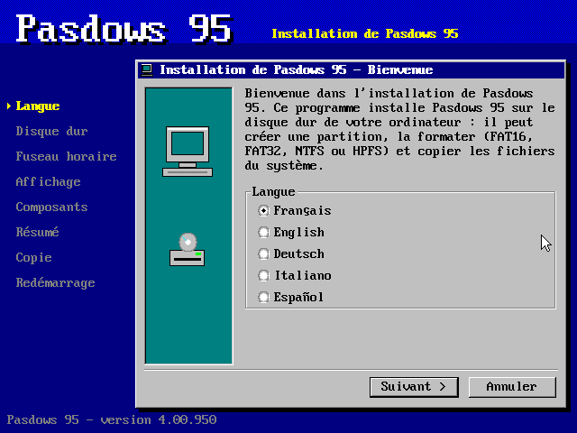<br><i>Choix de la langue</i></td><td align="center"><br><i>Disque dur, partition et système de fichiers (HPFS)</i></td></tr>
	<tr><td align="center"><br><i>Fuseau horaire</i></td><td align="center">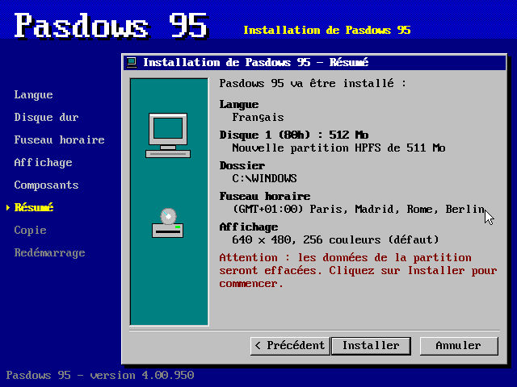<br><i>Résumé avant l'installation</i></td></tr>
	<tr><td align="center"><br><i>Copie des fichiers, puis écriture des répertoires et des bitmaps HPFS</i></td><td align="center"><br><i>Installation terminée</i></td></tr>
	<tr><td align="center">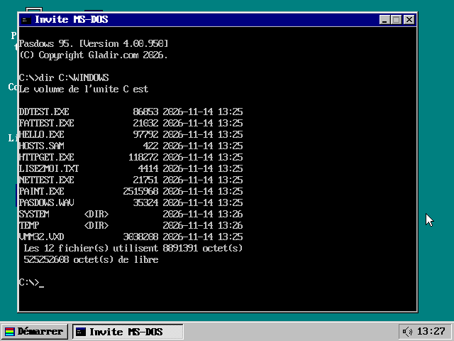<br><i>Démarré depuis la partition HPFS : C:\WINDOWS</i></td><td align="center">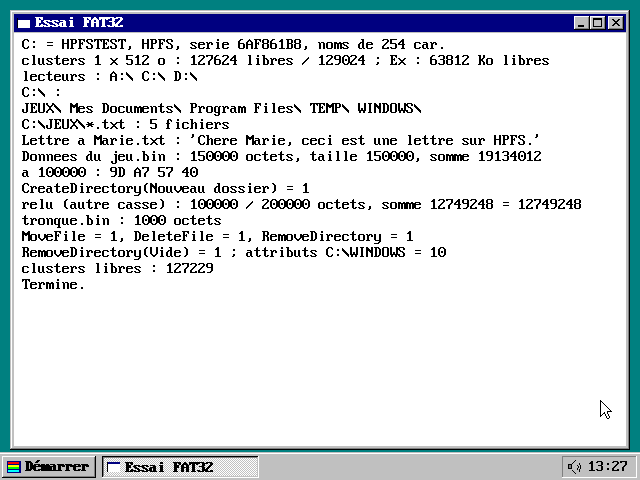<br><i>FATTEST.EXE sur un volume HPFS (noms longs, écriture, troncature, déplacement)</i></td></tr>
</table>

<h2>Captures d'écran</h2>

<table>
	<tr><td align="center"><br><i>Démarrage : étapes cochées automatiquement</i></td><td align="center">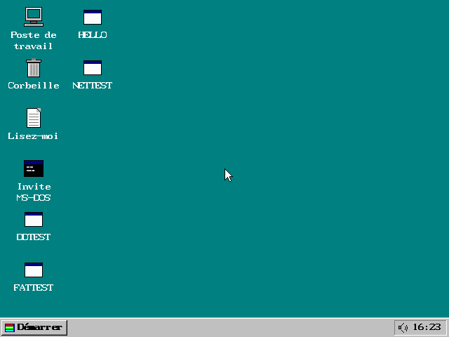<br><i>Bureau de Pasdows 95</i></td></tr>
	<tr><td align="center"><br><i>Menu Démarrer, sous-menu Paramètres</i></td><td align="center">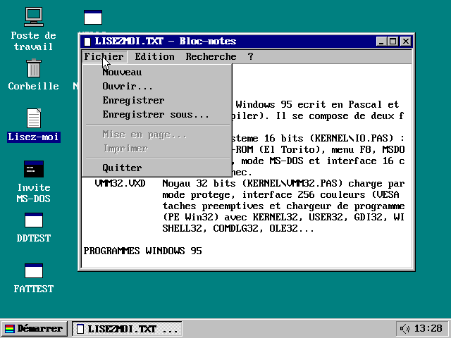<br><i>Bloc-notes et son menu Fichier</i></td></tr>
	<tr><td align="center">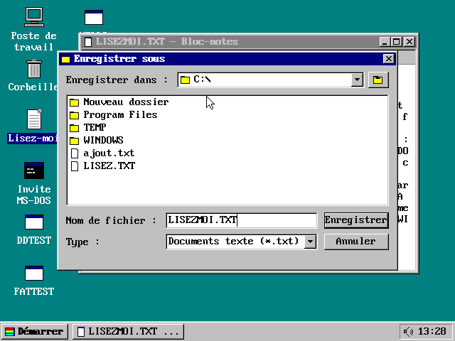<br><i>Boîte Enregistrer sous (disque dur C:)</i></td><td align="center"><br><i>Gestionnaire de périphériques</i></td></tr>
	<tr><td align="center"><br><i>Propriétés de la Sound Blaster 16 (ressources)</i></td><td align="center">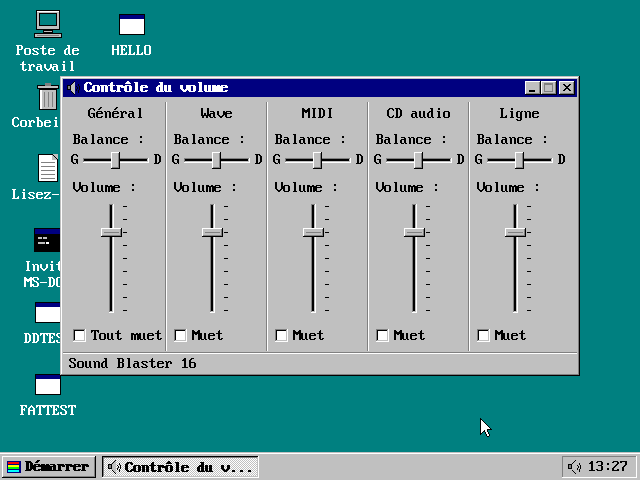<br><i>Contrôle du volume (mixeur de la carte son)</i></td></tr>
	<tr><td align="center"><br><i>Menu contextuel de l'icône de volume</i></td><td align="center"><br><i>Propriétés de Date/Heure (clic sur l'horloge)</i></td></tr>
	<tr><td align="center">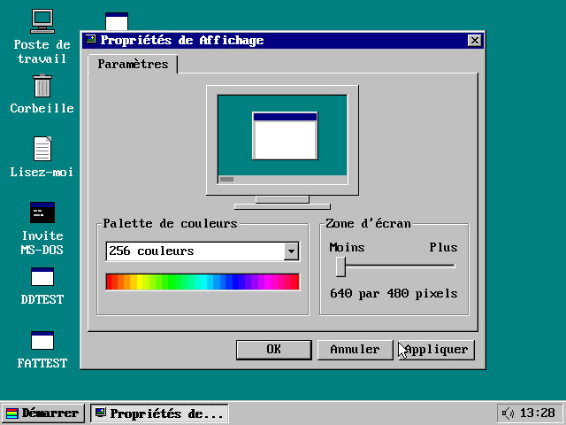<br><i>Propriétés d'affichage (modes VESA)</i></td><td align="center"><br><i>Invite MS-DOS (COMMAND.EXE)</i></td></tr>
</table>

<h2 id="directx">DirectX</h2>

Les jeux de Windows 95 passent presque tous par DirectX : Pasdows en fournit une implémentation écrite en Pascal dans le noyau (VMM32.VXD), qui se présente comme <b>DirectX 8.0</b> (clé <i>HKLM\Software\Microsoft\DirectX</i>, <i>Version</i> = 4.08.00.0400). Les DLL <b>DDRAW</b>, <b>D3DIM</b>, <b>D3DIM700</b>, <b>D3D8</b>, <b>DSOUND</b>, <b>DINPUT</b>, <b>DINPUT8</b>, <b>DPLAY</b>, <b>DPLAYX</b> et <b>DSETUP</b> sont résolues par nom et par ordinal, et <b>CoCreateInstance</b> crée les mêmes objets (CLSID_DirectDraw, CLSID_DirectSound, CLSID_DirectInput...). Chaque objet est un vrai objet COM : <b>QueryInterface</b> passe d'une version d'interface à l'autre (IDirectDraw, 2, 4, 7 ; IDirectDrawSurface, 2, 3, 4, 7 ; IDirect3D, 2, 3, 7...) en partageant le même cœur, avec AddRef et Release.

<ul>
	<li><b>DirectDraw</b> (DirectDrawCreate, DirectDrawCreateEx, DirectDrawEnumerate(Ex)) : niveaux de coopération plein écran exclusif et fenêtré, <b>vrais changements de mode</b> (SetDisplayMode à toutes les tailles VESA ou DISPI de la carte, en 8, 15, 16, 24 et 32 bits, EnumDisplayModes, RestoreDisplayMode) et, si la carte ne connaît pas le mode, agrandissement centré ; surfaces primaire, tampons arrière et chaînes de Flip, surfaces hors écran, textures, tampons Z et niveaux de mipmap ; Lock/Unlock, Blt (remplissage, étirement, miroirs, couleurs transparentes source et destination, ROP de copie, BLACKNESS et WHITENESS), BltFast, GetDC/ReleaseDC pour dessiner avec GDI ; palettes (8 bits, GetEntries/SetEntries appliqués à l'écran), découpeurs (listes de rectangles, découpeur attaché à une fenêtre), GetCaps, GetAvailableVidMem, GetDeviceIdentifier, WaitForVerticalBlank, GetScanLine, données privées et compteurs d'unicité. En mode fenêtré, la surface primaire est la fenêtre : ce qui y est copié est converti et affiché par le GDI de Pasdows.</li>
	<li><b>Direct3D</b> (Immediate Mode 1 à 7, et Direct3D 8) : un moteur de rendu <b>logiciel</b> complet, sans carte 3D : matrices monde, vue et projection, éclairage (lumières directionnelles, ponctuelles et projecteurs, matériaux, ambiant, spéculaire), brouillard, découpage sur les 6 plans, rastérisation avec correction de perspective, tampon Z 16 ou 32 bits, <b>textures</b> (8 bits avec palette, 16 et 32 bits, échantillonnage au plus proche, adressage répété, miroir ou bloqué), deux étages de mélange de textures, transparence (alpha blending et alpha test), états de rendu et de textures. Toutes les manières de dessiner sont reconnues : tampons d'exécution de Direct3D 1 (IDirect3DExecuteBuffer), DrawPrimitive, DrawIndexedPrimitive et leurs variantes Strided et VB (Direct3D 2, 3 et 7, sommets D3DVERTEX, D3DLVERTEX, D3DTLVERTEX et FVF), viewports, matériaux et lumières en objets (D3D 1 à 3), blocs d'états (D3D 7), énumération des périphériques et des formats de tampon Z. <b>Direct3D 8</b> (Direct3DCreate8) : adaptateurs et modes, CreateDevice en fenêtre ou en plein écran, Present, Reset, tampons de sommets et d'index, textures et surfaces avec LockRect, tampon Z automatique, SetVertexShader avec un code FVF, curseur, rampes de gamma. Les nuanceurs programmables (vertex et pixel shaders) ne sont pas disponibles : la version 0 est annoncée, comme une carte sans nuanceurs.</li>
	<li><b>DirectSound</b> (DirectSoundCreate, DirectSoundCreate8, DirectSoundEnumerate) : les tampons secondaires (8 ou 16 bits, mono ou stéréo, toutes fréquences) sont <b>mélangés en temps réel sur la Sound Blaster</b>, dans l'interruption DMA, avec volume, balance, fréquence, lecture en boucle, positions de lecture et d'écriture exactes, tampon primaire (SetFormat), DuplicateSoundBuffer, notifications de position (IDirectSoundNotify, événements signalés), son <b>3D</b> logiciel (IDirectSound3DBuffer et IDirectSound3DListener : position, vitesse, distances, cônes, atténuation et panoramique calculés par source). Sans carte son, les tampons avancent quand même en temps réel. La capture (enregistrement) n'est pas fournie.</li>
	<li><b>DirectInput</b> (DirectInputCreate, DirectInputCreateEx, DirectInput8Create) : clavier et souris système, EnumDevices, formats de données prédéfinis (c_dfDIKeyboard, c_dfDIMouse, c_dfDIMouse2) et formats propres au programme, GetDeviceState, mode tamponné (DIPROP_BUFFERSIZE, GetDeviceData, horodatage et numéro de séquence), mode absolu ou relatif, niveaux de coopération, acquisition et événements de notification. Il n'y a pas de manette de jeu (aucune n'est énumérée).</li>
	<li><b>DirectPlay</b> (DirectPlayCreate, DirectPlayEnumerate, DirectPlayLobbyCreate) : objets, sessions et lobby répondent, mais aucun fournisseur de service réseau n'est énuméré. <b>DirectMusic</b> n'est pas installé (CoCreateInstance rend REGDB_E_CLASSNOTREG, ce que les jeux savent traiter).</li>
</ul>

<b>APPS/DXDIAG.PAS</b> est l'<b>Outil de diagnostic DirectX</b> (<i>DirectX Diagnostic Tool</i>), une application Win32 écrite en Pascal et compilée par WPC, qui suit celui de Windows 95. Ses onglets <i>Système</i>, <i>Fichiers DirectX</i>, <i>Affichage</i>, <i>Son</i>, <i>Musique</i>, <i>Entrée</i>, <i>Réseau</i> et <i>Plus d'aide</i> sont remplis en interrogeant réellement les API : le Registre (version de DirectX, processeur), DirectDrawCreateEx (GetDeviceIdentifier, GetAvailableVidMem, GetDisplayMode, GetCaps), IDirect3D7::EnumDevices et Direct3DCreate8, DirectSoundEnumerate et IDirectSound::GetCaps, IDirectInput::EnumDevices et DirectPlayEnumerate. Les boutons <i>Tester DirectDraw</i> (plein écran 640x480 en 256 couleurs, remplissages et Flip), <i>Tester Direct3D</i> (cube éclairé qui tourne dans une fenêtre, tampon Z) et <i>Tester DirectSound</i> (son de 440 Hz) mettent DirectX à l'épreuve ; <i>Enregistrer les infos...</i> écrit le rapport DxDiag.txt. L'interface suit la variable d'environnement <b>LANGUAGE</b> : français (FR, par défaut), anglais (EN), allemand (GR ou DE), italien (IT) ou espagnol (SP ou ES) ; le rapport enregistré est en anglais, comme celui de Microsoft.

Exemples sur le CD-ROM : <b>DXDIAG.EXE</b>, <b>DDTEST.EXE</b> (<b>EXAMPLES/DDTEST.PAS</b> : DirectDraw 8 bits, DirectSound, DirectInput), <b>D3DTEST.EXE</b> (<b>EXAMPLES/D3DTEST.PAS</b> : Direct3D 7 en plein écran 16 bits, cube texturé et transparence) et <b>D3D8TEST.EXE</b> (<b>EXAMPLES/D3D8TEST.PAS</b> : Direct3D 8 dans une fenêtre, tampons de sommets et d'index, texture, éclairage). Le rendu étant entièrement logiciel, il est lent dans un émulateur sans accélération (quelques images par seconde sous QEMU).

<table>
	<tr><td align="center"><br><i>Outil de diagnostic DirectX : onglet Système</i></td><td align="center">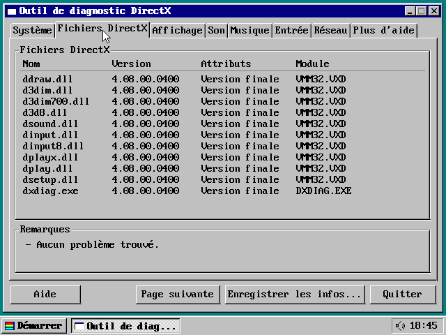<br><i>Fichiers DirectX</i></td></tr>
	<tr><td align="center">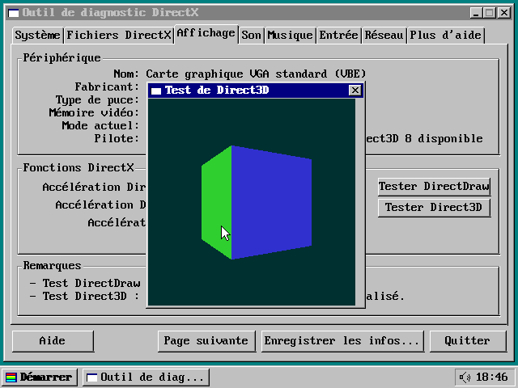<br><i>Tester Direct3D : cube éclairé rendu par le moteur logiciel</i></td><td align="center"><br><i>Onglet Son (DirectSound sur la Sound Blaster 16)</i></td></tr>
</table>

<h2 id="opengl">OpenGL</h2>

Pasdows fournit aussi <b>OPENGL32.DLL</b> : un <b>OpenGL 1.1 logiciel</b> écrit en Pascal dans le noyau, qui réutilise le moteur de rastérisation de Direct3D. Les 389 points d'entrée d'OpenGL 1.1 sont exportés (GetProcAddress, wglGetProcAddress), avec les contextes <b>wgl</b> (wglCreateContext, wglMakeCurrent, wglDeleteContext, wglShareLists...), les formats de pixels de GDI32 (ChoosePixelFormat, SetPixelFormat, DescribePixelFormat : RGBA 32 bits, double tampon, Z 24 bits, annoncé comme accéléré) et <b>SwapBuffers</b>, qui copie le tampon arrière dans la fenêtre. Sont réalisés : glBegin/glEnd et toutes les variantes de glVertex, glColor, glNormal, glTexCoord et glRasterPos ; les tableaux de sommets (glVertexPointer..., glDrawArrays, glDrawElements, glArrayElement, glInterleavedArrays) ; les piles de matrices (modèle-vue, projection, texture), glFrustum, glOrtho, glRotate, glTranslate, glScale ; tous les types de primitives (points, lignes, boucles, triangles, bandes, éventails, quadrilatères, polygones) avec le sommet qui donne la couleur en ombrage plat ; le tampon Z (glDepthFunc, glDepthMask, glDepthRange, glClearDepth), le mélange (glBlendFunc), le test alpha, l'élimination des faces (glCullFace, glFrontFace), glPolygonMode, glPolygonOffset, glScissor, glViewport ; l'<b>éclairage</b> (8 lumières directionnelles, ponctuelles ou projecteurs, matériaux, glColorMaterial, modèle d'éclairage) et le <b>brouillard</b> (linéaire, EXP, EXP2) ; les <b>textures</b> (glGenTextures, glBindTexture, glTexImage2D, glTexSubImage2D, glCopyTexImage2D, tous les formats et types de pixels dont les types compactés 16 bits, stockage en 16 ou 32 bits selon le format interne, répétition ou bord, glTexEnv MODULATE, REPLACE, DECAL et ADD, génération de coordonnées SPHERE_MAP et linéaire), le multitexture (glActiveTextureARB, glMultiTexCoord*ARB, deux unités) ; glReadPixels, glDrawPixels, glPushAttrib/glPopAttrib, glGetIntegerv/Floatv/Doublev/Booleanv, glGetString et glGetError. Les listes d'affichage, le tampon de pochoir, le tampon d'accumulation, les évaluateurs et la sélection sont acceptés sans effet. Pour aller vite, le rastériseur a un chemin rapide (une texture, cible 32 bits) qui sert aussi à Direct3D.

Exemple sur le CD-ROM : <b>GLTEST.EXE</b> (<b>EXAMPLES/GLTEST.PAS</b>) : cube texturé et éclairé (glBegin/glEnd), pyramide en tableaux de sommets (glDrawElements), carré translucide et brouillard, dans une fenêtre. Le jeu <i>Oni</i> (Bungie, 2001), qui n'existe qu'en OpenGL, s'installe (VISE), affiche son menu et ses niveaux en 3D ; il s'arrête encore au bout de quelques minutes à cause d'un problème restant hors d'OpenGL. Comme pour Direct3D, le rendu logiciel est lent dans un émulateur sans accélération.

<table>
	<tr><td align="center">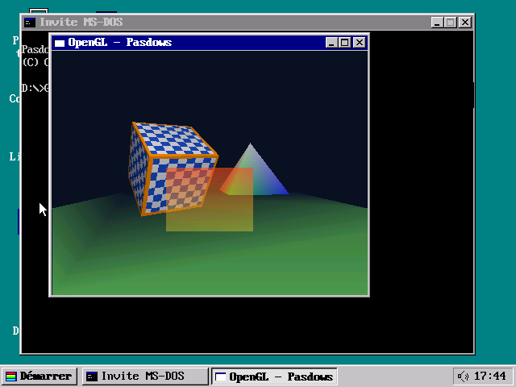<br><i>GLTEST.EXE : OpenGL 1.1 logiciel dans une fenêtre</i></td></tr>
</table>

<h2 id="couleurs">Vraies couleurs</h2>

En 256 couleurs, Pasdows compose l'écran avec la palette système, comme Windows 95. En <b>High Color</b> (15 ou 16 bits) et en <b>True Color</b> (24 ou 32 bits), le GDI compose désormais l'écran <b>en vraies couleurs</b>, directement au format de la carte (ou en 32 bits si la carte a un format inhabituel) : les couleurs RGB des crayons, des pinceaux et du texte, les bitmaps compatibles (CreateCompatibleBitmap, au format de l'écran), les DIB de 1, 4, 8, 16 (555 et 565 avec BI_BITFIELDS), 24 et 32 bits (SetDIBitsToDevice, StretchDIBits, CreateDIBitmap, GetDIBits, CreateDIBSection), BitBlt et StretchBlt avec toutes les opérations raster, les bitmaps monochromes et les masques gardent leurs couleurs exactes au lieu d'être ramenés à la palette. Les bitmaps compatibles sont reconvertis quand on change de mode d'<i>Affichage</i> sans redémarrer. RealizePalette ne touche plus la palette de l'écran en vraies couleurs (les palettes logiques ne servent qu'aux DIB à palette), et DirectDraw ou Direct3D en fenêtre passent leurs images au GDI en 32 bits. Le jeu Hoyle Classic Games II, qui exige High Color, est ainsi affiché avec toutes ses nuances.

<h2 id="multitache">Multitâche</h2>

<ul>
	<li><b>Processus</b> : le premier programme est chargé à son adresse préférée ; chaque programme suivant reçoit son propre répertoire de pages, dont les tables de 4 Ko font correspondre la zone de 0x400000 à la fin de l'image à des pages privées, et le noyau change de CR3 à chaque commutation de tâche. Le tas, les modules et DLL, les classes de fenêtres, les minuteries multimédia, les périphériques waveOut, les sockets et les objets DirectX appartiennent au processus et sont libérés à sa fin (ExitProcess, fin du dernier thread, TerminateProcess ou Gestionnaire des tâches). Le processus 4 est le <i>System</i> ; une seule machine virtuelle MS-DOS tourne à la fois et les tâches Windows 3.1 sont rattachées au processus système.</li>
	<li><b>API</b> : CreateProcessA (ligne de commande, STARTUPINFO), OpenProcess, TerminateProcess, GetExitCodeProcess, GetCurrentProcessId, GetWindowThreadProcessId, Get/SetPriorityClass, GetProcessTimes, GetThreadTimes, GetSystemTimes, GlobalMemoryStatusEx ; <b>PSAPI</b> (EnumProcesses, EnumProcessModules, GetModuleBaseName, GetModuleFileNameEx, GetProcessMemoryInfo, GetPerformanceInfo) ; <b>Toolhelp32</b> (CreateToolhelp32Snapshot, Process32First/Next, Thread32First/Next, Module32First/Next) ; <b>IPHLPAPI</b> (GetIfTable, GetIfEntry, avec les compteurs d'octets et de paquets de la carte réseau) ; EnumWindows, EnumThreadWindows, IsHungAppWindow, SwitchToThisWindow, EndTask, GetGuiResources, GetUserName, GetComputerName. Le temps processeur est mesuré par processus et par thread à chaque milliseconde de l'horloge (inactif, noyau, utilisateur).</li>
	<li><b>Synchronisation</b> : un seul espace de noms pour les objets nommés (les préfixes Global\ et Local\ sont acceptés), références par processus (un objet vit tant qu'un processus en garde une poignée), ERROR_ALREADY_EXISTS, OpenEvent, OpenMutex, OpenSemaphore, OpenFileMapping ; <b>mutex</b> récursifs avec propriétaire et <b>abandon</b> (WAIT_ABANDONED quand le thread propriétaire se termine), ReleaseMutex refusé à un autre thread, sémaphores avec maximum, événements manuels et automatiques (PulseEvent) ; WaitForSingleObject(Ex), <b>WaitForMultipleObjects</b> (un ou tous les objets, 64 au plus), <b>MsgWaitForMultipleObjects</b>(Ex), SignalObjectAndWait ; on peut attendre un processus ou un thread. Les vues d'un même mappage nommé partagent la même mémoire dans tous les processus.</li>
	<li><b>Menus des programmes</b> : les fenêtres Win32 ont une vraie <b>barre de menus</b> (SetMenu, menu de la classe, LoadMenu depuis les ressources MENU et MENUEX, sous-menus, coches, éléments grisés, séparateurs, raccourcis après une tabulation) qui envoie WM_COMMAND ; <b>TrackPopupMenu</b>(Ex) affiche un menu contextuel et attend le choix (TPM_RETURNCMD, alignements) ; CheckMenuItem, CheckMenuRadioItem et EnableMenuItem atteignent les sous-menus. Entrée et Échap actionnent le bouton par défaut et le bouton Annuler d'une fenêtre, comme dans une boîte de dialogue.</li>
</ul>

Exemple : <b>EXAMPLES/PROCTEST.PAS</b> (PROCTEST.EXE sur le CD-ROM) lance des copies de lui-même et vérifie la mémoire partagée nommée, les événements, sémaphores et mutex (récursion, abandon), WaitForMultipleObjects, les codes de sortie, OpenProcess et TerminateProcess : ses 20 contrôles passent.

<h2 id="taskmgr">Gestionnaire des tâches</h2>

<b>APPS/TASKMGR.PAS</b> est un <b>Gestionnaire des tâches</b> dans le style de celui de Windows XP, une application Win32 écrite en Pascal et compilée par WPC (TASKMGR.EXE). Il s'ouvre par <b>Ctrl+Alt+Suppr</b>, <b>Ctrl+Maj+Échap</b> ou le menu contextuel de la barre des tâches (<i>Gestionnaire des tâches</i>, à côté de <i>Réduire toutes les fenêtres</i>) ; un <b>mutex nommé</b> garde une seule instance : un second lancement ramène la fenêtre existante. Toutes les valeurs viennent des API du système, actualisées chaque seconde (fréquence <i>Haute</i>, <i>Normale</i>, <i>Basse</i> ou <i>Suspendue</i>).

<ul>
	<li><b>Applications</b> : les fenêtres des programmes (EnumWindows) et leur état (<i>En cours d'exécution</i> ou <i>Ne répond pas</i>, par IsHungAppWindow) ; <i>Fin de tâche</i> (EndTask), <i>Basculer vers</i> (double-clic ou Entrée), <i>Nouvelle tâche...</i> (CreateProcess) et un menu contextuel (<i>Mettre au premier plan</i>, <i>Réduire</i>, <i>Agrandir</i>, <i>Aller au processus</i>).</li>
	<li><b>Processus</b> : nom de l'image, utilisateur, utilisation du processeur et mémoire de chaque processus (Toolhelp32, GetProcessTimes, GetProcessMemoryInfo), y compris <i>System</i> et le processus inactif ; colonnes au choix (<i>Affichage, Sélectionner les colonnes</i> : PID, temps processeur, threads, handles, objets GDI et USER, pic de mémoire, priorité), tri par colonne, <b>Terminer le processus</b> (TerminateProcess, après l'avertissement de Windows XP) et <i>Définir la priorité</i> (SetPriorityClass).</li>
	<li><b>Performances</b> : jauge et historique de l'utilisation du processeur (les temps du noyau en rouge, <i>Affichage, Afficher les temps du noyau</i>), jauge et historique du fichier d'échange (charge dédiée), totaux (handles, threads, processus), mémoire physique (totale, disponible, cache système), charge dédiée (totale, limite, pic) et mémoire du noyau (paginée, non paginée), en Ko.</li>
	<li><b>Mise en réseau</b> : historique de l'utilisation de la carte réseau (GetIfTable), avec une échelle automatique (100 %, 10 % ou 1 %), vitesse de la liaison et état.</li>
	<li><b>Utilisateurs</b> : la session ouverte (<i>Fermer la session</i>).</li>
	<li>Menus <i>Fichier</i>, <i>Options</i> (<i>Toujours visible</i>, <i>Réduire après utilisation</i>, <i>Masquer en réduction</i>), <i>Affichage</i>, <i>Arrêter</i> (Arrêter, Redémarrer, Fermer la session, par ExitWindowsEx) et <i>?</i> ; barre d'état « Processus : 6 | UC : 2 % | Charge : 27M/63M ». L'interface suit la variable <b>LANGUAGE</b> (FR, EN, GR/DE, IT, SP/ES).</li>
</ul>

<table>
	<tr><td align="center">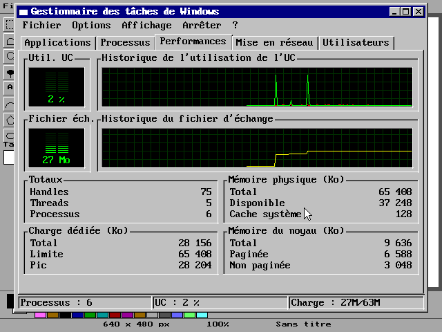<br><i>Onglet Performances</i></td><td align="center"><br><i>Onglet Processus (colonnes PID, Threads, Handles)</i></td></tr>
	<tr><td align="center"><br><i>Onglet Applications : Paint, DXDIAG, l'Invite MS-DOS et HELLO en même temps</i></td><td align="center">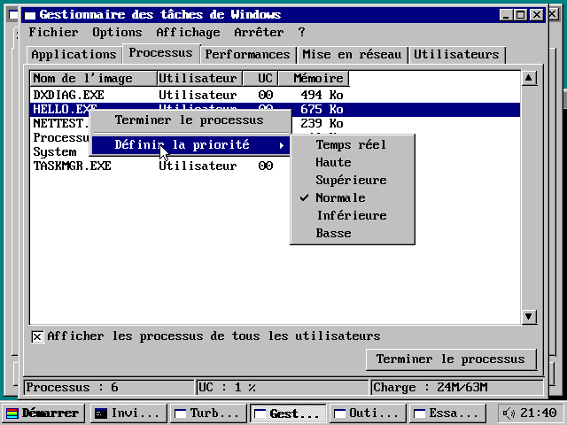<br><i>Menu contextuel d'un processus (TrackPopupMenu) : Définir la priorité</i></td></tr>
	<tr><td align="center">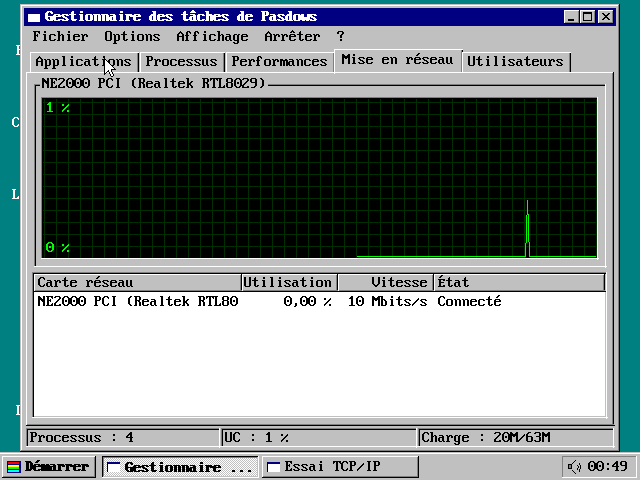<br><i>Mise en réseau : trafic de NETTEST et HTTPGET (échelle de 1 %)</i></td><td></td></tr>
</table>

<h2 id="paint">Paint</h2>

<b>APPS/PAINT.PAS</b> est le programme <b>PAINT.PAS</b> du dépôt <a href="https://github.com/gladir/clonedraw">CloneDRAW</a>, écrit pour DOS (Free Pascal, unités Graph, Crt et PtcMouse), adapté pour fonctionner comme une vraie application Windows 95 dans Pasdows. <b>Aucune fonction n'a été retirée</b> : outils de dessin (sélection, gomme, remplissage, pipette, loupe, crayon, pinceau, aérographe, texte, ligne, courbe, rectangle, polygone, ellipse, rectangle arrondi), annuler et rétablir, presse-papiers, zoom et plein écran, <i>Retourner/Pivoter</i>, <i>Étirer/Incliner</i>, <i>Inverser couleurs</i>, <i>Redimensionner</i>, <i>Rogner</i>, <i>Attributs</i>, <i>Modifier les couleurs</i> (teinte, saturation, luminosité, couleurs personnalisées, import et export de palettes), l'explorateur de fichiers de PAINT pour <i>Ouvrir</i> et <i>Enregistrer sous</i> (lecteurs, dossiers, nouveau dossier, filtres) avec tous ses formats (BMP, DIB, GIF, PNG, APNG, JPEG, PCX, TGA, TIFF, ICO, CUR, PPM, XBM, LBM, MSP, MacPaint, GEM, WPG, PSP, DDS, HDR, EXR, DICOM, fax, RAW ARW/CR2/DNG, BGX, export en source Pascal, assembleur, BASIC, C, C#, Python et Ruby), <i>Propriétés</i> du fichier, et les outils avancés : <i>Supprimer l'arrière-plan</i>, <i>Flou de l'arrière-plan</i>, <i>Reconnaissance de texte (OCR)</i> et <i>Fusionner des vêtements</i> (moteur VTON écrit en Pascal).

Le programme se lance par son icône sur le bureau, par <i>Démarrer, Programmes, Paint</i> (ou en tapant <b>PAINT</b> dans l'Invite MS-DOS). Il s'ouvre dans une fenêtre de 640x480 (zone de dessin de PAINT) centrée sur le bureau, dont le titre suit le fichier ouvert (« MAISON.BMP - Paint ») ; si l'écran est trop petit pour la fenêtre et son cadre (bureau en 640x480), Paint occupe tout l'écran, au-dessus de la barre des tâches, comme en plein écran. Alt+F4 ou <i>Fichier, Quitter</i> le ferment (en proposant d'enregistrer une image modifiée).

<table>
	<tr><td align="center">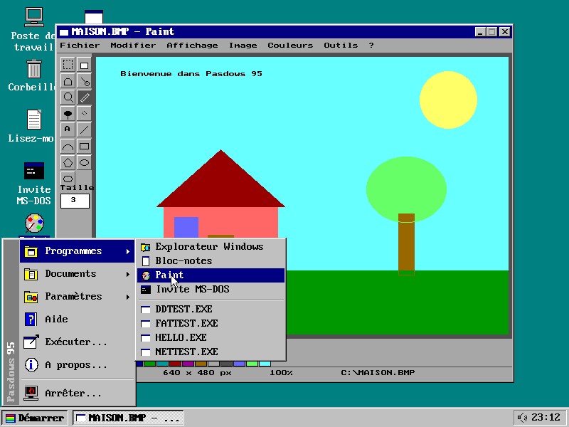<br><i>Démarrer, Programmes, Paint</i></td><td align="center">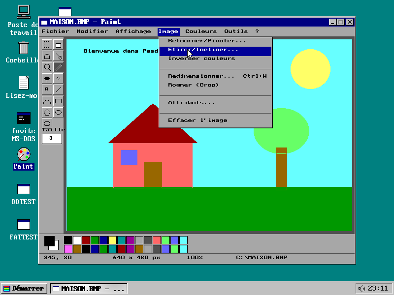<br><i>Menu Image</i></td></tr>
	<tr><td align="center"><br><i>Retourner / Pivoter (aperçu avant et après)</i></td><td align="center"><br><i>Modifier les couleurs</i></td></tr>
	<tr><td align="center"><br><i>Enregistrer sous (disque dur C:)</i></td><td align="center"><br><i>Menu Outils (arrière-plan, OCR, vêtements)</i></td></tr>
	<tr><td align="center"><br><i>Fusionner des vêtements (moteur VTON)</i></td><td></td></tr>
</table>

<h3>Comment PAINT.PAS est devenu une application Windows 95</h3>

<ul>
	<li>Le source reste celui de CloneDRAW : compilé par Free Pascal ou Turbo Pascal, il utilise toujours ses unités d'origine. Compilé par WPC (symbole <b>WPC</b> défini), la section « Couche Pasdows 95 » placée en tête remplace les unités <b>Graph</b>, <b>Crt</b> et <b>PtcMouse</b> par des appels Win32 et <b>{$APPTYPE GUI}</b> en fait un programme fenêtré (sous-système 2, sans console).</li>
	<li><b>Graph</b> : PAINT dessine dans une image de 256 couleurs en mémoire (DIB descendante) avec les primitives du BGI réécrites en Pascal (PutPixel, GetPixel, Line avec styles et épaisseurs, Rectangle, Bar, Circle, Arc, Ellipse, FillEllipse, OutTextXY avec la police 8x8 de la page de code 437, GetImage/PutImage, SetViewPort, SetWriteMode XOR, SetRGBPalette sur 8 bits...). Seule la zone modifiée est copiée dans la fenêtre par <b>SetDIBitsToDevice</b> ; WM_PAINT recopie toute l'image.</li>
	<li><b>Crt</b> et <b>PtcMouse</b> : la procédure de fenêtre de PAINT reçoit les messages WM_KEYDOWN, WM_SYSKEYDOWN et WM_CHAR (traduits en codes de ReadKey, avec #0 et le code de balayage pour les touches étendues, Alt+lettre et Alt+F4) et les messages de la souris (coordonnées de la zone client, capture pendant un glissement, clics brefs mémorisés jusqu'à leur lecture). KeyPressed, ReadKey, Delay, GetMouseState lisent ces messages par PeekMessage, si bien que PAINT garde sa propre boucle de messages comme sous DOS.</li>
	<li>Les dialogues propres à PAINT (explorateur de fichiers, propriétés, couleurs, OCR, VTON...) sont dessinés par PAINT lui-même dans sa fenêtre, comme sous DOS.</li>
	<li>Quelques corrections ont été faites dans le code de PAINT pour qu'il fonctionne et ne plante pas : le menu <b>?</b> (Aide, À propos) ne s'ouvrait pas (borne 5 au lieu de MENU_HELP), les racines des lecteurs (C:\, D:\) sont reconnues comme des dossiers par l'explorateur, et le moteur VTON attend le relâchement du clic de <i>Générer l'aperçu</i> avant de commencer (sinon ce clic était pris pour <i>Annuler</i>).</li>
</ul>

<h3>Limites dans Pasdows</h3>

<ul>
	<li><b>Fusionner des vêtements</b> utilise le modèle de segmentation <i>segformer_b2_clothes</i> (110 Mo), que PAINT télécharge une fois de Hugging Face en HTTPS par WININET, comme sous Windows : il faut une carte réseau (<b>-nic user,model=ne2k_pci</b> avec qemu) et un accès à Internet. Le modèle est gardé dans <i>C:\vton\segformer_b2_clothes</i> (ou dans le dossier donné par <b>SET VTON_CACHE=</b>) ; on peut aussi y copier <i>model.safetensors</i> et <i>config.json</i> à la main. Sans réseau, PAINT indique que la connexion est impossible, sans planter. Direct3D 11 n'existe pas dans Pasdows : le calcul se fait sur le processeur.</li>
	<li><b>Importer depuis un scanner</b> (WIA) et <b>Imprimer</b> affichent qu'ils ne sont pas disponibles, comme sur un Windows sans scanner ni imprimante.</li>
	<li>Les images s'enregistrent sur le disque dur <b>C:</b> (le CD-ROM D: est en lecture seule).</li>
</ul>

<h2 id="https">HTTPS</h2>

Pasdows 95 a son propre client <b>HTTPS</b>, écrit en Pascal dans le noyau VMM32 et offert aux programmes par <b>WININET.DLL</b>, comme Internet Explorer le faisait pour Windows 95 :

<ul>
	<li><b>WININET</b> : InternetOpen, <b>InternetOpenUrl</b> (adresses <b>http://</b> et <b>https://</b>, en-têtes supplémentaires), <b>InternetReadFile</b>, InternetQueryDataAvailable, <b>HttpQueryInfo</b> (code d'état, Content-Length, Content-Type, Location..., en-têtes bruts, valeurs numériques), InternetSetOption, InternetCloseHandle, InternetGetConnectedState. Quatre requêtes peuvent être ouvertes en même temps.</li>
	<li><b>HTTP/1.1</b> : requête GET (Host, User-Agent du programme, Connection: close), réponses <b>Content-Length</b> ou <b>chunked</b>, <b>redirections</b> 301, 302, 303, 307 et 308 (dix au plus, adresses absolues ou relatives, d'un serveur à un autre), adresses longues comme les URL signées des CDN (4 Ko au plus).</li>
	<li><b>TLS 1.2</b> : échange de clés <b>ECDHE</b> sur <b>x25519</b>, chiffrement <b>AES-128-GCM</b>, <b>SHA-256</b> et PRF de TLS 1.2 (suites ECDHE-RSA-AES128-GCM-SHA256 et ECDHE-ECDSA-AES128-GCM-SHA256), avec l'extension SNI (nom du serveur) qu'exigent les hébergeurs et les CDN. La cryptographie (SHA-256, HMAC, AES avec tables T, GHASH par tables de 4 bits, X25519 sur 32 chiffres de 8 bits, avec LongInt seulement) a été vérifiée avec les vecteurs de test et la bibliothèque <i>cryptography</i> de Python, et le client avec OpenSSL et le serveur HTTPS de Python (certificats RSA et ECDSA). Les aléas viennent du compteur du PIT, de l'horloge et de la souris, mélangés par SHA-256.</li>
	<li><b>Fichier HOSTS</b> : comme Windows 95, Pasdows consulte <i>HOSTS</i> dans le dossier système (<i>C:\WINDOWS\HOSTS</i> une fois installé) avant le DNS ; <i>HOSTS.SAM</i> sur le CD-ROM en est un exemple.</li>
	<li>La pile TCP/IP annonce maintenant une fenêtre de 7 segments, ce que l'anneau de réception de la carte NE2000 peut garder : avant, une rafale du serveur débordait de la carte et les segments perdus attendaient une retransmission. Dans qemu, un téléchargement passe ainsi de 52 Ko/s à environ 2,4 Mo/s en HTTP et 700 Ko/s en HTTPS (le chiffrement en Pascal coûte le reste).</li>
</ul>

<b>EXAMPLES/HTTPGET.PAS</b> (HTTPGET.EXE sur le CD-ROM) montre l'utilisation de WININET : dans l'Invite MS-DOS, <b>HTTPGET https://serveur/fichier C:\FICHIER</b> télécharge un fichier en affichant la progression, et <b>HTTPGET http://serveur/page</b> affiche la page.

<table>
	<tr><td align="center"><br><i>HTTPGET : HTTPS avec redirection, chunked, puis HTTP</i></td></tr>
</table>

Limites : <b>le certificat du serveur n'est pas vérifié</b> (Pasdows n'a ni magasin de certificats racines ni vérification des signatures RSA et ECDSA) : la connexion est chiffrée et protégée contre l'altération, mais un intermédiaire capable de se faire passer pour le serveur ne serait pas détecté. Seul TLS 1.2 est pris en charge (pas TLS 1.3 ni les versions antérieures), avec x25519 pour l'échange de clés ; pas de mandataire (proxy), pas de cookies ni de compression. Un serveur muet bloque la lecture jusqu'à la fermeture de la connexion TCP.

<h2 id="dos">Programmes MS-DOS</h2>

Comme la fenêtre MS-DOS de Windows 95, Pasdows exécute les programmes MS-DOS (fichiers <b>.COM</b>, et <b>.EXE</b> sans en-tête PE ni NE) dans une <b>machine virtuelle 8086</b>, écrite en Pascal dans le noyau VMM32. On les lance depuis l'Invite MS-DOS, l'Explorateur ou <i>Exécuter</i>.

<ul>
	<li><b>Mode virtuel 8086</b> : une tâche du noyau exécute le code 16 bits en mode V86 (EFLAGS.VM, IOPL 0). Le premier mégaoctet de la machine est un bloc de 1 Mo du tas placé à l'adresse 0 par la <b>pagination</b>, activée au premier programme DOS : le noyau, ses interruptions et les autres tâches voient la mémoire en identité (pages de 4 Mo), la machine a son propre répertoire de pages, chargé seulement pendant l'exécution du code 16 bits (CR3 par tâche dans le changement de contexte).</li>
	<li><b>Moniteur</b> : les instructions sensibles (INT, IRET, PUSHF, POPF, CLI, STI, HLT, IN, OUT, INS, OUTS) provoquent une faute de protection générale que le moniteur émule ; l'indicateur IF de la machine est virtuel. L'horloge (INT 08h et 1Ch, 18,2 Hz, PIT reprogrammable), le clavier (INT 09h et port 60h) et la souris sont des interruptions virtuelles, délivrées quand IF le permet ; les programmes qui détournent ces vecteurs et rappellent l'ancien gestionnaire fonctionnent.</li>
	<li><b>BIOS</b> écrit en Pascal : vidéo (INT 10h : modes, curseur, défilement, caractères, télétype, palettes, polices 8x8, 8x14 et 8x16, informations VGA), clavier (INT 16h, codes étendus, état de Maj/Ctrl/Alt), horloge (INT 1Ah), INT 11h, 12h, 13h, 15h, 17h, zone de données du BIOS. Chaque vecteur de la machine pointe sur un octet HLT en F000h : un INT vers ce vecteur est servi directement.</li>
	<li><b>DOS 7.0</b> (INT 21h, 20h, 27h, 2Fh) : blocs de mémoire (MCB, stratégies d'allocation), PSP, chargement des .COM et .EXE avec relocations, <b>EXEC</b> (4B00h, 4B01h pour les débogueurs, 4B03h pour les recouvrements), fin du programme avec retour au parent par la pile sauvée dans son PSP, programmes résidents, table des fichiers système et fichiers hérités, périphériques CON, NUL, PRN, AUX, IOCTL, recherche des fichiers (noms courts 8.3), répertoire courant par lecteur, date et heure, informations du pays, liste des listes... Les fichiers sont ceux du noyau : FAT12/16/32, NTFS, CD-ROM.</li>
	<li><b>Écran</b> : en mode texte, la page B800h (80 x 25, 16 couleurs) est recopiée dans la fenêtre MS-DOS, curseur compris ; un programme qui passe en <b>mode graphique</b> occupe l'écran entier (Alt+Tab ramène au bureau). Les modes à plans EGA/VGA (0Dh, 0Eh, 10h, 12h, pilote EGAVGA.BGI) sont émulés : la mémoire A0000h de la machine est absente, chaque accès provoque un défaut de page et le moniteur exécute l'instruction (MOV, XCHG, opérations logiques et arithmétiques, décalages, instructions de chaînes avec REP) à travers les registres de la carte (masque des plans, modes d'écriture 0 à 3, fonctions logiques, masque de bits, verrous, comparaison de couleur). Le mode 13h (256 couleurs) et les modes CGA sont recopiés de la mémoire linéaire.</li>
	<li><b>Souris</b> (INT 33h, avec gestionnaire d'événements) : pointeur texte dans la fenêtre, flèche dessinée en mode graphique.</li>
	<li><b>COMMAND.COM intégré</b> : <i>COMSPEC</i> désigne C:\COMMAND.COM ; sans ce fichier, un interpréteur intégré à la machine (DIR, CD, CLS, COPY, DEL, MD, RD, REN, TYPE, SET, MEM, VER, EXIT, programmes, COMMAND /C) sert à <i>Fichier, DOS shell</i> et aux outils des programmes.</li>
	<li><b>Noms longs</b> (API de Windows 95, INT 21h <b>AX=71xxh</b>) : les programmes MS-DOS et les clients DPMI (pointeurs sélecteur:décalage, 16 ou 32 bits, ou appels en mode réel par l'INT 31h 0300h) accèdent aux noms longs des volumes FAT (VFAT), NTFS et HPFS, avec la casse conservée : 7139h, 713Ah et 713Bh (créer, supprimer et changer de répertoire), 7141h (supprimer, avec jokers et attributs), 7143h (attributs, taille, dates de modification, d'accès et de création), 7147h (répertoire courant en noms longs), 714Eh, 714Fh et 71A1h (recherche : WIN32_FIND_DATA avec le nom long et le nom court, dates FILETIME ou DOS), 7156h (renommer), 7160h (nom complet, chemin court 8.3 ou chemin long), 716Ch et 71A9h (ouverture et création étendues : ouvrir, tronquer ou créer, action effectuée dans CX), 71A0h (informations du volume : FAT32, NTFS, HPFS, noms de 255 caractères), 71A6h (informations d'un fichier ouvert), 71A7h (conversions FILETIME et date du DOS), 71A8h (nom court généré) et 710Dh. Une fonction inconnue rend CF=1 et AX=7100h, comme un DOS sans noms longs. Les fonctions 8.3 habituelles (3Dh, 4Eh...) voient les noms courts NOM~1.EXT. Le répertoire courant est gardé en noms courts, comme sous Windows 95. Côté Win32, GetShortPathName et GetLongPathName convertissent réellement les chemins. Exemple : <b>EXAMPLES/LFNTEST.ASM</b> (LFNTEST.COM sur le CD-ROM, à lancer depuis un disque C: inscriptible) passe ses 25 contrôles en mode réel puis en mode protégé.</li>
	<li><b>Mémoire étendue XMS 3.0</b> (INT 2Fh 4300h et 4310h, pilote HIMEM) : blocs EMB jusqu'à 16 Mo pris dans le tas du noyau, déplacements (0Bh) entre mémoire conventionnelle et blocs, verrouillage avec adresse linéaire, redimensionnement, informations et version 3.0.</li>
	<li><b>Mémoire paginée EMS 4.0</b> (INT 67h, pilote EMMXXXX0) : cadre de pages en E000h, 256 pages de 16 Ko ; la projection d'une page logique change seulement les entrées de la table des pages de la machine (aucune copie). Fonctions 40h à 5Dh : allocation, projection (y compris plusieurs pages à la fois), sauvegarde et restauration de la projection, noms des poignées, déplacement et échange de régions, informations matérielles.</li>
	<li><b>Serveur DPMI 0.9</b> (INT 2Fh 1687h) : le client 16 ou 32 bits passe en mode protégé, en anneau 3 avec des sélecteurs de la LDT, dans le répertoire de pages de sa machine. Services de l'INT 31h : descripteurs (0000h à 000Ch), blocs DOS (0100h à 0102h), vecteurs d'interruption et gestionnaires d'exceptions (0200h à 0205h), appels en mode réel et rappels (0300h à 0306h, avec changement de mode brut), version, mémoire (0500h à 0503h), verrouillage, adresses physiques, indicateur d'interruptions virtuel, API des fabricants. Les interruptions logicielles sont réfléchies en mode réel avec une pile de contextes, l'horloge, le clavier et la souris sont délivrés aux gestionnaires du mode protégé, les exceptions (#GP, #NP, #SS...) vont aux gestionnaires du client. Les <b>extensions MS-DOS</b> de Windows (INT 21h en mode protégé avec pointeurs traduits, EXEC, blocs de mémoire, API « MS-DOS » de l'INT 2Fh 168Ah) et le sélecteur 40h des données du BIOS permettent de lancer les programmes de <b>Borland Pascal</b> (RTM.EXE et DPMI16BI.OVL) comme <b>TPX.EXE</b>, et les programmes <b>DOS/4GW</b> (Watcom) : les blocs de mémoire (0501h) sont donnés en pages entières comme sous Windows, une interruption matérielle réfléchie en mode réel rend au code interrompu tous ses registres, l'horloge est délivrée même à un client qui tourne en boucle (gestionnaire du mode réel ou du mode protégé), et une IRQ n'est pas redonnée tant que son gestionnaire n'est pas terminé (les tops en retard de l'horloge émulée n'arrivent plus en rafale). Essayé avec la version DOS de <b>Tomb Raider</b> (1996, DOS/4GW, VESA) : depuis le disque dur, avec son CD-ROM dans le lecteur D:, le jeu passe sa vérification du CD, affiche l'écran titre en 640x480 et joue ses niveaux en 3D (démonstrations).</li>
	<li><b>VESA BIOS Extensions 1.2</b> (INT 10h AX=4Fxxh) : modes 100h (640x400) et 101h (640x480) en 256 couleurs, fenêtre de 64 Ko en A000h (4F05h ou fonction de fenêtre appelée par CALL FAR), informations du contrôleur et des modes (4F00h, 4F01h), mode courant (4F03h), longueur de ligne (4F06h), début de l'affichage (4F07h), largeur du DAC (4F08h). La banque choisie est projetée par la table des pages de la machine : un programme écrit directement dans la mémoire vidéo.</li>
	<li>L'unité <b>Crt</b> de Turbo Pascal 6 et 7 s'arrêtait sur l'erreur 200 (<i>Division by zero</i>) des processeurs rapides : le moniteur reconnaît son étalonnage de Delay et limite le quotient, comme les correctifs de l'unité.</li>
</ul>

<b>Turbo Pascal 7</b> s'installe dans Pasdows depuis ses quatre disquettes : avec qemu, démarrez avec <b>-fda Disk01.img</b>, tapez <b>A:</b> puis <b>INSTALL</b> dans l'Invite MS-DOS, et changez de disquette dans le moniteur de qemu (<b>change floppy0 Disk02.img</b>) quand l'installateur la demande. L'EDI (<b>C:\TP\BIN\TURBO</b>) fonctionne ensuite entièrement : édition avec coloration, menus au clavier et à la souris, aide en ligne, compilation en mémoire ou sur disque et exécution, débogueur pas à pas, écran utilisateur (Alt+F5), <i>DOS shell</i>, compilateur en ligne de commande <b>TPC</b>, et les programmes graphiques comme <b>BGIDEMO</b>. L'EDI en mode protégé (<b>C:\TP\BIN\TPX</b>) démarre par le serveur DPMI et dispose de toute la mémoire étendue pour compiler.

<table>
	<tr>
		<td align="center">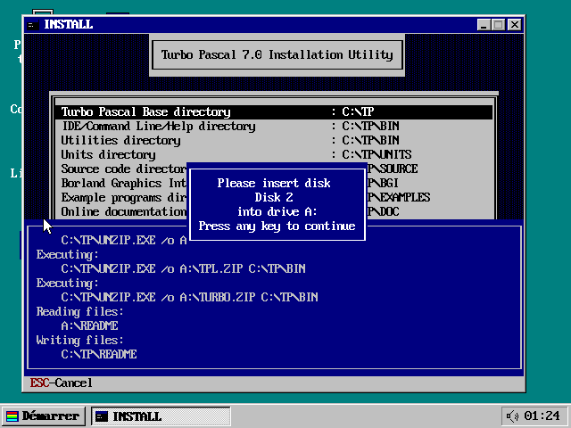<br><i>INSTALL.EXE depuis les disquettes (A:)</i></td>
		<td align="center">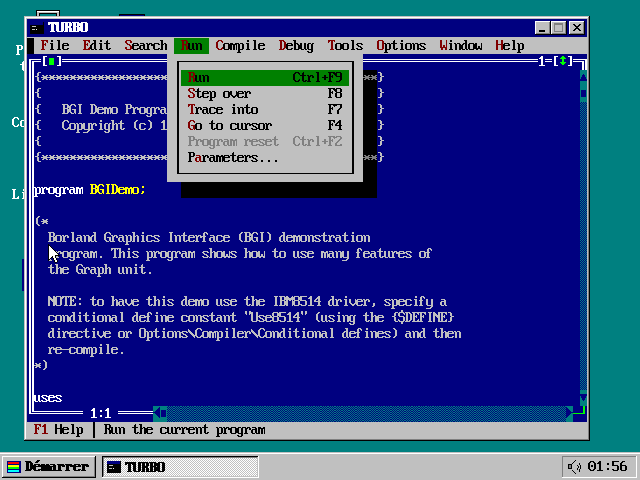<br><i>L'EDI de Turbo Pascal 7 dans la fenêtre MS-DOS</i></td>
	</tr>
	<tr>
		<td align="center"><br><i>Débogueur intégré (F8, pas à pas)</i></td>
		<td align="center">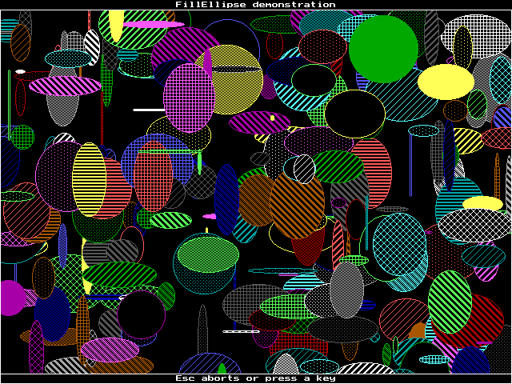<br><i>BGIDEMO en VGA 640x480 16 couleurs (plein écran)</i></td>
	</tr>
	<tr>
		<td align="center"><br><i>TPX.EXE, l'EDI en mode protégé (DPMI) : compilation sur disque</i></td>
		<td align="center"><br><i>Compile, Information : 38 Mo de mémoire protégée libre</i></td>
	</tr>
</table>

Limites : une seule machine virtuelle à la fois (comme un seul programme Win32) ; le serveur DPMI n'offre pas de mémoire virtuelle (pas de fichier d'échange) et seuls des clients 16 bits (Borland Pascal) ont été essayés, pas les extenseurs 32 bits comme DOS/4GW ; pas de son (haut-parleur, Sound Blaster et AdLib ne sont pas émulés pour la machine) ; les modes graphiques SVGA (VESA) ne sont pas proposés ; les programmes Windows ne se lancent pas depuis l'interpréteur intégré. La variable <b>DOSTRACE</b> (commande SET de AUTOEXEC.BAT) journalise sur le port série les appels de l'INT 21h et des autres interruptions.

<h2>Langue</h2>

La langue par défaut est le français. On utilise l'anglais si la variable d'environnement est <b>LANGUAGE=EN</b>, l'allemand si elle est <b>LANGUAGE=GR</b>, l'espagnol avec <b>LANGUAGE=SP</b> et l'italien avec <b>LANGUAGE=IT</b>. La variable se fixe dans <i>AUTOEXEC.BAT</i> sur le CD-ROM, avec la commande <b>SET</b> dans l'Invite MS-DOS ou dans <i>Paramètres régionaux</i> ; l'interface change de langue immédiatement.

<h2>Compilateur WPC</h2>

<b>WPC.PAS</b> est une copie du compilateur <b>OS2PC.PAS</b> du dépôt OS2-0 (lui-même dérivé de <i>TPCW32.PAS</i> du dépôt DEV-COOLS), renommé de « OS/2 Pascal Compiler » à « Windows 95 Pascal Compiler ». Toutes ses destinations sont conservées et il ajoute :

<table>
	<tr><th>Option</th><th>Description</th></tr>
	<tr><td><b>-CW95IO</b></td><td>IO.SYS de Pasdows 95 : image binaire brute 8086 (mode réel) chargée en 07C0:0000. Le BIOS n'en charge que les 2 premiers Ko (comme ISOLINUX) ; une amorce de 227 octets placée en tête de l'image relit le reste du fichier depuis le CD-ROM grâce à la table d'information d'amorce écrite par MAKEISO, puis passe le contrôle au programme avec l'unité d'amorçage dans <i>PrefixSeg</i>.</td></tr>
	<tr><td><b>-CVMM32</b></td><td>VMM32.VXD de Pasdows 95 : image PE 32 bits chargée à 1 Mo (comme la destination noyau d'OS2-0). La clause <b>exports</b> du programme publie ses fonctions Pascal comme API Win32 : WPC génère pour chacune un thunk stdcall et la table d'exportation dans laquelle le chargeur PE de VMM32 résout les importations des programmes.</td></tr>
	<tr><td><b>-CW32</b></td><td>Exécutable Windows 95 (PE Win32), destination d'origine du compilateur ; l'unité Graph y est émulée par une fenêtre GDI.</td></tr>
</table>

Pour compiler Paint, WPC (destination <b>-CW32</b>) a été étendu au dialecte Free Pascal utilisé par CloneDRAW, et plusieurs erreurs du compilateur ont été corrigées :

<ul>
	<li>Types <b>Int64</b> / <b>QWord</b> (EDX:EAX, multiplication, division, décalages et comparaisons 64 bits), <b>AnsiString</b> en <b>{$H+}</b> (compteur de références, concaténation, Copy, Delete, SetLength, Length, chaînes constantes), <b>tableaux dynamiques</b> (SetLength, High, Length, libération automatique), <b>exceptions</b> (<b>Try...Except</b>, <b>Try...Finally</b>, <b>Raise</b>, classes d'exception sans champs), <b>{$PUSH}</b>/<b>{$POP}</b>, <b>{$APPTYPE GUI}</b>.</li>
	<li>Conventions <b>stdcall</b> et <b>cdecl</b>, types procéduraux (avec appel par transtypage), procédures imbriquées avec lien statique, tableaux ouverts, paramètres Var/Const sans type, valeurs par défaut, transtypages vers les types du programme (y compris à gauche d'une affectation), arithmétique de pointeurs (POINTERMATH), <b>With</b> réentrant, résultat de fonction <b>Result</b>.</li>
	<li>Corrections : constante nommée dans les bornes d'un tableau d'une section TYPE (le tableau n'avait qu'un élément), paramètres <b>Var</b> d'un type procédural pris pour des variables globales (une variable <i>Inc</i> masquait la procédure Inc), plus de 8 DLL importées (WININET et OLEAUT32 disparaissaient de la table d'importation), plus de 256 commutateurs {$I±}, {$R±}, <b>PType(expr)^ :=</b>, fonctions qui rendent un enregistrement (adresse dans une pile libérée), Ord, Abs et transtypages sur 32 bits, valeur d'un PChar littéral, adresse indiquée par les erreurs d'E/S.</li>
	<li>Limites relevées : 1,5 million de jetons, 4096 procédures, 16 Mo de code, 32 Mo de données.</li>
</ul>

VMM32 exporte aussi les fonctions nécessaires à PAINT : <b>sprintf</b> et <b>strtod</b> (formatage et lecture des réels du runtime de WPC), QueryPerformanceCounter/Frequency, CoTaskMemAlloc/Free, PropVariantClear, SysAllocString/SysFreeString (OLEAUT32) et WININET (voir la section <a href="#https">HTTPS</a>).

<h2>Construire et essayer</h2>

```bash
cd KERNEL
./BUILD.sh
```

```bash
qemu-system-i386 -m 64 -cdrom IMAGE/PASDOWS.ISO -boot d -nic user,model=ne2k_pci
```

Avec un disque dur FAT32 (un disque vierge se formate depuis le Poste de travail) :

```bash
qemu-img create -f raw disque.img 1G
```

```bash
qemu-system-i386 -m 64 -cdrom IMAGE/PASDOWS.ISO -boot d -hda disque.img -nic user,model=ne2k_pci
```

Avec une disquette (images de 360 Ko à 1,44 Mo, lecteur <b>A:</b>) :

```bash
qemu-system-i386 -m 64 -cdrom IMAGE/PASDOWS.ISO -boot d -hda disque.img -fda Disk01.img
```

L'option <b>-nic user,model=ne2k_pci</b> donne à Pasdows une carte réseau NE2000, <b>model=pcnet</b> une AMD PCnet, <b>model=e1000</b> une Intel PRO/1000 et <b>model=e1000e</b> une Intel 82574L (qemu fournit l'adresse IP par DHCP ; l'hôte est joignable en 10.0.2.2). Sans elle, TCP/IP ne fonctionne qu'en boucle locale.

Sous <b>VirtualBox</b>, créez une machine de type <i>Windows 95</i> (ou <i>Other</i>) avec la carte graphique <i>VBoxVGA</i>, au moins 64 Mo de mémoire et une carte réseau PCnet-FAST III, PCnet-PCI II ou Intel PRO/1000, et démarrez sur <i>IMAGE/PASDOWS.ISO</i> (ou installez Pasdows avec <i>IMAGE/INSTALL.ISO</i>) ; aucun pilote n'est à installer.

Sous <b>VMware Workstation</b>, créez une machine <i>Other</i> (ou <i>Windows 95</i> si votre version la propose) avec au moins 64 Mo de mémoire et démarrez sur <i>IMAGE/PASDOWS.ISO</i> : la carte SVGA II, la souris et la carte réseau (vlance, e1000 ou e1000e) sont reconnues sans pilote à installer ; <i>Affichage, Ajuster automatiquement l'invité</i> fait suivre à l'écran de Pasdows la taille de la fenêtre.

Pour exécuter un programme Windows 95, copiez-le (avec ses fichiers de données) dans <i>IMAGE/CDROM</i>, relancez BUILD, puis double-cliquez son icône sur le bureau de Pasdows.

Pour copier IO.SYS sur une autre image de CD-ROM, il suffit de le désigner comme fichier d'amorce :

```bash
MAKEISO MONCD.ISO /BOOT:IO.SYS IO.SYS VMM32.VXD AUTOEXEC.BAT MSDOS.SYS LISEZMOI.TXT
```

<h2>Règles de programmation</h2>

<ul>
	<li>Turbo Pascal / Free Pascal, sans programmation objet : des enregistrements (<i>Record</i>) passés par référence à des procédures et fonctions.</li>
	<li>Aucune unité ajoutée (IO.PAS et VMM32.PAS n'en utilisent aucune, ils ne s'appuient que sur le BIOS et le matériel) et aucun fichier d'inclusion ($I).</li>
	<li>Lignes de 80 caractères au plus dans IO.PAS et VMM32.PAS (chargeables dans l'EDI de Free Pascal) ; les caractères accentués sont écrits avec des codes <i>#nnn</i> de la page de code 437 (police du BIOS VGA).</li>
	<li><b>APPS/PAINT.PAS</b> garde le style de CloneDRAW (fichier UTF-8, lignes longues, mode FPC) pour rester compilable par Free Pascal et facile à resynchroniser ; seule sa couche Pasdows 95 suit les règles ci-dessus.</li>
</ul>

<h2>Licence</h2>

MIT, voir le fichier LICENSE.
